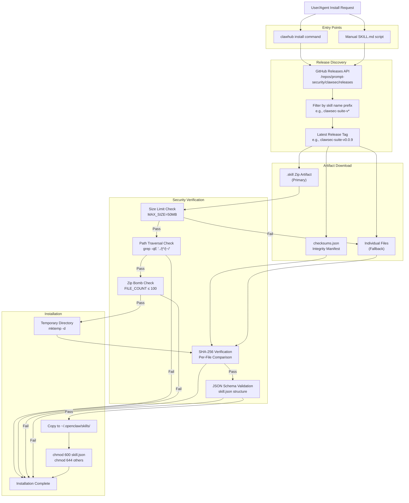
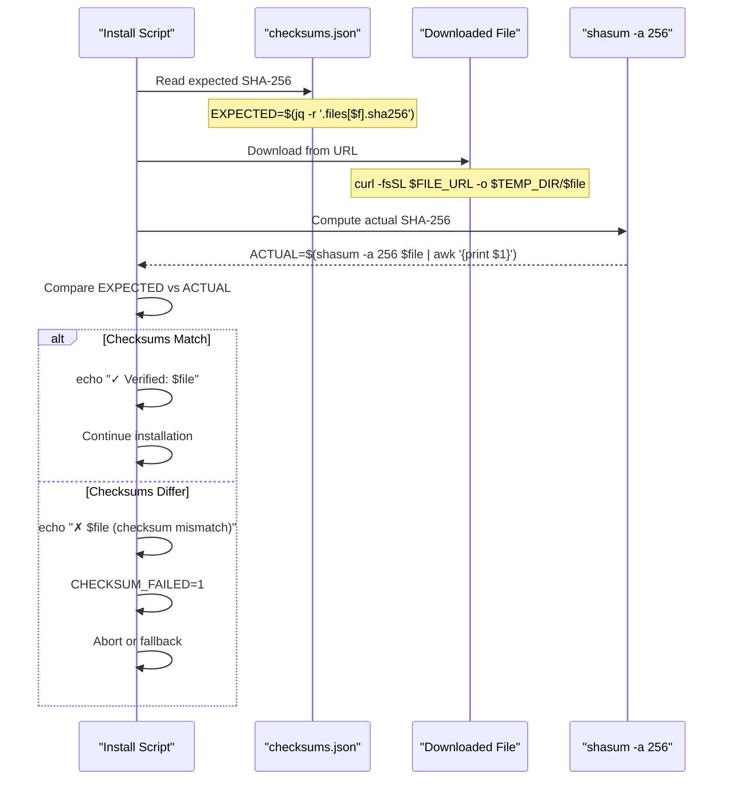
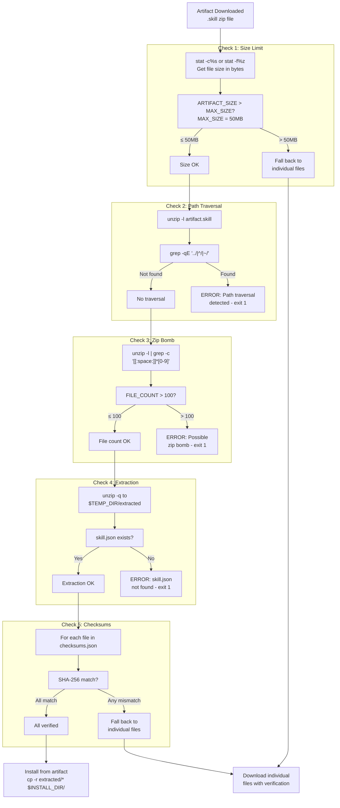
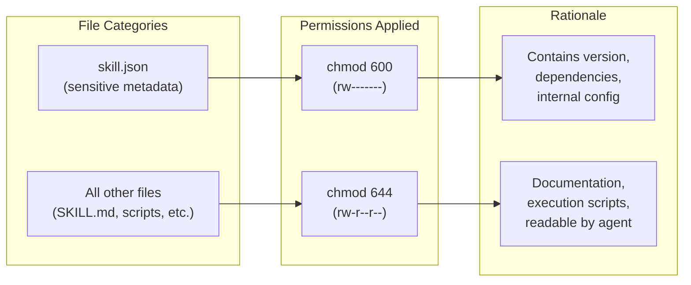
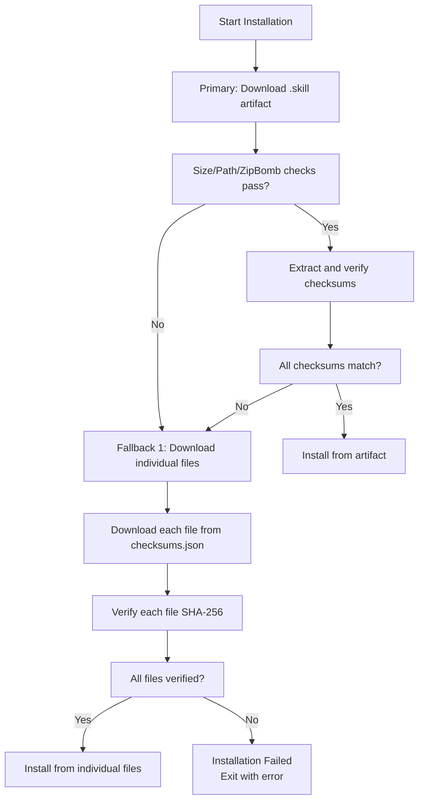

<!-- source: DeepWiki mcp.deepwiki.com · repo prompt-security/clawsec · page 2.1 Installation Flow and Verification · fetched 2026-10-27 -->

# Installation Flow and Verification

<details>
<summary>Relevant source files</summary>

The following files were used as context for generating this wiki page:

- [skills/clawsec-feed/SKILL.md](skills/clawsec-feed/SKILL.md)
- [skills/clawsec-feed/skill.json](skills/clawsec-feed/skill.json)
- [skills/clawsec-suite/SKILL.md](skills/clawsec-suite/SKILL.md)
- [skills/clawtributor/SKILL.md](skills/clawtributor/SKILL.md)
- [skills/clawtributor/skill.json](skills/clawtributor/skill.json)

</details>


## Purpose and Scope

This document describes the complete installation process for ClawSec skills, covering artifact retrieval, integrity verification, security validation, and file system installation. This includes both automated installation via `clawhub` and manual download procedures with comprehensive security checks.

For information about the broader skills ecosystem and orchestration, see [Skills Ecosystem](#4). For CI/CD release packaging that creates these artifacts, see [Skill Release Pipeline](#5.1). For the landing page interface that guides users to installation, see [Landing Page and Web Interface](#2.2).

---

## Installation Methods Overview

ClawSec skills support two primary installation methods:

| Method | Entry Point | Verification | Use Case |
|--------|-------------|--------------|----------|
| `clawhub` | `npx clawhub@latest install <skill>` | Automated | Recommended for most users |
| Manual Download | Shell script in `SKILL.md` | Manual verification required | Transparency, custom workflows, clawhub unavailable |

Both methods converge on the same verification and security checks before files are written to disk.

**Installation Flow Diagram**



Sources: [skills/clawsec-suite/SKILL.md:36-113](), [skills/clawsec-feed/SKILL.md:86-198](), [skills/clawtributor/SKILL.md:52-198]()

---

## Installation Artifacts

### checksums.json Manifest

The `checksums.json` file serves as the canonical integrity manifest for all release artifacts. It is downloaded first and validated before any other files are retrieved.

**Structure:**

```json
{
  "skill": "clawsec-suite",
  "version": "0.0.9",
  "files": {
    "SKILL.md": {
      "path": "SKILL.md",
      "sha256": "a1b2c3d4...",
      "url": "https://github.com/.../SKILL.md"
    },
    "skill.json": {
      "path": "skill.json",
      "sha256": "e5f6g7h8...",
      "url": "https://github.com/.../skill.json"
    }
  }
}
```

**Validation Requirements:**
- Must contain `skill`, `version`, and `files` top-level keys [skills/clawsec-feed/SKILL.md:108-111]()
- Each file entry must have `sha256` and either `url` or discoverable from release base URL
- JSON structure validated with `jq -e '.skill and .version and .files'`

Sources: [skills/clawsec-suite/SKILL.md:59-64](), [skills/clawsec-feed/SKILL.md:99-111]()

### .skill Zip Artifact (Primary)

The `.skill` artifact is a zip archive containing all skill files in a structured directory layout. It is the primary installation method due to:
- Single download operation (reduced network requests)
- Atomic integrity verification
- Bandwidth efficiency for multi-file skills

**Naming Convention:** `{skill-name}-v{version}.skill` or `{skill-name}.skill`

Example: `clawsec-suite-v0.0.9.skill`, `clawsec-feed.skill`

**Internal Structure:**
```
clawsec-suite-v0.0.9.skill
└── clawsec-suite/
    ├── skill.json
    ├── SKILL.md
    ├── advisories/
    │   └── feed.json
    ├── hooks/
    │   └── clawsec-advisory-guardian/
    └── scripts/
        ├── setup_advisory_hook.mjs
        └── guarded_skill_install.mjs
```

Sources: [skills/clawsec-feed/SKILL.md:114-148]()

### Individual Files (Fallback)

If the `.skill` artifact is unavailable or fails verification, installation falls back to downloading individual files listed in `checksums.json`. Each file is:
1. Downloaded from its `url` specified in the manifest
2. Verified immediately via SHA-256 checksum
3. Only installed if all files pass verification

This provides resilience against partial repository states or artifact generation issues.

Sources: [skills/clawsec-feed/SKILL.md:205-235]()

---

## Download and Retrieval Process

**Release Discovery Flow:**

```mermaid
graph LR
    subgraph "Step 1: Discover Latest Release"
        API["curl -sSL<br/>api.github.com/repos/<br/>prompt-security/clawsec/releases"]
        JQFilter["jq -r '[.[] | select(.tag_name |<br/>startswith(\"skill-name-v\"))]<br/>[0].tag_name'"]
        LatestTag["LATEST_TAG=<br/>clawsec-suite-v0.0.9"]
    end
    
    subgraph "Step 2: Construct URLs"
        BaseURL["BASE_URL=<br/>github.com/.../releases/download/<br/>$LATEST_TAG"]
        ChecksumURL["$BASE_URL/checksums.json"]
        ArtifactURL["$BASE_URL/skill.skill"]
    end
    
    subgraph "Step 3: Download with Retry"
        RetryLogic["curl -sSL --fail --show-error<br/>--retry 3 --retry-delay 1"]
        TempStorage["mktemp -d<br/>$TEMP_DIR"]
    end
    
    API --> JQFilter
    JQFilter --> LatestTag
    LatestTag --> BaseURL
    BaseURL --> ChecksumURL
    BaseURL --> ArtifactURL
    ChecksumURL --> RetryLogic
    ArtifactURL --> RetryLogic
    RetryLogic --> TempStorage
```

**Key Implementation Details:**

1. **GitHub API Rate Limiting:** The GitHub API is used without authentication for public repositories, subject to 60 requests/hour per IP. Installation scripts include `--retry 3 --retry-delay 1` to handle transient failures [skills/clawsec-feed/SKILL.md:90-105]().

2. **Tag Filtering:** Release tags follow the pattern `{skill-name}-v{version}`. The `jq` filter uses `startswith()` to match the specific skill being installed [skills/clawsec-feed/SKILL.md:90-93]().

3. **Temporary Storage:** All downloads occur in a temporary directory created with `mktemp -d`, automatically cleaned up via `trap 'rm -rf "$TEMP_DIR"' EXIT` [skills/clawsec-suite/SKILL.md:54-56]().

Sources: [skills/clawsec-feed/SKILL.md:89-105](), [skills/clawsec-suite/SKILL.md:46-57]()

---

## Checksum Verification

SHA-256 checksums provide cryptographic integrity verification for all downloaded files. Verification occurs at multiple stages to ensure no corrupted or tampered files reach the installation directory.

**Verification Matrix:**

| Verification Stage | Files Checked | Failure Action | Code Reference |
|-------------------|---------------|----------------|----------------|
| Initial manifest validation | `checksums.json` | Abort installation | [skills/clawsec-suite/SKILL.md:61-64]() |
| Per-file download (fallback) | Each individual file | Mark file as failed, continue others | [skills/clawsec-feed/SKILL.md:222-230]() |
| Post-extraction (.skill artifact) | All extracted files | Fall back to individual files | [skills/clawsec-feed/SKILL.md:150-173]() |
| Final installation check | Aggregate all failures | Exit if any file failed | [skills/clawsec-suite/SKILL.md:92-95]() |

**Checksum Computation:**

The installation script uses `shasum -a 256` (macOS/BSD) or `sha256sum` (Linux) depending on availability:

```bash
if command -v shasum >/dev/null 2>&1; then
  ACTUAL="$(shasum -a 256 "$FILE" | awk '{print $1}')"
else
  ACTUAL="$(sha256sum "$FILE" | awk '{print $1}')"
fi
```

Sources: [skills/clawsec-suite/SKILL.md:78-82]()

**Per-File Verification Process Diagram:**



Sources: [skills/clawsec-feed/SKILL.md:150-173](), [skills/clawsec-suite/SKILL.md:66-95]()

---

## Security Verification Layer

ClawSec implements defense-in-depth with multiple independent security checks before any artifact is installed. These checks prevent common attack vectors including zip bombs, path traversal, and resource exhaustion.

**Security Check Sequence Diagram:**



Sources: [skills/clawsec-feed/SKILL.md:118-202](), [skills/clawtributor/SKILL.md:82-151]()

### Size Limit Check

**Purpose:** Prevent denial-of-service attacks via excessively large files that could exhaust disk space or memory during extraction.

**Implementation:**
```bash
ARTIFACT_SIZE=$(stat -c%s "$TEMP_DIR/clawsec-feed.skill" 2>/dev/null || \
                stat -f%z "$TEMP_DIR/clawsec-feed.skill")
MAX_SIZE=$((50 * 1024 * 1024))  # 50MB

if [ "$ARTIFACT_SIZE" -gt "$MAX_SIZE" ]; then
  echo "WARNING: Artifact too large, falling back to individual files"
fi
```

**Limit:** 50 MB (52,428,800 bytes)

**Action on Failure:** Fall back to individual file downloads (non-fatal)

Sources: [skills/clawsec-feed/SKILL.md:118-124]()

### Path Traversal Detection

**Purpose:** Prevent malicious archives from writing files outside the intended installation directory using `../` sequences, absolute paths (`/`), or home directory expansion (`~/`).

**Implementation:**
```bash
if unzip -l "$TEMP_DIR/clawsec-feed.skill" | grep -qE '\.\./|^/|~/'; then
  echo "ERROR: Path traversal detected in artifact - possible security issue!"
  exit 1
fi
```

**Detection Patterns:**
- `../` - Parent directory traversal
- `^/` - Absolute path (line start with `/`)
- `~/` - Home directory expansion

**Action on Failure:** Abort installation immediately (fatal error)

Sources: [skills/clawsec-feed/SKILL.md:127-131](), [skills/clawtributor/SKILL.md:91-95]()

### Zip Bomb Prevention

**Purpose:** Detect compressed archives that expand to an extremely large number of files, which could exhaust inodes or directory entry limits.

**Implementation:**
```bash
FILE_COUNT=$(unzip -l "$TEMP_DIR/clawsec-feed.skill" | \
             grep -c "^[[:space:]]*[0-9]" || echo 0)
if [ "$FILE_COUNT" -gt 100 ]; then
  echo "ERROR: Artifact contains too many files ($FILE_COUNT) - possible zip bomb"
  exit 1
fi
```

**Limit:** 100 files maximum

**Detection Method:** Count lines in `unzip -l` output that begin with whitespace followed by digits (file entry lines)

**Action on Failure:** Abort installation immediately (fatal error)

Sources: [skills/clawsec-feed/SKILL.md:133-138](), [skills/clawtributor/SKILL.md:97-102]()

### JSON Structure Validation

**Purpose:** Ensure that `skill.json` and other JSON configuration files conform to expected schemas before they are used.

**Validation Checks:**

| File | Required Fields | Validation Command |
|------|----------------|-------------------|
| `checksums.json` | `skill`, `version`, `files` | `jq -e '.skill and .version and .files'` |
| `skill.json` | `name`, `version` | `jq -e '.name and .version'` |
| `feed.json` | `version`, `advisories` | `jq -e '.version and .advisories'` |

**Implementation Example:**
```bash
if ! jq -e '.name and .version' "$TEMP_DIR/downloads/skill.json" >/dev/null 2>&1; then
  echo "ERROR: skill.json missing required fields (name, version)"
  exit 1
fi
```

**Action on Failure:** Abort installation immediately (fatal error)

Sources: [skills/clawsec-feed/SKILL.md:238-241](), [skills/clawsec-feed/SKILL.md:177-189]()

---

## File Permissions and Installation

After all verification checks pass, files are copied to the installation directory with specific permissions enforcing the principle of least privilege.

**Permission Model:**



**Implementation:**
```bash
chmod 600 "$DEST/skill.json"
find "$DEST" -type f ! -name "skill.json" -exec chmod 644 {} \;
```

**Rationale:**
- `skill.json`: 600 (read/write by owner only) prevents other users from reading version information or dependency details that could aid in targeted attacks
- Other files: 644 (read by all, write by owner) allows agent processes running under the same user to read documentation and scripts

Sources: [skills/clawsec-suite/SKILL.md:108-109](), [skills/clawsec-feed/SKILL.md:195-196]()

**Installation Directory Structure:**

```
~/.openclaw/skills/
├── clawsec-suite/               # Installed skill root
│   ├── skill.json               # 600 permissions
│   ├── SKILL.md                 # 644 permissions
│   ├── advisories/
│   │   └── feed.json            # 644 permissions
│   ├── hooks/
│   │   └── clawsec-advisory-guardian/
│   │       └── hook.mjs         # 644 permissions
│   └── scripts/
│       ├── setup_advisory_hook.mjs      # 644 permissions
│       └── guarded_skill_install.mjs    # 644 permissions
└── clawsec-feed/
    ├── skill.json               # 600 permissions
    ├── SKILL.md                 # 644 permissions
    └── advisories/
        └── feed.json            # 644 permissions
```

The installation directory `~/.openclaw/skills/` is implicitly created with default umask permissions (typically 755 for directories).

Sources: [skills/clawsec-suite/SKILL.md:50-51](), [skills/clawsec-feed/SKILL.md:95]()

---

## Post-Installation Verification

After files are installed, the installation script performs final confirmation steps:

1. **Verify Installation Directory Exists:** Check that `$DEST` directory was created successfully
2. **Echo Installation Confirmation:** Print final success message with version and location [skills/clawsec-suite/SKILL.md:111]()
3. **Provide Next Steps:** Display skill-specific setup commands (e.g., hook installation for clawsec-suite) [skills/clawsec-suite/SKILL.md:112]()

**Success Output Example:**
```
Verified: skill.json
Verified: SKILL.md
Verified: advisories/feed.json
Installing from artifact...
SUCCESS: Skill installed from .skill artifact
```

Sources: [skills/clawsec-suite/SKILL.md:111-112](), [skills/clawsec-feed/SKILL.md:197-198]()

---

## Error Handling and Fallback Mechanisms

The installation flow implements multiple fallback paths to ensure resilience:

**Fallback Hierarchy:**



**Error Exit Codes:**

| Exit Code | Condition | Example |
|-----------|-----------|---------|
| 0 | Success | All verifications passed, files installed |
| 1 | Fatal error | Path traversal detected, checksum mismatch, JSON validation failure |

**Non-Fatal Conditions (Trigger Fallback):**
- `.skill` artifact too large (> 50MB)
- `.skill` artifact download fails (404, network error)
- Post-extraction checksum verification fails

**Fatal Conditions (Abort Installation):**
- Path traversal detected in zip archive
- Zip bomb detected (> 100 files)
- All download attempts failed (artifact + individual files)
- Checksum mismatch on individual file downloads
- Required JSON fields missing after download

Sources: [skills/clawsec-feed/SKILL.md:199-203](), [skills/clawsec-feed/SKILL.md:232-235]()

---

## Installation State Management

Installation is stateless and atomic - either all files are installed successfully with correct permissions, or installation fails and no files are written to the destination directory. There is no partial installation state.

**Temporary Storage Cleanup:**

All downloads occur in a temporary directory with automatic cleanup:
```bash
TEMP_DIR="$(mktemp -d)"
trap 'rm -rf "$TEMP_DIR"' EXIT
```

This ensures that even if the script is interrupted (Ctrl+C, SIGTERM), temporary files are removed.

Sources: [skills/clawsec-suite/SKILL.md:54-56](), [skills/clawsec-feed/SKILL.md:96-97]()

---

