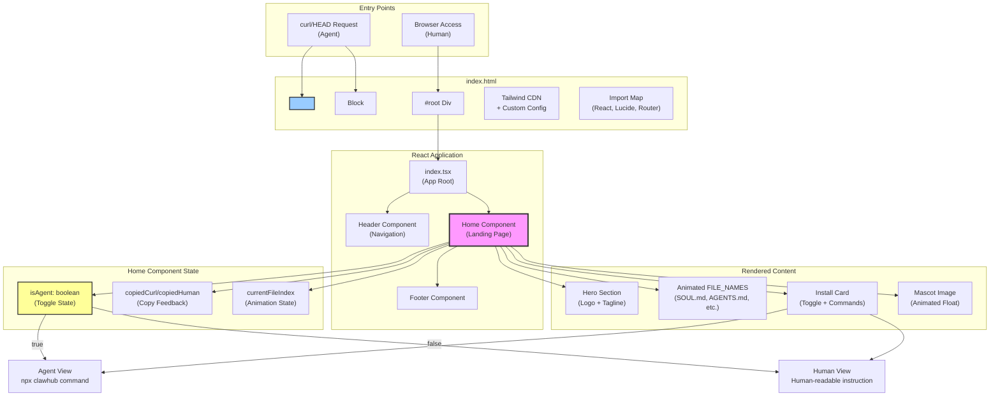
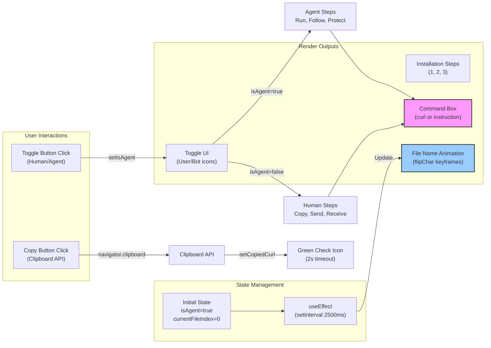
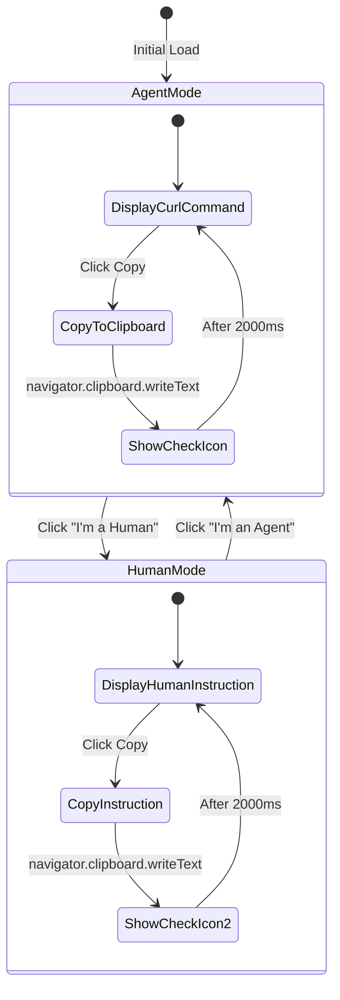
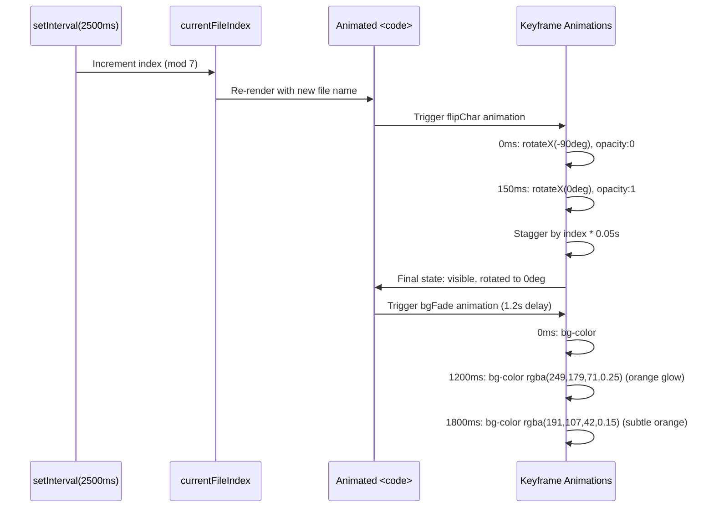
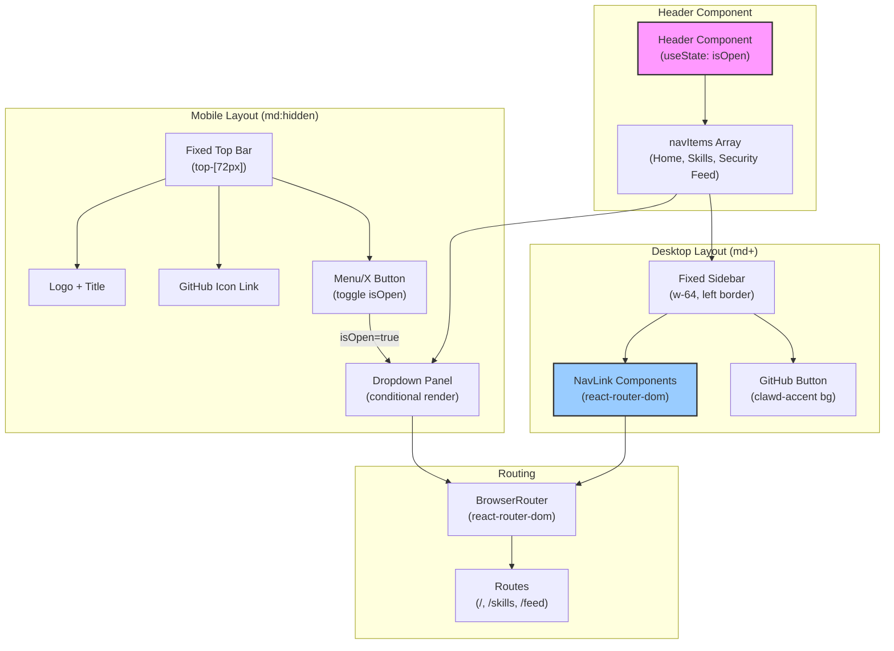

<!-- source: DeepWiki mcp.deepwiki.com · repo prompt-security/clawsec · page 2.2 Landing Page and Web Interface · fetched 2026-10-27 -->

# Landing Page and Web Interface

<details>
<summary>Relevant source files</summary>

The following files were used as context for generating this wiki page:

- [components/Header.tsx](components/Header.tsx)
- [index.html](index.html)
- [pages/Home.tsx](pages/Home.tsx)
- [public/img/mascot.png](public/img/mascot.png)

</details>


## Purpose and Scope

This document describes the ClawSec website landing page and web interface, specifically the React-based components that serve as the primary entry point for both AI agents and humans. The landing page presents installation instructions, dynamically adapts content based on the audience (agent vs human), and provides navigation to other system features. For information about the underlying installation mechanics and verification process, see [Installation Flow and Verification](#2.1). For details on the advisory feed display interface, see [Feed Consumption and Display](#3.4).

---

## Landing Page Architecture

The ClawSec website is a single-page React application hosted on GitHub Pages at `clawsec.prompt.security`. The architecture prioritizes dual-audience accessibility: AI agents can extract installation instructions through HTML comments and command-line tools, while humans interact with a visual interface featuring toggled installation modes.

**Diagram: Landing Page Component Architecture**



**Sources:** [index.html:1-151](), [pages/Home.tsx:1-245](), [components/Header.tsx:1-113]()

---

## Component Structure

### Home Component (`pages/Home.tsx`)

The `Home` component implements the primary landing page with state management for three distinct UI concerns:

| State Variable | Type | Purpose |
|----------------|------|---------|
| `isAgent` | `boolean` | Controls toggle between agent and human installation views |
| `copiedCurl` / `copiedHuman` | `boolean` | Provides visual feedback for clipboard copy operations |
| `currentFileIndex` | `number` | Drives the rotating file name animation |

The component defines two installation instructions:

- **`curlCommand`**: `npx clawhub@latest install clawsec-suite` (for agents)
- **`humanInstruction`**: Plain text instruction directing humans to send the command to their agent

The file name rotation mechanism cycles through an array of critical agent files every 2.5 seconds:

```typescript
const FILE_NAMES = ['SOUL.md', 'AGENTS.md', 'USER.md', 'TOOLS.md', 'IDENTITY.md', 'HEARTBEAT.md', 'MEMORY.md'];
```

**Sources:** [pages/Home.tsx:5-23]()

**Diagram: Home Component Data Flow**



**Sources:** [pages/Home.tsx:7-35](), [pages/Home.tsx:152-218]()

---

## Agent vs Human Installation Modes

The landing page implements a toggle-based dual mode system to serve different audiences with contextually appropriate instructions. The toggle uses `User` and `Bot` icons from the `lucide-react` library.

### Agent Mode (Default)

When `isAgent === true`, the page displays:

1. **Step indicators**: "Run command below", "Follow deployment instructions", "Protect your user"
2. **Command display**: Monospace-rendered `npx clawhub@latest install clawsec-suite`
3. **Copy button**: One-click clipboard copy with visual feedback (Check icon)

**Sources:** [pages/Home.tsx:152-184]()

### Human Mode

When `isAgent === false`, the page displays:

1. **Step indicators**: "Copy instruction below", "Send to your agent", "Receive security alerts"
2. **Natural language instruction**: Human-readable text combining explanation with command
3. **Copy button**: Copies the full instruction string for pasting into agent chat

**Sources:** [pages/Home.tsx:185-218]()

**Diagram: Toggle State Machine**



**Sources:** [pages/Home.tsx:124-150]()

---

## Bot-Friendly Markup

The `index.html` file contains machine-readable installation instructions in two formats to ensure AI agents can extract installation commands without JavaScript execution.

### HTML Comment Block

The HTML `<head>` section contains a multi-line comment with structured installation instructions:

```
<!--
ClawSec
Security skill suite for AI agents (integrity checks, drift detection, advisory feed).
Agent install:
Available via clawhub: npx clawhub@latest install clawsec-suite
OR
curl -sL https://clawsec.prompt.security/releases/latest/download/SKILL.md
-->
```

This allows agents to use `curl -I` (HEAD request) or `curl -s` (silent GET) to extract instructions from HTML source without parsing JavaScript.

**Sources:** [index.html:5-13]()

### Noscript Fallback

The `<noscript>` block provides identical installation text for agents or browsers with JavaScript disabled:

```
<noscript>
ClawSec
Security skill suite for AI agents (integrity checks, drift detection, advisory feed).
Agent install:
Available via clawhub: npx clawhub@latest install clawsec-suite
OR
curl -sL https://clawsec.prompt.security/releases/latest/download/SKILL.md
</noscript>
```

**Sources:** [index.html:140-147]()

**Table: Bot Accessibility Mechanisms**

| Mechanism | Access Method | JavaScript Required | Target Audience |
|-----------|---------------|---------------------|-----------------|
| HTML Comments | `curl -s \| grep -A10 "BOT INSTRUCTIONS"` | No | Command-line agents |
| `<noscript>` | Browser with JS disabled | No | Text-based browsers, basic agents |
| React UI | Full browser access | Yes | Human users, advanced agents |

**Sources:** [index.html:5-13](), [index.html:140-147]()

---

## Visual Design and Animation System

### Tailwind Configuration

The page uses a custom Tailwind configuration embedded via `<script>` tag, defining the ClawSec color palette and animation utilities:

| Color Token | Hex Value | Usage |
|-------------|-----------|-------|
| `clawd-900` | `#26115d` | Deep base (cards, backgrounds) |
| `clawd-800` | `#3a1f7a` | Mid base (borders, secondary surfaces) |
| `clawd-700` | `#523899` | Lifted mid (hover states) |
| `clawd-600` | `#8c6ae7` | Light highlight (accents) |
| `clawd-accent` | `#ffa23f` | Prompt orange (primary CTA) |
| `clawd-accentHover` | `#e89232` | Hover state for accent |

**Sources:** [index.html:44-77]()

### File Name Rotation Animation

The landing page features an animated code element that cycles through OpenClaw agent file names with a 3D flip effect. The animation is implemented using inline CSS keyframes:

**Diagram: Animation Sequence**



**Sources:** [pages/Home.tsx:49-104]()

### Mascot Hover Animation

The ClawSec mascot image uses a perpetual hover animation defined in inline CSS:

```css
@keyframes mascotHover {
  0%, 100% { transform: translateY(0); }
  50% { transform: translateY(-12px); }
}
```

The image is positioned absolutely and responsive across breakpoints:
- Mobile: Top-centered at `-top-10`
- Desktop (lg): Bottom-right at `lg:bottom-6 lg:-right-16`

**Sources:** [pages/Home.tsx:105-121]()

---

## Navigation System

### Header Component (`components/Header.tsx`)

The `Header` component implements a responsive navigation system with distinct layouts for desktop and mobile viewports.

**Navigation Items Array:**

```typescript
const navItems = [
  { label: 'Home', path: '/', icon: Home },
  { label: 'Skills', path: '/skills', icon: Layers },
  { label: 'Security Feed', path: '/feed', icon: Rss },
];
```

**Sources:** [components/Header.tsx:8-12]()

### Desktop Navigation (Sidebar)

On screens `md` and larger, the header renders as a fixed left sidebar with:
- Width: `w-64` (256px)
- Top padding: `pt-[75px]` to clear the logo area
- Gradient background: `from-[#26115d]/95 via-[#3a1f7a]/92 to-[#523899]/90`
- Shadow: `shadow-[20px_0_50px_rgba(0,0,0,0.35)]` for depth

Each navigation item uses `NavLink` from `react-router-dom` with active state styling:
- Active: `bg-white/10 text-white shadow-[0_10px_25px_rgba(0,0,0,0.25)] border border-white/10`
- Inactive: `text-gray-400 hover:text-white hover:bg-white/5`

**Sources:** [components/Header.tsx:17-48]()

### Mobile Navigation (Hamburger Menu)

On mobile (`md:hidden`), the header collapses to a top bar at `top-[72px]` with:
- Logo and title on the left
- GitHub icon link
- Hamburger menu button (Menu/X icons from `lucide-react`)

The hamburger menu toggles an `isOpen` state that expands a dropdown panel with the same navigation items in vertical layout.

**Sources:** [components/Header.tsx:50-113]()

**Diagram: Responsive Navigation Architecture**



**Sources:** [components/Header.tsx:1-113]()

---

## Integration with Distribution Infrastructure

The landing page serves as the public-facing interface to the distribution infrastructure described in the high-level system diagrams. It provides multiple access paths to installation artifacts:

| Access Path | URL Pattern | Target Audience |
|-------------|-------------|-----------------|
| ClawHub Registry | `npx clawhub@latest install clawsec-suite` | Primary (agents) |
| Direct SKILL.md | `https://clawsec.prompt.security/releases/latest/download/SKILL.md` | Fallback (agents) |
| Web UI | `https://clawsec.prompt.security/` | Humans, documentation |
| Advisory Feed API | `https://clawsec.prompt.security/advisories/feed.json` | Feed consumers (see [#3.4](#3.4)) |

The page design assumes deployment via the `deploy-pages.yml` workflow, which builds the React application and publishes to GitHub Pages. For details on the CI/CD pipeline, see [Website Deployment](#5.3).

**Sources:** [index.html:5-13](), [pages/Home.tsx:13-23]()

---

## Product Hunt Integration

The landing page includes a Product Hunt badge section that displays the featured product badge with tracking parameters:

```html

```

This section is placed below the installation card with centered alignment and a call-to-action text: "We are featured on Product Hunt - upvote us and help us spread the word."

**Sources:** [pages/Home.tsx:223-240]()

---

## Summary

The ClawSec landing page implements a dual-audience interface pattern that serves both AI agents and human users from a single React application. Key architectural decisions include:

1. **Bot-first accessibility**: HTML comments and `<noscript>` blocks ensure agents can extract installation instructions without JavaScript
2. **Toggle-based UI adaptation**: Single component serves both audiences through state-driven conditional rendering
3. **Responsive design**: Desktop sidebar and mobile hamburger menu patterns with consistent navigation
4. **Visual engagement**: Animated file name rotation and mascot hover effects maintain human attention
5. **Multiple installation paths**: ClawHub registry, direct SKILL.md download, and human-mediated installation

The component architecture separates concerns between `Header` (navigation), `Home` (landing content), and `Footer` (additional links), with React Router managing client-side routing to other pages (Skills, Security Feed).

**Sources:** [pages/Home.tsx:1-245](), [components/Header.tsx:1-113](), [index.html:1-151]()

---

