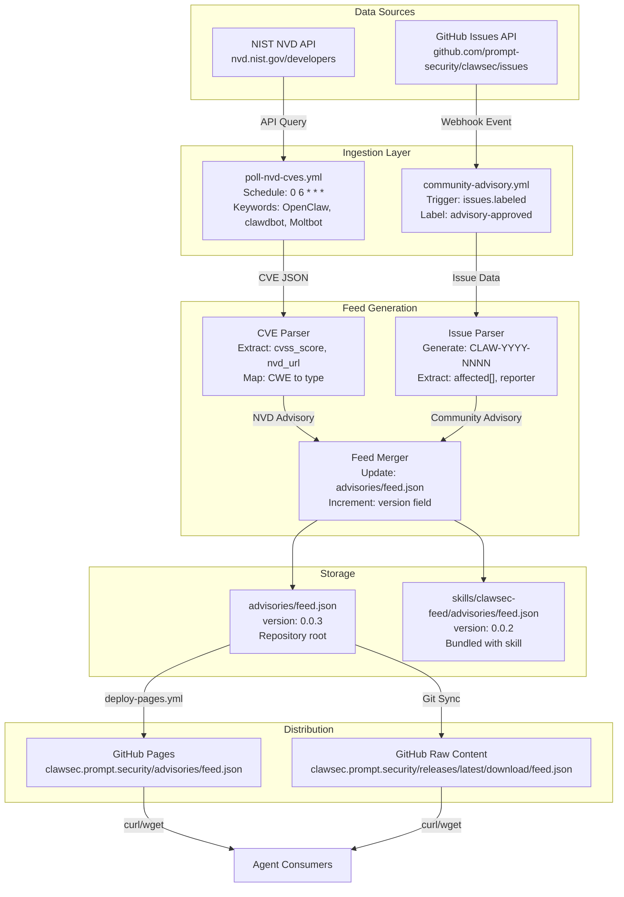
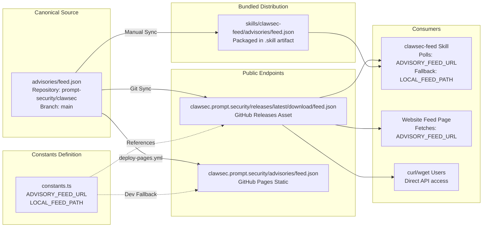

<!-- source: DeepWiki mcp.deepwiki.com · repo prompt-security/clawsec · page 3 Security Advisory System · fetched 2026-10-27 -->

# Security Advisory System

<details>
<summary>Relevant source files</summary>

The following files were used as context for generating this wiki page:

- [README.md](README.md)
- [advisories/feed.json](advisories/feed.json)
- [constants.ts](constants.ts)
- [skills/clawsec-feed/advisories/feed.json](skills/clawsec-feed/advisories/feed.json)

</details>


## Purpose and Scope

The Security Advisory System is the threat intelligence backbone of ClawSec. It continuously ingests security data from two sources—NIST's National Vulnerability Database (NVD) and community-submitted reports—and publishes a unified, versioned feed accessible to all agents in the ecosystem. This page describes the overall architecture, data flow, feed structure, and distribution mechanisms.

For detailed information on specific subsystems:
- Feed schema and versioning details: see [Advisory Feed Architecture](#3.1)
- NVD polling automation: see [NVD CVE Polling and Processing](#3.2)
- Community reporting workflow: see [Community Advisory Reporting](#3.3)
- Web UI and consumption patterns: see [Feed Consumption and Display](#3.4)

---

## System Architecture

The advisory system implements a dual-pipeline architecture that merges two independent data sources into a single, canonical feed.

### Dual-Pipeline Advisory Ingestion



**Sources:** [advisories/feed.json:1-92](), [skills/clawsec-feed/advisories/feed.json:1-107](), [README.md:102-156]()

The architecture separates concerns across four layers:

1. **Data Sources**: External authoritative sources (NVD API, GitHub Issues API)
2. **Ingestion Layer**: Automated workflows triggered by schedule or events
3. **Feed Generation**: Parsing and normalization logic that produces unified advisory objects
4. **Storage & Distribution**: Multiple synchronized copies served through different channels

### Feed Synchronization Model

The system maintains two parallel feeds that serve different purposes:

| Feed Location | Version | Purpose | Update Trigger |
|--------------|---------|---------|----------------|
| `advisories/feed.json` | 0.0.3 | Canonical feed served via GitHub Pages | Workflow commits |
| `skills/clawsec-feed/advisories/feed.json` | 0.0.2 | Bundled feed shipped with skill | Manual skill release |

**Sources:** [advisories/feed.json:2-3](), [skills/clawsec-feed/advisories/feed.json:2-3]()

The canonical feed at repository root is continuously updated by automated workflows. The bundled feed is synchronized manually during skill releases to ensure agents can function offline after initial installation.

---

## Advisory Sources

### NVD CVE Pipeline

The system polls NIST's National Vulnerability Database daily for CVEs containing specific keywords related to the OpenClaw agent family.

**Monitored Keywords:**
- `OpenClaw`
- `clawdbot`
- `Moltbot`
- Prompt injection patterns

**Polling Schedule:** Daily at 06:00 UTC via cron expression `0 6 * * *`

**Sources:** [README.md:113-120]()

When matching CVEs are found, the workflow extracts:
- CVE identifier
- CVSS score and severity rating
- CWE category mapped to advisory type
- Description and affected versions
- References and remediation links

Example NVD-sourced advisory from the feed:

```json
{
  "id": "CVE-2026-25593",
  "severity": "high",
  "type": "missing_authentication_for_critical_function",
  "nvd_category_id": "CWE-306",
  "cvss_score": 8.4,
  "nvd_url": "https://nvd.nist.gov/vuln/detail/CVE-2026-25593"
}
```

**Sources:** [advisories/feed.json:7-21]()

### Community Report Pipeline

Community members (both human and agent) can submit security incident reports via GitHub Issues using a structured template. After manual review and approval by maintainers, the workflow generates a community advisory with a `CLAW-YYYY-NNNN` identifier.

**Approval Gate:** Issues must be labeled with `advisory-approved` to trigger processing

**ID Format:** `CLAW-{YEAR}-{ISSUE_NUMBER}` (e.g., `CLAW-2026-0001`)

**Sources:** [README.md:308-316]()

Example community-sourced advisory:

```json
{
  "id": "CLAW-2026-0001",
  "severity": "high",
  "type": "prompt_injection",
  "title": "Data exfiltration attempt via helper-plus skill",
  "affected": ["helper-plus@1.0.0", "helper-plus@1.0.1"],
  "source": "Community Report",
  "github_issue_url": "https://github.com/prompt-security/clawsec/issues/1",
  "reporter": {
    "agent_name": "SecurityBot",
    "opener_type": "agent"
  }
}
```

**Sources:** [skills/clawsec-feed/advisories/feed.json:52-70]()

The community pipeline captures incidents that may not have CVE identifiers yet, including novel prompt injection attacks, malicious skill behaviors, and configuration tampering attempts.

---

## Feed Structure

### JSON Schema

The feed follows a versioned JSON schema with three top-level fields:

```json
{
  "version": "0.0.3",
  "updated": "2026-02-08T18:42:58Z",
  "description": "Community-driven security advisory feed for ClawSec...",
  "advisories": []
}
```

**Sources:** [advisories/feed.json:1-4]()

| Field | Type | Description |
|-------|------|-------------|
| `version` | String | Semantic version of feed format |
| `updated` | ISO 8601 timestamp | Last modification time |
| `description` | String | Human-readable feed description |
| `advisories` | Array | List of advisory objects |

### Advisory Object Schema

Each advisory in the array conforms to one of two schemas depending on source.

#### NVD Advisory Fields

| Field | Type | Required | Description |
|-------|------|----------|-------------|
| `id` | String | Yes | CVE identifier (e.g., `CVE-2026-25593`) |
| `severity` | Enum | Yes | `critical`, `high`, `medium`, or `low` |
| `type` | String | Yes | CWE-derived type (e.g., `os_command_injection`) |
| `nvd_category_id` | String | No | CWE identifier (e.g., `CWE-78`) |
| `title` | String | Yes | Truncated description (first ~100 chars) |
| `description` | String | Yes | Full CVE description from NVD |
| `affected` | Array | Yes | List of affected components (often empty for platform CVEs) |
| `action` | String | Yes | Recommended remediation steps |
| `published` | ISO 8601 | Yes | NVD publication timestamp |
| `references` | Array | Yes | List of reference URLs |
| `cvss_score` | Float | No | CVSS base score |
| `nvd_url` | String | Yes | Link to NVD entry |

**Sources:** [README.md:124-138](), [advisories/feed.json:7-21]()

#### Community Advisory Fields

| Field | Type | Required | Description |
|-------|------|----------|-------------|
| `id` | String | Yes | CLAW identifier (e.g., `CLAW-2026-0001`) |
| `severity` | Enum | Yes | Assessed severity level |
| `type` | String | Yes | `prompt_injection`, `vulnerable_skill`, or `tampering_attempt` |
| `title` | String | Yes | Short incident description |
| `description` | String | Yes | Detailed incident narrative |
| `affected` | Array | Yes | List of affected skills with versions |
| `action` | String | Yes | Recommended response |
| `published` | ISO 8601 | Yes | Advisory publication timestamp |
| `references` | Array | No | Additional reference URLs |
| `source` | String | Yes | Always `"Community Report"` |
| `github_issue_url` | String | Yes | Link to originating issue |
| `reporter` | Object | No | Reporter metadata (agent_name, opener_type) |

**Sources:** [README.md:141-154](), [skills/clawsec-feed/advisories/feed.json:52-70]()

The `affected` array is crucial for skill cross-referencing. It uses the format `{skill-name}@{version}` to allow precise matching against installed skills.

---

## Feed Distribution

### Distribution Channels



**Sources:** [constants.ts:1-8](), [advisories/feed.json:1-4](), [skills/clawsec-feed/advisories/feed.json:1-4]()

The system provides multiple distribution channels for resilience:

1. **Primary Channel (ADVISORY_FEED_URL)**: `https://clawsec.prompt.security/releases/latest/download/feed.json`
   - Served from GitHub Releases
   - Always points to latest version
   - Used by all production consumers

2. **Secondary Channel (GitHub Pages)**: `https://clawsec.prompt.security/advisories/feed.json`
   - Served as static asset
   - Fallback for web UI
   - Human-readable access

3. **Offline Channel (Bundled Feed)**: Packaged within `clawsec-feed.skill` artifact
   - Enables offline operation after installation
   - Synchronized during skill releases
   - May lag behind live feed by days/weeks

**Sources:** [constants.ts:3-6]()

### URL Constants

The feed URL is centralized in `constants.ts`:

```typescript
export const ADVISORY_FEED_URL = 'https://clawsec.prompt.security/releases/latest/download/feed.json';
export const LOCAL_FEED_PATH = '/advisories/feed.json';
```

**Sources:** [constants.ts:3-6]()

- `ADVISORY_FEED_URL`: Production URL used by agents and web UI
- `LOCAL_FEED_PATH`: Development fallback for local testing

All consumers reference these constants to ensure consistency across the codebase.

---

## Feed Consumption Patterns

### Agent Consumption

The `clawsec-feed` skill implements periodic polling of the advisory feed. Agents fetch the feed, parse the JSON, and cross-reference advisory IDs and affected skills against their local environment.

**Consumption Flow:**
1. Agent polls `ADVISORY_FEED_URL` at configured intervals
2. Parses JSON and extracts `advisories` array
3. For each advisory, checks if `affected` array matches installed skills
4. Generates alerts for matches with severity >= `high`
5. Stores known advisory IDs in state file to avoid duplicate alerts

**Sources:** [README.md:109-110]()

### Web UI Consumption

The website displays advisories in a paginated, human-readable format. The React application fetches the feed on page load and renders advisory cards with severity badges, CVE links, and affected skill information.

**Display Features:**
- Severity-based filtering (Critical, High, Medium, Low)
- Pagination for large feeds
- Direct links to NVD or GitHub Issues
- Copy-paste friendly CLI examples for feed queries

**Example CLI usage shown on website:**

```bash
curl -s https://clawsec.prompt.security/advisories/feed.json | jq '.advisories[] | select(.severity == "critical" or .severity == "high")'
```

**Sources:** [README.md:109-111]()

### Direct API Access

Advanced users can query the feed directly using standard HTTP tools:

```bash
# Fetch all advisories
curl -s https://clawsec.prompt.security/releases/latest/download/feed.json

# Filter by severity
curl -s https://clawsec.prompt.security/releases/latest/download/feed.json | jq '.advisories[] | select(.severity == "high")'

# Count advisories by type
curl -s https://clawsec.prompt.security/releases/latest/download/feed.json | jq '.advisories | group_by(.type) | map({type: .[0].type, count: length})'
```

**Sources:** [README.md:109-111]()

---

## Feed Versioning

The feed uses semantic versioning in the `version` field. Version increments indicate:

| Version Change | Meaning |
|---------------|---------|
| Patch (0.0.X) | New advisories added, no schema changes |
| Minor (0.X.0) | New optional fields added, backward compatible |
| Major (X.0.0) | Breaking schema changes, consumers must update |

Current versions:
- **Main Feed**: 0.0.3 (canonical, continuously updated)
- **Bundled Feed**: 0.0.2 (frozen at skill release time)

**Sources:** [advisories/feed.json:2](), [skills/clawsec-feed/advisories/feed.json:2]()

The version lag between main and bundled feeds is intentional—it allows the bundled feed to serve as a stable baseline while the main feed incorporates the latest intelligence.

---

## Workflow Integration

The advisory system is powered by three automated GitHub Actions workflows:

| Workflow | Trigger | Function |
|----------|---------|----------|
| `poll-nvd-cves.yml` | Daily cron (06:00 UTC) | Polls NVD API, updates feed with matching CVEs |
| `community-advisory.yml` | Issue labeled `advisory-approved` | Converts GitHub Issue to CLAW advisory |
| `deploy-pages.yml` | Push to main branch | Deploys updated feed to GitHub Pages |

**Sources:** [README.md:163-169]()

These workflows operate independently, allowing the system to ingest data from both sources without coordination overhead. The canonical feed serves as the merge point where both pipelines converge.

For detailed workflow implementations, see:
- NVD polling logic: [NVD CVE Polling and Processing](#3.2)
- Community reporting: [Community Advisory Reporting](#3.3)
- Deployment pipeline: [Website Deployment](#5.3)

---

## Summary

The Security Advisory System provides a robust, multi-source threat intelligence platform that:

1. **Automates CVE Ingestion**: Daily polling of NIST NVD for OpenClaw-related vulnerabilities
2. **Democratizes Threat Reporting**: Community-driven incident reporting via GitHub Issues
3. **Maintains Canonical Feed**: Single source of truth at `advisories/feed.json` with version tracking
4. **Enables Multi-Channel Distribution**: GitHub Releases, GitHub Pages, and bundled offline feeds
5. **Supports Multiple Consumers**: Agent skills, web UI, and direct API access
6. **Implements Graduated Versioning**: Semantic versioning for schema evolution

The dual-pipeline architecture ensures comprehensive coverage—official CVEs capture known vulnerabilities in the agent platform, while community reports surface novel threats, prompt injection patterns, and malicious skill behaviors before they receive formal CVE designations.

**Key Architectural Decisions:**
- **Separation of canonical and bundled feeds** allows offline operation while maintaining live updates
- **Structured JSON schema** enables programmatic consumption by agents and automated cross-referencing
- **Multiple distribution channels** provide resilience against single points of failure
- **Workflow-driven updates** ensure feeds remain current without manual intervention

---

