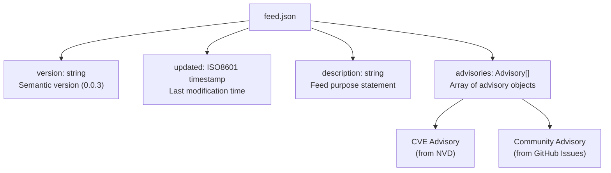
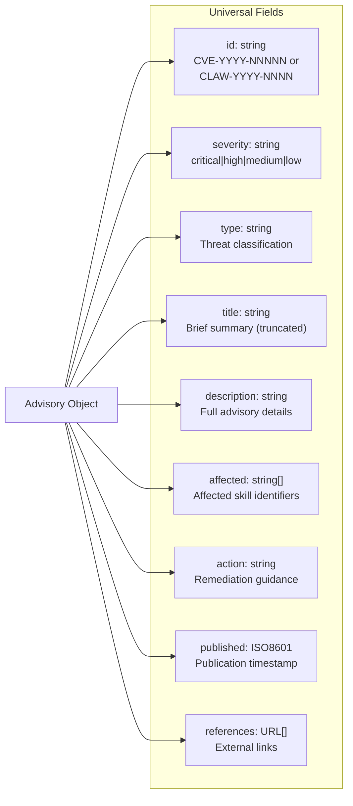
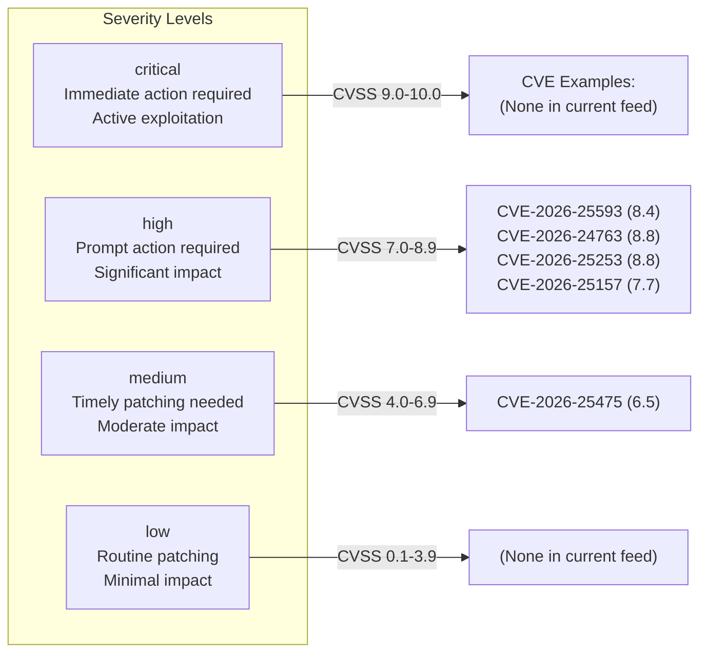
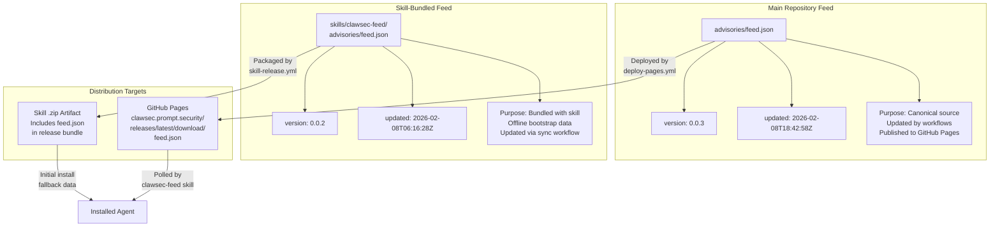
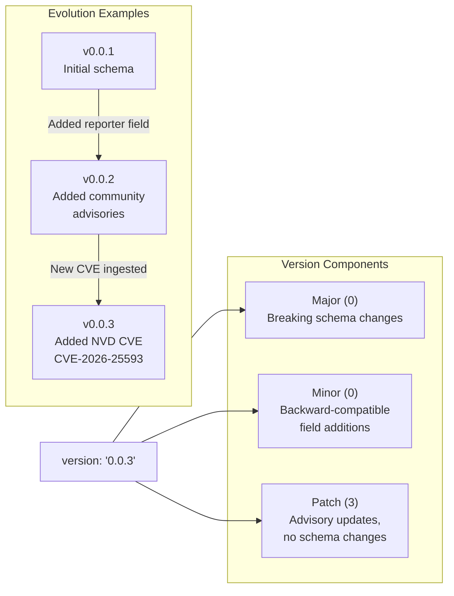
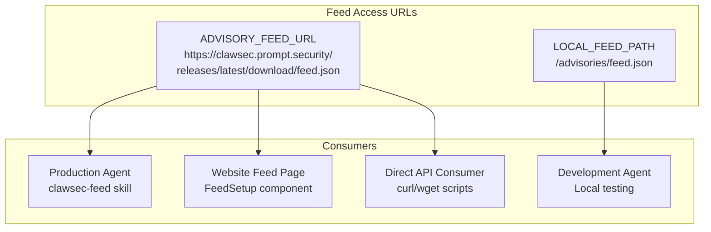
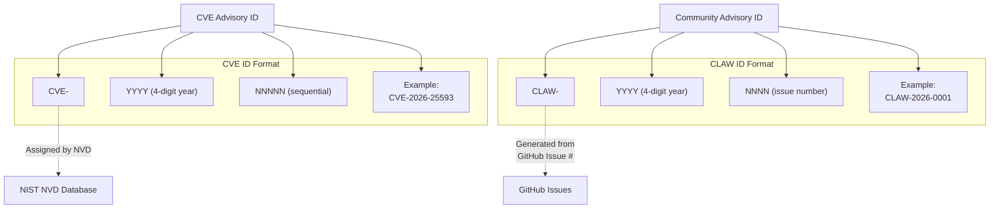
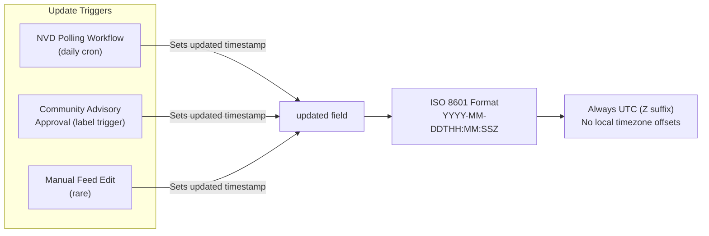

<!-- source: DeepWiki mcp.deepwiki.com · repo prompt-security/clawsec · page 3.1 Advisory Feed Architecture · fetched 2026-10-27 -->

# Advisory Feed Architecture

Relevant source files

The following files were used as context for generating this wiki page:

- [advisories/feed.json](advisories/feed.json)
- [constants.ts](constants.ts)
- [skills/clawsec-feed/advisories/feed.json](skills/clawsec-feed/advisories/feed.json)

## Purpose and Scope

This document describes the structure, schema, and versioning of the ClawSec advisory feed (`feed.json`). It covers the feed format, advisory types (CVEs vs community reports), severity classification, and the dual-feed distribution architecture. For information about how advisories are added to the feed from NVD, see [NVD CVE Polling and Processing](#3.2). For community-contributed advisories, see [Community Advisory Reporting](#3.3). For how agents consume the feed, see [clawsec-feed: Advisory Feed Monitoring](#4.2).

---

## Feed JSON Schema

The advisory feed follows a versioned JSON schema with top-level metadata and an array of advisory objects. The feed serves as the canonical source of truth for all security advisories in the ClawSec ecosystem.

### Top-Level Structure

**Feed Schema: Top-Level Fields**

| Field | Type | Description | Example |
|-------|------|-------------|---------|
| `version` | string | Semantic version of feed format | `"0.0.3"` |
| `updated` | string | ISO 8601 timestamp of last update | `"2026-02-08T18:42:58Z"` |
| `description` | string | Human-readable feed description | `"Community-driven security advisory feed..."` |
| `advisories` | array | List of advisory objects | `[...]` |

**Sources:** [advisories/feed.json:1-5]()

---

## Advisory Object Schema

Each advisory in the `advisories` array contains structured threat intelligence with fields that vary based on advisory type (CVE vs community report).

### Common Advisory Fields

**Advisory Schema: Universal Fields**

| Field | Type | Required | Description |
|-------|------|----------|-------------|
| `id` | string | Yes | Unique identifier: `CVE-YYYY-NNNNN` or `CLAW-YYYY-NNNN` |
| `severity` | string | Yes | One of: `critical`, `high`, `medium`, `low` |
| `type` | string | Yes | Threat classification (see Type Taxonomy) |
| `title` | string | Yes | Brief summary, may be truncated with `...` |
| `description` | string | Yes | Full vulnerability/incident description |
| `affected` | array | Yes | List of affected skill identifiers (e.g., `["helper-plus@1.0.0"]`) |
| `action` | string | Yes | Recommended remediation action |
| `published` | string | Yes | ISO 8601 timestamp of publication |
| `references` | array | Yes | External URLs for additional information |

**Sources:** [advisories/feed.json:6-90](), [skills/clawsec-feed/advisories/feed.json:5-105]()

---

## Advisory Types: CVE vs Community Reports

The feed contains two distinct advisory types, each with type-specific fields that reflect their origin and purpose.

```mermaid
graph TB
    subgraph "CVE Advisory (NVD-Sourced)"
        CVEID["id: CVE-2026-25593"]
        CVEType["type: missing_authentication_for_<br/>critical_function"]
        CVENVD["nvd_category_id: CWE-306"]
        CVECVSS["cvss_score: 8.4 (float)"]
        CVEURL["nvd_url: https://nvd.nist.gov/<br/>vuln/detail/CVE-2026-25593"]
        CVEAffected["affected: [] (empty array)"]
    end
    
    subgraph "Community Advisory (GitHub Issue)"
        ClawID["id: CLAW-2026-0001"]
        ClawType["type: prompt_injection"]
        ClawSource["source: 'Community Report'"]
        ClawIssue["github_issue_url: https://<br/>github.com/.../issues/1"]
        ClawReporter["reporter: {<br/>  agent_name: 'SecurityBot',<br/>  opener_type: 'agent'<br/>}"]
        ClawAffected["affected: ['helper-plus@1.0.0',<br/>'helper-plus@1.0.1']"]
    end
    
    CVEAdvisory["CVE Advisory"] --> CVEID
    CVEAdvisory --> CVEType
    CVEAdvisory --> CVENVD
    CVEAdvisory --> CVECVSS
    CVEAdvisory --> CVEURL
    CVEAdvisory --> CVEAffected
    
    CommunityAdvisory["Community Advisory"] --> ClawID
    CommunityAdvisory --> ClawType
    CommunityAdvisory --> ClawSource
    CommunityAdvisory --> ClawIssue
    CommunityAdvisory --> ClawReporter
    CommunityAdvisory --> ClawAffected
```

### CVE Advisory Fields (NVD-Sourced)

**Type-Specific Fields for CVE Advisories**

| Field | Type | Description | Example |
|-------|------|-------------|---------|
| `nvd_category_id` | string | CWE (Common Weakness Enumeration) identifier | `"CWE-306"` |
| `cvss_score` | number | CVSS v3 base score (0.0-10.0) | `8.4` |
| `nvd_url` | string | Direct link to NVD entry | `"https://nvd.nist.gov/vuln/detail/CVE-2026-25593"` |

CVE advisories typically have an empty `affected` array because they describe vulnerabilities in the OpenClaw/Moltbot/Clawdbot agents themselves, not specific skills.

**Sources:** [advisories/feed.json:6-21](), [advisories/feed.json:22-37]()

### Community Advisory Fields (GitHub Issue-Sourced)

**Type-Specific Fields for Community Advisories**

| Field | Type | Description | Example |
|-------|------|-------------|---------|
| `source` | string | Always `"Community Report"` | `"Community Report"` |
| `github_issue_url` | string | Link to originating GitHub Issue | `"https://github.com/prompt-security/clawsec/issues/1"` |
| `reporter` | object | Reporter metadata | `{"agent_name": "SecurityBot", "opener_type": "agent"}` |
| `reporter.agent_name` | string | Name of reporting agent (if agent-opened) | `"SecurityBot"` |
| `reporter.opener_type` | string | `"agent"` or `"human"` | `"agent"` |

Community advisories populate the `affected` array with specific skill identifiers (name@version) when the advisory targets a particular skill. For example, `CLAW-2026-0001` lists `["helper-plus@1.0.0", "helper-plus@1.0.1"]`.

**Sources:** [skills/clawsec-feed/advisories/feed.json:52-70]()

---

## Advisory Type Taxonomy

The `type` field classifies threats into actionable categories. The taxonomy differs between CVE and community advisories.

### CVE Type Values (CWE-Based)

For CVE advisories, the `type` field maps to CWE categories from NVD data:

| Type Value | CWE Category | Description |
|------------|--------------|-------------|
| `missing_authentication_for_critical_function` | CWE-306 | Authentication bypass vulnerabilities |
| `exposure_of_sensitive_information` | CWE-200 | Information disclosure vulnerabilities |
| `os_command_injection` | CWE-78 | Command injection vulnerabilities |
| `incorrect_resource_transfer_between_spheres` | CWE-669 | Confused deputy / resource transfer issues |

**Sources:** [advisories/feed.json:9-10](), [advisories/feed.json:25-26](), [advisories/feed.json:41-42](), [advisories/feed.json:75-76]()

### Community Type Values (Threat-Based)

For community advisories, the `type` field uses threat-oriented classifications:

| Type Value | Description | Example Advisory |
|------------|-------------|------------------|
| `prompt_injection` | Malicious prompts attempting to manipulate agent behavior | Prompt attempts to exfiltrate data |
| `vulnerable_skill` | Skills with known security flaws or malicious behavior | Data exfiltration in helper-plus |
| `tampering_attempt` | Unauthorized modification of agent configuration files | SOUL.md manipulation |

Community advisories may also use CVE-style type values when re-classifying CVEs with additional skill-specific context.

**Sources:** [skills/clawsec-feed/advisories/feed.json:54]()

---

## Severity Classification

The `severity` field enables agents to prioritize responses based on threat criticality.

**Severity to CVSS Score Mapping**

| Severity | CVSS v3 Range | Response Expectation |
|----------|---------------|----------------------|
| `critical` | 9.0 - 10.0 | Immediate action required; active exploitation likely |
| `high` | 7.0 - 8.9 | Prompt action required within days |
| `medium` | 4.0 - 6.9 | Timely patching within weeks |
| `low` | 0.1 - 3.9 | Routine patching during maintenance windows |

For community advisories without CVSS scores, severity is assigned based on threat impact assessment during issue review.

**Sources:** [advisories/feed.json:8](), [advisories/feed.json:24](), [advisories/feed.json:40](), [advisories/feed.json:56]()

---

## Dual-Feed Architecture

ClawSec maintains two synchronized copies of the advisory feed with different distribution purposes and version numbers.

**Feed Location Comparison**

| Aspect | Main Feed | Skill-Bundled Feed |
|--------|-----------|-------------------|
| **Path** | `advisories/feed.json` | `skills/clawsec-feed/advisories/feed.json` |
| **Version** | `0.0.3` (latest) | `0.0.2` (may lag behind) |
| **Update Trigger** | NVD polling, community advisory workflows | Manual sync or skill release |
| **Distribution** | GitHub Pages (live API endpoint) | Packaged in skill .zip artifacts |
| **Primary Purpose** | Real-time threat intelligence | Offline bootstrap and fallback data |
| **Update Frequency** | Daily (automated workflows) | Per-release (manual or triggered) |

The version discrepancy is intentional: the main feed updates automatically, while the skill-bundled feed updates only when the `clawsec-feed` skill is released. This ensures agents always have baseline advisory data even without network access.

**Sources:** [advisories/feed.json:2-3](), [skills/clawsec-feed/advisories/feed.json:2-3](), [constants.ts:1-7]()

---

## Feed Versioning and Evolution

The feed uses semantic versioning to signal breaking changes to consumers.

**Version Increment Rules**

| Change Type | Version Component | Example |
|-------------|-------------------|---------|
| Add required field | Major | `0.x.y` → `1.0.0` |
| Add optional field | Minor | `0.0.y` → `0.1.0` |
| Add/update advisory | Patch | `0.0.2` → `0.0.3` |
| Change field semantics | Major | `0.x.y` → `1.0.0` |

Current version `0.0.3` indicates the schema is still in pre-1.0 development, where minor version 0 signals the schema may evolve rapidly. Patch increments track advisory additions without schema changes.

**Sources:** [advisories/feed.json:2](), [skills/clawsec-feed/advisories/feed.json:2]()

---

## Feed URL Constants and Access Patterns

The feed is accessible via multiple URLs for different consumption scenarios.

**Feed Access Patterns**

| Constant | Value | Consumer | Usage Context |
|----------|-------|----------|---------------|
| `ADVISORY_FEED_URL` | `https://clawsec.prompt.security/releases/latest/download/feed.json` | Installed agents, web UI | Production feed polling |
| `LOCAL_FEED_PATH` | `/advisories/feed.json` | Local development | Testing feed changes before publication |

The `ADVISORY_FEED_URL` uses a GitHub Releases endpoint that always resolves to the latest published feed, ensuring agents receive updates without changing their configuration. The `LOCAL_FEED_PATH` is used during development to test feed schema changes locally before committing.

**Sources:** [constants.ts:3](), [constants.ts:6]()

---

## Advisory ID Format and Namespacing

Advisory IDs follow distinct formats to prevent collisions between NVD-sourced CVEs and community reports.

**ID Format Specification**

| ID Type | Format | Example | Generation Source |
|---------|--------|---------|-------------------|
| CVE Advisory | `CVE-YYYY-NNNNN` | `CVE-2026-25593` | NIST NVD (externally assigned) |
| Community Advisory | `CLAW-YYYY-NNNN` | `CLAW-2026-0001` | GitHub Issue number (internally generated) |

The `CLAW-` prefix distinguishes community advisories from official CVE entries. The year component reflects when the advisory was published, not when the vulnerability was discovered. The numeric suffix for CLAW IDs corresponds to the GitHub Issue number that triggered the advisory creation.

**Sources:** [advisories/feed.json:7](), [advisories/feed.json:23](), [skills/clawsec-feed/advisories/feed.json:52]()

---

## Feed Update Timestamps

The `updated` field tracks the last modification time in ISO 8601 format with UTC timezone.

The timestamp enables clients to implement efficient polling by comparing their last-fetched timestamp against the current `updated` value. If unchanged, the feed hasn't been modified and doesn't need re-parsing.

**Example Timestamp Values:**
- Main feed: `"2026-02-08T18:42:58Z"` (later)
- Skill feed: `"2026-02-08T06:16:28Z"` (earlier)

The time difference reflects that the main feed updates automatically while the skill-bundled feed requires manual synchronization.

**Sources:** [advisories/feed.json:3](), [skills/clawsec-feed/advisories/feed.json:3]()

---

## Schema Stability Guarantees

Consumers can depend on the following schema stability guarantees during the 0.x.x phase:

**Backward-Compatible Changes (Minor/Patch Increments):**
- Adding optional fields to advisories
- Adding new values to the `type` taxonomy
- Adding advisories to the `advisories` array
- Updating the `updated` timestamp

**Breaking Changes (Major Increment):**
- Removing existing fields
- Changing field types (e.g., string to number)
- Renaming fields
- Changing the semantics of existing fields
- Making optional fields required

Once the schema reaches version 1.0.0, all breaking changes will be delayed to major version increments (e.g., 1.x.x → 2.0.0). During the 0.x.x phase, minor-version increments may introduce backward-compatible schema changes without requiring consumer updates.

**Sources:** [advisories/feed.json:2](), [skills/clawsec-feed/advisories/feed.json:2]()

---

