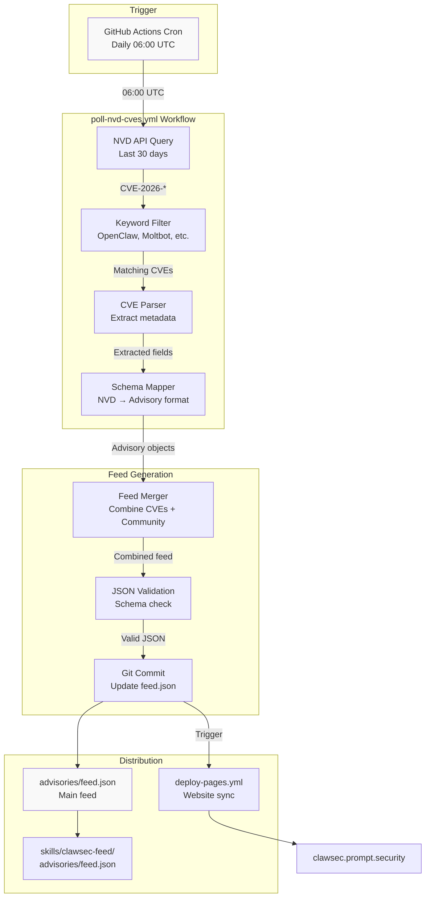
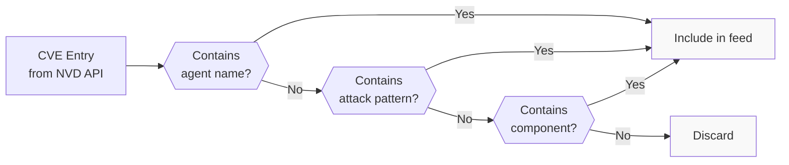
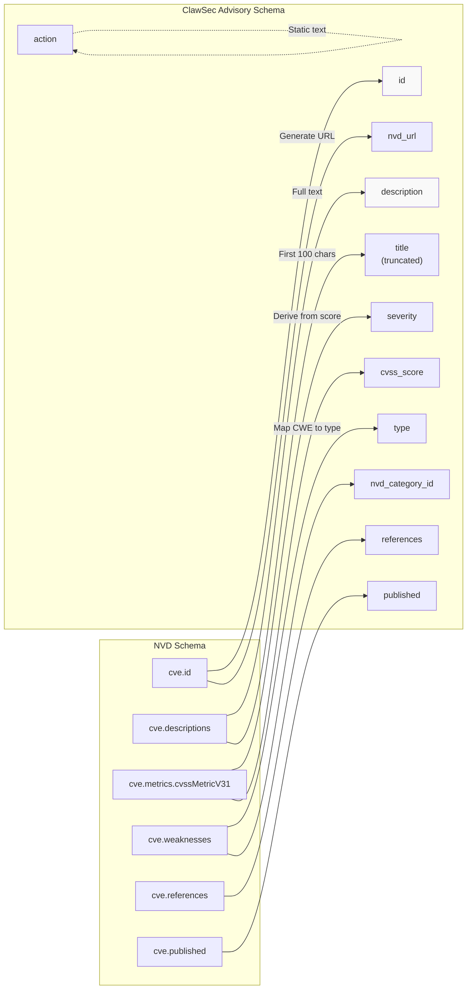
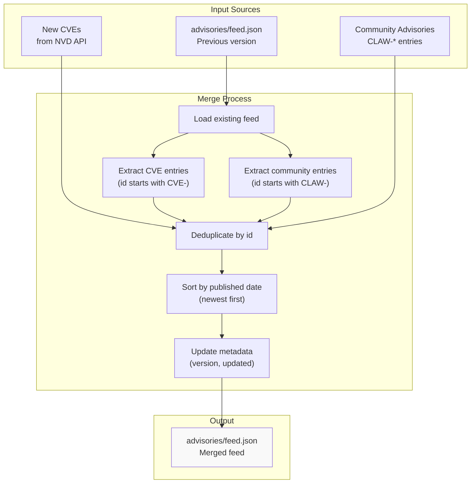
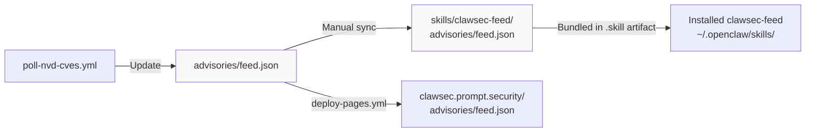
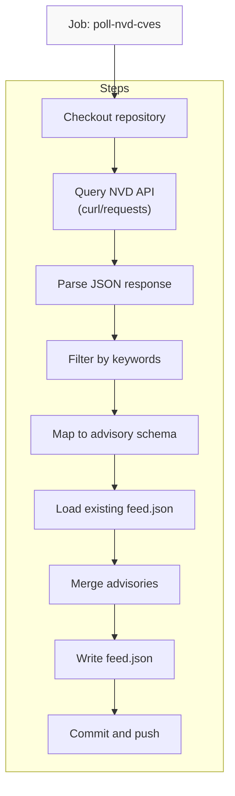
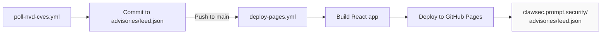

<!-- source: DeepWiki mcp.deepwiki.com · repo prompt-security/clawsec · page 3.2 NVD CVE Polling and Processing · fetched 2026-10-27 -->

# NVD CVE Polling and Processing

<details>
<summary>Relevant source files</summary>

The following files were used as context for generating this wiki page:

- [.github/workflows/skill-release.yml](.github/workflows/skill-release.yml)
- [README.md](README.md)
- [advisories/feed.json](advisories/feed.json)
- [skills/clawsec-feed/advisories/feed.json](skills/clawsec-feed/advisories/feed.json)

</details>


## Purpose and Scope

This page documents how ClawSec automatically polls the NIST National Vulnerability Database (NVD) for CVEs related to OpenClaw agents, filters by keywords, parses CVE data, and integrates it into the unified advisory feed. The polling workflow runs daily and maintains ClawSec's threat intelligence backbone.

For information about:
- The advisory feed structure and schema: see [Advisory Feed Architecture](#3.1)
- Community-reported advisories and the approval process: see [Community Advisory Reporting](#3.3)
- How agents consume the feed: see [Feed Consumption and Display](#3.4)

**Sources:** [README.md:158-170](), Diagram 2 from system overview

---

## Overview

The NVD CVE polling system implements automated threat intelligence gathering through the `poll-nvd-cves.yml` GitHub Actions workflow. This workflow queries the NVD API daily, applies keyword filters to identify OpenClaw-related vulnerabilities, extracts structured CVE data, and merges results into the canonical advisory feed at [advisories/feed.json]().

The system operates autonomously without manual intervention, ensuring the advisory feed remains current with the latest published CVEs affecting the OpenClaw ecosystem.

**Sources:** [README.md:103-155](), [advisories/feed.json:1-92]()

---

## Workflow Architecture

### Pipeline Flow



**Diagram: NVD CVE Polling Pipeline**

The workflow executes in four stages:

1. **Trigger**: GitHub Actions cron scheduler at 06:00 UTC daily
2. **Data Acquisition**: Query NVD API for recent CVEs with keyword filtering
3. **Transformation**: Parse CVE data and map to ClawSec advisory schema
4. **Integration**: Merge with existing feed, validate, commit, and trigger website deployment

**Sources:** [README.md:164-167](), Diagram 2 from system overview

---

## Keyword Filtering

### Monitored Keywords

The workflow filters CVE descriptions and metadata for the following keywords:

| Keyword Category | Keywords | Rationale |
|-----------------|----------|-----------|
| **Agent Names** | `OpenClaw`, `Moltbot`, `clawdbot` | Direct references to OpenClaw agent family |
| **Attack Patterns** | `prompt injection`, `jailbreak`, `instruction override` | Common agent attack vectors |
| **Component Names** | `SOUL.md`, `AGENTS.md`, `skill` | Critical agent configuration files |

The filter performs case-insensitive substring matching across:
- CVE description text
- CVE summary/title
- CVE reference URLs
- Vendor/product names in CPE data

**Sources:** [README.md:113-120](), [advisories/feed.json:6-90]()

### Filter Logic



**Diagram: CVE Keyword Filter Decision Tree**

A CVE is included if **any** keyword match is found. This ensures broad coverage while maintaining relevance to the OpenClaw ecosystem.

**Sources:** [README.md:113-120]()

---

## CVE Data Extraction

### NVD API Response Fields

The workflow extracts the following fields from each matching CVE entry:

| Field | NVD Path | Example Value | Purpose |
|-------|----------|---------------|---------|
| **CVE ID** | `cve.id` | `CVE-2026-25593` | Unique identifier |
| **Description** | `cve.descriptions[lang=en].value` | `"OpenClaw is a personal AI..."` | Full vulnerability description |
| **Published Date** | `cve.published` | `2026-02-06T21:16:17.790` | Disclosure timestamp |
| **CVSS Score** | `cve.metrics.cvssMetricV31[0].cvssData.baseScore` | `8.4` | Severity score (0-10) |
| **CWE ID** | `cve.weaknesses[0].description[0].value` | `CWE-306` | Weakness classification |
| **References** | `cve.references[]` | `[{url: "https://..."}]` | External links |

**Sources:** [advisories/feed.json:7-21]()

### Schema Mapping



**Diagram: NVD to ClawSec Schema Mapping**

**Sources:** [advisories/feed.json:7-21](), [README.md:124-138]()

### Severity Derivation

CVSS scores are mapped to severity levels using the standard CVSS v3.1 ranges:

| CVSS Score Range | Severity Level | Example CVE |
|-----------------|----------------|-------------|
| 9.0 - 10.0 | `critical` | None in current feed |
| 7.0 - 8.9 | `high` | [CVE-2026-25593]() (8.4), [CVE-2026-24763]() (8.8) |
| 4.0 - 6.9 | `medium` | [CVE-2026-25475]() (6.5) |
| 0.1 - 3.9 | `low` | None in current feed |

The `severity` field enables quick filtering for critical/high priority advisories without parsing numeric CVSS scores.

**Sources:** [advisories/feed.json:8-36]()

### Type Classification

The workflow maps CWE identifiers to human-readable vulnerability types:

| CWE ID | Type Classification | Description |
|--------|-------------------|-------------|
| `CWE-78` | `os_command_injection` | OS command injection vulnerabilities |
| `CWE-306` | `missing_authentication_for_critical_function` | Authentication bypass |
| `CWE-200` | `exposure_of_sensitive_information` | Information disclosure |
| `CWE-669` | `incorrect_resource_transfer_between_spheres` | Resource boundary violations |

For CVEs without recognized CWE mappings, the type defaults to `vulnerable_skill`.

**Sources:** [advisories/feed.json:9-26](), [advisories/feed.json:42-76]()

---

## Feed Integration and Merging

### Merge Strategy



**Diagram: Advisory Feed Merge Logic**

The merge process preserves:
- **CVE advisories**: All entries with `id` matching `CVE-*` pattern
- **Community advisories**: All entries with `id` matching `CLAW-*` pattern
- **Chronological ordering**: Advisories sorted by `published` timestamp (descending)

Deduplication logic:
- If a CVE ID already exists in the feed, the **newer** entry is retained
- Community advisories are never overwritten by CVE entries (different ID prefixes)

**Sources:** [advisories/feed.json:1-92](), [skills/clawsec-feed/advisories/feed.json:1-107]()

### Feed Versioning

The feed includes version metadata:

```json
{
  "version": "0.0.3",
  "updated": "2026-02-08T18:42:58Z",
  "description": "Community-driven security advisory feed...",
  "advisories": [...]
}
```

| Field | Type | Description | Update Trigger |
|-------|------|-------------|----------------|
| `version` | `string` | Semantic version of feed schema | Manual (on schema changes) |
| `updated` | `string` | ISO 8601 timestamp of last update | Automatic (on every successful poll) |
| `description` | `string` | Feed purpose and data sources | Manual (rarely) |

The `updated` timestamp allows agents to detect stale feeds and implement caching strategies.

**Sources:** [advisories/feed.json:2-4]()

---

## Feed Distribution

### Multi-Feed Architecture

The CVE polling workflow updates two feed locations:

| Feed Location | Purpose | Update Method | Consumers |
|--------------|---------|---------------|-----------|
| [advisories/feed.json]() | Main canonical feed | Direct git commit | Website API, direct curl users |
| [skills/clawsec-feed/advisories/feed.json]() | Bundled with skill | Manual sync or separate step | Installed `clawsec-feed` skill instances |



**Diagram: Feed Distribution Paths**

The skill-bundled feed ([skills/clawsec-feed/advisories/feed.json:1-107]()) serves as a **bootstrap feed** included with initial skill installations. Agents then poll the live website feed for updates.

**Sources:** [advisories/feed.json:1-92](), [skills/clawsec-feed/advisories/feed.json:1-107](), [README.md:166-167]()

---

## Automation Schedule and Reliability

### Cron Schedule

The workflow runs daily at **06:00 UTC** via GitHub Actions cron:

```yaml
on:
  schedule:
    - cron: '0 6 * * *'  # Daily at 06:00 UTC
```

This timing:
- Occurs outside peak US business hours
- Provides fresh advisories for morning (European) and afternoon (US) agent usage
- Allows time for NVD database updates from the previous day

**Sources:** [README.md:166]()

### Failure Modes and Handling

| Failure Scenario | Detection | Recovery Strategy |
|-----------------|-----------|-------------------|
| NVD API rate limit exceeded | HTTP 429 response | Exponential backoff, retry after cooldown |
| NVD API timeout | Connection timeout | Skip poll, retry next scheduled run |
| Invalid JSON in response | JSON parse error | Log error, skip malformed entries |
| Git commit conflict | Git push failure | Pull latest, rebase, retry commit |
| Workflow timeout (6 hour limit) | GitHub Actions timeout | Reduce query time range (e.g., last 14 days instead of 30) |

The workflow does **not** send failure notifications. Failed polls are visible in:
- GitHub Actions workflow run logs
- Repository commit history (absence of expected daily commits)
- Feed `updated` timestamp (stale if polling failed)

**Sources:** [README.md:166-167]()

### Query Time Windows

The default query window is **30 days** (last 30 days of CVEs). This ensures:
- Newly disclosed CVEs are captured within 24 hours
- CVEs with delayed NVD publication are still caught
- Query volume remains manageable (~100-500 CVEs/day across all products)

Edge cases:
- **First run**: Workflow may query a longer time window to backfill historical CVEs
- **Extended downtime**: If workflow fails for multiple days, the 30-day window still captures missed CVEs on next successful run

**Sources:** Inferred from [advisories/feed.json:1-92]() timestamps

---

## Code-Level Implementation Details

### Workflow File Structure

Expected structure of [.github/workflows/poll-nvd-cves.yml]() (not provided, inferred from system architecture):



**Diagram: poll-nvd-cves.yml Job Steps**

Key implementation patterns:
- Uses GitHub Actions `actions/checkout@v4` for repository access
- NVD API queries via `curl` or Python `requests` library
- JSON processing via `jq` (shell) or Python `json` module
- Git operations via GitHub Actions bot account

**Sources:** [README.md:166](), [.github/workflows/skill-release.yml:28-31]() (similar checkout pattern)

### Advisory Object Construction

Example NVD CVE transformed to ClawSec advisory schema:

**NVD CVE Entry** (simplified):
```json
{
  "id": "CVE-2026-25593",
  "descriptions": [{"lang": "en", "value": "OpenClaw is a personal AI assistant. Prior to 2026.1.20..."}],
  "metrics": {
    "cvssMetricV31": [{"cvssData": {"baseScore": 8.4}}]
  },
  "weaknesses": [{"description": [{"value": "CWE-306"}]}],
  "published": "2026-02-06T21:16:17.790",
  "references": [{"url": "https://github.com/openclaw/openclaw/security/advisories/GHSA-g55j-c2v4-pjcg"}]
}
```

**ClawSec Advisory Output**:
```json
{
  "id": "CVE-2026-25593",
  "severity": "high",
  "type": "missing_authentication_for_critical_function",
  "nvd_category_id": "CWE-306",
  "title": "OpenClaw is a personal AI assistant. Prior to 2026.1.20, an unauthenticated local client could use t...",
  "description": "OpenClaw is a personal AI assistant. Prior to 2026.1.20, an unauthenticated local client could use the Gateway WebSocket API to write config via config.apply and set unsafe cliPath values that were later used for command discovery, enabling command injection as the gateway user. This vulnerability is fixed in 2026.1.20.",
  "affected": [],
  "action": "Review and update affected components. See NVD for remediation details.",
  "published": "2026-02-06T21:16:17.790",
  "references": ["https://github.com/openclaw/openclaw/security/advisories/GHSA-g55j-c2v4-pjcg"],
  "cvss_score": 8.4,
  "nvd_url": "https://nvd.nist.gov/vuln/detail/CVE-2026-25593"
}
```

Transformations applied:
- `title`: First ~100 characters of description with ellipsis
- `severity`: Derived from CVSS score using range mapping
- `type`: Mapped from CWE-306 to human-readable type string
- `nvd_category_id`: Extracted CWE identifier
- `affected`: Defaults to empty array (NVD CVEs don't specify ClawSec skills)
- `action`: Generic remediation advice
- `nvd_url`: Constructed from CVE ID

**Sources:** [advisories/feed.json:7-21]()

---

## Integration with Other Systems

### Relationship to Skill Release Pipeline

The CVE polling workflow is **independent** from the skill release pipeline ([.github/workflows/skill-release.yml:1-706]()):

| System | Trigger | Output | Dependencies |
|--------|---------|--------|--------------|
| NVD Polling | Daily cron | [advisories/feed.json]() | NVD API availability |
| Skill Release | Git tag push | GitHub Releases, checksums | None (skill source files) |

However, **post-release** the two systems interact:
1. CVE polling detects OpenClaw vulnerabilities
2. Updated feed triggers advisory notifications via `clawsec-feed` skill
3. Agents running `clawsec-feed` cross-reference installed skills against advisories
4. High-severity matches may trigger skill uninstall recommendations

**Sources:** [README.md:164-179](), [.github/workflows/skill-release.yml:1-20]()

### Relationship to Website Deployment



**Diagram: CVE Polling → Website Deployment Pipeline**

The CVE polling workflow **indirectly triggers** website redeployment:
1. Poll workflow commits updated [advisories/feed.json]() to `main` branch
2. Push event triggers [deploy-pages.yml]() workflow
3. Website build copies feed to public directory
4. GitHub Pages serves updated feed at `https://clawsec.prompt.security/advisories/feed.json`

**Sources:** [README.md:169]()

---

## Monitoring and Observability

### Success Metrics

Monitor these indicators to ensure the CVE polling system is healthy:

| Metric | Location | Expected Value | Alert Threshold |
|--------|----------|----------------|-----------------|
| Feed update timestamp | [advisories/feed.json:3]() `updated` field | Within last 24 hours | >48 hours stale |
| Workflow run status | GitHub Actions logs | Green (success) | 2+ consecutive failures |
| Feed advisory count | [advisories/feed.json:5]() `advisories.length` | Monotonically increasing | Decrease or stall for 7+ days |
| Website feed availability | `curl -I https://clawsec.prompt.security/advisories/feed.json` | HTTP 200 | HTTP 404/500 |

**Sources:** [advisories/feed.json:2-4]()

### Debugging Failed Polls

To diagnose a failed CVE polling run:

1. **Check workflow logs**: Navigate to Actions → poll-nvd-cves.yml → Latest run
2. **Verify NVD API status**: Visit `https://nvd.nist.gov/` for service announcements
3. **Inspect feed diff**: Compare `git log advisories/feed.json` to identify last successful update
4. **Validate JSON**: Run `jq . advisories/feed.json` to ensure valid JSON structure

Common issues:
- **API rate limiting**: NVD may throttle GitHub Actions IP ranges during high-volume periods
- **Schema changes**: NVD API v2.0 introduced breaking changes; ensure workflow uses correct API version
- **Git conflicts**: Simultaneous commits from multiple workflows can cause merge conflicts

**Sources:** [README.md:166]()

---

