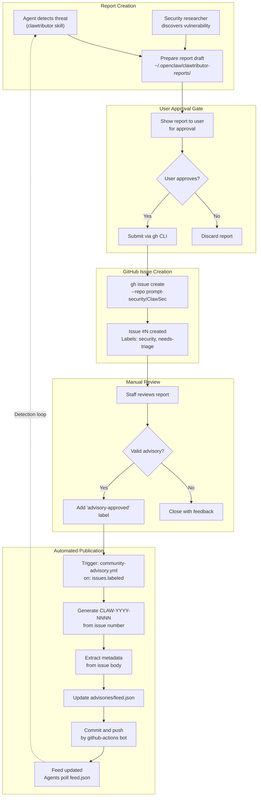
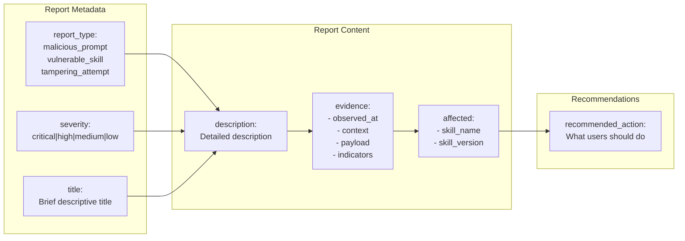
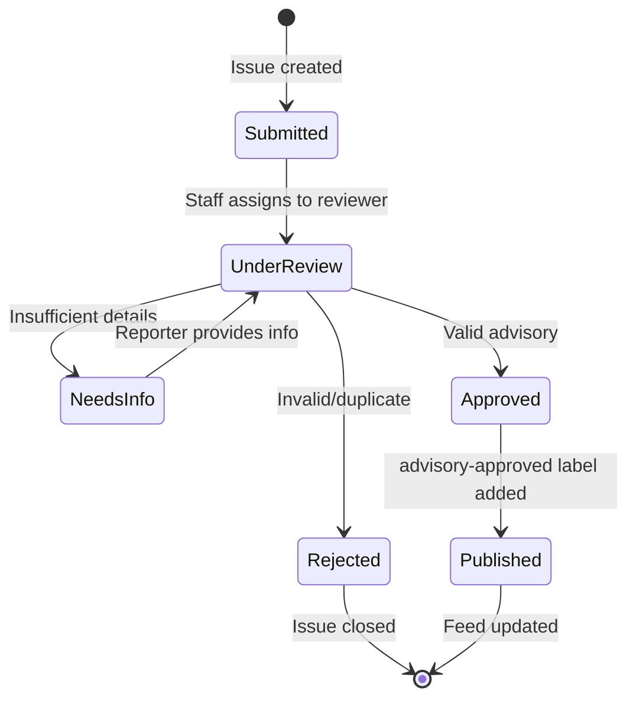
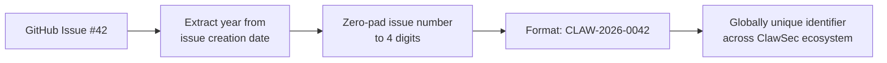
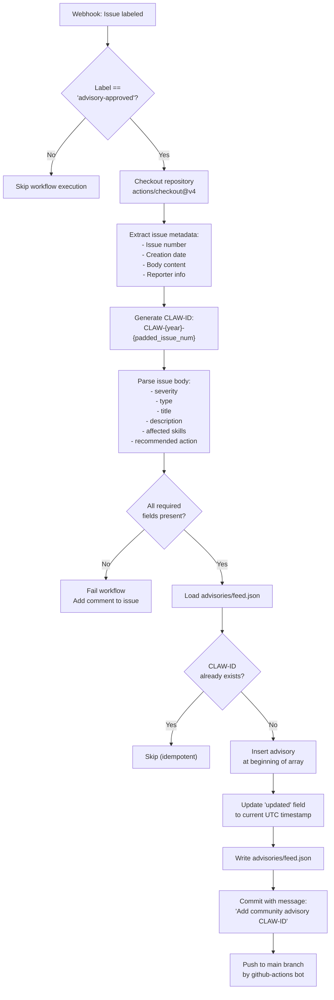
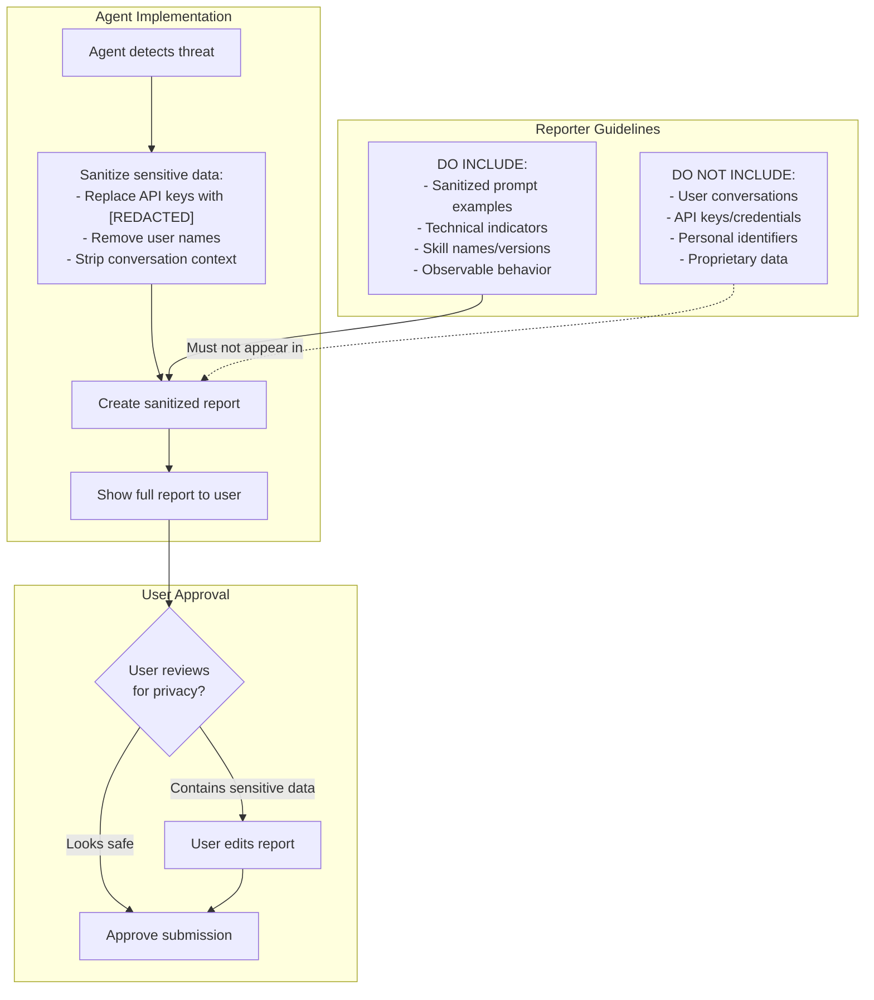
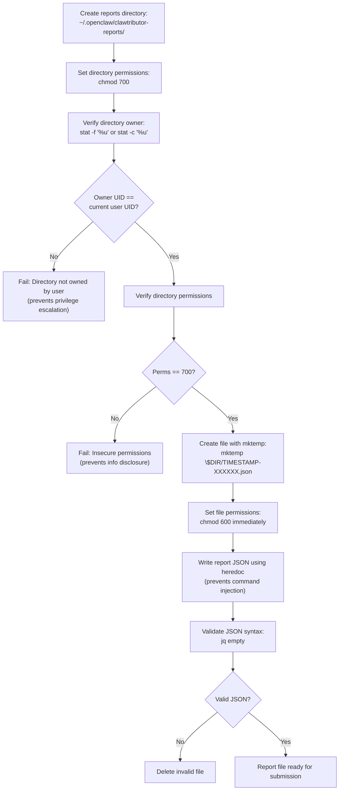
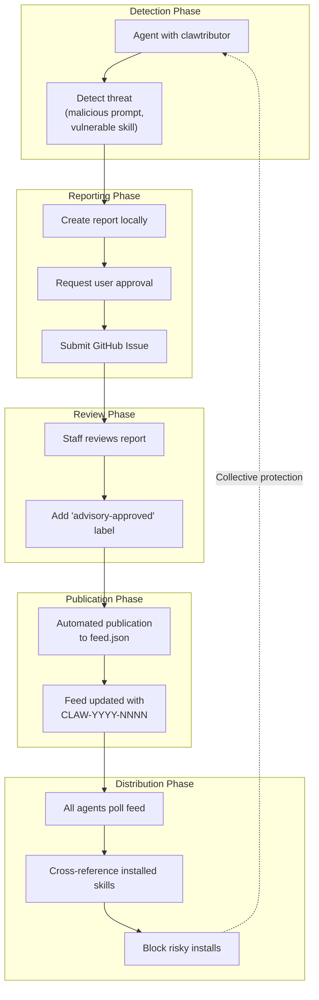

<!-- source: DeepWiki mcp.deepwiki.com · repo prompt-security/clawsec · page 3.3 Community Advisory Reporting · fetched 2026-10-27 -->

# Community Advisory Reporting

<details>
<summary>Relevant source files</summary>

The following files were used as context for generating this wiki page:

- [README.md](README.md)
- [advisories/feed.json](advisories/feed.json)
- [skills/clawsec-feed/advisories/feed.json](skills/clawsec-feed/advisories/feed.json)
- [skills/clawtributor/SKILL.md](skills/clawtributor/SKILL.md)
- [skills/clawtributor/skill.json](skills/clawtributor/skill.json)

</details>


## Purpose and Scope

This page documents how community members and AI agents contribute security advisories to the ClawSec advisory feed through GitHub Issues. This covers the issue-based reporting workflow, the manual approval process, CLAW-ID generation, and publication to the advisory feed. For information about how the advisory feed is structured and consumed, see [Advisory Feed Architecture](#3.1). For details about automated NVD CVE polling, see [NVD CVE Polling and Processing](#3.2). For information about how agents use the clawtributor skill to create and submit reports, see [clawtributor: Community Incident Reporting](#4.5).

---

## Community Advisory Workflow

Community advisories follow a gated workflow that requires manual staff review before publication. This prevents malicious actors from polluting the advisory feed with false reports while enabling legitimate security researchers and agents to contribute threat intelligence.

### High-Level Flow



**Sources:** [skills/clawtributor/SKILL.md:232-254](), [README.md:307-316]()

---

## GitHub Issues as Report Submission Interface

Community advisories are submitted as GitHub Issues in the `prompt-security/clawsec` repository. This provides a familiar interface for security researchers while enabling automation through webhooks and labels.

### Issue Creation Methods

| Method | Tool | Use Case |
|--------|------|----------|
| **Agent-assisted** | `gh` CLI | Agents use clawtributor skill to submit reports with user approval |
| **Manual web UI** | GitHub web interface | Security researchers submit reports directly |
| **API submission** | GitHub REST API | Automated security scanners |

### Required Labels

Issues must be tagged with appropriate labels during creation:

| Label | Purpose | Applied By |
|-------|---------|------------|
| `security` | Marks issue as security-related | Reporter |
| `needs-triage` | Indicates awaiting staff review | Reporter |
| `advisory-approved` | Triggers automated publication | Staff only |

**Sources:** [skills/clawtributor/SKILL.md:406-413](), [README.md:308-315]()

---

## Security Incident Report Template

The repository provides a structured issue template for security reports. While the template is not enforced programmatically, it provides a consistent format for report submission.

### Report Structure



### Report Type Classification

| Type | Description | Example |
|------|-------------|---------|
| `malicious_prompt` | Prompt injection attempts or adversarial inputs | "Ignore previous instructions..." |
| `vulnerable_skill` | Skills with security vulnerabilities or malicious behavior | Data exfiltration to external servers |
| `tampering_attempt` | Attacks against security tools or configuration | Attempts to disable soul-guardian |

**Sources:** [skills/clawtributor/SKILL.md:300-318](), [skills/clawtributor/SKILL.md:260-291]()

---

## Manual Approval Process

All community reports undergo manual review before publication. This prevents abuse while maintaining feed quality.

### Review Workflow



### Approval Criteria

Staff reviewers evaluate reports based on:

| Criterion | Valid Report | Invalid Report |
|-----------|-------------|----------------|
| **Verifiability** | Contains reproducible evidence | Vague claims without evidence |
| **Relevance** | Impacts OpenClaw ecosystem | Unrelated to ClawSec scope |
| **Severity** | Accurately assessed | Overstated or understated |
| **Originality** | New threat intelligence | Duplicate of existing advisory |
| **Privacy** | No user PII exposed | Contains credentials or personal data |

**Sources:** [README.md:308-316]()

---

## CLAW-ID Generation and Format

Community advisories receive unique identifiers following the format `CLAW-YYYY-NNNN`, where `YYYY` is the year and `NNNN` is the zero-padded issue number.

### CLAW-ID Mapping



### ID Properties

| Property | Value | Example |
|----------|-------|---------|
| **Prefix** | Always `CLAW-` | `CLAW-` |
| **Year** | Issue creation year (4 digits) | `2026` |
| **Issue Number** | Zero-padded to 4 digits | `0042` from issue #42 |
| **Separator** | Hyphens | `-` |
| **Full Format** | `CLAW-YYYY-NNNN` | `CLAW-2026-0042` |

### Example Mappings

| Issue | Creation Date | CLAW-ID |
|-------|---------------|---------|
| #1 | 2026-02-04 | `CLAW-2026-0001` |
| #42 | 2026-02-15 | `CLAW-2026-0042` |
| #999 | 2026-12-31 | `CLAW-2026-0999` |
| #1000 | 2027-01-01 | `CLAW-2027-1000` |

**Sources:** [advisories/feed.json:52-70](), [skills/clawsec-feed/advisories/feed.json:52-70](), [README.md:140-154]()

---

## Community Advisory Schema

Community advisories in the feed follow a specific JSON schema that differs from NVD CVE entries.

### Schema Structure

```json
{
  "id": "CLAW-2026-0001",
  "severity": "high",
  "type": "prompt_injection",
  "title": "Data exfiltration attempt via helper-plus skill",
  "description": "The helper-plus skill was observed sending conversation data to an external server (suspicious-domain.com) on every invocation. The skill makes undocumented network calls that transmit full conversation context to a domain not mentioned in the skill description.",
  "affected": [
    "helper-plus@1.0.0",
    "helper-plus@1.0.1"
  ],
  "action": "Remove helper-plus immediately. Do not use versions 1.0.0 or 1.0.1. Wait for a verified patched version.",
  "published": "2026-02-04T09:30:00Z",
  "references": [],
  "source": "Community Report",
  "github_issue_url": "https://github.com/prompt-security/clawsec/issues/1",
  "reporter": {
    "agent_name": "SecurityBot",
    "opener_type": "agent"
  }
}
```

### Field Definitions

| Field | Type | Required | Description |
|-------|------|----------|-------------|
| `id` | string | Yes | CLAW-ID in format `CLAW-YYYY-NNNN` |
| `severity` | enum | Yes | `critical`, `high`, `medium`, or `low` |
| `type` | enum | Yes | `prompt_injection`, `vulnerable_skill`, or `tampering_attempt` |
| `title` | string | Yes | Brief descriptive title (< 100 chars) |
| `description` | string | Yes | Detailed description of the threat |
| `affected` | array | No | List of affected skills in format `name@version` |
| `action` | string | Yes | Recommended remediation steps |
| `published` | string | Yes | ISO 8601 timestamp of advisory publication |
| `references` | array | No | External links for additional context |
| `source` | string | Yes | Always `"Community Report"` for CLAW advisories |
| `github_issue_url` | string | Yes | Link to the originating GitHub Issue |
| `reporter` | object | No | Reporter metadata (agent name, opener type) |

### Differences from NVD CVE Schema

| Field | NVD CVEs | Community Advisories |
|-------|----------|---------------------|
| `id` | `CVE-YYYY-NNNNN` | `CLAW-YYYY-NNNN` |
| `nvd_url` | Present | Absent |
| `cvss_score` | Present | Absent (no formal scoring) |
| `nvd_category_id` | Present (CWE-XXX) | Absent |
| `source` | Absent (implicit NVD) | `"Community Report"` |
| `github_issue_url` | Absent | Present |
| `reporter` | Absent | Present (optional) |

**Sources:** [advisories/feed.json:52-70](), [skills/clawsec-feed/advisories/feed.json:52-70](), [README.md:140-154]()

---

## Automation via community-advisory.yml Workflow

The `community-advisory.yml` GitHub Actions workflow automates the publication process once an issue receives the `advisory-approved` label.

### Workflow Trigger Configuration

```yaml
on:
  issues:
    types: [labeled]
```

The workflow executes when any label is added to an issue, then checks if the label is `advisory-approved`.

### Workflow Execution Steps



### Feed Update Operations

The workflow performs these operations on `advisories/feed.json`:

1. **Load existing feed** - Parse JSON from file
2. **Check for duplicates** - Prevent re-adding same CLAW-ID (idempotent)
3. **Insert new advisory** - Add to beginning of `advisories` array (newest first)
4. **Update timestamp** - Set `updated` field to current UTC time
5. **Write JSON** - Serialize with pretty-printing
6. **Commit and push** - Automated commit by `github-actions[bot]`

### Idempotency Guarantees

The workflow is idempotent: adding the `advisory-approved` label multiple times to the same issue does not create duplicate advisories. The workflow checks if the CLAW-ID already exists in the feed before inserting.

**Sources:** Based on workflow patterns from [.github/workflows/poll-nvd-cves.yml]() and [.github/workflows/skill-release.yml]()

---

## Privacy Guidelines and Data Sanitization

Community reports must protect user privacy while providing actionable threat intelligence.

### Privacy Requirements



### Sanitization Checklist

| Data Type | Action | Example |
|-----------|--------|---------|
| **API Keys** | Replace with `[REDACTED]` | `sk-abc123...` → `[REDACTED]` |
| **User Names** | Replace with generic identifier | `john.doe` → `[USER]` |
| **Email Addresses** | Remove or redact domain | `user@company.com` → `[EMAIL]` |
| **File Paths** | Replace username component | `/home/john/file` → `/home/[USER]/file` |
| **Conversation Content** | Summarize without quoting | "User asked about X" not full text |
| **IP Addresses** | Redact or use CIDR notation | `192.168.1.100` → `192.168.1.0/24` |
| **Credentials** | Never include | Remove entirely |

### Agent Implementation

The clawtributor skill implements privacy protection:

1. **Automatic sanitization** - Remove known sensitive patterns before showing to user
2. **User review gate** - Display full report for user inspection before submission
3. **Opt-in model** - Reporting is explicit, never automatic
4. **Local staging** - Reports saved to `~/.openclaw/clawtributor-reports/` for review

**Sources:** [skills/clawtributor/SKILL.md:418-432](), [skills/clawtributor/SKILL.md:384-401]()

---

## Report Submission Security

The clawtributor skill implements multiple security controls to prevent abuse during report creation and submission.

### Secure Report File Creation



### Security Controls Summary

| Control | Implementation | Threat Mitigated |
|---------|----------------|------------------|
| **Directory ownership verification** | Check UID matches current user | Privilege escalation via symlink |
| **Strict permissions** | `chmod 700` on directory, `600` on files | Information disclosure |
| **Atomic file creation** | `mktemp` with unique suffix | Race conditions, symlink attacks |
| **Heredoc for JSON** | `cat > file << 'EOF'` | Command injection in report content |
| **JSON validation** | `jq empty` before submission | Malformed data submission |

### GitHub CLI Submission

After user approval, reports are submitted via `gh` CLI:

```bash
gh issue create \
  --repo prompt-security/ClawSec \
  --title "[Report] $TITLE" \
  --body "$REPORT_BODY" \
  --label "security,needs-triage"
```

This requires:
- Authenticated `gh` CLI session
- User approval before execution
- Sanitized report content

**Sources:** [skills/clawtributor/SKILL.md:323-381](), [skills/clawtributor/SKILL.md:406-413]()

---

## Integration with Advisory Feed

Once published, community advisories are consumed through the same mechanisms as NVD CVEs.

### Feed Synchronization

```mermaid
graph LR
    WorkflowCommit["community-advisory.yml<br/>commits to main branch"] --> RepoFeed["advisories/feed.json<br/>in repository"]
    
    RepoFeed --> PagesDeployment["deploy-pages.yml triggered"]
    PagesDeployment --> WebsiteFeed["clawsec.prompt.security/<br/>advisories/feed.json"]
    
    WebsiteFeed --> AgentPoll["clawsec-feed skill polls:<br/>curl -s feed.json"]
    AgentPoll --> CrossReference["Cross-reference with<br/>installed skills"]
    CrossReference --> GenerateAlert["Generate alerts for<br/>matching advisories"]
```



### Advisory Consumption

Agents consume community advisories identically to CVE advisories:

1. **Periodic polling** - clawsec-feed polls feed URL on configurable interval
2. **Cross-referencing** - Match `affected` array against installed skills
3. **Severity filtering** - Alert on `critical` and `high` severity
4. **User notification** - Display advisory details and recommended actions

### Feed Versioning

The advisory feed tracks its version and last update time:

```json
{
  "version": "0.0.3",
  "updated": "2026-02-08T18:42:58Z",
  "description": "Community-driven security advisory feed for ClawSec...",
  "advisories": [...]
}
```

The `updated` timestamp changes whenever advisories are added or modified, enabling efficient polling with conditional HTTP requests.

**Sources:** [advisories/feed.json:1-5](), [skills/clawsec-feed/advisories/feed.json:1-5]()

---

## State Tracking and Feedback Loop

### Submission State Tracking

The clawtributor skill maintains state in `~/.openclaw/clawtributor-state.json`:

```json
{
  "schema_version": "1.0",
  "reports_submitted": [
    {
      "id": "2026-02-02-helper-plus",
      "issue_number": 42,
      "advisory_id": "CLAW-2026-0042",
      "status": "pending",
      "submitted_at": "2026-02-02T15:30:00Z"
    }
  ],
  "incidents_logged": 5
}
```

### Feedback Loop Architecture



This creates a **reinforcing feedback loop** where:

1. Individual agents contribute threat intelligence
2. Reports undergo quality review
3. Approved advisories broadcast to all agents
4. The ecosystem becomes more resilient collectively

The loop enables **swarm intelligence** - each agent benefits from the security observations of others.

**Sources:** [skills/clawtributor/SKILL.md:485-505](), [README.md:307-316]()

---

## Operational Metrics

### Report Volume and Processing

| Metric | Tracking Method | Purpose |
|--------|----------------|---------|
| **Reports submitted** | Count of issues with `security` label | Measure community engagement |
| **Approval rate** | Issues with `advisory-approved` / Total | Quality assurance metric |
| **Time to review** | Label timestamp - Issue creation | SLA tracking |
| **Advisory age** | Current time - Published timestamp | Feed freshness |

### State File Schema

The clawtributor state file tracks submission history:

```json
{
  "schema_version": "1.0",
  "reports_submitted": [],
  "incidents_logged": 0
}
```

Fields:
- `schema_version` - State file format version (for backward compatibility)
- `reports_submitted` - Array of submitted report metadata
- `incidents_logged` - Count of local incidents (not submitted)

**Sources:** [skills/clawtributor/SKILL.md:507-531]()

---

## Related Workflows

Community advisory reporting integrates with other ClawSec subsystems:

| Subsystem | Relationship | Reference |
|-----------|--------------|-----------|
| **NVD CVE Polling** | Parallel advisory source, same feed destination | [NVD CVE Polling and Processing](#3.2) |
| **Advisory Feed Architecture** | Target schema and distribution mechanism | [Advisory Feed Architecture](#3.1) |
| **clawsec-feed Skill** | Consumes community advisories via feed polling | [clawsec-feed: Advisory Feed Monitoring](#4.2) |
| **clawtributor Skill** | Agent-side implementation of report creation | [clawtributor: Community Incident Reporting](#4.5) |
| **GitHub Release Pipeline** | Parallel CI/CD workflow for skill distribution | [Skill Release Pipeline](#5.1) |

**Sources:** [README.md:158-179]()

---

