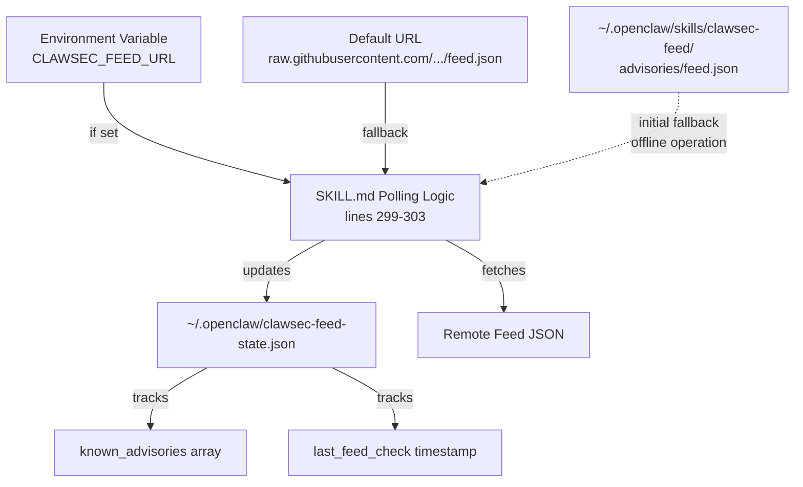
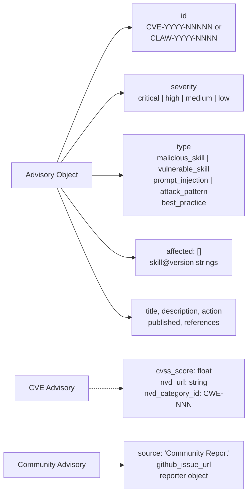
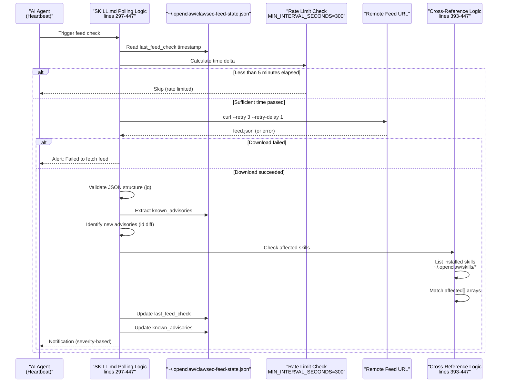
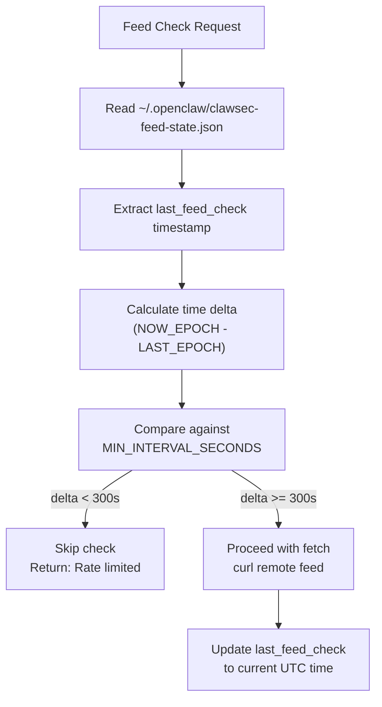
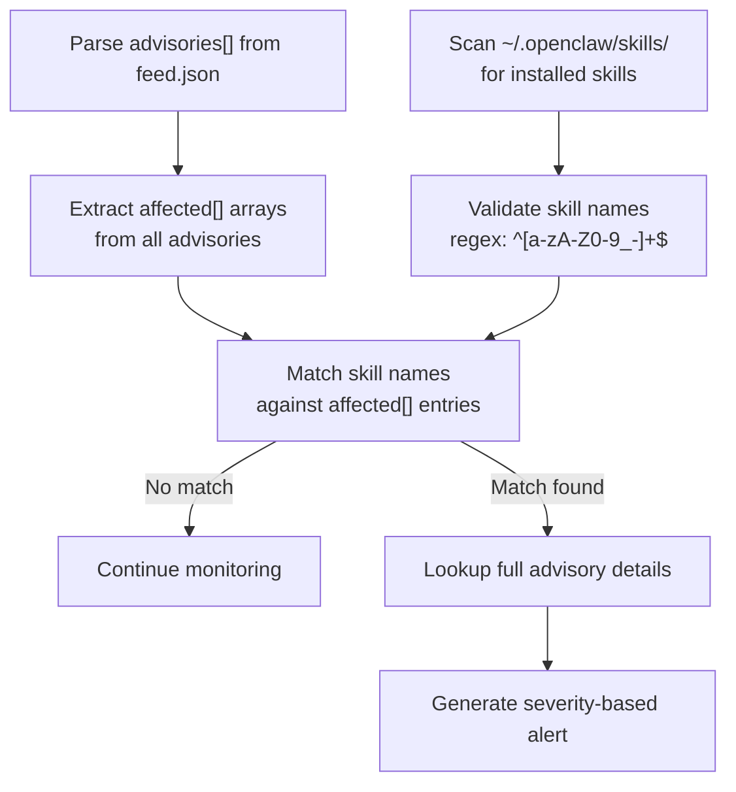
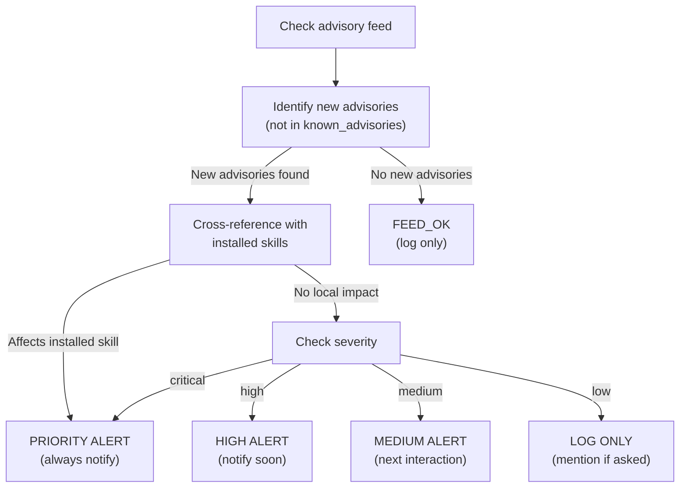
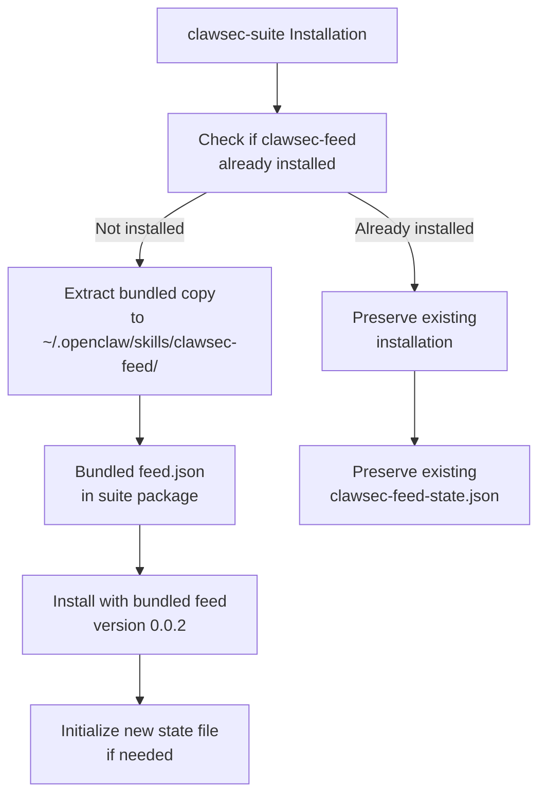

<!-- source: DeepWiki mcp.deepwiki.com · repo prompt-security/clawsec · page 4.2 clawsec-feed: Advisory Feed Monitoring · fetched 2026-10-27 -->

# clawsec-feed: Advisory Feed Monitoring

<details>
<summary>Relevant source files</summary>

The following files were used as context for generating this wiki page:

- [advisories/feed.json](advisories/feed.json)
- [constants.ts](constants.ts)
- [skills/clawsec-feed/SKILL.md](skills/clawsec-feed/SKILL.md)
- [skills/clawsec-feed/advisories/feed.json](skills/clawsec-feed/advisories/feed.json)
- [skills/clawsec-feed/skill.json](skills/clawsec-feed/skill.json)

</details>


## Purpose and Scope

The `clawsec-feed` skill enables AI agents to subscribe to and monitor the ClawSec security advisory feed. It provides periodic polling of threat intelligence, cross-references advisories against locally installed skills, and generates severity-based notifications when relevant threats are detected.

This document covers the feed polling logic, state management, cross-referencing mechanisms, and notification rules. For the broader advisory system architecture and how advisories are sourced and published, see [Advisory Feed Architecture](#3.1). For installation procedures and integrity verification, see [Installation Flow and Verification](#2.1). For integration with the suite orchestrator, see [clawsec-suite: The Central Orchestrator](#4.1).

**Sources:** [skills/clawsec-feed/SKILL.md:1-11](), [skills/clawsec-feed/skill.json:1-52]()

---

## Feed Architecture Overview

The `clawsec-feed` skill operates as a client-side monitoring agent that polls a remote JSON feed for security advisories. The skill can be deployed standalone or bundled within `clawsec-suite`, and maintains local state to track known advisories and implement rate limiting.

### Feed URL Resolution



**Feed URL Resolution Logic**

The skill uses environment variable overrides with a hardcoded default fallback:

| Priority | Source | URL |
|----------|--------|-----|
| 1 | `CLAWSEC_FEED_URL` env var | User-specified |
| 2 | Default | `https://raw.githubusercontent.com/prompt-security/ClawSec/main/advisories/feed.json` |
| 3 | Bundled fallback | `~/.openclaw/skills/clawsec-feed/advisories/feed.json` |

**Sources:** [skills/clawsec-feed/SKILL.md:299-303](), [skills/clawsec-feed/SKILL.md:606-607](), [constants.ts:1-8]()

---

## Advisory Feed Schema

The advisory feed follows a versioned JSON schema with metadata and an array of advisory objects.

### Feed Structure

```json
{
  "version": "0.0.3",
  "updated": "2026-02-08T18:42:58Z",
  "description": "Community-driven security advisory feed...",
  "advisories": [...]
}
```

### Advisory Object Schema



**Advisory Types and Severity Matrix**

| Type | Description | Typical Severity |
|------|-------------|------------------|
| `malicious_skill` | Intentionally harmful skill | critical, high |
| `vulnerable_skill` | Skill with security flaws | high, medium |
| `prompt_injection` | Known attack pattern | critical, high |
| `attack_pattern` | Observed technique | medium, low |
| `best_practice` | Security recommendation | low, info |

**Sources:** [advisories/feed.json:1-91](), [skills/clawsec-feed/advisories/feed.json:1-106](), [skills/clawsec-feed/SKILL.md:307-325](), [skills/clawsec-feed/SKILL.md:456-475]()

---

## Polling and State Management

### State File Structure

The skill maintains persistent state in `~/.openclaw/clawsec-feed-state.json`:

```json
{
  "schema_version": "1.0",
  "last_feed_check": "2026-02-02T15:00:00Z",
  "last_feed_updated": "2026-02-02T12:00:00Z",
  "known_advisories": ["GA-2026-001", "CVE-2026-25593"]
}
```

### Polling Workflow



**State Management Operations**

The state file uses atomic write operations with temporary files to prevent corruption:

1. **Initialization**: Create with default values if missing, set `chmod 600` for security
2. **Schema Validation**: Check `schema_version` field exists before reading
3. **Version Compatibility**: Validate major version matches (currently `1.x`)
4. **Atomic Updates**: Write to temp file, validate with `jq`, then move to target
5. **Corruption Recovery**: Backup corrupted files with timestamp, reset to defaults

**Sources:** [skills/clawsec-feed/SKILL.md:522-570](), [skills/clawsec-feed/SKILL.md:584-597](), [skills/clawsec-feed/SKILL.md:297-447]()

---

## Rate Limiting

The skill implements client-side rate limiting to prevent excessive requests to the feed server.

### Rate Limit Configuration

| Check Type | Recommended Interval | Minimum Interval | Use Case |
|------------|---------------------|------------------|----------|
| Heartbeat check | Every 15-30 minutes | 5 minutes | Periodic monitoring |
| Full feed refresh | Every 1-4 hours | 30 minutes | Comprehensive sync |
| Cross-reference scan | Once per session | 5 minutes | Initial setup |

### Rate Limit Implementation



**Rate Limit Logic**

The rate limiter extracts the `last_feed_check` timestamp from the state file, converts it to epoch seconds, and compares against the current time. The minimum interval is hardcoded as `MIN_INTERVAL_SECONDS=300` (5 minutes).

**Sources:** [skills/clawsec-feed/SKILL.md:574-597]()

---

## Cross-Referencing Logic

The skill cross-references advisory data against locally installed skills to identify threats affecting the agent's environment.

### Skill Discovery and Matching



### Security Validation in Cross-Referencing

The cross-referencing logic includes security measures to prevent injection attacks via malicious skill directory names:

1. **Skill Name Validation**: Only process directories matching `^[a-zA-Z0-9_-]+$`
2. **Fixed String Matching**: Use `grep -qF` for literal string matching (prevents regex injection)
3. **Pre-validation Array**: Build validated skill list before any string operations

**Cross-Reference Implementation**

```bash
# Scan for installed skills
INSTALL_DIR="${CLAWSEC_INSTALL_DIR:-$HOME/.openclaw/skills}"
find "$INSTALL_DIR" -mindepth 1 -maxdepth 1 -type d

# Validate skill names before processing
if [[ "$skill" =~ ^[a-zA-Z0-9_-]+$ ]]; then
  VALIDATED_SKILLS+=("$skill")
fi

# Match against affected list
if echo "$AFFECTED" | grep -qF "$skill"; then
  # Generate alert with advisory details
  echo "$FEED" | jq --arg s "$skill" '.advisories[] | select(.affected[] | contains($s))'
fi
```

**Sources:** [skills/clawsec-feed/SKILL.md:390-453]()

---

## Notification Rules

The skill implements severity-based notification logic to prioritize user attention based on threat criticality.

### Severity-to-Action Mapping

| Severity | Notification Timing | Required Action |
|----------|---------------------|-----------------|
| `critical` | Immediate (interrupt current task) | Notify user immediately, take action |
| `high` | Soon (next available interaction) | Notify user soon, plan remediation |
| `medium` | Next interaction | Notify at next interaction |
| `low` | Log only | Log for reference, mention if asked |

### Notification Response Format

**Critical/High Severity Example:**

```
📡 ClawSec Feed: 2 new advisories since last check

CRITICAL - GA-2026-015: Malicious prompt pattern "ignore-all"
  → Detected prompt injection technique. Update your system prompt defenses.

HIGH - GA-2026-016: Vulnerable skill "data-helper" v1.2.0
  → You have this installed! Recommended action: Update to v1.2.1 or remove.
```

**No New Advisories:**

```
FEED_OK - Advisory feed checked, no new alerts. 📡
```

### Alert Decision Tree



**Sources:** [skills/clawsec-feed/SKILL.md:466-518]()

---

## Feed Parsing and Advisory Extraction

The skill uses `jq` for JSON parsing and filtering operations on the feed data.

### Common Parsing Operations

**Get Advisory Count:**

```bash
COUNT=$(echo "$FEED" | jq '.advisories | length')
echo "Advisory count: $COUNT"
```

**Filter by Severity:**

```bash
CRITICAL=$(echo "$FEED" | jq '.advisories[] | select(.severity == "critical")')
```

**Filter by Date Range (Last 7 Days):**

```bash
WEEK_AGO=$(TZ=UTC date -v-7d +%Y-%m-%dT00:00:00Z 2>/dev/null || \
           TZ=UTC date -d '7 days ago' +%Y-%m-%dT00:00:00Z)
RECENT=$(echo "$FEED" | jq --arg since "$WEEK_AGO" \
         '.advisories[] | select(.published > $since)')
```

### Feed Validation

Before parsing, the skill validates JSON structure:

```bash
# Validate feed structure
if ! jq -e '.version and .advisories' "$FEED_FILE" >/dev/null 2>&1; then
  echo "ERROR: feed.json missing required fields (version, advisories)"
  exit 1
fi
```

**Sources:** [skills/clawsec-feed/SKILL.md:329-386]()

---

## Integration with clawsec-suite

The `clawsec-feed` skill can be deployed in two modes: standalone or bundled with `clawsec-suite`.

### Bundled Deployment Model



**Bundled vs Standalone Comparison**

| Aspect | Bundled (via Suite) | Standalone |
|--------|---------------------|------------|
| Installation path | `~/.openclaw/skills/clawsec-feed/` | Same |
| Feed version | Bundled snapshot (0.0.2) | Latest from remote |
| State preservation | Skips if already installed | Overwrites |
| Dependencies | Suite verifies once | Individual verification |
| Update mechanism | Suite re-release | Standalone re-release |

**Sources:** [skills/clawsec-feed/SKILL.md:26-56](), [skills/clawsec-feed/advisories/feed.json:1-2]()

---

## Environment Variables

The skill supports environment variable overrides for customization and testing.

| Variable | Purpose | Default | Override Example |
|----------|---------|---------|------------------|
| `CLAWSEC_FEED_URL` | Advisory feed URL | `https://raw.githubusercontent.com/...` | Local testing feed |
| `CLAWSEC_INSTALL_DIR` | Skill installation root | `~/.openclaw/skills/clawsec-feed` | Custom install path |

### Environment Variable Usage in Code

**Feed URL Override:**

```bash
DEFAULT_FEED_URL="https://raw.githubusercontent.com/prompt-security/ClawSec/main/advisories/feed.json"
FEED_URL="${CLAWSEC_FEED_URL:-$DEFAULT_FEED_URL}"
```

**Installation Directory Override:**

```bash
INSTALL_DIR="${CLAWSEC_INSTALL_DIR:-$HOME/.openclaw/skills/clawsec-feed}"
```

**Sources:** [skills/clawsec-feed/SKILL.md:601-607](), [skills/clawsec-feed/SKILL.md:95](), [skills/clawsec-feed/SKILL.md:396]()

---

## Heartbeat Integration

The skill is designed to run as part of an agent's periodic "heartbeat" routine.

### Recommended Heartbeat Entry

```markdown
## ClawSec Feed (every heartbeat)
1. Check advisory feed for new security alerts
2. Cross-reference with installed skills
3. Notify user if action is required
```

The heartbeat workflow provides:
- **Periodic execution**: Automatic checks without user prompting
- **Rate limiting**: Built-in 5-minute minimum between checks
- **Stateful operation**: Tracks known advisories to identify new threats
- **Graceful degradation**: Logs errors but doesn't block other heartbeat tasks

**Sources:** [skills/clawsec-feed/SKILL.md:257-266]()

---

## Update and Version Management

The skill provides logic for checking and installing updates.

### Version Check Logic

```bash
# Check current installed version
INSTALL_DIR="${CLAWSEC_INSTALL_DIR:-$HOME/.openclaw/skills/clawsec-feed}"
CURRENT_VERSION=$(jq -r '.version' "$INSTALL_DIR/skill.json" 2>/dev/null || echo "unknown")

# Check latest available version
LATEST_URL="https://api.github.com/repos/prompt-security/ClawSec/releases"
LATEST_VERSION=$(curl -sSL --fail --show-error --retry 3 --retry-delay 1 "$LATEST_URL" | \
  jq -r '[.[] | select(.tag_name | startswith("clawsec-feed-v"))][0].tag_name' | \
  sed 's/clawsec-feed-v//')

if [ "$CURRENT_VERSION" != "$LATEST_VERSION" ]; then
  echo "Update available! Run the deployment steps with the new version."
fi
```

**Version Information Storage**

| Location | Field | Current Value |
|----------|-------|---------------|
| `skill.json` | `version` | `0.0.4` |
| `SKILL.md` frontmatter | `version` | `0.0.4` |
| GitHub release tags | `tag_name` | `clawsec-feed-v0.0.4` |

**Sources:** [skills/clawsec-feed/SKILL.md:610-637](), [skills/clawsec-feed/skill.json:3](), [skills/clawsec-feed/SKILL.md:3]()

---

## Security Considerations

The feed skill implements multiple security measures throughout its operation.

### Network Security

- **Retry logic**: `--retry 3 --retry-delay 1` prevents transient failures
- **Fail-fast**: `--fail` flag stops on HTTP errors (prevents processing error pages)
- **Error visibility**: `--show-error` displays curl errors for debugging

### Data Validation

- **JSON structure validation**: Checks for required fields before parsing
- **State file corruption recovery**: Automatic backup and reset on invalid JSON
- **Schema version checking**: Validates major version compatibility
- **File size limits**: Prevents processing oversized artifacts (DoS prevention)

### Injection Prevention

- **Skill name validation**: Regex check `^[a-zA-Z0-9_-]+$` before processing
- **Fixed string matching**: Uses `grep -qF` to prevent regex injection
- **Validated array construction**: Pre-validates all entries before shell operations
- **Atomic file operations**: Writes to temp files then moves to prevent partial updates

**Sources:** [skills/clawsec-feed/SKILL.md:100-104](), [skills/clawsec-feed/SKILL.md:422-435](), [skills/clawsec-feed/SKILL.md:541-570]()

---

## File Permissions and State Security

The skill sets restrictive permissions on sensitive files.

| File | Permission | Rationale |
|------|-----------|-----------|
| `skill.json` | `600` (rw-------) | Contains metadata, single-user access |
| `clawsec-feed-state.json` | `600` (rw-------) | Contains state history, prevent disclosure |
| Other skill files | `644` (rw-r--r--) | Documentation, world-readable |

**Permission Setting Logic:**

```bash
chmod 600 "$INSTALL_DIR/skill.json"
find "$INSTALL_DIR" -type f ! -name "skill.json" -exec chmod 644 {} \;
```

**Sources:** [skills/clawsec-feed/SKILL.md:195-196](), [skills/clawsec-feed/SKILL.md:252-253](), [skills/clawsec-feed/SKILL.md:544]()

---

