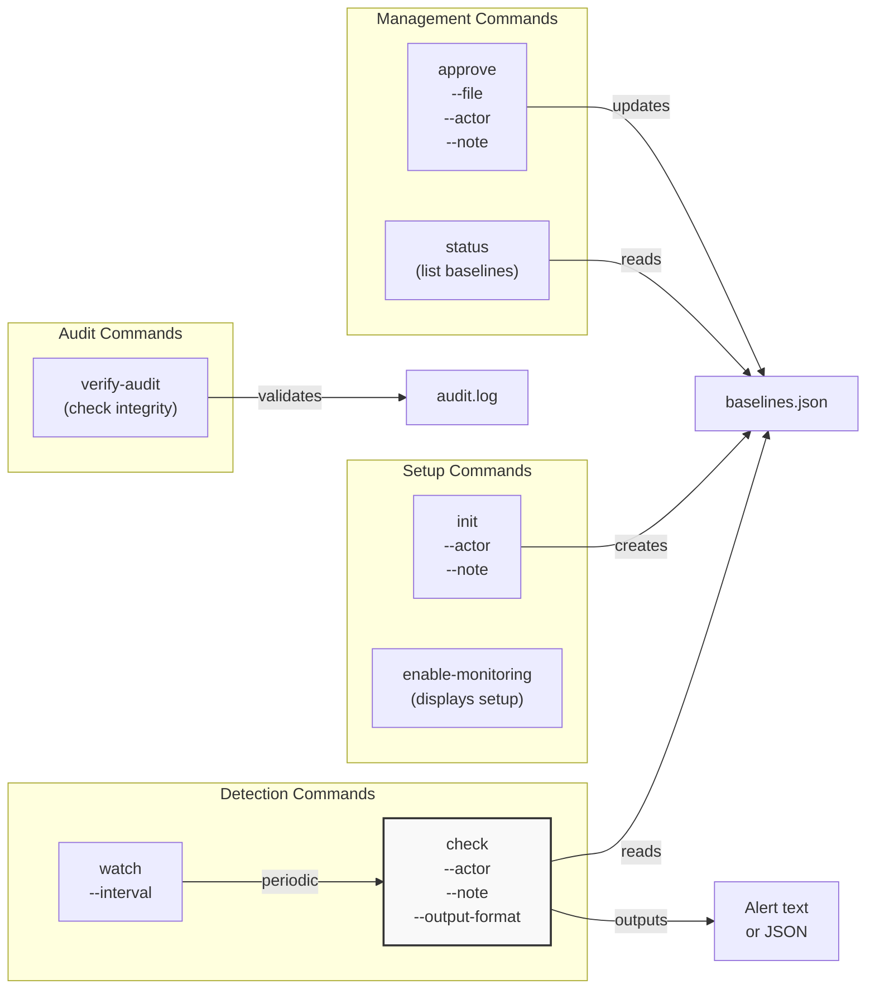

<!-- source: DeepWiki mcp.deepwiki.com · repo prompt-security/clawsec · page 4.3 soul-guardian: Drift Detection and File Integrity · fetched 2026-10-27 -->

# soul-guardian: Drift Detection and File Integrity

<details>
<summary>Relevant source files</summary>

The following files were used as context for generating this wiki page:

- [README.md](README.md)
- [skills/soul-guardian/SKILL.md](skills/soul-guardian/SKILL.md)
- [skills/soul-guardian/scripts/install_launchd_plist.py](skills/soul-guardian/scripts/install_launchd_plist.py)

</details>


## Purpose and Scope

This document describes the **soul-guardian** skill, which provides drift detection and file integrity monitoring for AI agent workspace files. Soul-guardian maintains SHA-256 baselines of critical configuration files (SOUL.md, AGENTS.md, etc.), detects unauthorized modifications, and implements graduated response policies (auto-restore, alert-only, or ignore).

For information about baseline creation and drift detection algorithms, see [Baseline Management and Drift Detection](#4.3.1). For information about automated periodic monitoring using macOS launchd, see [macOS launchd Integration](#4.3.2). For information about the suite-level orchestration and installation, see [clawsec-suite: The Central Orchestrator](#4.1).

**Sources:** [skills/soul-guardian/SKILL.md:1-13](), [README.md:86]()

---

## Skill Overview

Soul-guardian is an **optional** skill in the ClawSec suite designed for agents that require file integrity protection. Unlike `clawsec-feed` (universal installation) or `openclaw-audit-watchdog` (family-specific), soul-guardian is installed only when explicitly requested or when the agent determines it needs drift protection.

**Key Capabilities:**
- **Drift Detection** - Monitors workspace files using SHA-256 hash baselines
- **Graduated Response** - Auto-restore critical files (SOUL.md, AGENTS.md), alert-only for others
- **Audit Trail** - Maintains tamper-evident audit log with hash chaining
- **Patch Generation** - Creates unified diffs for manual review
- **Alert Integration** - Produces user-facing alerts for heartbeat workflows

**Sources:** [skills/soul-guardian/SKILL.md:1-6](), [README.md:86]()

---

## System Architecture

```mermaid
graph TB
    subgraph "Agent Workspace"
        SOUL["SOUL.md<br/>(restore mode)"]
        AGENTS["AGENTS.md<br/>(restore mode)"]
        USER["USER.md<br/>(alert mode)"]
        TOOLS["TOOLS.md<br/>(alert mode)"]
        IDENTITY["IDENTITY.md<br/>(alert mode)"]
        HEARTBEAT["HEARTBEAT.md<br/>(alert mode)"]
        MEMORY["MEMORY.md<br/>(alert mode)"]
        MemoryFiles["memory/*.md<br/>(ignore mode)"]
    end
    
    subgraph "soul_guardian.py Script"
        InitCmd["init command<br/>Create baselines"]
        CheckCmd["check command<br/>Detect drift"]
        ApproveCmd["approve command<br/>Update baseline"]
        StatusCmd["status command<br/>View baselines"]
        WatchCmd["watch command<br/>Continuous monitoring"]
        VerifyCmd["verify-audit command<br/>Audit log integrity"]
        EnableCmd["enable-monitoring command<br/>Setup instructions"]
    end
    
    subgraph "State Directory"
        Baselines["baselines.json<br/>SHA-256 hashes"]
        Policy["policy.json<br/>File modes"]
        AuditLog["audit.log<br/>Chained events"]
        Patches["patches/<br/>Unified diffs"]
    end
    
    subgraph "Integration Points"
        HeartbeatFlow["HEARTBEAT.md<br/>Periodic check"]
        LaunchdPlist["launchd plist<br/>macOS automation"]
        AlertOutput["Alert output<br/>--output-format alert"]
    end
    
    InitCmd -->|"scan + hash"| SOUL
    InitCmd -->|"scan + hash"| AGENTS
    InitCmd -->|"scan + hash"| USER
    InitCmd -->|"write"| Baselines
    InitCmd -->|"write"| Policy
    InitCmd -->|"append"| AuditLog
    
    CheckCmd -->|"read current"| SOUL
    CheckCmd -->|"read current"| AGENTS
    CheckCmd -->|"compare"| Baselines
    CheckCmd -->|"on drift"| Patches
    CheckCmd -->|"restore mode"| SOUL
    CheckCmd -->|"restore mode"| AGENTS
    CheckCmd -->|"alert mode"| USER
    CheckCmd -->|"ignore mode"| MemoryFiles
    CheckCmd -->|"output"| AlertOutput
    
    ApproveCmd -->|"update"| Baselines
    ApproveCmd -->|"append"| AuditLog
    
    StatusCmd -->|"read"| Baselines
    StatusCmd -->|"read"| Policy
    
    WatchCmd -->|"periodic"| CheckCmd
    
    VerifyCmd -->|"verify chain"| AuditLog
    
    HeartbeatFlow -->|"invoke"| CheckCmd
    LaunchdPlist -->|"invoke"| CheckCmd
    
    style CheckCmd fill:#f9f9f9,stroke:#333,stroke-width:2px
    style Baselines fill:#f9f9f9,stroke:#333,stroke-width:2px
    style AlertOutput fill:#f9f9f9,stroke:#333,stroke-width:2px
```



**Diagram:** Soul-guardian system architecture showing the main script (`soul_guardian.py`), its commands, protected workspace files, state directory components, and integration points.

**Sources:** [skills/soul-guardian/SKILL.md:13-91](), [skills/soul-guardian/scripts/soul_guardian.py]()

---

## Protection Policy

Soul-guardian implements a **graduated response policy** based on file criticality. The policy is defined in `policy.json` within the state directory and maps each protected file to one of three modes:

| File | Mode | Behavior on Drift |
|------|------|-------------------|
| `SOUL.md` | `restore` | Auto-restore to baseline + generate alert |
| `AGENTS.md` | `restore` | Auto-restore to baseline + generate alert |
| `USER.md` | `alert` | Generate alert only, no auto-restore |
| `TOOLS.md` | `alert` | Generate alert only, no auto-restore |
| `IDENTITY.md` | `alert` | Generate alert only, no auto-restore |
| `HEARTBEAT.md` | `alert` | Generate alert only, no auto-restore |
| `MEMORY.md` | `alert` | Generate alert only, no auto-restore |
| `memory/*.md` | `ignore` | No action (memory files expected to change) |

**Mode Semantics:**
- **restore** - Critical identity/instruction files that must not drift without approval. On drift: (1) generate unified diff patch, (2) restore file from baseline, (3) produce alert, (4) log to audit trail.
- **alert** - Important files where changes should be reviewed but not automatically reverted. On drift: (1) generate unified diff patch, (2) produce alert, (3) log to audit trail.
- **ignore** - Transient files expected to change frequently (e.g., memory, logs). No drift detection performed.

**Sources:** [skills/soul-guardian/SKILL.md:48-60]()

---

## Command Interface

The `soul_guardian.py` script provides a command-line interface for all drift detection operations. The script is located at [skills/soul-guardian/scripts/soul_guardian.py]().

### Command Reference



**Diagram:** Command structure of `soul_guardian.py` showing setup, detection, management, and audit operations.

### Command Details

**`init`** - Initialize baselines for protected files
```bash
python3 soul_guardian.py init --actor setup --note "initial baseline"
```
- Scans workspace for protected files
- Computes SHA-256 hashes
- Writes `baselines.json` and `policy.json`
- Creates initial audit log entry

**`check`** - Detect drift and apply policy
```bash
python3 soul_guardian.py check --actor heartbeat --output-format alert
```
- Compares current file hashes against baselines
- Applies policy (restore/alert/ignore)
- Generates unified diffs for changed files
- Produces alert output if drift detected
- **Silent on success** (exit code 0, no output)
- **Exits 2 on drift** with alert output

**`watch`** - Continuous monitoring mode
```bash
python3 soul_guardian.py watch --interval 30
```
- Runs `check` command in a loop
- Sleeps for specified interval between checks
- Useful for interactive terminal monitoring

**`approve`** - Approve intentional changes
```bash
python3 soul_guardian.py approve --file SOUL.md --actor user --note "authorized update"
```
- Updates baseline hash for specified file
- Logs approval event to audit trail
- Used after intentional modifications

**`status`** - Display current baselines
```bash
python3 soul_guardian.py status
```
- Lists all protected files and their baseline hashes
- Shows policy mode for each file
- Displays last check timestamp

**`verify-audit`** - Validate audit log integrity
```bash
python3 soul_guardian.py verify-audit
```
- Validates hash chain in audit log
- Detects tampering attempts
- Ensures audit trail completeness

**`enable-monitoring`** - Display integration instructions
```bash
python3 soul_guardian.py enable-monitoring
```
- Shows how to add monitoring to HEARTBEAT.md
- Displays launchd setup instructions (macOS)
- Provides cron examples (Linux)

**Sources:** [skills/soul-guardian/SKILL.md:61-91]()

---

## Workflow Integration

Soul-guardian is designed to integrate seamlessly with agent heartbeat workflows and automated scheduling systems.

### Heartbeat Integration

The recommended integration method is to add a drift check to the agent's `HEARTBEAT.md` procedure:

```markdown
## Soul Guardian Check
- Run `python3 skills/soul-guardian/scripts/soul_guardian.py check --actor heartbeat --output-format alert`
- If any output is produced, relay it to the user immediately as a security alert
```

This integration pattern leverages the **silent-on-success** behavior: the `check` command produces no output (exit code 0) when no drift is detected, making it safe to run frequently without spam. Only when drift occurs does it produce output that should be relayed to the user.

**Sources:** [skills/soul-guardian/SKILL.md:32-39]()

### macOS launchd Integration

For macOS systems, soul-guardian provides automated periodic checks via launchd. The [skills/soul-guardian/scripts/install_launchd_plist.py]() script generates and installs a launchd property list that runs drift checks at specified intervals.

**Example:**
```bash
python3 skills/soul-guardian/scripts/install_launchd_plist.py \
  --workspace-root ~/.openclaw/workspace \
  --interval-seconds 600 \
  --install
```

This creates a launchd job with:
- **Label:** `com.clawdbot.soul-guardian.<agentId>` [skills/soul-guardian/scripts/install_launchd_plist.py:89]()
- **Program:** `soul_guardian.py check` [skills/soul-guardian/scripts/install_launchd_plist.py:102-112]()
- **Interval:** 600 seconds (10 minutes) by default [skills/soul-guardian/scripts/install_launchd_plist.py:66-68]()
- **Logs:** Written to `~/.clawdbot/soul-guardian/<agentId>/logs/` [skills/soul-guardian/scripts/install_launchd_plist.py:96-100]()

For detailed information about launchd integration, see [macOS launchd Integration](#4.3.2).

**Sources:** [skills/soul-guardian/scripts/install_launchd_plist.py:1-169]()

---

## Alert Format and Output

Soul-guardian produces structured alerts when drift is detected. The `--output-format` flag controls alert formatting:

### Alert Format (Default)

When `--output-format alert` is specified, the output is human-readable and designed for direct relay to users:

```
==================================================
🚨 SOUL GUARDIAN SECURITY ALERT
==================================================

📄 FILE: SOUL.md
   Mode: restore
   Status: ✅ RESTORED to approved baseline
   Expected hash: abc123def456...
   Found hash:    789xyz000111...
   Diff saved: /path/to/patches/drift.patch

==================================================
Review changes and investigate the source of drift.
If intentional, run: soul_guardian.py approve --file <path>
==================================================
```

This format includes:
- **File path** - Which file drifted
- **Mode** - Policy mode (restore/alert/ignore)
- **Status** - Action taken (RESTORED or DRIFT DETECTED)
- **Hashes** - Expected vs. found SHA-256 checksums
- **Patch location** - Path to unified diff for review
- **Remediation** - Instructions for approving intentional changes

**Sources:** [skills/soul-guardian/SKILL.md:96-117]()

### JSON Format

For programmatic consumption, soul-guardian can output structured JSON (implementation details covered in [Baseline Management and Drift Detection](#4.3.1)).

---

## State Management

Soul-guardian maintains persistent state in an external state directory, separate from the agent workspace. This separation provides resilience against workspace corruption and simplifies backup strategies.

### State Directory Structure

```
~/.clawdbot/soul-guardian/<agentId>/
├── baselines.json       # SHA-256 hashes for protected files
├── policy.json          # File mode mappings (restore/alert/ignore)
├── audit.log            # Tamper-evident event log with hash chaining
├── patches/             # Unified diffs for drift incidents
│   ├── 2026-02-01_SOUL.md_drift.patch
│   └── 2026-02-02_AGENTS.md_drift.patch
└── logs/                # launchd output (if using automated checks)
    ├── launchd.stdout.log
    └── launchd.stderr.log
```

### State Directory Location

By default, the state directory is located at:
```
~/.clawdbot/soul-guardian/<agentId>/
```

where `<agentId>` is derived from the workspace folder name [skills/soul-guardian/scripts/install_launchd_plist.py:29-30](). The state directory can be customized via the `--state-dir` flag [skills/soul-guardian/scripts/install_launchd_plist.py:54-57]().

**Recommendation:** Store the state directory on a separate filesystem or backup location from the workspace for increased resilience against workspace-level attacks.

**Sources:** [skills/soul-guardian/scripts/install_launchd_plist.py:33-34](), [skills/soul-guardian/SKILL.md:134]()

---

## Security Model

Soul-guardian implements several security principles to maintain integrity and detect tampering:

### Security Guarantees

**Drift Detection:**
- Uses SHA-256 cryptographic hashing for baseline comparison
- Refuses to operate on symbolic links (prevents symlink attacks)
- Uses atomic writes for file restoration (prevents partial writes)
- Generates unified diffs for all changes (enables forensic review)

**Audit Trail:**
- Maintains hash-chained audit log (detects log tampering)
- Records actor and note metadata (best-effort provenance)
- `verify-audit` command validates log integrity
- Append-only operation (no deletion or modification of past events)

**File Safety:**
- Validates file ownership before operations
- Creates backup copies before restoration
- Refuses to restore if baseline is unavailable
- Reports errors instead of failing silently

**Sources:** [skills/soul-guardian/SKILL.md:122-135]()

### Security Limitations

**Known Limitations:**
- **Actor metadata is best-effort** - Cannot cryptographically prove WHO made a change, only record claimed identity
- **Requires trusted state directory** - If attacker controls both workspace AND state directory, protection is ineffective
- **Not a backup solution** - Restores to baseline, not to arbitrary point-in-time
- **No real-time protection** - Detection occurs at check intervals, not in real-time

**Threat Model:**
Soul-guardian protects against:
- ✅ Accidental modification of critical files
- ✅ Prompt injection attacks that attempt to modify SOUL.md/AGENTS.md
- ✅ Malicious skills that tamper with agent identity
- ✅ Unauthorized changes by compromised plugins

Soul-guardian does NOT protect against:
- ❌ Root-level system compromise
- ❌ Attacks that control both workspace and state directory
- ❌ Real-time in-memory tampering
- ❌ Malicious modifications made between check intervals

**Sources:** [skills/soul-guardian/SKILL.md:122-135]()

---

## Integration with ClawSec Suite

Soul-guardian is installed by `clawsec-suite` when explicitly requested or when the agent determines it needs drift protection. The suite manager handles:

1. **Installation** - Downloads and verifies soul-guardian artifacts from GitHub Releases
2. **Initialization** - Runs `init` command to create initial baselines
3. **Configuration** - Sets up heartbeat integration or automated scheduling
4. **Updates** - Checks for new versions during suite health checks

For information about suite-level orchestration, see [clawsec-suite: The Central Orchestrator](#4.1). For information about the guarded installation process, see [Guarded Skill Installation](#4.1.2).

**Sources:** [README.md:86](), [skills/soul-guardian/SKILL.md:1-6]()

---

## Demo and Testing

Soul-guardian includes a demonstration script that simulates a drift detection and restoration workflow:

```bash
bash skills/soul-guardian/scripts/demo.sh
```

The demo performs the following sequence:
1. **Clean check** - Verifies no drift exists (silent, exit 0)
2. **Inject malicious content** - Modifies SOUL.md with unauthorized changes
3. **Detect drift** - Runs heartbeat check (produces alert, exit 2)
4. **Auto-restore** - Shows SOUL.md was automatically restored to baseline

This demo validates:
- Drift detection accuracy
- Auto-restore functionality for `restore` mode files
- Alert generation and formatting
- Patch generation for forensic review

**Sources:** [skills/soul-guardian/SKILL.md:139-152]()

---

## Summary

Soul-guardian provides comprehensive file integrity protection through:

1. **SHA-256 Baseline Tracking** - Cryptographic hashing of protected files
2. **Graduated Response Policy** - Auto-restore, alert-only, or ignore based on file criticality
3. **Tamper-Evident Audit Log** - Hash-chained event log with integrity verification
4. **Seamless Integration** - Silent-on-success design for heartbeat and cron workflows
5. **Forensic Review** - Unified diff generation for all detected changes
6. **Multi-Platform Support** - Native integration with macOS launchd and Linux cron

The skill operates as a standalone security layer that can be integrated into existing agent workflows with minimal configuration. For detailed implementation information, see [Baseline Management and Drift Detection](#4.3.1) and [macOS launchd Integration](#4.3.2).

**Sources:** [skills/soul-guardian/SKILL.md:1-164](), [README.md:86]()

---

