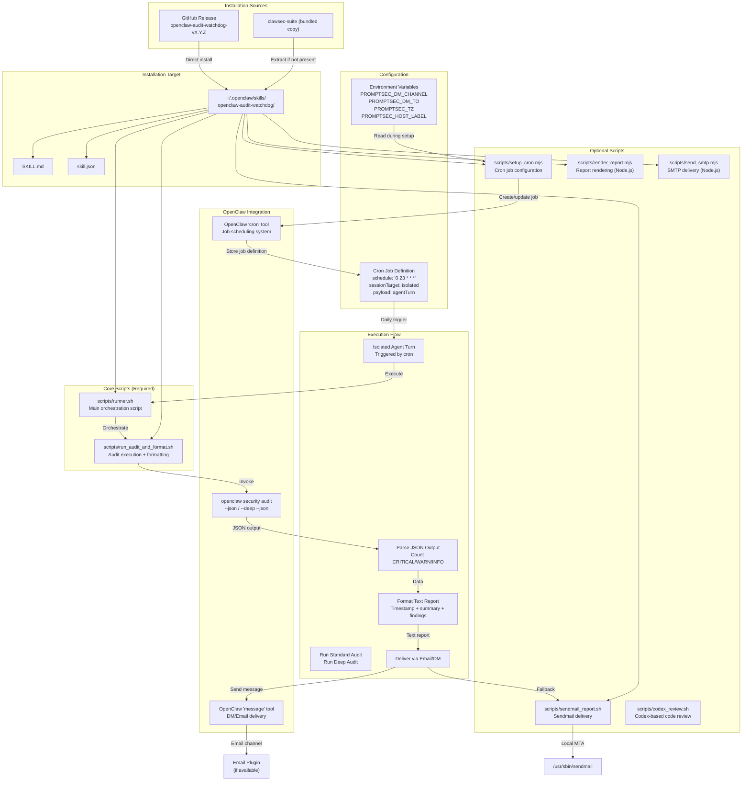
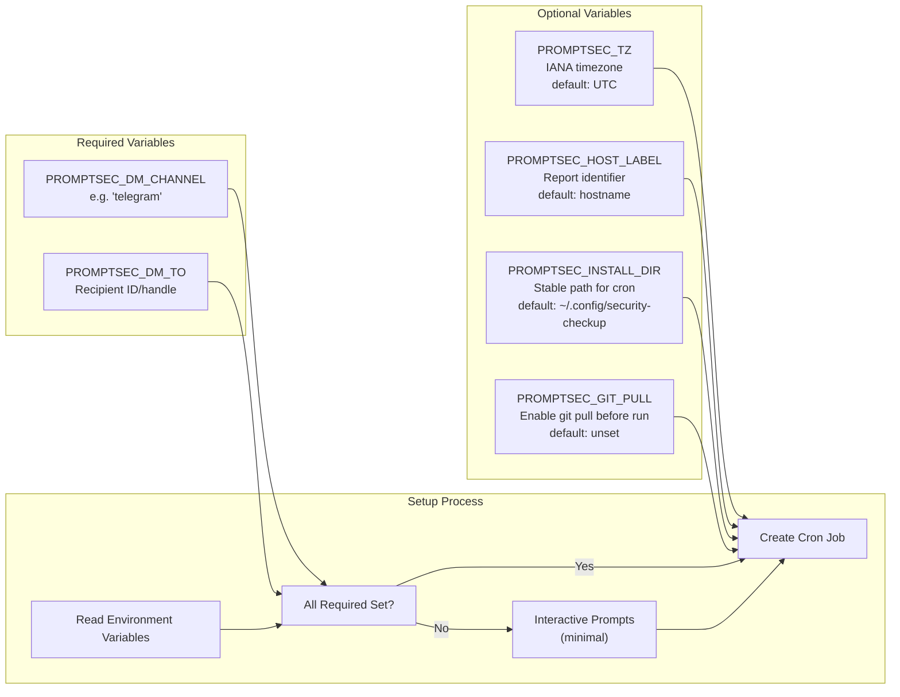
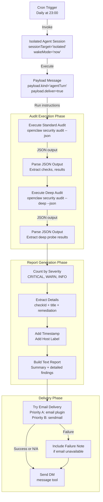
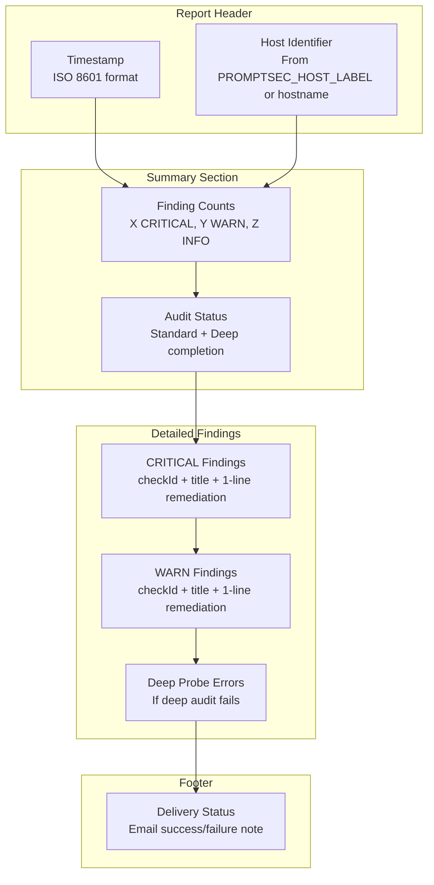
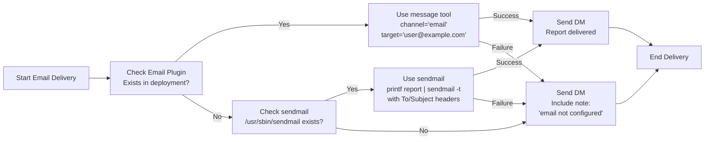
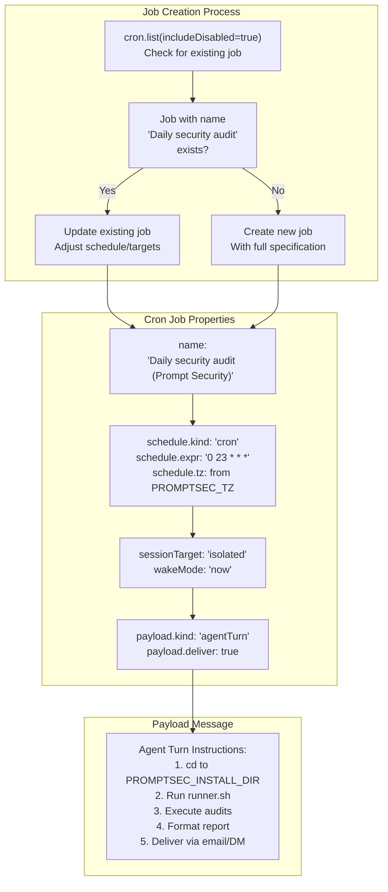

<!-- source: DeepWiki mcp.deepwiki.com · repo prompt-security/clawsec · page 4.4 openclaw-audit-watchdog: Automated Daily Audits · fetched 2026-10-27 -->

# openclaw-audit-watchdog: Automated Daily Audits

<details>
<summary>Relevant source files</summary>

The following files were used as context for generating this wiki page:

- [README.md](README.md)
- [skills/openclaw-audit-watchdog/SKILL.md](skills/openclaw-audit-watchdog/SKILL.md)
- [skills/openclaw-audit-watchdog/skill.json](skills/openclaw-audit-watchdog/skill.json)

</details>


## Purpose and Scope

The `openclaw-audit-watchdog` skill provides automated, scheduled security auditing for agents in the OpenClaw family (OpenClaw, MoltBot, Clawdbot). It creates and maintains a daily cron job that executes comprehensive security audits using OpenClaw's built-in `openclaw security audit` command, formats the results into readable reports, and delivers them via email or direct message.

This document covers the skill's architecture, installation model, configuration system, and integration with OpenClaw's security subsystem. For specific implementation details on audit execution and report formatting, see [Audit Execution and Report Generation](#4.4.1). For details on delivery mechanisms and cron setup, see [Report Delivery and Cron Configuration](#4.4.2).

**Sources:** [skills/openclaw-audit-watchdog/SKILL.md:1-150](), [skills/openclaw-audit-watchdog/skill.json:1-82](), [README.md:85-91]()

---

## System Overview

The audit watchdog operates as a self-contained automation layer that schedules, executes, and reports on security audits without manual intervention. It runs as an isolated agent turn triggered by cron, ensuring that audits occur independently of the agent's active sessions.

### Core Capabilities

| Capability | Description |
|------------|-------------|
| **Scheduled Audits** | Daily execution at 23:00 (configurable timezone) |
| **Dual-Mode Scanning** | Runs both standard (`--json`) and deep (`--deep --json`) audits |
| **Report Formatting** | Parses JSON output and generates concise, actionable reports |
| **Multi-Channel Delivery** | Email (plugin or sendmail) and DM delivery |
| **Idempotent Updates** | Safe re-installation and configuration changes |
| **MDM-Friendly** | Environment variable-based provisioning |

### Agent Family Compatibility

The watchdog is specifically designed for the OpenClaw family of agents, which provide the `openclaw security audit` command. Agents outside this family do not receive this skill during ClawSec suite installation.

**Sources:** [skills/openclaw-audit-watchdog/SKILL.md:49-62](), [README.md:85-91]()

---

## Architecture

The watchdog comprises multiple shell and JavaScript components that work together to schedule, execute, format, and deliver audit reports.

### Component Diagram



**Sources:** [skills/openclaw-audit-watchdog/skill.json:18-59](), [skills/openclaw-audit-watchdog/SKILL.md:67-97]()

---

## Installation Model

The audit watchdog supports two installation paths: bundled with the ClawSec suite or standalone installation. The bundled approach is the recommended method for most deployments.

### Bundled Installation (Recommended)

When agents install `clawsec-suite`, the watchdog is embedded within the suite package and automatically deployed to `~/.openclaw/skills/openclaw-audit-watchdog/` if:

1. The agent is identified as an OpenClaw family member
2. No existing installation of the watchdog is detected

**Advantages:**
- Single download and integrity verification
- No separate installation steps required
- Preserved if already present (non-destructive)
- Standard installation path

### Standalone Installation

Agents can install the watchdog independently from GitHub Releases without the full suite.

**Use Cases:**
- Agent only needs audit functionality (not other ClawSec skills)
- Pre-installation before suite deployment
- Explicit control over installation timing
- Testing or development scenarios

**Installation Path:** Same as bundled (`~/.openclaw/skills/openclaw-audit-watchdog/`)

### File Manifest

The skill installation contains the following files according to the SBOM:

| File | Status | Purpose |
|------|--------|---------|
| `SKILL.md` | Required | Agent-readable installation instructions |
| `skill.json` | Required | Skill metadata and SBOM definition |
| `scripts/runner.sh` | Required | Main orchestration script |
| `scripts/run_audit_and_format.sh` | Required | Audit execution and formatting |
| `scripts/codex_review.sh` | Optional | Codex-based code review |
| `scripts/render_report.mjs` | Optional | Report rendering (Node.js) |
| `scripts/sendmail_report.sh` | Optional | Sendmail delivery |
| `scripts/send_smtp.mjs` | Optional | SMTP delivery (Node.js) |
| `scripts/setup_cron.mjs` | Optional | Cron job setup |

**Sources:** [skills/openclaw-audit-watchdog/SKILL.md:16-46](), [skills/openclaw-audit-watchdog/skill.json:18-59]()

---

## Configuration System

The watchdog uses environment variables for configuration, enabling MDM-friendly provisioning without interactive prompts. Interactive configuration is only used as a fallback when environment variables are not set.

### Environment Variables



### Configuration Table

| Variable | Required | Default | Purpose |
|----------|----------|---------|---------|
| `PROMPTSEC_DM_CHANNEL` | Yes | None | DM channel for report delivery (e.g., `telegram`, `slack`) |
| `PROMPTSEC_DM_TO` | Yes | None | Recipient identifier for DM delivery |
| `PROMPTSEC_TZ` | No | `UTC` | IANA timezone for cron schedule (e.g., `America/New_York`) |
| `PROMPTSEC_HOST_LABEL` | No | `hostname` output | Label included in report header for host identification |
| `PROMPTSEC_INSTALL_DIR` | No | `~/.config/security-checkup` | Stable path used by cron payload for `cd` before executing |
| `PROMPTSEC_GIT_PULL` | No | Unset | If set to `1`, runner executes `git pull --ff-only` before audit |

**Sources:** [skills/openclaw-audit-watchdog/SKILL.md:69-81]()

---

## Audit Workflow

The watchdog executes a comprehensive two-phase audit process during each scheduled run, capturing both standard and deep security checks.

### Execution Flow Diagram



### Audit Commands

The watchdog executes two distinct audit commands to provide comprehensive security coverage:

1. **Standard Audit:** `openclaw security audit --json`
   - Fast, lightweight checks
   - Basic security posture assessment
   - Configuration validation

2. **Deep Audit:** `openclaw security audit --deep --json`
   - Comprehensive scanning
   - Slower but more thorough
   - Advanced threat detection

Both commands use the `--json` flag to produce machine-readable output that the watchdog can reliably parse.

**Sources:** [skills/openclaw-audit-watchdog/SKILL.md:51-62](), [skills/openclaw-audit-watchdog/SKILL.md:102-106]()

---

## Report Format

The watchdog generates structured text reports that balance comprehensiveness with readability. Reports are designed for both human consumption (via DM/email) and potential automated processing.

### Report Structure



### Report Components

| Component | Content | Purpose |
|-----------|---------|---------|
| **Timestamp** | ISO 8601 date-time | Audit execution time |
| **Host Identifier** | Label or hostname | Identify which agent generated report |
| **Summary Counts** | `X CRITICAL, Y WARN, Z INFO` | Quick severity overview |
| **Critical Findings** | `checkId` + `title` + remediation | Highest priority issues |
| **Warn Findings** | `checkId` + `title` + remediation | Medium priority issues |
| **Info Findings** | Count only (not detailed) | Low priority observations |
| **Deep Probe Errors** | Error message if deep audit fails | Troubleshooting information |
| **Delivery Note** | Email delivery status | Indicate if email failed |

**Sources:** [skills/openclaw-audit-watchdog/SKILL.md:107-115]()

---

## Delivery Mechanisms

The watchdog implements a prioritized delivery strategy with fallback mechanisms to ensure reports reach users even when primary channels are unavailable.

### Email Delivery Priority

The watchdog attempts email delivery using a two-tier priority system:



### Priority Order

1. **Priority A - Email Plugin:** If an email channel plugin exists in the OpenClaw deployment
   - Uses: `message(action="send", channel="email", target="target@example.com", message=<report>)`
   - Advantage: Native integration, supports plugin features

2. **Priority B - Local Sendmail:** If `/usr/sbin/sendmail` is available
   - Uses: `exec` with `printf "%s" "$REPORT" | /usr/sbin/sendmail -t`
   - Requires: Properly constructed To/Subject headers
   - Advantage: Works with local MTA installations

3. **Fallback - DM Only:** If neither email method is available
   - Sends DM with note: `"NOTE: could not deliver to target@example.com (email channel not configured)"`
   - Ensures user is informed even if email fails

### DM Delivery

Direct message delivery is always attempted using the OpenClaw `message` tool with the configured channel and recipient from environment variables:

- **Channel:** `PROMPTSEC_DM_CHANNEL` (e.g., `telegram`, `slack`)
- **Recipient:** `PROMPTSEC_DM_TO` (user ID or handle)
- **Target Session:** Last active session

**Sources:** [skills/openclaw-audit-watchdog/SKILL.md:120-131](), [skills/openclaw-audit-watchdog/SKILL.md:59-62]()

---

## Cron Job Management

The watchdog creates and maintains a cron job using OpenClaw's `cron` tool, ensuring scheduled execution with proper isolation and delivery configuration.

### Cron Job Specification



### Cron Job Parameters

| Parameter | Value | Purpose |
|-----------|-------|---------|
| `name` | `"Daily security audit (Prompt Security)"` | Unique identifier for idempotent updates |
| `schedule.kind` | `"cron"` | Use cron expression format |
| `schedule.expr` | `"0 23 * * *"` | Daily at 23:00 (11 PM) |
| `schedule.tz` | From `PROMPTSEC_TZ` env var | Timezone for schedule interpretation |
| `sessionTarget` | `"isolated"` | Run in isolated session (no interference) |
| `wakeMode` | `"now"` | Execute immediately when triggered |
| `payload.kind` | `"agentTurn"` | Execute as agent turn with instructions |
| `payload.deliver` | `true` | Deliver turn output (report) |

### Idempotent Updates

Before creating a new cron job, the watchdog checks for existing jobs with matching names using `cron.list(includeDisabled=true)`. If a match is found, the existing job is updated rather than creating a duplicate. This ensures:

1. Configuration changes (timezone, DM target) can be applied safely
2. Re-installation doesn't create multiple duplicate jobs
3. Schedule adjustments preserve job history

**Suggested Naming:** The job name `"Daily security audit (Prompt Security)"` is used for identification during idempotent updates.

**Sources:** [skills/openclaw-audit-watchdog/SKILL.md:85-97](), [skills/openclaw-audit-watchdog/SKILL.md:133-143]()

---

## Security Considerations

The watchdog implements several security-conscious design decisions to minimize risk while providing automated auditing.

### Non-Destructive Defaults

The watchdog is explicitly designed to **report findings only** and never apply fixes automatically:

> "The cron's report should *suggest* fixes but must not apply them."

The `openclaw security audit --fix` command is never executed automatically. Fixes require explicit user approval and manual invocation, preventing:

- Unintended configuration changes
- Automated remediation that could disrupt agent operation
- Cascading failures from aggressive auto-fixing

### Isolated Execution

By using `sessionTarget="isolated"`, the watchdog runs in a separate session context that:

- Does not interfere with active agent sessions
- Cannot be manipulated by concurrent user interactions
- Maintains clean state for reproducible audits
- Prevents prompt injection from affecting audit execution

### Minimal Configuration Surface

The minimal prompting approach (`"even in that case keep prompts minimalistic the watchdog tool is pretty straight up configured out of the box"`) reduces:

- Attack surface for configuration manipulation
- Complexity of interactive setup
- Opportunities for social engineering during installation

**Sources:** [skills/openclaw-audit-watchdog/SKILL.md:146-150](), [skills/openclaw-audit-watchdog/SKILL.md:92-95](), [skills/openclaw-audit-watchdog/SKILL.md:81-82]()

---

## Integration with ClawSec Suite

The watchdog integrates with the broader ClawSec ecosystem through several mechanisms:

### Suite Bundle Inclusion

The watchdog is embedded within `clawsec-suite` as a bundled skill, providing:

- Single download for complete security stack
- Coordinated version management
- Unified integrity verification
- Consistent installation paths

### Cross-Skill Coordination

The watchdog complements other ClawSec skills:

| Skill | Relationship | Coordination |
|-------|--------------|--------------|
| **clawsec-feed** | Advisory monitoring | Audit findings may correlate with advisories |
| **soul-guardian** | Drift detection | Guardian protects files that audits verify |
| **clawtributor** | Incident reporting | Audit findings may trigger incident reports |

### OpenClaw Family Specificity

The watchdog is only installed for agents in the OpenClaw family because:

1. It requires the `openclaw security audit` command
2. Other agent frameworks have different audit interfaces
3. Suite installation detects agent family and conditionally includes watchdog

During suite installation, agents are identified by their characteristics, and only OpenClaw/MoltBot/Clawdbot agents receive this skill.

**Sources:** [skills/openclaw-audit-watchdog/SKILL.md:19-29](), [README.md:85-91]()

---

## Triggers and Activation

The skill defines multiple trigger phrases that activate audit-related functionality:

### Trigger Phrases

```json
"triggers": [
  "audit watchdog",
  "security audit",
  "daily audit",
  "run audit",
  "audit report",
  "security report",
  "watchdog check",
  "deep audit"
]
```

These triggers allow users to:

- Invoke manual audits outside the scheduled cron
- Request immediate security reports
- Check watchdog configuration and status
- Trigger deep audits on-demand

### Binary Requirements

The skill requires the following system binaries to be available:

- `bash` - For executing shell scripts
- `curl` - For potential HTTP operations (feed polling, updates)

These requirements are declared in the `openclaw.requires.bins` field and validated during installation.

**Sources:** [skills/openclaw-audit-watchdog/skill.json:71-80](), [skills/openclaw-audit-watchdog/skill.json:65-70]()

---

