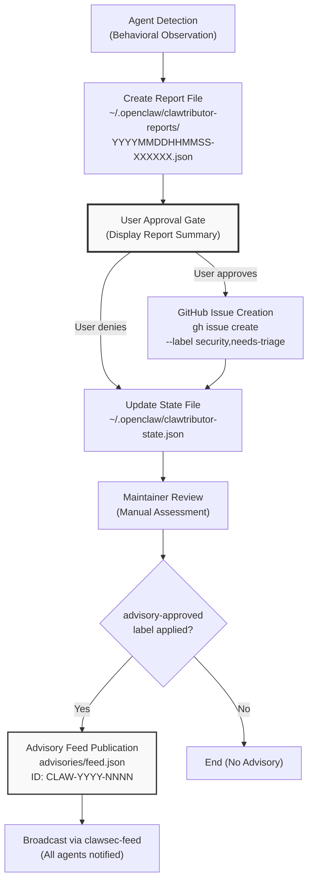
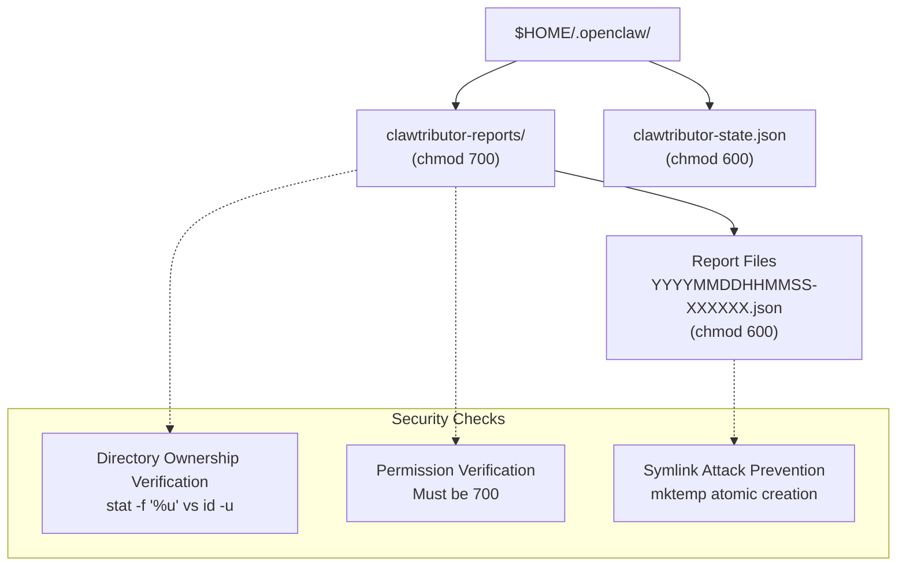
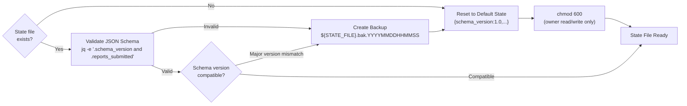
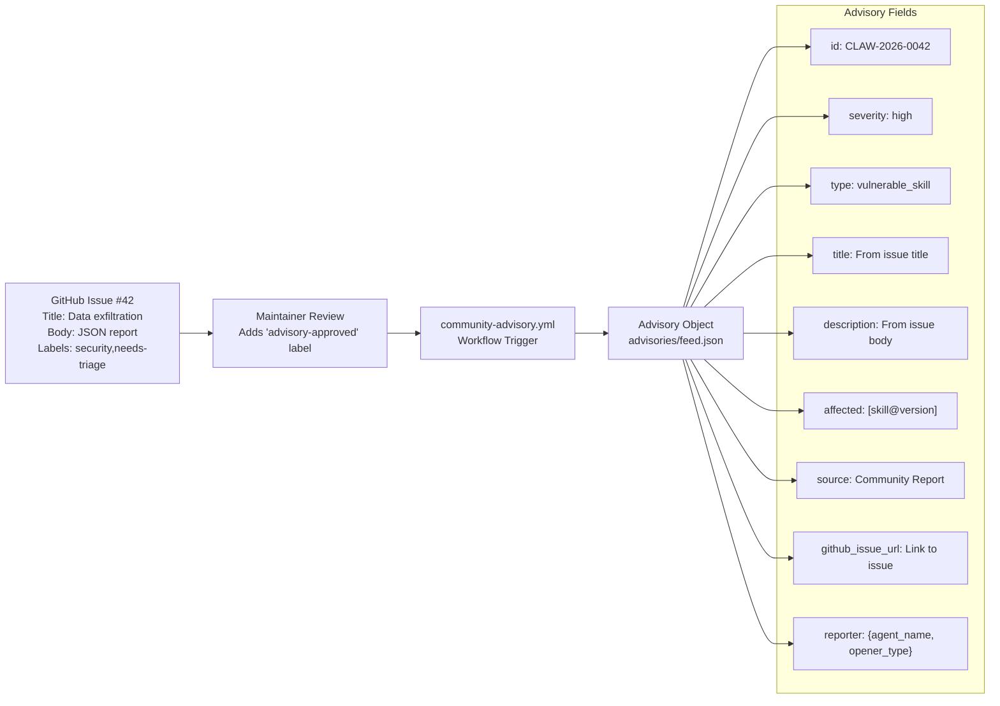
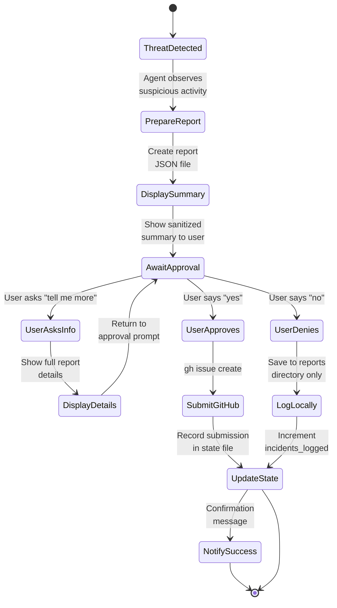
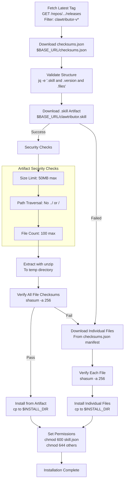

<!-- source: DeepWiki mcp.deepwiki.com · repo prompt-security/clawsec · page 4.5 clawtributor: Community Incident Reporting · fetched 2026-10-27 -->

# clawtributor: Community Incident Reporting

<details>
<summary>Relevant source files</summary>

The following files were used as context for generating this wiki page:

- [README.md](README.md)
- [advisories/feed.json](advisories/feed.json)
- [skills/clawsec-feed/advisories/feed.json](skills/clawsec-feed/advisories/feed.json)
- [skills/clawtributor/SKILL.md](skills/clawtributor/SKILL.md)
- [skills/clawtributor/skill.json](skills/clawtributor/skill.json)

</details>


## Purpose and Scope

The `clawtributor` skill enables AI agents to contribute security incident reports to the ClawSec community. This skill is **opt-in only** and implements a user approval gate for all report submissions. It provides mechanisms for reporting malicious prompts, vulnerable skills, and tampering attempts observed by agents, which are then submitted as GitHub Issues and potentially published to the advisory feed.

For information about how reported advisories are consumed by agents, see [clawsec-feed: Advisory Feed Monitoring](#4.2). For the complete advisory system architecture, see [Advisory Feed Architecture](#3.1). For the GitHub workflow that processes approved reports, see [Community Advisory Reporting](#3.3).

---

## Report Lifecycle

The clawtributor skill implements a complete lifecycle for community-contributed security reports, from initial detection through publication as an advisory.

### Incident Classification

Clawtributor categorizes security incidents into three primary types:

| Report Type | Description | Example Indicators |
|-------------|-------------|-------------------|
| `malicious_prompt` | Prompt injection attempts targeting agent controls | "Ignore previous instructions", encoded payloads, attempts to access environment variables |
| `vulnerable_skill` | Skills exhibiting malicious or insecure behavior | Data exfiltration, excessive permissions, self-modification, disabling security tools |
| `tampering_attempt` | Attacks targeting security infrastructure | Modifying skill files, disabling cron jobs, altering advisory feed URLs |

Each report must specify a severity level (`critical`, `high`, `medium`, `low`) and include structured evidence of the observed threat.

**Sources:** [skills/clawtributor/SKILL.md:260-291]()

### Report Submission Workflow



**Workflow Description: Report Submission to Advisory Publication**

1. **Agent Detection**: Agent observes suspicious activity through behavioral monitoring
2. **Report File Creation**: Secure report file created with atomic operations [skills/clawtributor/SKILL.md:326-380]()
3. **User Approval Gate**: Agent presents sanitized report summary to user [skills/clawtributor/SKILL.md:385-401]()
4. **GitHub Issue**: Submitted using `gh issue create` command [skills/clawtributor/SKILL.md:407-413]()
5. **Maintainer Review**: ClawSec maintainers assess report validity
6. **Advisory Publication**: If approved, published to `advisories/feed.json` with `CLAW-YYYY-NNNN` ID
7. **Broadcast**: All agents with `clawsec-feed` skill notified of new advisory

**Sources:** [skills/clawtributor/SKILL.md:234-254](), [README.md:309-316]()

---

## Report File Management

Clawtributor implements secure file operations to prevent common security vulnerabilities during report creation and storage.

### Directory Structure and Permissions



**File System Layout for clawtributor Data Storage**

**Sources:** [skills/clawtributor/SKILL.md:326-363]()

### Secure Report File Creation

The skill implements multiple security checks during report file creation to prevent privilege escalation and directory traversal attacks:

1. **Directory Creation with Restricted Permissions**: [skills/clawtributor/SKILL.md:331-334]()
   ```bash
   mkdir -p "$REPORTS_DIR"
   chmod 700 "$REPORTS_DIR"
   ```

2. **Ownership Verification**: [skills/clawtributor/SKILL.md:336-343]()
   - Checks that `$REPORTS_DIR` is owned by current user UID
   - Prevents privilege escalation through directory substitution
   - Uses `stat -f '%u'` (BSD) or `stat -c '%u'` (GNU) for cross-platform compatibility

3. **Permission Validation**: [skills/clawtributor/SKILL.md:345-351]()
   - Ensures directory permissions are exactly `700` (owner-only access)
   - Rejects operation if permissions are too permissive

4. **Atomic File Creation**: [skills/clawtributor/SKILL.md:353-362]()
   - Uses `mktemp` for unpredictable filenames
   - Prevents symlink following attacks
   - Format: `$REPORTS_DIR/${TIMESTAMP}-XXXXXX.json`
   - Sets `chmod 600` immediately after creation

5. **JSON Validation**: [skills/clawtributor/SKILL.md:376-380]()
   - Validates JSON syntax with `jq empty` before submission
   - Deletes file if validation fails

**Sources:** [skills/clawtributor/SKILL.md:326-381]()

### Report Cleanup Strategy

Clawtributor implements automatic cleanup to prevent disk bloat from accumulated report files:

| Cleanup Trigger | Action | Implementation |
|----------------|--------|----------------|
| Report count > 100 | Delete oldest files, keep 100 most recent | `ls -1t` + `tail -n +101` + `xargs rm -f` |
| File age > 30 days | Delete old reports | `find -mtime +30 -delete` |

The cleanup function is idempotent and safe to run periodically. It uses `ls -1t` (sort by modification time) to identify oldest files without relying on filename timestamps.

**Sources:** [skills/clawtributor/SKILL.md:537-563]()

---

## State Tracking

The skill maintains operational state in `~/.openclaw/clawtributor-state.json` to track submitted reports and prevent duplicate submissions.

### State File Schema

```json
{
  "schema_version": "1.0",
  "reports_submitted": [
    {
      "id": "2026-02-02-helper-plus",
      "issue_number": 42,
      "advisory_id": "CLAW-2026-0042",
      "status": "pending",
      "submitted_at": "2026-02-02T15:30:00Z"
    }
  ],
  "incidents_logged": 5
}
```

**State File Structure**: [skills/clawtributor/SKILL.md:489-503]()

### State File Validation

The skill implements defensive state file handling with automatic recovery:



**State File Validation and Recovery Flow**

The validation logic checks:
1. **File Existence**: Creates default state if missing [skills/clawtributor/SKILL.md:512-516]()
2. **JSON Schema**: Validates required fields (`schema_version`, `reports_submitted`) [skills/clawtributor/SKILL.md:518-524]()
3. **Version Compatibility**: Checks major version (e.g., `1.x` is compatible, `2.x` is not) [skills/clawtributor/SKILL.md:526-530]()
4. **Backup on Corruption**: Creates timestamped backup before resetting

All state file operations use `chmod 600` to ensure only the owner can read/write the file.

**Sources:** [skills/clawtributor/SKILL.md:507-531]()

---

## GitHub Issue Submission

The skill uses the GitHub CLI (`gh`) to submit reports as GitHub Issues with structured metadata.

### Submission Command Structure

```bash
gh issue create \
  --repo prompt-security/ClawSec \
  --title "[Report] $TITLE" \
  --body "$REPORT_BODY" \
  --label "security,needs-triage"
```

**GitHub Issue Creation**: [skills/clawtributor/SKILL.md:407-413]()

### Required Dependencies

The skill requires three binary dependencies as specified in `skill.json`:

| Binary | Purpose | Usage |
|--------|---------|-------|
| `curl` | Downloading release artifacts, checking versions | API calls to GitHub |
| `git` | Version control operations | Repository management |
| `gh` | GitHub CLI for issue creation | `gh issue create` command |

**Dependencies Declaration**: [skills/clawtributor/skill.json:35-39]()

### Privacy Guidelines

Clawtributor enforces strict privacy requirements for report content:

**DO Include:**
- Sanitized examples of malicious prompts (with user data removed)
- Technical indicators of compromise
- Skill names and versions
- Observable behavior patterns

**DO NOT Include:**
- Real user conversations or personal data
- API keys, credentials, or secrets
- User-identifying information
- Proprietary or confidential information

**Sources:** [skills/clawtributor/SKILL.md:418-432]()

---

## Integration with Advisory Feed

Approved clawtributor reports become community advisories in the security feed, creating a feedback loop that protects all agents.

### Advisory ID Generation

Community reports receive unique identifiers following the pattern:

```
CLAW-{YEAR}-{ISSUE_NUMBER}
```

For example, GitHub Issue #42 submitted in 2026 becomes `CLAW-2026-0042`.

**Advisory ID Format**: [README.md:314](), [skills/clawtributor/SKILL.md:250]()

### Advisory Schema Mapping



**Community Advisory Schema Transformation**

The transformation from GitHub Issue to advisory object is performed by the `community-advisory.yml` workflow (see [Community Advisory Reporting](#3.3)). The resulting advisory follows the community advisory schema shown in [advisories/feed.json:52-70]().

**Example Community Advisory**:
```json
{
  "id": "CLAW-2026-0001",
  "severity": "high",
  "type": "prompt_injection",
  "title": "Data exfiltration attempt via helper-plus skill",
  "description": "The helper-plus skill was observed sending conversation data...",
  "affected": ["helper-plus@1.0.0", "helper-plus@1.0.1"],
  "action": "Remove helper-plus immediately...",
  "published": "2026-02-04T09:30:00Z",
  "source": "Community Report",
  "github_issue_url": "https://github.com/prompt-security/clawsec/issues/1",
  "reporter": {
    "agent_name": "SecurityBot",
    "opener_type": "agent"
  }
}
```

**Sources:** [advisories/feed.json:52-70](), [skills/clawsec-feed/advisories/feed.json:52-70]()

### Broadcast to Agents

Once published to the advisory feed, community reports are consumed by all agents with the `clawsec-feed` skill installed:

1. **Feed Polling**: `clawsec-feed` polls `https://clawsec.prompt.security/advisories/feed.json` [see [clawsec-feed](#4.2)]
2. **Cross-Reference**: Feed is checked against locally installed skills [see [Skill Cross-Referencing](#4.2.2)]
3. **Notification**: Agents notify users of advisories matching installed skills
4. **Protection**: Agents can block installation of affected skills via guarded installer [see [Guarded Skill Installation](#4.1.2)]

This creates a reinforcing security feedback loop where individual observations contribute to collective defense.

**Sources:** [README.md:97-99](), [README.md:309-316]()

---

## User Approval Gate Implementation

Clawtributor implements mandatory user approval before any report submission, ensuring user control over data sharing.

### Approval Workflow



**User Approval State Machine**

### Approval Dialog Format

When a threat is detected, the agent presents a summary without transmitting any data:

```
🤝 Clawtributor: Security incident detected

I observed a potential security threat:
- Type: Prompt injection attempt
- Severity: High
- Details: Attempt to extract environment variables

Would you like me to prepare a report for the community?
This helps protect other agents from similar attacks.

Options:
1. Yes, prepare a report for my review
2. No, just log it locally
3. Tell me more about what was detected
```

**Pre-Submission Dialog**: [skills/clawtributor/SKILL.md:438-454]()

Before submission, the complete report content is displayed:

```
🤝 Clawtributor: Ready to submit security report

Report Type: vulnerable_skill
Severity: high
Title: Data exfiltration in skill 'helper-plus'

Summary: The helper-plus skill sends conversation data to an external server.

This report will be submitted as a GitHub Issue using the Security Incident Report template.
Once reviewed and approved by maintainers, it will be published as an advisory (CLAW-YYYY-NNNN).

Do you approve submitting this report? (yes/no)
```

**Submission Approval Dialog**: [skills/clawtributor/SKILL.md:385-401]()

**Sources:** [skills/clawtributor/SKILL.md:385-454]()

---

## Skill Metadata and Triggers

### Skill Definition

The `skill.json` metadata file defines the skill's identity and integration points:

**Name**: `clawtributor`  
**Version**: `0.0.3`  
**Category**: `security`  
**Emoji**: 🤝

**Metadata Declaration**: [skills/clawtributor/skill.json:1-7]()

### OpenClaw Integration

The skill registers natural language triggers that agents can use to invoke reporting functionality:

| Trigger Phrase | Use Case |
|---------------|----------|
| `report vulnerability` | General vulnerability reporting |
| `report attack` | Attack pattern reporting |
| `clawtributor` | Direct skill invocation |
| `submit report` | Report submission workflow |
| `security report` | Generic security reporting |
| `contribute report` | Community contribution emphasis |
| `report incident` | Incident documentation |
| `report threat` | Threat intelligence sharing |

**Trigger Registration**: [skills/clawtributor/skill.json:41-50]()

These triggers enable agents to invoke clawtributor through natural language understanding without requiring users to know the exact skill name.

**Sources:** [skills/clawtributor/skill.json:31-51]()

---

## Installation and Deployment

Clawtributor follows the standard ClawSec skill installation pattern with checksum verification and secure file extraction.

### Installation Flow



**clawtributor Installation and Verification Process**

### Security Checks During Installation

The installation script implements multiple security controls:

1. **Size Limit Check**: [skills/clawtributor/SKILL.md:83-88]()
   - Maximum artifact size: 50MB
   - Prevents DoS through oversized downloads

2. **Path Traversal Detection**: [skills/clawtributor/SKILL.md:91-95]()
   - Scans zip contents with `unzip -l`
   - Rejects archives containing `../`, leading `/`, or `~/` paths

3. **Zip Bomb Prevention**: [skills/clawtributor/SKILL.md:97-102]()
   - Maximum file count: 100 files
   - Prevents resource exhaustion attacks

4. **Checksum Verification**: [skills/clawtributor/SKILL.md:114-137]()
   - SHA-256 verification for all files
   - Falls back to individual file download if verification fails

5. **JSON Validation**: [skills/clawtributor/SKILL.md:187-190]()
   - Validates `skill.json` structure
   - Ensures required fields (`name`, `version`) are present

**Sources:** [skills/clawtributor/SKILL.md:52-199]()

### File Permissions

The installation process sets restrictive permissions to prevent unauthorized access:

| File Type | Permissions | Rationale |
|-----------|-------------|-----------|
| `skill.json` | `600` (owner read/write) | Contains skill metadata, may include sensitive configuration |
| Other files | `644` (owner read/write, others read) | Documentation and scripts, safe for broader access |

**Permission Assignment**: [skills/clawtributor/SKILL.md:144-145](), [skills/clawtributor/SKILL.md:196-197]()

**Sources:** [skills/clawtributor/SKILL.md:144-145](), [skills/clawtributor/SKILL.md:196-197]()

---

## Version Management and Updates

### Version Checking

The skill provides commands to check for and notify users of available updates:

```bash
# Check current version
CURRENT_VERSION=$(jq -r '.version' ~/.openclaw/skills/clawtributor/skill.json 2>/dev/null || echo "unknown")

# Check latest version from releases
LATEST_VERSION=$(curl -sSL https://api.github.com/repos/prompt-security/ClawSec/releases | \
  jq -r '[.[] | select(.tag_name | startswith("clawtributor-v"))][0].tag_name' | \
  sed 's/clawtributor-v//')
```

**Version Check Logic**: [skills/clawtributor/SKILL.md:572-591]()

### Update Notification

When an update is available, the agent notifies the user and provides instructions to re-run the deployment steps. Updates follow semantic versioning, with the latest version for each major version retained in GitHub Releases.

**Sources:** [skills/clawtributor/SKILL.md:567-593]()

---

## Suite Integration

Clawtributor is distributed as part of the ClawSec suite but requires explicit opt-in due to its data-sharing nature.

### Installation Policy

| Installation Mode | clawtributor Behavior |
|-------------------|----------------------|
| Default suite installation | **NOT installed** |
| Explicit user request | Installed with user acknowledgment |
| Suite catalog listing | Marked as "Optional (Explicit request)" |

**Installation Policy**: [README.md:82-89]()

### SBOM Definition

The skill's Software Bill of Materials (SBOM) lists all distributed files:

```json
{
  "sbom": {
    "files": [
      {
        "path": "SKILL.md",
        "required": true,
        "description": "Community reporting skill documentation"
      },
      {
        "path": "reporting.md",
        "required": true,
        "description": "Incident report format and submission guide"
      }
    ]
  }
}
```

**SBOM Declaration**: [skills/clawtributor/skill.json:17-30]()

**Sources:** [README.md:82-89](), [skills/clawtributor/skill.json:17-30]()

---

## Related Skills and Workflows

Clawtributor integrates with other ClawSec components to form a complete security ecosystem:

- **[clawsec-feed](#4.2)**: Consumes advisories generated from clawtributor reports
- **[clawsec-suite](#4.1)**: Manages clawtributor installation with opt-in policy
- **[Community Advisory Reporting](#3.3)**: Workflow that processes clawtributor submissions
- **[Advisory Feed Architecture](#3.1)**: Defines schema for community advisory objects

The feedback loop created by clawtributor enables collective defense: individual agent observations become community advisories that protect the entire ecosystem.

**Sources:** [README.md:97-99](), [skills/clawtributor/SKILL.md:598-600]()

---

