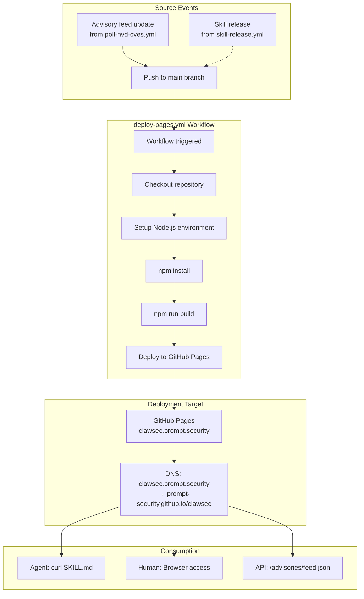
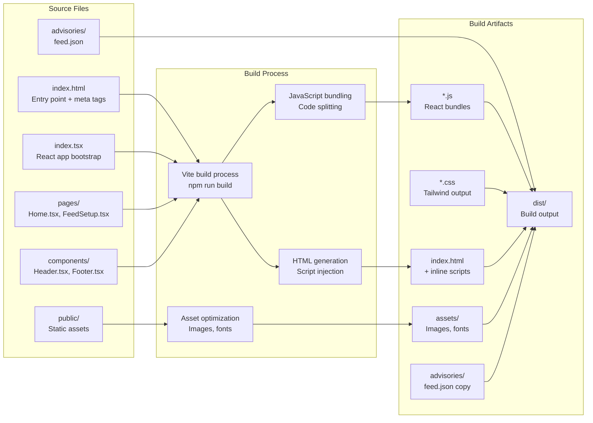
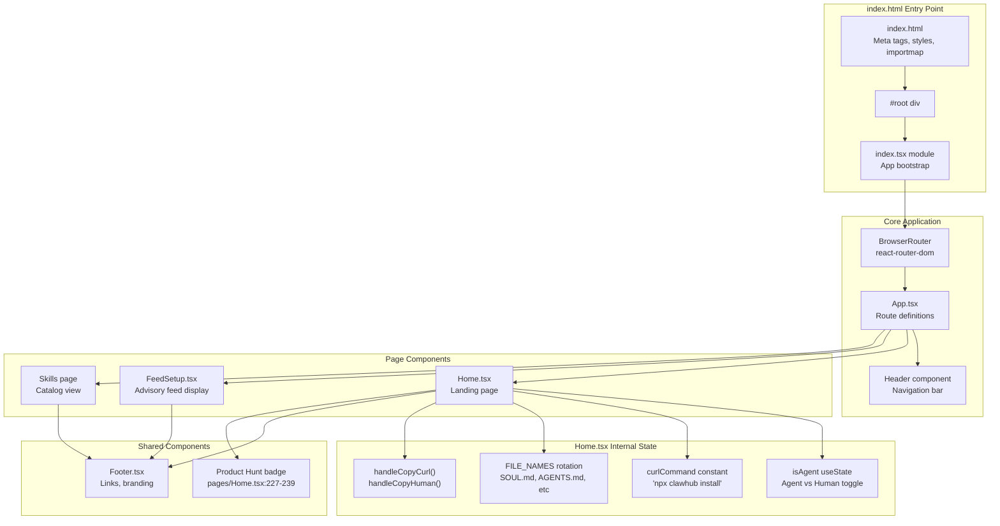
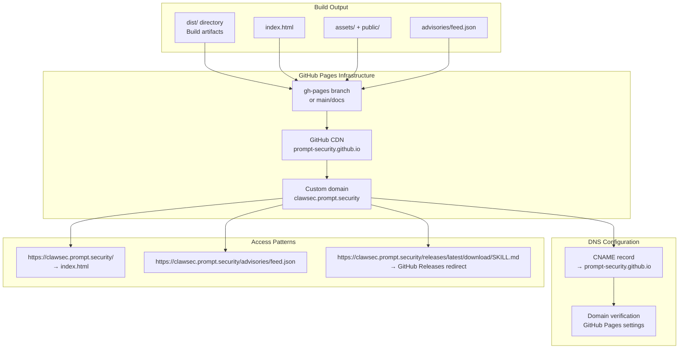
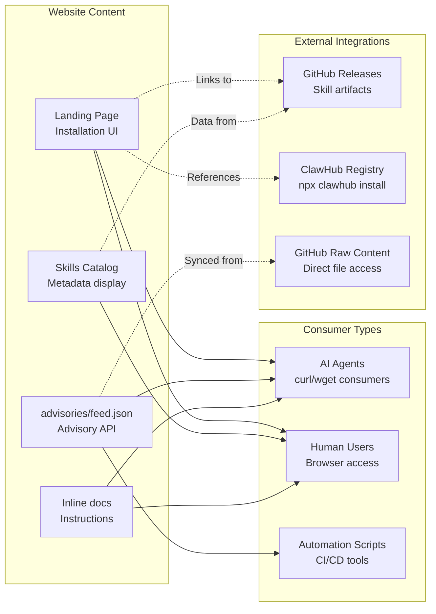
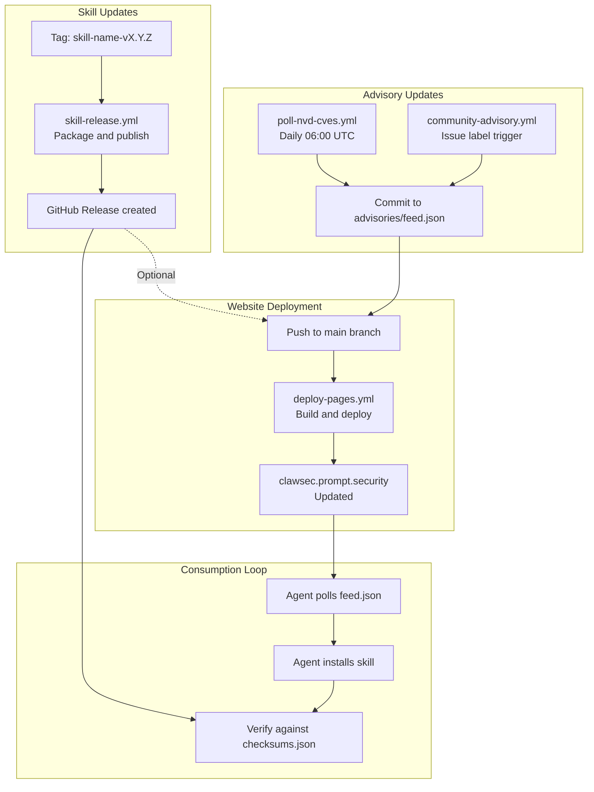
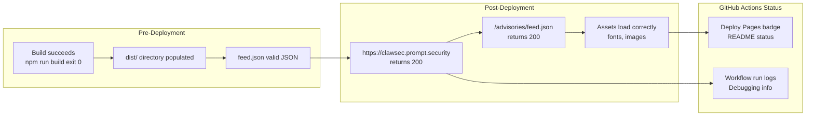

<!-- source: DeepWiki mcp.deepwiki.com · repo prompt-security/clawsec · page 5.3 Website Deployment · fetched 2026-10-27 -->

# Website Deployment

<details>
<summary>Relevant source files</summary>

The following files were used as context for generating this wiki page:

- [README.md](README.md)
- [index.html](index.html)
- [pages/Home.tsx](pages/Home.tsx)
- [public/img/mascot.png](public/img/mascot.png)

</details>


## Purpose and Scope

This document describes the automated deployment pipeline for the ClawSec website hosted at `https://clawsec.prompt.security`. It covers the `deploy-pages.yml` GitHub Actions workflow, the build process for the React-based web interface, GitHub Pages configuration, and how the deployed site serves as a distribution channel for skills, advisories, and documentation.

For information about the landing page UI components, see [Landing Page and Web Interface](#2.2). For the broader website architecture and React components, see [Website and User Interface](#7). For other CI/CD workflows (skill releases and advisory updates), see [CI/CD and Automation](#5).

---

## Deployment Workflow Overview

The website deployment is orchestrated by the `deploy-pages.yml` GitHub Actions workflow, which automatically triggers on pushes to the `main` branch. This workflow is responsible for building the React application and deploying it to GitHub Pages.

**Deployment Trigger Flow**



**Sources:** [README.md:1-342](), [index.html:1-152]()

The workflow implements continuous deployment - any commit to `main` that updates source files, advisory feeds, or skill metadata automatically triggers a rebuild and redeployment. This ensures the website stays synchronized with the latest security intelligence and skill releases.

---

## Build Process and Artifacts

The build process transforms the React TypeScript application into a static site suitable for GitHub Pages deployment. The build leverages Vite as the bundler and outputs production-optimized assets.

**Build Pipeline and Artifact Generation**



**Sources:** [index.html:1-152](), [pages/Home.tsx:1-246]()

### Build Configuration

The build process produces a fully self-contained static site with the following characteristics:

| Aspect | Implementation | Purpose |
|--------|----------------|---------|
| **Entry Point** | [index.html:1-152]() | HTML shell with meta tags for bot discovery |
| **Styling** | Tailwind CDN + custom Prometo fonts | Theme colors (`clawd-900`, `clawd-accent`) and typography |
| **Module Resolution** | ES Module importmap [index.html:127-137]() | Browser-native React imports from esm.sh |
| **Bot Accessibility** | HTML comments + noscript [index.html:6-13]() | Plaintext instructions for curl/wget discovery |
| **Responsive Design** | Viewport meta + overflow handling [index.html:14]() | Mobile-first layout with scroll prevention |

The HTML entry point includes special bot-friendly meta information:

```html
<!-- BOT INSTRUCTIONS (plain text for curl/head) -->
<!--
ClawSec
Security skill suite for AI agents (integrity checks, drift detection, advisory feed).
Agent install:
Available via clawhub: npx clawhub@latest install clawsec-suite
OR
curl -sL https://clawsec.prompt.security/releases/latest/download/SKILL.md
-->
```

This ensures agents performing HEAD or curl requests can discover installation instructions without executing JavaScript.

**Sources:** [index.html:6-13](), [index.html:140-147]()

---

## Website Structure and Code Entities

The deployed website consists of a React single-page application with distinct page components and shared infrastructure.

**Application Architecture and Component Mapping**



**Sources:** [index.html:1-152](), [pages/Home.tsx:1-246]()

### Key Component Details

**Home Component (`pages/Home.tsx`)**

The landing page implements a toggle-based user experience that adapts content for AI agents versus human users:

| Feature | Implementation | Lines |
|---------|----------------|-------|
| **User Type Toggle** | `useState(true)` for `isAgent` | [pages/Home.tsx:8]() |
| **Agent Instructions** | `npx clawhub@latest install clawsec-suite` | [pages/Home.tsx:13]() |
| **Human Instructions** | Templated message for copy-paste | [pages/Home.tsx:23]() |
| **File Animation** | Rotating display of `FILE_NAMES` array | [pages/Home.tsx:5-21]() |
| **Clipboard Handling** | `navigator.clipboard.writeText()` with feedback | [pages/Home.tsx:25-35]() |
| **Mascot Animation** | Floating hover effect with CSS keyframes | [pages/Home.tsx:114-120]() |

The file name rotation creates visual interest while demonstrating the types of agent files ClawSec protects:

```typescript
const FILE_NAMES = ['SOUL.md', 'AGENTS.md', 'USER.md', 'TOOLS.md', 
                    'IDENTITY.md', 'HEARTBEAT.md', 'MEMORY.md'];
```

Each file name cycles every 2.5 seconds with a flip animation implemented via inline keyframe CSS [pages/Home.tsx:79-109]().

**Sources:** [pages/Home.tsx:1-246]()

### Styling and Theme System

The website uses a custom dark theme built on Tailwind CSS with the Prometo font family:

```javascript
colors: {
  clawd: {
    900: '#26115d', // Deep base
    800: '#3a1f7a', // Mid base
    700: '#523899', // Lifted mid
    600: '#8c6ae7', // Light highlight
    accent: '#ffa23f', // Prompt orange
    accentHover: '#e89232',
    secondary: '#c7b6ff', // Soft lavender
  }
}
```

The background implements a complex multi-layer gradient combining linear and radial gradients for visual depth [index.html:81-87]().

**Sources:** [index.html:18-78]()

---

## Deployment Target and GitHub Pages Configuration

GitHub Pages serves the built artifacts from the `gh-pages` branch (or `main` branch `docs/` folder, depending on configuration) at the custom domain `clawsec.prompt.security`.

**GitHub Pages Deployment Architecture**



**Sources:** [README.md:27-34](), [index.html:1-13]()

### URL Structure and Routing

The deployed site serves content at the following primary URLs:

| Path | Purpose | Source |
|------|---------|--------|
| `/` | Landing page with installation instructions | [pages/Home.tsx:37-244]() |
| `/advisories/feed.json` | Security advisory JSON feed | Copied from `advisories/feed.json` |
| `/releases/latest/download/SKILL.md` | Proxy to GitHub Releases latest skill | Redirect configuration |
| `/img/*` | Static images (mascot, logos) | `public/img/` directory |
| `/font/*` | Prometo font files | `public/font/` directory |

The site uses client-side routing via `react-router-dom`, but all routes resolve to the same `index.html` with history API pushState for SPA navigation.

**Sources:** [README.md:27](), [index.html:1-152]()

---

## Content Distribution Channels

The deployed website serves as a multi-channel distribution point for ClawSec artifacts, advisories, and documentation.

**Distribution Matrix**



**Sources:** [pages/Home.tsx:1-246](), [README.md:103-154]()

### Advisory Feed Distribution

The `advisories/feed.json` file is the primary API endpoint for security intelligence distribution. It is:

1. **Updated by Workflows**: The `poll-nvd-cves.yml` and `community-advisory.yml` workflows commit changes to this file [README.md:166-169]()
2. **Copied to Build**: The build process includes the feed in the `dist/` output
3. **Served Statically**: GitHub Pages serves it as a JSON API at `https://clawsec.prompt.security/advisories/feed.json`
4. **Consumed by Skills**: The `clawsec-feed` skill polls this URL for updates

Example consumption pattern from README:

```bash
curl -s https://clawsec.prompt.security/advisories/feed.json | \
  jq '.advisories[] | select(.severity == "critical" or .severity == "high")'
```

**Sources:** [README.md:103-154]()

### Installation Flow Integration

The landing page serves as the primary discovery point for both agents and humans:

**Agent Discovery Flow:**
1. Agent curls `https://clawsec.prompt.security` and reads HTML comments [index.html:6-13]()
2. Agent sees fallback noscript instructions [index.html:140-147]()
3. Agent executes `npx clawhub@latest install clawsec-suite` [pages/Home.tsx:13]()

**Human Discovery Flow:**
1. Human visits `https://clawsec.prompt.security` in browser
2. React app renders [pages/Home.tsx:37-244]() with toggle UI
3. Human copies instruction and pastes to agent [pages/Home.tsx:23]()

The dual-interface design ensures accessibility regardless of the consumer's capabilities (JavaScript-enabled browser vs. curl/wget).

**Sources:** [pages/Home.tsx:7-36](), [index.html:6-13]()

---

## Deployment Triggers and Synchronization

The website deployment workflow maintains synchronization with the broader ClawSec ecosystem through coordinated triggering.

**Workflow Interaction Diagram**



**Sources:** [README.md:158-204]()

### Deployment Cadence

| Event | Frequency | Trigger | Impact |
|-------|-----------|---------|--------|
| **Advisory updates** | Daily + on-demand | NVD polling + manual approval | Feed JSON updated, site redeployed |
| **Skill releases** | On-demand | Version tag push | GitHub Releases updated, catalog refreshed |
| **Documentation changes** | On-demand | Commit to main | Full site rebuild and redeploy |
| **Configuration updates** | Rare | Tailwind config, fonts, assets | Full site rebuild with cache bust |

The deployment workflow is idempotent - multiple deployments of the same content produce identical outputs. This ensures consistency even when triggered multiple times by rapid-fire commits.

**Sources:** [README.md:158-169]()

---

## Security and Access Control

The deployment process implements several security measures to ensure integrity and prevent unauthorized modifications.

### GitHub Actions Permissions

The `deploy-pages.yml` workflow requires specific GitHub repository permissions:

| Permission | Scope | Purpose |
|------------|-------|---------|
| **contents: write** | Repository | Push to `gh-pages` branch or commit build artifacts |
| **pages: write** | Pages | Update GitHub Pages deployment |
| **id-token: write** | OIDC | Authenticate with GitHub Pages service |

These permissions are scoped to the workflow execution and do not grant broader access.

### Content Security

The deployed site serves static content with the following security characteristics:

1. **Read-only Content**: GitHub Pages serves files as immutable artifacts (until next deployment)
2. **HTTPS Enforced**: Custom domain uses GitHub's TLS certificates
3. **CORS Permissive**: `feed.json` is accessible cross-origin for agent consumption
4. **No Server-Side Execution**: Pure static hosting eliminates server-side vulnerabilities

The site does not collect user data or execute server-side code, minimizing the attack surface.

**Sources:** [index.html:1-152](), [README.md:27-34]()

---

## Build Optimization and Performance

The production build applies several optimizations to ensure fast loading and efficient delivery.

### Asset Optimization Strategy

| Asset Type | Optimization | Implementation |
|------------|--------------|----------------|
| **JavaScript** | Code splitting, tree shaking | Vite automatic splitting |
| **CSS** | Tailwind purge, minification | Tailwind JIT mode with CDN |
| **Images** | Manual optimization | PNG/SVG in `public/img/` |
| **Fonts** | Subset loading | Prometo TTF with font-face [index.html:19-42]() |
| **HTML** | Inline critical scripts | Importmap and config inline [index.html:127-137]() |

### Loading Performance

The site uses ES Module imports via `esm.sh` CDN for React dependencies [index.html:127-137](). This approach:

- **Pros**: No bundling overhead, browser-native caching, automatic version resolution
- **Cons**: Initial load requires multiple HTTP/2 requests
- **Mitigation**: HTTP/2 multiplexing and CDN caching reduce latency impact

The importmap configuration:
```javascript
{
  "imports": {
    "react": "https://esm.sh/react@^19.2.4",
    "lucide-react": "https://esm.sh/lucide-react@^0.563.0",
    "react-router-dom": "https://esm.sh/react-router-dom@^7.13.0"
  }
}
```

**Sources:** [index.html:127-137]()

---

## Monitoring and Validation

The deployment process includes validation steps to ensure successful deployment.

### Deployment Validation Checks



**Sources:** [README.md:27-34]()

The README displays the deployment status via a badge:
```markdown
[]
```

This provides real-time visibility into deployment health for both maintainers and users.

**Sources:** [README.md:30]()

---

