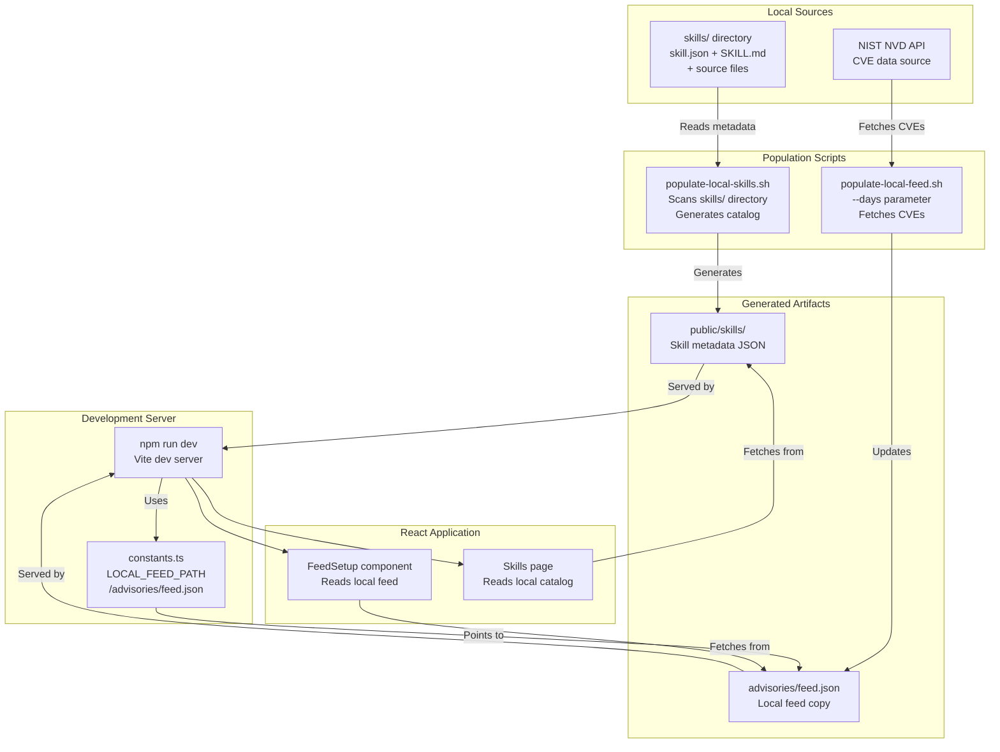
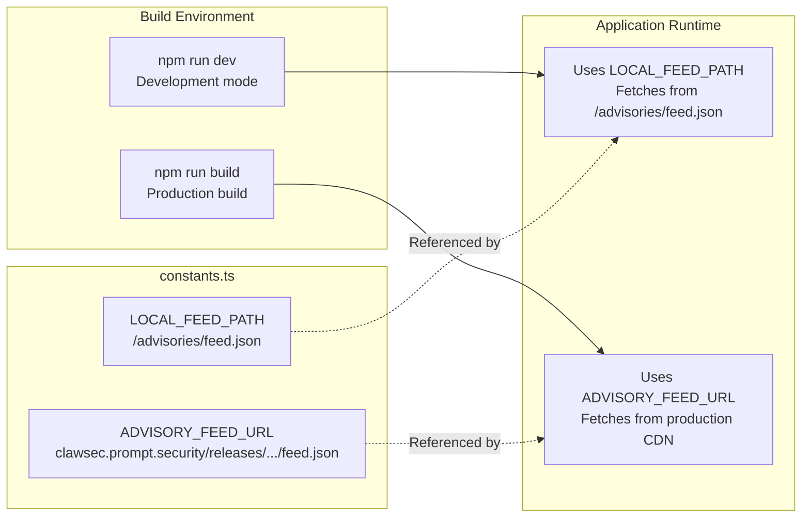
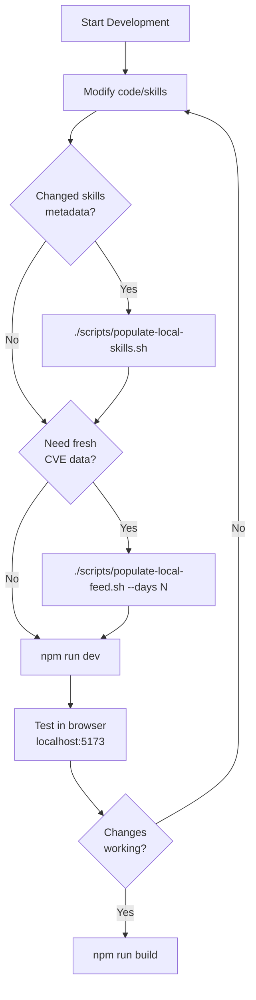

<!-- source: DeepWiki mcp.deepwiki.com · repo prompt-security/clawsec · page 6.3 Local Development Environment · fetched 2026-10-27 -->

# Local Development Environment

<details>
<summary>Relevant source files</summary>

The following files were used as context for generating this wiki page:

- [README.md](README.md)
- [constants.ts](constants.ts)

</details>


## Purpose and Scope

This page documents the local development environment setup for ClawSec, specifically the tools for populating local skill catalogs and advisory feeds during development. These scripts enable developers to work with local data instead of fetching from production URLs, facilitating offline development and testing.

For skill validation and packaging tools, see [Local Validation and Packaging](#6.1). For the release workflow, see [Release Script Usage](#6.2).

## Overview

The ClawSec development environment requires local copies of two key data sources:

1. **Skills Catalog**: Metadata and installation files for all skills in the `skills/` directory
2. **Advisory Feed**: Security advisories from the NVD CVE database and community reports

Two shell scripts populate these data sources from local and remote sources respectively:

- `scripts/populate-local-skills.sh`: Generates skill catalog from local `skills/` directory
- `scripts/populate-local-feed.sh`: Fetches real CVE data from NVD API to populate advisory feed

The application switches between local development paths and production URLs based on the build environment.

**Sources**: [README.md:238-264]()

---

## Local Development Data Flow



**Sources**: [README.md:257-264](), [constants.ts:1-8]()

---

## populate-local-skills.sh Script

The `populate-local-skills.sh` script generates a local skills catalog by scanning the `skills/` directory and extracting metadata from each skill's `skill.json` file.

### Functionality

The script performs the following operations:

1. **Directory Scanning**: Iterates through all subdirectories in `skills/`
2. **Metadata Extraction**: Reads `skill.json` from each skill directory
3. **Catalog Generation**: Creates JSON catalog files in `public/skills/`
4. **Asset Copying**: Copies skill documentation and installation files to public directory

### Output Structure

The script generates files in the `public/skills/` directory, making them available to the development server at `/skills/*` paths. This mirrors the production structure where skills are hosted on GitHub Releases.

### Usage

```bash
# Run from repository root
./scripts/populate-local-skills.sh
```

The script requires no arguments and operates on the current `skills/` directory structure.

**Sources**: [README.md:259-260](), [README.md:276-299]()

---

## populate-local-feed.sh Script

The `populate-local-feed.sh` script fetches real CVE data from the NIST National Vulnerability Database (NVD) API and generates a local copy of the advisory feed.

### Functionality

The script performs the following operations:

1. **CVE Fetching**: Queries NVD API for CVEs matching ClawSec keywords (OpenClaw, clawdbot, Moltbot, prompt injection)
2. **Time Range Filtering**: Uses `--days` parameter to limit query window
3. **Feed Generation**: Formats CVE data into the ClawSec advisory schema
4. **Feed Writing**: Outputs to `advisories/feed.json`

### Parameters

| Parameter | Description | Example |
|-----------|-------------|---------|
| `--days` | Number of days to look back for CVEs | `--days 120` fetches last 4 months |

### Usage

```bash
# Fetch CVEs from last 120 days
./scripts/populate-local-feed.sh --days 120

# Fetch CVEs from last 30 days
./scripts/populate-local-feed.sh --days 30
```

### Output Format

The script generates `advisories/feed.json` following the same schema as the production feed (see [Advisory Feed Architecture](#3.1)):

```json
{
  "version": "0.0.3",
  "last_updated": "2026-01-15T12:00:00Z",
  "advisories": [
    {
      "id": "CVE-2026-XXXXX",
      "severity": "critical",
      "type": "vulnerable_skill",
      "title": "...",
      "description": "...",
      "published": "2026-01-15T00:00:00Z",
      "cvss_score": 8.8,
      "nvd_url": "https://nvd.nist.gov/vuln/detail/CVE-2026-XXXXX"
    }
  ]
}
```

**Sources**: [README.md:262-264](), [README.md:106-154]()

---

## Local vs Production URL Configuration

The application uses different data source URLs depending on the build environment, controlled through `constants.ts`.

### Constants Configuration



### Configuration Details

The `constants.ts` file defines two feed URL constants:

| Constant | Value | Usage |
|----------|-------|-------|
| `ADVISORY_FEED_URL` | `https://clawsec.prompt.security/releases/latest/download/feed.json` | Production builds |
| `LOCAL_FEED_PATH` | `/advisories/feed.json` | Development server |

**File Reference**: [constants.ts:1-8]()

### Environment Detection

The application determines which URL to use based on the build mode:

- **Development**: Vite dev server serves `advisories/feed.json` at `/advisories/feed.json`
- **Production**: Application fetches from the full `ADVISORY_FEED_URL`

Components consuming the feed should reference the appropriate constant based on the environment.

**Sources**: [constants.ts:1-8]()

---

## Development Workflow

### Initial Setup

```bash
# 1. Install dependencies
npm install

# 2. Populate local skills catalog
./scripts/populate-local-skills.sh

# 3. Populate advisory feed with recent CVEs
./scripts/populate-local-feed.sh --days 120
```

### Development Cycle



### Common Development Tasks

| Task | Commands |
|------|----------|
| Add new skill | 1. Create `skills/new-skill/` directory<br/>2. Add `skill.json` and `SKILL.md`<br/>3. Run `./scripts/populate-local-skills.sh`<br/>4. Restart dev server |
| Update advisory feed | `./scripts/populate-local-feed.sh --days 90` |
| Validate skill changes | `python utils/validate_skill.py skills/skill-name` (see [Local Validation](#6.1)) |
| Test skill installation | Manual installation from local catalog URLs |
| Build for production | `npm run build` |

### Directory Structure After Population

```
clawsec/
├── advisories/
│   └── feed.json                    # Generated by populate-local-feed.sh
├── public/
│   └── skills/                      # Generated by populate-local-skills.sh
│       ├── skill-name-1/
│       │   ├── skill.json
│       │   └── SKILL.md
│       └── skill-name-2/
│           ├── skill.json
│           └── SKILL.md
├── scripts/
│   ├── populate-local-skills.sh
│   └── populate-local-feed.sh
└── skills/                          # Source skill directories
    ├── clawsec-suite/
    ├── clawsec-feed/
    ├── soul-guardian/
    ├── openclaw-audit-watchdog/
    └── clawtributor/
```

**Sources**: [README.md:238-271](), [README.md:276-299]()

---

## Integration with Development Server

### Vite Configuration

The Vite development server automatically serves files from the `public/` directory at the root path and the `advisories/` directory relative to the project root.

### URL Resolution

| Local Path | Dev Server URL | Production URL |
|------------|----------------|----------------|
| `advisories/feed.json` | `http://localhost:5173/advisories/feed.json` | `https://clawsec.prompt.security/advisories/feed.json` |
| `public/skills/*/skill.json` | `http://localhost:5173/skills/*/skill.json` | `https://clawsec.prompt.security/skills/*/skill.json` |

### Hot Module Replacement

The development server supports hot module replacement (HMR) for React components. However, changes to JSON data files (feed.json, skill.json) require manual browser refresh as they are served as static assets.

**Sources**: [README.md:248-254](), [constants.ts:1-8]()

---

## Troubleshooting

### Feed Not Loading

**Symptom**: Advisory feed shows as empty or fails to load

**Solutions**:
1. Verify `advisories/feed.json` exists and is valid JSON
2. Re-run `./scripts/populate-local-feed.sh --days 120`
3. Check browser console for fetch errors
4. Ensure dev server is serving from correct root directory

### Skills Not Appearing

**Symptom**: Skills page shows no skills or outdated metadata

**Solutions**:
1. Verify `public/skills/` directory contains generated files
2. Re-run `./scripts/populate-local-skills.sh`
3. Check that each skill has valid `skill.json` with required fields
4. Restart dev server with `npm run dev`

### NVD API Rate Limiting

**Symptom**: `populate-local-feed.sh` fails with rate limit errors

**Solutions**:
1. Reduce `--days` parameter to fetch fewer CVEs
2. Wait and retry after rate limit window expires
3. Use existing `advisories/feed.json` if available

**Sources**: [README.md:257-270]()

---

