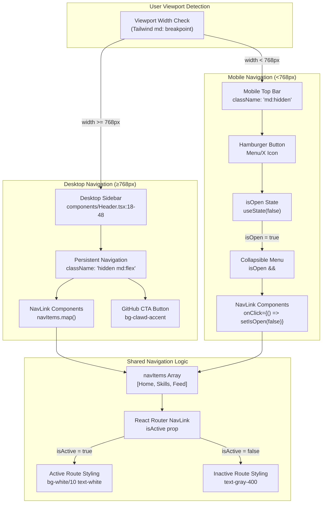
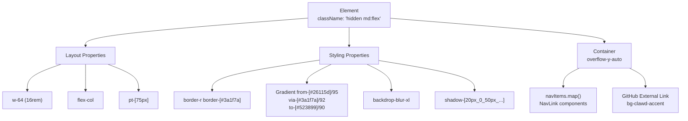
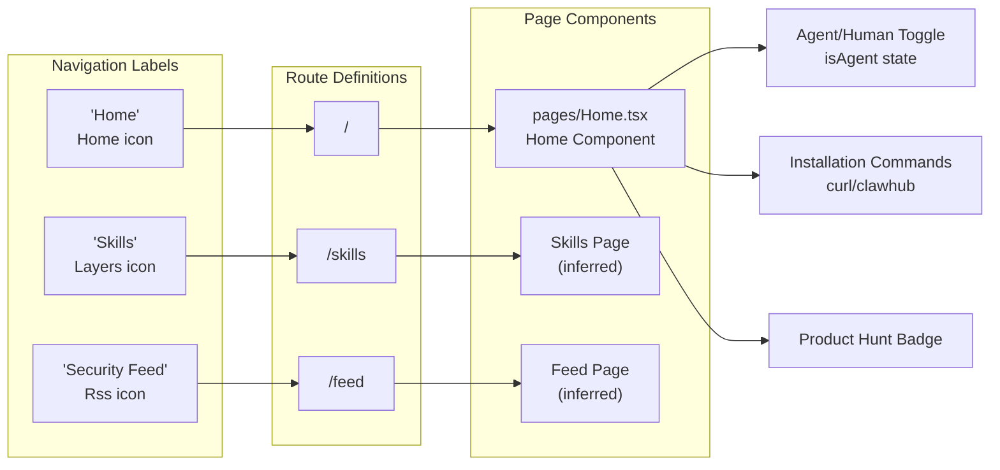
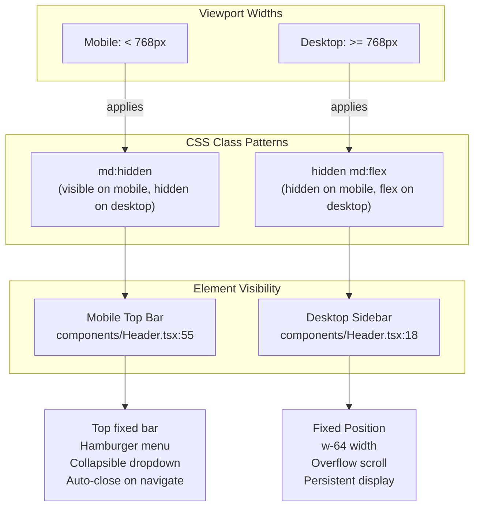
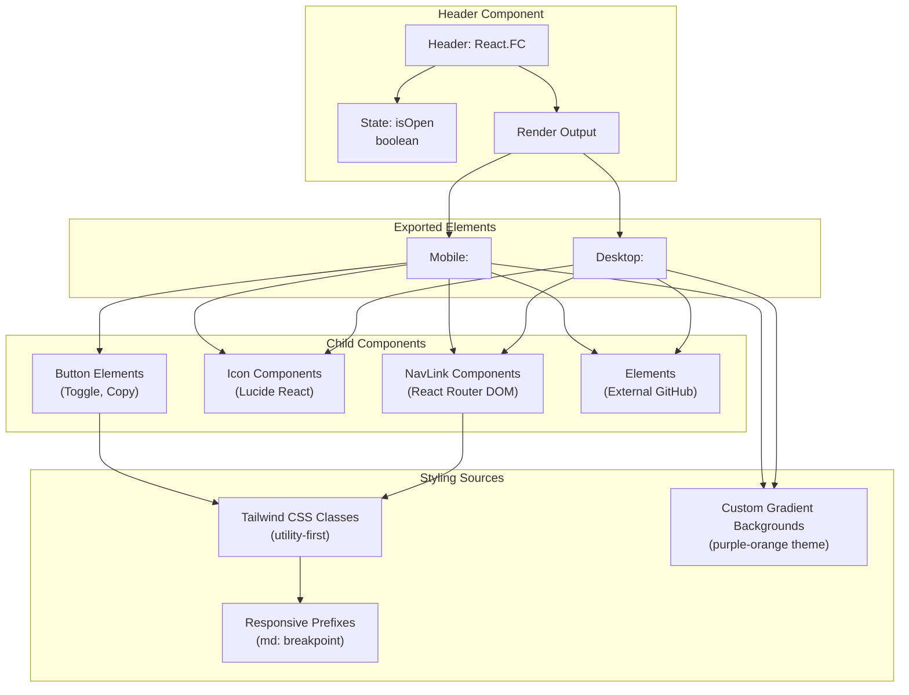

<!-- source: DeepWiki mcp.deepwiki.com · repo prompt-security/clawsec · page 7.1 Application Structure and Navigation · fetched 2026-10-27 -->

# Application Structure and Navigation

<details>
<summary>Relevant source files</summary>

The following files were used as context for generating this wiki page:

- [components/Header.tsx](components/Header.tsx)
- [index.html](index.html)
- [pages/Home.tsx](pages/Home.tsx)
- [public/img/mascot.png](public/img/mascot.png)

</details>


## Purpose and Scope

This document describes the ClawSec website's React application structure, navigation system, and routing architecture. It covers the `Header` component's implementation, the navigation menu structure, routing paths, and how the application adapts between desktop and mobile viewports.

For details about the Home page content and installation instructions UI, see [Home Page Component](#7.2). For the security feed display implementation, see [Feed Display Page](#7.3).

---

## Application Entry Point and Configuration

The ClawSec website is a client-side React application served via GitHub Pages. The application bootstraps through `index.html`, which configures the runtime environment before loading React components.

### HTML Configuration and Dependencies

The [index.html:1-151]() file serves as the application shell and defines critical configuration:

| Configuration Aspect | Implementation | Location |
|---------------------|----------------|----------|
| **Font System** | Custom Prometo font family with 4 weights (400, 500, 700, 800) | [index.html:19-42]() |
| **CSS Framework** | Tailwind CSS loaded via CDN | [index.html:17]() |
| **Color Scheme** | Custom `clawd` color palette (900, 800, 700, 600, accent, accentHover, secondary) | [index.html:54-62]() |
| **Module System** | ESM import maps for React 19.2.4, React Router 7.13.0, Lucide React 0.563.0 | [index.html:127-137]() |
| **Background Gradient** | Multi-layer radial and linear gradients creating purple-orange theme | [index.html:81-86]() |

The application uses **bot-friendly metadata** embedded in HTML comments ([index.html:5-13]()) and noscript tags ([index.html:140-147]()), allowing AI agents to discover installation instructions via simple `curl` or `wget` requests without JavaScript execution.

**Sources:** [index.html:1-151]()

---

## Navigation Architecture

The navigation system implements a **responsive two-mode design**: a persistent desktop sidebar and a collapsible mobile hamburger menu. Both modes share the same navigation items but render with different layouts and interaction patterns.

### Navigation Items Structure

The `Header` component defines navigation through a static `navItems` array at [components/Header.tsx:8-12]():

```typescript
const navItems = [
  { label: 'Home', path: '/', icon: Home },
  { label: 'Skills', path: '/skills', icon: Layers },
  { label: 'Security Feed', path: '/feed', icon: Rss },
];
```

Each navigation item consists of:
- **label**: Display text
- **path**: React Router route path
- **icon**: Lucide React icon component

This data structure drives both desktop and mobile navigation rendering through iteration.

**Sources:** [components/Header.tsx:8-12]()

### Navigation Flow Diagram



**Sources:** [components/Header.tsx:1-113]()

---

## Header Component Architecture

The `Header` component at [components/Header.tsx:5-113]() implements the complete navigation system as a single React functional component with internal state management.

### Component State Management

The component maintains minimal state for mobile menu visibility:

| State Variable | Type | Purpose | Default Value |
|---------------|------|---------|---------------|
| `isOpen` | `boolean` | Controls mobile menu expansion | `false` |

State is managed through React's `useState` hook at [components/Header.tsx:6]() and toggled via button click at [components/Header.tsx:73]().

**Sources:** [components/Header.tsx:6](), [components/Header.tsx:71-77]()

### Desktop Sidebar Implementation

The desktop navigation renders as a **fixed-position sidebar** with the following characteristics:



The sidebar uses Tailwind's responsive `md:` prefix to hide on mobile viewports (< 768px) at [components/Header.tsx:18](). The `pt-[75px]` padding accounts for the top banner height, ensuring navigation items appear below the header.

**Sources:** [components/Header.tsx:17-48]()

### Mobile Navigation Implementation

Mobile navigation implements a **two-tier layout**: a persistent top bar with a collapsible dropdown menu.

#### Mobile Top Bar Structure

The top bar at [components/Header.tsx:55-79]() contains:
1. **ClawSec Logo**: NavLink to home with favicon icon
2. **GitHub Link**: External link with GitHub icon
3. **Hamburger Menu Button**: Toggles `isOpen` state between Menu and X icons

#### Mobile Menu Dropdown

When `isOpen` is `true`, a dropdown renders at [components/Header.tsx:80-109]() with:
- Semi-transparent background matching desktop sidebar colors
- Full navigation items array iteration
- Auto-close behavior: each `NavLink` has `onClick={() => setIsOpen(false)}` at [components/Header.tsx:87]()
- GitHub CTA button matching desktop styling

**Sources:** [components/Header.tsx:55-110]()

---

## React Router Integration

The navigation system integrates with React Router DOM v7.13.0 through the `NavLink` component, which provides active route detection and styling.

### NavLink Active State Styling

The `NavLink` component receives a render function that exposes the `isActive` boolean at [components/Header.tsx:24]() (desktop) and [components/Header.tsx:88]() (mobile):

```typescript
className={({ isActive }) =>
  `${baseLink} ${
    isActive
      ? 'bg-white/10 text-white shadow-[0_10px_25px_rgba(0,0,0,0.25)] border border-white/10'
      : 'text-gray-400 hover:text-white hover:bg-white/5'
  }`
}
```

This conditional styling creates visual differentiation:

| Route State | Background | Text Color | Additional Effects |
|------------|------------|------------|-------------------|
| **Active** | `bg-white/10` | `text-white` | Shadow, border |
| **Inactive** | Transparent (hover: `bg-white/5`) | `text-gray-400` | None |

The `baseLink` constant at [components/Header.tsx:14-15]() defines shared styling: `flex items-center gap-3 px-3 py-2 rounded-lg text-sm font-medium transition-all`.

**Sources:** [components/Header.tsx:14-34](), [components/Header.tsx:84-96]()

### Route Path Mapping



The root route (`/`) maps to the `Home` component from [pages/Home.tsx:7-245](), which implements the landing page with agent/human installation toggle. The `/skills` and `/feed` routes are defined in the navigation items but their component implementations are not shown in the provided files (likely defined in the main routing configuration at `/index.tsx`).

**Sources:** [components/Header.tsx:8-12](), [pages/Home.tsx:1-245]()

---

## Icon System Integration

The navigation system uses **Lucide React** icons imported via ESM at [components/Header.tsx:3]():

| Icon Component | Usage Location | Purpose |
|----------------|----------------|---------|
| `Menu` | Mobile hamburger button | Show collapsed state |
| `X` | Mobile hamburger button | Show expanded state |
| `Terminal` | GitHub button | Code/repository context |
| `Home` | Home navigation item | Homepage indicator |
| `Layers` | Skills navigation item | Multiple skills metaphor |
| `Rss` | Feed navigation item | Advisory feed metaphor |
| `Github` | Mobile GitHub link | Repository link |

Icons are sized consistently at 16-24px depending on context. The desktop GitHub button uses `size={16}` at [components/Header.tsx:43](), while mobile uses `size={21}` at [components/Header.tsx:69]() for better touch targets.

**Sources:** [components/Header.tsx:3](), [components/Header.tsx:32](), [components/Header.tsx:43](), [components/Header.tsx:69](), [components/Header.tsx:94](), [components/Header.tsx:104]()

---

## Responsive Breakpoint System

The navigation adapts through Tailwind CSS media query prefixes, using the `md:` breakpoint at 768px:



Additional responsive adjustments:
- Desktop sidebar has `pt-[75px]` for top spacing
- Mobile top bar positioned at `top-[72px]` ([components/Header.tsx:55]())
- Mobile logo visible only on `md:hidden` context
- Both navigation modes use the same `navItems` array for consistency

**Sources:** [components/Header.tsx:18](), [components/Header.tsx:55]()

---

## External Link Handling

The GitHub repository link appears in both desktop and mobile navigation but uses standard `<a>` tags rather than React Router `NavLink` components, since it navigates to an external URL:

```typescript
<a
  href="https://github.com/prompt-security/clawsec"
  target="_blank"
  rel="noopener noreferrer"
  // ... styling classes
>
```

The link includes:
- `target="_blank"`: Opens in new tab
- `rel="noopener noreferrer"`: Security best practice to prevent reverse tabnabbing
- Consistent `bg-clawd-accent` styling in both mobile and desktop contexts

This appears at [components/Header.tsx:37-45]() (desktop) and [components/Header.tsx:98-106]() (mobile).

**Sources:** [components/Header.tsx:37-45](), [components/Header.tsx:62-70](), [components/Header.tsx:98-106]()

---

## Header Component Interface



The `Header` component is exported as a named export at [components/Header.tsx:5]() and [components/Header.tsx:113](), making it importable as `import { Header } from '../components/Header'` in parent components.

**Sources:** [components/Header.tsx:5](), [components/Header.tsx:113]()

---

