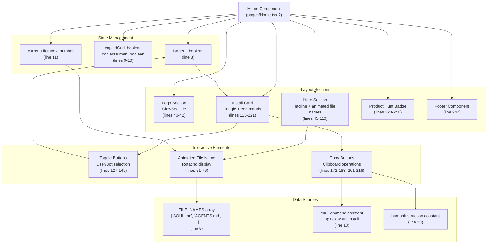
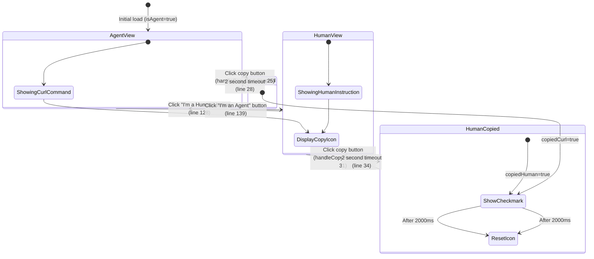
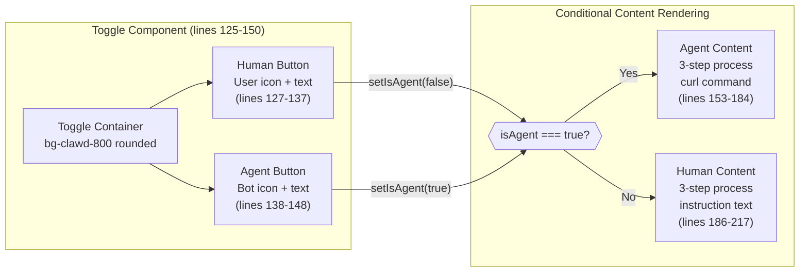
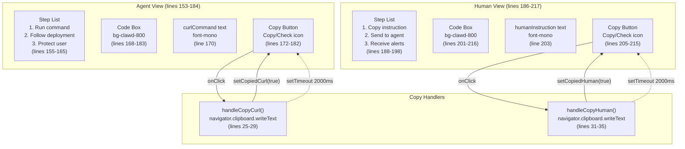
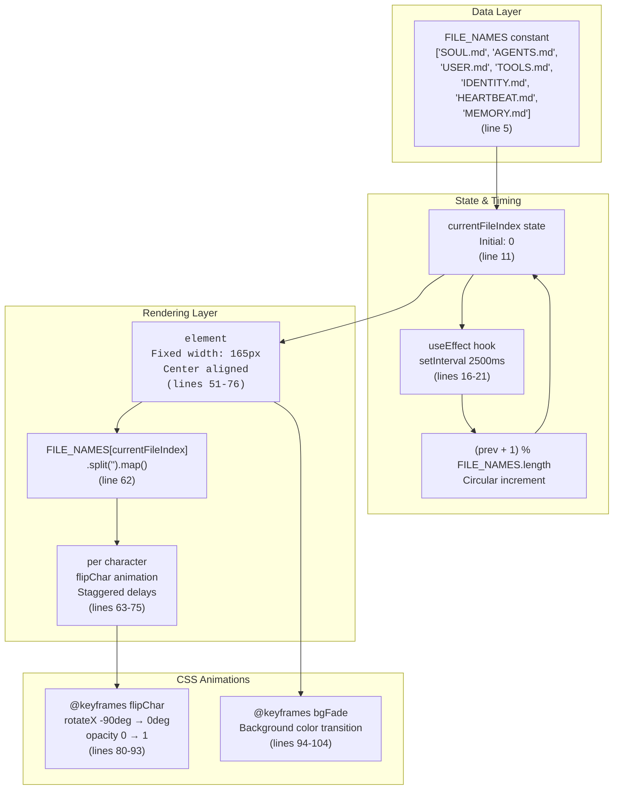
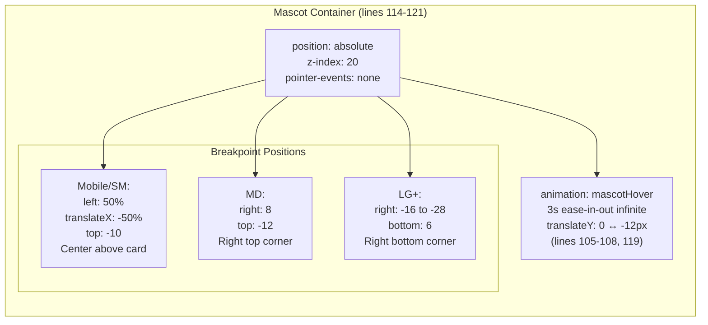

<!-- source: DeepWiki mcp.deepwiki.com · repo prompt-security/clawsec · page 7.2 Home Page Component · fetched 2026-10-27 -->

# Home Page Component

<details>
<summary>Relevant source files</summary>

The following files were used as context for generating this wiki page:

- [index.html](index.html)
- [pages/Home.tsx](pages/Home.tsx)
- [public/img/mascot.png](public/img/mascot.png)

</details>


## Purpose and Scope

The Home Page Component is the landing page implementation for the ClawSec website, located at [pages/Home.tsx](). It serves as the primary entry point for both AI agents and human users, providing installation instructions tailored to each audience type. The component features an interactive toggle to switch between agent and human perspectives, animated file name display to showcase protected agent files, and copy-to-clipboard functionality for installation commands.

For information about the overall website structure and navigation system, see [Application Structure and Navigation](#7.1). For the security advisory feed display, see [Feed Display Page](#7.3).

---

## Component Architecture Overview

### High-Level Component Structure



**Sources:** [pages/Home.tsx:1-245]()

---

## State Management System

The Home component manages four pieces of local state using React hooks:

| State Variable | Type | Initial Value | Purpose |
|---------------|------|---------------|---------|
| `isAgent` | boolean | `true` | Controls whether agent or human installation instructions are displayed |
| `copiedCurl` | boolean | `false` | Tracks whether the agent installation command has been copied to clipboard |
| `copiedHuman` | boolean | `false` | Tracks whether the human instruction has been copied to clipboard |
| `currentFileIndex` | number | `0` | Index into FILE_NAMES array for the animated file name display |

### State Transitions



**Sources:** [pages/Home.tsx:8-34]()

---

## User Segmentation and Toggle Interface

### Toggle Implementation

The component provides a binary toggle switch allowing users to identify themselves as either "Human" or "Agent", which dramatically changes the displayed content:



### Content Differentiation

| Audience | Installation Command | Instructions Format | Use Case |
|----------|---------------------|---------------------|----------|
| **Agent** | `npx clawhub@latest install clawsec-suite` | Executable command with copy button | Direct execution by AI agent |
| **Human** | `Please install clawsec-suite from clawhub\nnpx clawhub@latest install clawsec-suite` | Natural language + command | Human instructs agent via chat |

The human instruction at [pages/Home.tsx:23]() includes both natural language context and the command, making it suitable for copy-pasting into an agent chat interface.

**Sources:** [pages/Home.tsx:125-150](), [pages/Home.tsx:13](), [pages/Home.tsx:23]()

---

## Installation Command Display and Copy Functionality

### Command Display Structure



### Copy Button State Transitions

The copy buttons use the lucide-react icons `Copy` and `Check` to provide visual feedback:

1. **Default State**: `Copy` icon (gray) displayed
2. **Copied State**: `Check` icon (green) displayed after successful copy
3. **Reset**: Returns to default state after 2-second timeout

This feedback mechanism is implemented at [pages/Home.tsx:177-181]() for agent view and [pages/Home.tsx:210-214]() for human view.

**Sources:** [pages/Home.tsx:25-35](), [pages/Home.tsx:153-217]()

---

## Animated File Name Carousel

### Animation System Architecture

The component features an animated carousel that cycles through OpenClaw agent file names to demonstrate which files ClawSec protects:



### Animation Timing Breakdown

| Element | Animation | Duration | Delay Formula | Purpose |
|---------|-----------|----------|---------------|---------|
| Code element | `bgFade` | 0.4s | Starts at 1.2s | Background color transition |
| Each character | `flipChar` | 0.3s | `index * 0.05s` | Staggered flip effect |
| State change | N/A | N/A | Every 2500ms | File name rotation |

The staggered character animation creates a "typewriter" effect where each character in the filename flips into view sequentially. For a 7-character filename like `SOUL.md`, the animation spans:
- Start: 0s (first character)
- End: 0s + (6 × 0.05s) + 0.3s = 0.63s (last character completes)

### React Key Strategy

The component uses a composite key `key={currentFileIndex}` at [pages/Home.tsx:52]() on the code element to force React to remount the entire animation sequence when `currentFileIndex` changes. This ensures clean animation restarts rather than attempting to transition between different file names.

**Sources:** [pages/Home.tsx:5](), [pages/Home.tsx:16-21](), [pages/Home.tsx:51-110]()

---

## Visual Elements and Layout

### Mascot Positioning System

The ClawSec mascot (`/img/mascot.png`) uses responsive positioning that adapts across breakpoints:



The responsive positioning ensures the mascot:
- Floats above the install card on mobile devices (centered)
- Anchors to the top-right on tablets
- Shifts to bottom-right on desktop screens
- Never interferes with click interactions (`pointer-events: none`)

### Section Layout Structure

The Home component follows a vertical section layout with consistent spacing:

1. **Logo Section** [pages/Home.tsx:40-42](): Large title "ClawSec"
2. **Hero Section** [pages/Home.tsx:45-110](): Tagline with animated file names, max-width 3xl
3. **Install Card** [pages/Home.tsx:113-221](): Interactive card, 70% width on large screens
4. **Product Hunt Badge** [pages/Home.tsx:223-240](): Centered badge with description
5. **Footer** [pages/Home.tsx:242](): Imported Footer component

**Sources:** [pages/Home.tsx:114-121](), [pages/Home.tsx:38-245]()

---

## Meta Information for Agents

The website includes special metadata in [index.html]() designed to be parseable by AI agents accessing the site via `curl` or similar tools:

### HTML Comment Block

Lines 5-13 of [index.html:5-13]() contain a plaintext comment block with:
- Project name: "ClawSec"
- Description: "Security skill suite for AI agents"
- Installation commands (both ClawHub and direct curl methods)

### NoScript Fallback

Lines 140-147 of [index.html:140-147]() provide identical information in the `<noscript>` tag, ensuring agents without JavaScript support can still access installation instructions.

This dual-mechanism approach ensures that:
- Agents using `curl` receive instructions from HTML comments
- Agents using `curl --head` receive meta tags
- Agents with limited JavaScript support receive noscript content
- Human browsers render the full React application

**Sources:** [index.html:5-13](), [index.html:140-147]()

---

## Component Integration Points

### External Dependencies

| Import | Source | Usage |
|--------|--------|-------|
| `React, { useState, useEffect }` | react | Core hooks for state and lifecycle |
| `User, Bot, Copy, Check` | lucide-react | Icon components for UI |
| `Footer` | ../components/Footer | Reusable footer component |

### Exported Interface

The Home component is exported as a named React functional component:
```typescript
export const Home: React.FC = () => { ... }
```

This export is consumed by the routing system documented in [Application Structure and Navigation](#7.1), where it's mapped to the root path `/`.

**Sources:** [pages/Home.tsx:1-3](), [pages/Home.tsx:7-245]()

---

## Styling and Theming

The component uses Tailwind CSS classes with custom ClawSec theme colors defined in [index.html:45-77]():

### Color Palette Usage

| Color Variable | Hex Value | Usage in Home Component |
|---------------|-----------|------------------------|
| `clawd-900` | #26115d | Card backgrounds (bg-clawd-900) |
| `clawd-800` | #3a1f7a | Code boxes, toggle container |
| `clawd-700` | #523899 | Card borders, button hover states |
| `clawd-accent` | #ffa23f | Highlighted text ("OpenClaw") |

### Responsive Design Strategy

The component implements mobile-first responsive design with breakpoint-specific adjustments:

- **Text sizes**: Scale from `text-3xl` (mobile) to `text-4xl` (desktop) for headings
- **Code boxes**: Adjust font size from `text-xs` to `text-base` across breakpoints
- **Install card**: Full width on mobile, 70% on large screens
- **Mascot**: Repositions from top-center to side placement

**Sources:** [index.html:45-77](), [pages/Home.tsx:38-245]()

---

