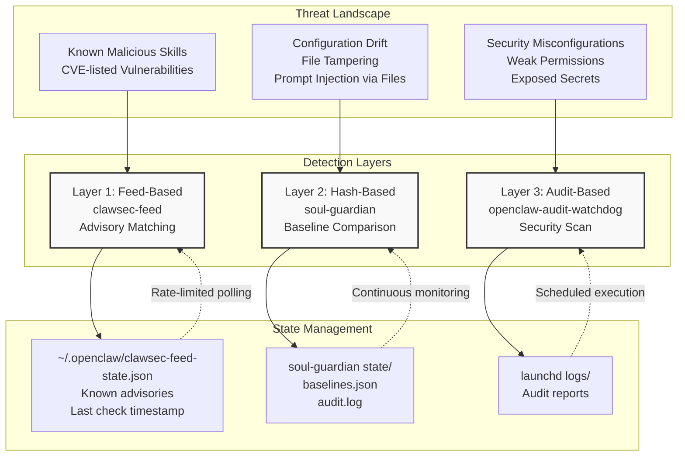
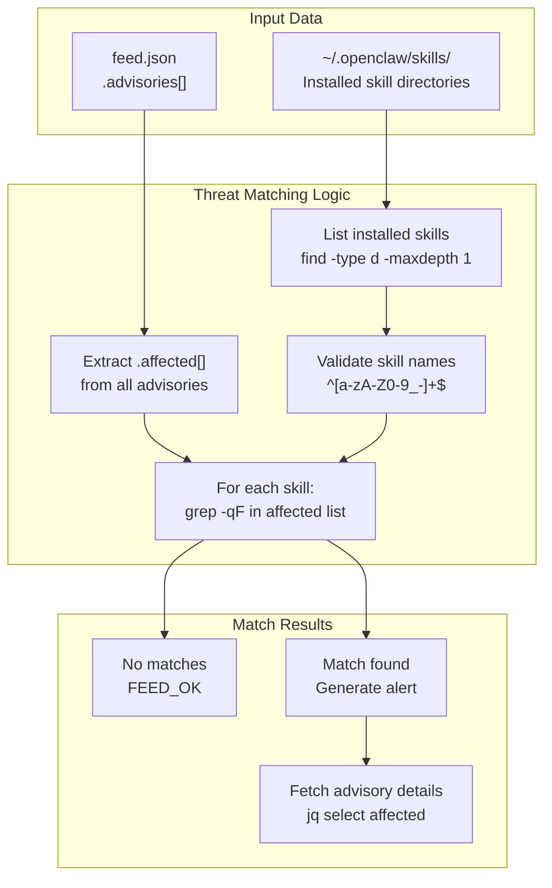
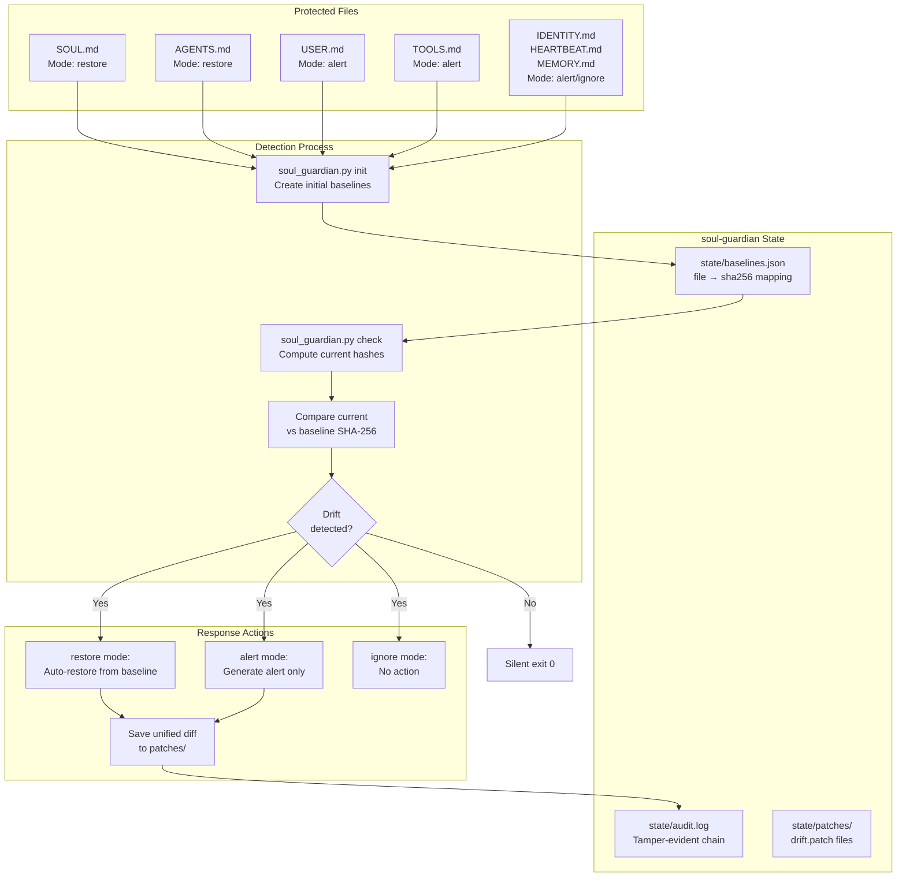
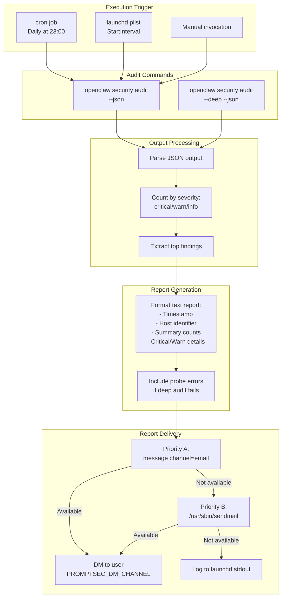
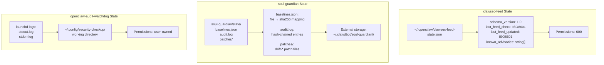

<!-- source: DeepWiki mcp.deepwiki.com · repo prompt-security/clawsec · page 8.1 Threat Detection Layers · fetched 2026-10-27 -->

# Threat Detection Layers

<details>
<summary>Relevant source files</summary>

The following files were used as context for generating this wiki page:

- [skills/clawsec-feed/SKILL.md](skills/clawsec-feed/SKILL.md)
- [skills/clawsec-feed/skill.json](skills/clawsec-feed/skill.json)
- [skills/openclaw-audit-watchdog/SKILL.md](skills/openclaw-audit-watchdog/SKILL.md)
- [skills/openclaw-audit-watchdog/skill.json](skills/openclaw-audit-watchdog/skill.json)
- [skills/soul-guardian/SKILL.md](skills/soul-guardian/SKILL.md)
- [skills/soul-guardian/scripts/install_launchd_plist.py](skills/soul-guardian/scripts/install_launchd_plist.py)

</details>


## Purpose and Scope

This document describes ClawSec's three-tier threat detection architecture: **feed-based detection** (known vulnerabilities), **hash-based detection** (configuration drift), and **audit-based detection** (comprehensive security scanning). Each layer targets different threat vectors and operates independently to provide defense-in-depth.

For information about how these detection mechanisms trigger response actions, see [Response Mechanisms and User Control](#8.2). For details on the integrity verification of skills themselves during installation, see [Integrity Verification](#8.3).

---

## Detection Architecture Overview

ClawSec implements three complementary detection layers that operate continuously to identify threats:



**Detection Layer Characteristics**

| Layer | Target Threats | Detection Method | Update Frequency | State Location |
|-------|---------------|------------------|------------------|----------------|
| Feed-Based | Known CVEs, malicious skills | Pattern matching against advisory database | Every 5-30 minutes (rate-limited) | `~/.openclaw/clawsec-feed-state.json` |
| Hash-Based | File tampering, drift | SHA-256 comparison with approved baselines | Continuous (heartbeat) or periodic (launchd) | `soul-guardian/state/baselines.json` |
| Audit-Based | Misconfigurations, policy violations | Command execution and output parsing | Daily (cron/launchd) | launchd logs |

**Sources:** [skills/clawsec-feed/SKILL.md:280-326](), [skills/soul-guardian/SKILL.md:48-60](), [skills/openclaw-audit-watchdog/SKILL.md:49-62]()

---

## Layer 1: Feed-Based Detection

### Advisory Feed Architecture

The feed-based detection layer monitors a centralized advisory feed for known threats and cross-references them against locally installed skills. This provides early warning for newly disclosed vulnerabilities and malicious skill campaigns.

```mermaid
graph LR
    subgraph Sources["Advisory Sources"]
        NVD["NIST NVD API<br/>CVE-2026-XXXXX"]
        Issues["GitHub Issues<br/>Community Reports"]
    end
    
    subgraph Feed["Feed Distribution"]
        MainFeed["advisories/feed.json<br/>Canonical feed"]
        RawGitHub["raw.githubusercontent.com<br/>main/advisories/feed.json"]
    end
    
    subgraph Detection["clawsec-feed Polling"]
        FetchFeed["curl --retry 3<br/>Download feed.json"]
        ParseJSON["jq .advisories<br/>Parse advisories"]
        CheckState["Load clawsec-feed-state.json<br/>Compare known_advisories"]
        CrossRef["Cross-reference<br/>against ~/.openclaw/skills/"]
    end
    
    subgraph Output["Detection Output"]
        NewAdvisory["New advisory detected"]
        MatchSkill["Installed skill matches<br/>advisory.affected[]"]
        Alert["Generate alert<br/>severity-based"]
    end
    
    NVD --> MainFeed
    Issues --> MainFeed
    MainFeed --> RawGitHub
    RawGitHub --> FetchFeed
    FetchFeed --> ParseJSON
    ParseJSON --> CheckState
    CheckState --> CrossRef
    CrossRef --> NewAdvisory
    CrossRef --> MatchSkill
    NewAdvisory --> Alert
    MatchSkill --> Alert
```



**Feed Polling Implementation**

The feed detection layer is implemented in [skills/clawsec-feed/SKILL.md:297-304]() with rate limiting enforced in [skills/clawsec-feed/SKILL.md:574-597]().

**Key Implementation Details:**

1. **Feed URL Resolution**: Uses environment variable `CLAWSEC_FEED_URL` if set, otherwise defaults to raw GitHub URL for real-time updates [skills/clawsec-feed/SKILL.md:299-300]()

2. **Advisory Structure**: Each advisory contains [skills/clawsec-feed/SKILL.md:308-325]():
   - `id`: Unique identifier (e.g., `GA-2026-001` for community, `CVE-2026-XXXXX` for NVD)
   - `severity`: `critical`, `high`, `medium`, `low`
   - `type`: `malicious_skill`, `vulnerable_skill`, `prompt_injection`, `attack_pattern`, `best_practice`
   - `affected[]`: Array of affected skill identifiers with version patterns

3. **State Tracking**: Maintains `~/.openclaw/clawsec-feed-state.json` [skills/clawsec-feed/SKILL.md:525-532]() with schema:
   ```json
   {
     "schema_version": "1.0",
     "last_feed_check": "2026-02-02T15:00:00Z",
     "last_feed_updated": "2026-02-02T12:00:00Z",
     "known_advisories": ["GA-2026-001", "GA-2026-002"]
   }
   ```

4. **Rate Limiting**: Minimum 5-minute interval between checks [skills/clawsec-feed/SKILL.md:587-596]() to prevent excessive API requests

**Sources:** [skills/clawsec-feed/SKILL.md:280-326](), [skills/clawsec-feed/SKILL.md:525-597]()

---

### Cross-Referencing and Threat Matching

The feed layer performs active correlation between advisory data and the local skill installation directory:



**Implementation**: The cross-referencing logic is implemented in [skills/clawsec-feed/SKILL.md:390-446]() with critical security validations:

1. **Skill Name Validation**: Uses regex `^[a-zA-Z0-9_-]+$` to prevent shell injection via malicious directory names [skills/clawsec-feed/SKILL.md:430-434]()

2. **Fixed-String Matching**: Uses `grep -qF` (fixed string) rather than regex to prevent regex injection attacks [skills/clawsec-feed/SKILL.md:441]()

3. **Advisory Detail Retrieval**: For matched skills, extracts full advisory details using jq [skills/clawsec-feed/SKILL.md:444]()

**Notification Thresholds** [skills/clawsec-feed/SKILL.md:479-496]():

| Severity | Notification Timing | Action Required |
|----------|-------------------|-----------------|
| `critical` | Immediate | User notification, take action |
| `high` | Soon | User notification, plan remediation |
| `medium` | Next interaction | Inform user |
| `low` | Log only | Available if user asks |

**Sources:** [skills/clawsec-feed/SKILL.md:390-496]()

---

## Layer 2: Hash-Based Detection (Drift)

### Baseline Management and File Integrity

The hash-based detection layer protects critical agent configuration files by maintaining SHA-256 baselines and detecting unauthorized modifications. This layer operates independently of network connectivity and provides real-time drift detection.



**Default Protection Policy** [skills/soul-guardian/SKILL.md:48-60]():

| File Pattern | Mode | Action on Drift |
|-------------|------|-----------------|
| `SOUL.md` | `restore` | Auto-restore to baseline + alert |
| `AGENTS.md` | `restore` | Auto-restore to baseline + alert |
| `USER.md` | `alert` | Alert only, no restore |
| `TOOLS.md` | `alert` | Alert only, no restore |
| `IDENTITY.md` | `alert` | Alert only, no restore |
| `HEARTBEAT.md` | `alert` | Alert only, no restore |
| `MEMORY.md` | `alert` | Alert only, no restore |
| `memory/*.md` | `ignore` | No action |

**Sources:** [skills/soul-guardian/SKILL.md:48-60]()

---

### Detection Workflow and Alert Format

The drift detection workflow is designed to be silent when no drift occurs, making it suitable for integration with heartbeat checks:

```mermaid
graph LR
    subgraph Invocation["Check Invocation"]
        CLI["soul_guardian.py check<br/>--output-format alert<br/>--actor heartbeat"]
    end
    
    subgraph Baseline["Baseline Loading"]
        LoadState["Load state/baselines.json"]
        ValidateBaseline["Validate baseline exists"]
    end
    
    subgraph Scan["File Scanning"]
        ReadFile["Read protected file"]
        ComputeHash["Compute SHA-256"]
        CompareHash{"Hash<br/>matches?"}
    end
    
    subgraph DriftHandling["Drift Handling"]
        GenerateDiff["Generate unified diff<br/>baseline vs current"]
        CheckMode{"File<br/>mode?"}
        Restore["restore:<br/>Atomic write baseline"]
        Alert["alert:<br/>Log drift only"]
        SavePatch["Save diff to<br/>patches/drift-TIMESTAMP.patch"]
    end
    
    subgraph Output["Output"]
        Silent["No output<br/>Exit 0"]
        AlertMsg["Security alert output<br/>Exit 2"]
    end
    
    CLI --> LoadState
    LoadState --> ValidateBaseline
    ValidateBaseline --> ReadFile
    ReadFile --> ComputeHash
    ComputeHash --> CompareHash
    
    CompareHash -->|"Match"| Silent
    CompareHash -->|"Mismatch"| GenerateDiff
    GenerateDiff --> CheckMode
    CheckMode -->|"restore"| Restore
    CheckMode -->|"alert"| Alert
    Restore --> SavePatch
    Alert --> SavePatch
    SavePatch --> AlertMsg
```



**Alert Format** [skills/soul-guardian/SKILL.md:96-114]():

When drift is detected with `--output-format alert`, the output is designed for direct relay to users:

```
==================================================
🚨 SOUL GUARDIAN SECURITY ALERT
==================================================

📄 FILE: SOUL.md
   Mode: restore
   Status: ✅ RESTORED to approved baseline
   Expected hash: abc123def456...
   Found hash:    789xyz000111...
   Diff saved: /path/to/patches/drift.patch

==================================================
Review changes and investigate the source of drift.
If intentional, run: soul_guardian.py approve --file <path>
==================================================
```

**Integration Methods**:

1. **Heartbeat Integration** [skills/soul-guardian/SKILL.md:31-39](): Add to `HEARTBEAT.md` for automatic checks
2. **launchd Integration** [skills/soul-guardian/scripts/install_launchd_plist.py:1-168](): Periodic background checks on macOS
3. **Watch Mode** [skills/soul-guardian/SKILL.md:72-75](): Continuous monitoring with configurable interval

**Sources:** [skills/soul-guardian/SKILL.md:31-114](), [skills/soul-guardian/scripts/install_launchd_plist.py:1-168]()

---

### Security Model and Limitations

The hash-based detection layer implements several security measures while acknowledging its limitations:

**Security Features** [skills/soul-guardian/SKILL.md:120-135]():

1. **SHA-256 Baseline Integrity**: Uses cryptographic hashing for tamper detection
2. **Unified Diff Generation**: Produces reviewable patches for all drift events
3. **Tamper-Evident Audit Log**: Hash-chained audit log tracks all operations
4. **Symlink Protection**: Refuses to operate on symbolic links
5. **Atomic Writes**: Uses atomic file operations for restoration to prevent partial writes

**Known Limitations** [skills/soul-guardian/SKILL.md:129-135]():

1. **Actor Attribution**: Cannot cryptographically prove WHO made a change (actor is metadata only)
2. **Dual Compromise**: Cannot protect if attacker controls both workspace AND external state directory
3. **Not a Backup Solution**: Baselines only store hashes, not full file content (except in patches)

**Recommended Configuration**: Store state directory outside the workspace (e.g., `~/.clawdbot/soul-guardian/<agent-id>/`) for better resilience against workspace compromise [skills/soul-guardian/scripts/install_launchd_plist.py:33-35]().

**Sources:** [skills/soul-guardian/SKILL.md:120-135](), [skills/soul-guardian/scripts/install_launchd_plist.py:33-35]()

---

## Layer 3: Audit-Based Detection

### Comprehensive Security Scanning

The audit-based detection layer runs comprehensive security checks by executing OpenClaw's built-in security audit commands. This layer provides deep analysis of configuration, permissions, and security posture.



**Audit Execution Flow** [skills/openclaw-audit-watchdog/SKILL.md:49-62]():

1. **Standard Audit**: Runs `openclaw security audit --json` for basic security checks
2. **Deep Audit**: Runs `openclaw security audit --deep --json` for comprehensive analysis
3. **Report Formatting**: Summarizes findings with critical/warn/info counts
4. **Delivery**: Attempts email delivery, falls back to DM, logs to launchd

**Sources:** [skills/openclaw-audit-watchdog/SKILL.md:49-116]()

---

### Configuration and Deployment

The audit watchdog supports both environment-based configuration (for MDM/automated deployment) and interactive setup:

**Environment Variables** [skills/openclaw-audit-watchdog/SKILL.md:69-80]():

| Variable | Purpose | Default |
|----------|---------|---------|
| `PROMPTSEC_DM_CHANNEL` | DM delivery channel (e.g., `telegram`) | Required |
| `PROMPTSEC_DM_TO` | Recipient identifier | Required |
| `PROMPTSEC_TZ` | IANA timezone for scheduling | `UTC` |
| `PROMPTSEC_HOST_LABEL` | Label in report | `hostname` |
| `PROMPTSEC_INSTALL_DIR` | Working directory for cron | `~/.config/security-checkup` |
| `PROMPTSEC_GIT_PULL` | Enable `git pull --ff-only` before run | Disabled |

**Cron Job Configuration** [skills/openclaw-audit-watchdog/SKILL.md:86-96]():

```json
{
  "schedule.kind": "cron",
  "schedule.expr": "0 23 * * *",
  "schedule.tz": "<user timezone>",
  "sessionTarget": "isolated",
  "wakeMode": "now",
  "payload.kind": "agentTurn",
  "payload.deliver": true
}
```

**Delivery Priority** [skills/openclaw-audit-watchdog/SKILL.md:120-131]():

1. **Priority A**: Email plugin if available: `message(action="send", channel="email", ...)`
2. **Priority B**: Fallback to sendmail: `printf "%s" "$REPORT" | /usr/sbin/sendmail -t`
3. **Fallback**: DM delivery with note about email failure

**Idempotency**: Before creating a new job, the watchdog checks for existing jobs named `"Daily security audit"` and updates them instead of creating duplicates [skills/openclaw-audit-watchdog/SKILL.md:133-140]().

**Sources:** [skills/openclaw-audit-watchdog/SKILL.md:69-140]()

---

## Detection Layer Integration

### Complementary Coverage Matrix

The three detection layers provide complementary coverage across the threat landscape:

```mermaid
graph TB
    subgraph ThreatTypes["Threat Categories"]
        T1["Known Vulnerabilities<br/>CVEs<br/>Malicious Skills"]
        T2["Tampering<br/>Configuration Drift<br/>File Modification"]
        T3["Misconfigurations<br/>Weak Permissions<br/>Policy Violations"]
        T4["Novel Attacks<br/>Zero-Days<br/>Unknown Threats"]
    end
    
    subgraph Coverage["Detection Coverage"]
        Feed1["Feed: Strong<br/>Database-driven matching"]
        Feed2["Feed: None<br/>Not file-based"]
        Feed3["Feed: None<br/>Not policy-based"]
        Feed4["Feed: Partial<br/>Community reports"]
        
        Hash1["Hash: None<br/>Not CVE-aware"]
        Hash2["Hash: Strong<br/>Cryptographic integrity"]
        Hash3["Hash: None<br/>Not policy-based"]
        Hash4["Hash: Strong<br/>Detects any file change"]
        
        Audit1["Audit: None<br/>Not CVE-aware"]
        Audit2["Audit: Weak<br/>Limited to known patterns"]
        Audit3["Audit: Strong<br/>Policy enforcement"]
        Audit4["Audit: None<br/>Requires signatures"]
    end
    
    T1 --> Feed1
    T1 --> Hash1
    T1 --> Audit1
    
    T2 --> Feed2
    T2 --> Hash2
    T2 --> Audit2
    
    T3 --> Feed3
    T3 --> Hash3
    T3 --> Audit3
    
    T4 --> Feed4
    T4 --> Hash4
    T4 --> Audit4
```



**Coverage Analysis**:

| Threat Type | Feed-Based | Hash-Based | Audit-Based | Best Defense |
|-------------|-----------|------------|-------------|--------------|
| Known CVEs | ✅ Strong | ❌ None | ❌ None | Feed-based |
| Malicious Skills | ✅ Strong | ❌ None | ❌ None | Feed-based |
| File Tampering | ❌ None | ✅ Strong | 🟡 Weak | Hash-based |
| Configuration Drift | ❌ None | ✅ Strong | 🟡 Weak | Hash-based |
| Weak Permissions | ❌ None | ❌ None | ✅ Strong | Audit-based |
| Policy Violations | ❌ None | ❌ None | ✅ Strong | Audit-based |
| Novel File-based Attacks | 🟡 Partial | ✅ Strong | ❌ None | Hash-based |
| Community-reported Threats | ✅ Strong | ❌ None | ❌ None | Feed-based |

**Defense-in-Depth Strategy**: The three layers operate independently, ensuring that:
- Network outages don't disable hash-based or audit-based detection
- Compromise of state files for one layer doesn't affect others
- Different attack vectors are covered by specialized detection mechanisms

**Sources:** [skills/clawsec-feed/SKILL.md:280-326](), [skills/soul-guardian/SKILL.md:48-60](), [skills/openclaw-audit-watchdog/SKILL.md:49-62]()

---

## Detection State Management

### State File Locations and Schemas

Each detection layer maintains independent state to track detection history and enable incremental checks:



**Feed State Schema** [skills/clawsec-feed/SKILL.md:525-532]():

```json
{
  "schema_version": "1.0",
  "last_feed_check": "2026-02-02T15:00:00Z",
  "last_feed_updated": "2026-02-02T12:00:00Z",
  "known_advisories": ["GA-2026-001", "CVE-2026-12345"]
}
```

- **Location**: `~/.openclaw/clawsec-feed-state.json`
- **Permissions**: 600 (user read/write only) [skills/clawsec-feed/SKILL.md:544]()
- **Validation**: Schema version check before reading [skills/clawsec-feed/SKILL.md:556-559]()
- **Corruption Handling**: Auto-backup and reset if invalid [skills/clawsec-feed/SKILL.md:549-553]()

**Guardian State Structure**:

- **Baselines**: `soul-guardian/state/baselines.json` - Maps file paths to SHA-256 hashes
- **Audit Log**: `soul-guardian/state/audit.log` - Tamper-evident operation log with hash chaining
- **Patches**: `soul-guardian/state/patches/` - Unified diff files for all detected drift
- **External Storage**: Recommended at `~/.clawdbot/soul-guardian/<agent-id>/` for resilience [skills/soul-guardian/scripts/install_launchd_plist.py:33-35]()

**Watchdog State** [skills/soul-guardian/scripts/install_launchd_plist.py:96-100]():

- **Log Directory**: `<state-dir>/logs/launchd.stdout.log` and `launchd.stderr.log`
- **Working Directory**: Specified in launchd plist, defaults to workspace root
- **Report Storage**: Transient - delivered via email/DM, not persisted

**Sources:** [skills/clawsec-feed/SKILL.md:525-570](), [skills/soul-guardian/scripts/install_launchd_plist.py:33-35](), [skills/soul-guardian/scripts/install_launchd_plist.py:96-100]()

---

### State Update Operations

State updates follow secure patterns to prevent corruption and maintain integrity:

**Feed State Updates** [skills/clawsec-feed/SKILL.md:561-570]():

```bash
# Atomic update pattern using temp file
TEMP_STATE=$(mktemp)
if jq --arg t "$(TZ=UTC date +%Y-%m-%dT%H:%M:%SZ)" \
   '.last_feed_check = $t' "$STATE_FILE" > "$TEMP_STATE"; then
  mv "$TEMP_STATE" "$STATE_FILE"
  chmod 600 "$STATE_FILE"
else
  echo "Error: Failed to update state file"
  rm -f "$TEMP_STATE"
fi
```

**Guardian State Security**:
- All state operations logged to tamper-evident audit log
- Atomic write operations prevent partial updates
- Symlink checks prevent TOCTOU attacks
- External state directory option isolates from workspace compromise

**Rate Limiting for Feed State** [skills/clawsec-feed/SKILL.md:586-596]():

```bash
LAST_CHECK=$(jq -r '.last_feed_check // "1970-01-01T00:00:00Z"' "$STATE_FILE")
LAST_EPOCH=$(date -d "$LAST_CHECK" +%s)
NOW_EPOCH=$(date +%s)

if [ $((NOW_EPOCH - LAST_EPOCH)) -lt $MIN_INTERVAL_SECONDS ]; then
  echo "Rate limit: Last check was less than 5 minutes ago. Skipping."
  exit 0
fi
```

**Sources:** [skills/clawsec-feed/SKILL.md:538-597](), [skills/soul-guardian/SKILL.md:120-135]()

---

