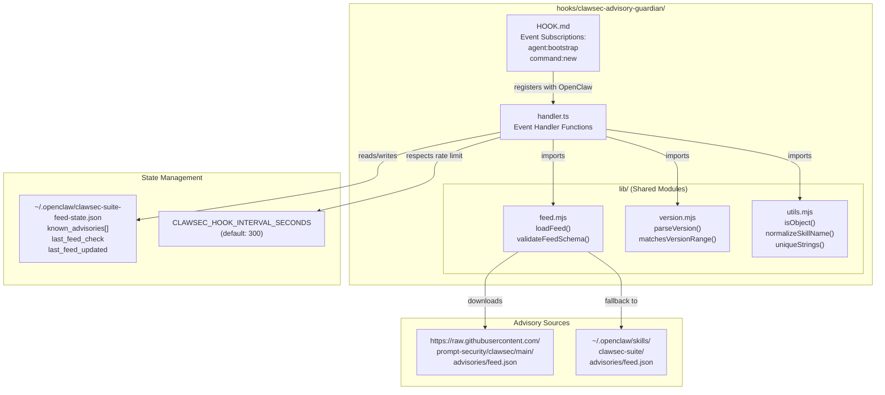
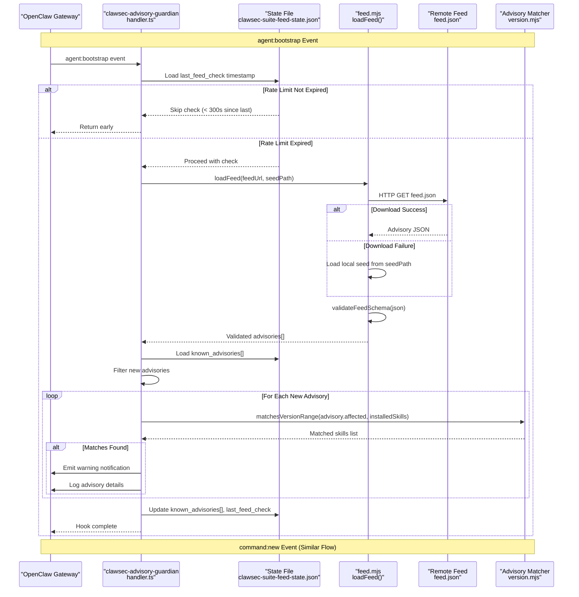
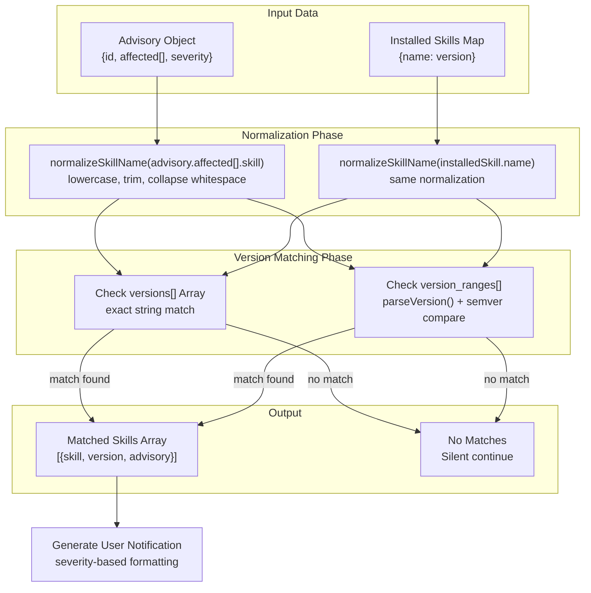
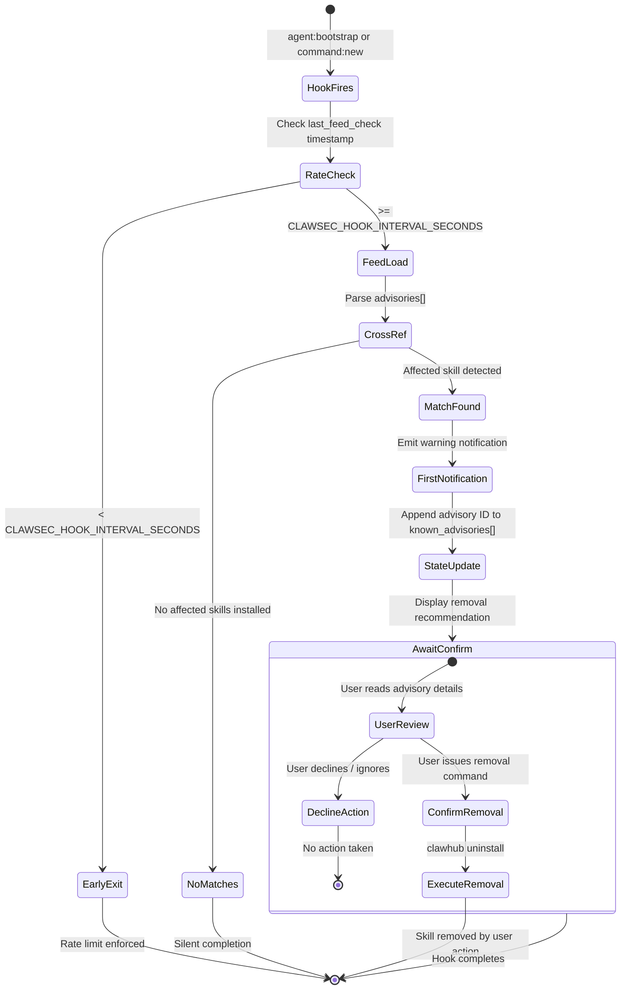

<!-- source: DeepWiki mcp.deepwiki.com · repo prompt-security/clawsec · extra page Advisory Guardian Hook · fetched 2026-10-27 -->

# Advisory Guardian Hook

<details>
<summary>Relevant source files</summary>

The following files were used as context for generating this wiki page:

- [skills/clawsec-suite/SKILL.md](skills/clawsec-suite/SKILL.md)
- [skills/clawsec-suite/skill.json](skills/clawsec-suite/skill.json)

</details>


## Purpose and Scope

The `clawsec-advisory-guardian` hook is an OpenClaw hook package bundled with `clawsec-suite` that provides real-time security monitoring by intercepting agent lifecycle events, checking the advisory feed for threats matching locally installed skills, and enforcing approval-gated responses before destructive actions. This document covers the hook's architecture, event lifecycle, cross-referencing logic, rate-limiting mechanisms, and approval-gating patterns.

For information about the suite's guarded installation flow that blocks risky installs at installation time, see [Guarded Skill Installation](#4.1.2). For the portable heartbeat procedure that can also trigger advisory checks, see [Heartbeat Workflow](#4.1.4). For details on the advisory feed structure and data sources, see [Advisory Feed Architecture](#3.1).

---

## Hook Package Structure

The advisory guardian is a self-contained OpenClaw hook package located at `hooks/clawsec-advisory-guardian/` within the suite installation directory. It consists of hook metadata, a TypeScript handler, and shared utility modules that are also used by other suite components.

### Hook Components

| Component | Path | Purpose |
|-----------|------|---------|
| Hook Metadata | `hooks/clawsec-advisory-guardian/HOOK.md` | OpenClaw hook manifest with event subscriptions |
| Event Handler | `hooks/clawsec-advisory-guardian/handler.ts` | Main hook handler that processes advisory events |
| Feed Utilities | `hooks/clawsec-advisory-guardian/lib/feed.mjs` | Advisory feed loading and validation logic |
| Version Matching | `hooks/clawsec-advisory-guardian/lib/version.mjs` | Semver parsing and version range matching |
| General Utilities | `hooks/clawsec-advisory-guardian/lib/utils.mjs` | Object validation, skill name normalization, string deduplication |

The hook follows OpenClaw's hook package structure, where `HOOK.md` declares event subscriptions and `handler.ts` exports the event handler functions that OpenClaw invokes at runtime.

**Diagram: Advisory Guardian Hook Package Structure**



Sources: [skills/clawsec-suite/skill.json:41-65](), [skills/clawsec-suite/SKILL.md:27-29]()

---

## Event Lifecycle and Hook Triggers

The advisory guardian subscribes to two critical OpenClaw lifecycle events that provide early intervention points before an agent begins processing user requests or starting new sessions.

### Hook Event Subscriptions

The hook fires on:

1. **`agent:bootstrap`** - Triggered when OpenClaw gateway initializes after restart or configuration reload. This provides a system-wide check before any user interactions occur.

2. **`command:new`** - Triggered when a user executes the `/new` command to start a fresh session. This ensures each new conversation context begins with current security state.

These events are declared in the hook metadata and registered during `setup_advisory_hook.mjs` execution. The hook handler receives event context including the OpenClaw instance, current configuration, and session state.

**Diagram: Advisory Guardian Event Flow**



Sources: [skills/clawsec-suite/SKILL.md:131-136](), [skills/clawsec-suite/skill.json:42-49]()

---

## Rate Limiting and State Management

To prevent excessive network requests and duplicate notifications, the hook implements rate-limiting based on time intervals and advisory ID tracking.

### Rate Limit Configuration

The hook respects the `CLAWSEC_HOOK_INTERVAL_SECONDS` environment variable, which defaults to `300` seconds (5 minutes). If a hook event fires within this interval since the last feed check, the handler exits early without fetching the feed.

[skills/clawsec-suite/SKILL.md:168]()

### State File Schema

The state file at `~/.openclaw/clawsec-suite-feed-state.json` tracks:

```json
{
  "schema_version": "1.0",
  "known_advisories": ["CVE-2026-12345", "CLAW-2026-0042"],
  "last_feed_check": "2026-01-15T10:30:00Z",
  "last_feed_updated": "2026-01-15T10:30:00Z"
}
```

| Field | Type | Purpose |
|-------|------|---------|
| `schema_version` | string | State file format version for future migrations |
| `known_advisories` | string[] | Array of advisory IDs previously seen and notified |
| `last_feed_check` | ISO 8601 | Timestamp of last feed poll attempt |
| `last_feed_updated` | ISO 8601 | Timestamp when feed data actually changed |

The handler initializes this file with empty arrays and null timestamps if it doesn't exist, setting file permissions to `600` for security.

[skills/clawsec-suite/SKILL.md:167-193]()

### Advisory ID Deduplication

New advisories are determined by set difference:

```
new_advisories = feed.advisories[].id - state.known_advisories[]
```

This ensures each advisory generates exactly one notification, even if the hook fires multiple times before state updates complete. After notification, the advisory IDs are appended to `known_advisories[]` and persisted atomically.

Sources: [skills/clawsec-suite/SKILL.md:195-196](), [skills/clawsec-suite/skill.json:52-65]()

---

## Advisory Cross-Referencing Logic

The hook's core security function is matching advisories to locally installed skills using the `affected` field structure and version range matching.

### Affected Skills Schema

Each advisory contains an `affected` array with entries specifying:

```json
{
  "id": "CVE-2026-12345",
  "affected": [
    {
      "skill": "helper-plus",
      "versions": ["1.0.0", "1.0.1"],
      "version_ranges": [">=1.0.0 <1.1.0"]
    }
  ]
}
```

### Matching Algorithm

**Diagram: Cross-Referencing and Matching Flow**



The matching process:

1. **Skill Name Normalization**: Both advisory skill names and installed skill names pass through `normalizeSkillName()` from `lib/utils.mjs`, which:
   - Converts to lowercase
   - Trims leading/trailing whitespace
   - Collapses multiple spaces to single space
   
   This prevents mismatches from case variations or whitespace inconsistencies.

2. **Exact Version Matching**: If the advisory specifies a `versions` array, check if the installed skill's version appears in this array using strict string equality.

3. **Range Version Matching**: If the advisory specifies `version_ranges` (semver ranges like `>=1.0.0 <2.0.0`), use `lib/version.mjs` functions:
   - Parse both installed version and range endpoints with `parseVersion()`
   - Compare using semver-aware logic (major.minor.patch comparison)
   - Return true if installed version falls within any specified range

4. **Match Aggregation**: Collect all matched (skill, version, advisory) tuples for notification generation.

Sources: [skills/clawsec-suite/SKILL.md:131-135](), [skills/clawsec-suite/skill.json:52-60]()

---

## Approval-Gated Response Flow

When the hook detects a match between an advisory and an installed skill, it implements a non-destructive notification pattern that requires explicit user confirmation before any removal action.

### Response Policy Hierarchy

The hook follows this graduated response model:

| Advisory Severity | Installed Skill Match | Hook Action |
|-------------------|----------------------|-------------|
| `critical` | Yes | Immediate notification + removal recommendation + approval gate |
| `high` | Yes | Immediate notification + removal recommendation + approval gate |
| `medium` | Yes | Notification + investigation recommendation |
| `low` | Yes | Notification + monitoring recommendation |
| Any | No | Silent (no notification) |

### Approval-Gated Removal Contract

The hook **never** automatically removes, disables, or modifies installed skills. Instead, it:

1. **First Notification**: When a match is detected, emit a warning to the OpenClaw notification system with:
   - Advisory ID and title
   - Severity level (uppercase, color-coded if supported)
   - Affected skill name and version
   - Brief description of the threat
   - Recommended action (e.g., "Remove helper-plus v1.0.1")

2. **First Confirmation**: The initial detection and notification count as the first confirmation that the user is aware of the threat.

3. **Await Second Confirmation**: The hook outputs guidance asking the user to explicitly confirm removal:
   ```
   "To proceed with removal, run: npx clawhub uninstall helper-plus"
   "Or confirm via: 'Yes, I want to remove helper-plus v1.0.1'"
   ```

4. **Second Confirmation Trigger**: Only after the user explicitly issues a removal command (detected by the suite's command processing logic or the user manually running uninstall) does removal proceed.

This double-confirmation pattern prevents:
- Automated attacks that manipulate the advisory feed to trigger mass skill removal
- False positives that delete legitimate skills
- Destructive actions during unattended agent operation

[skills/clawsec-suite/SKILL.md:223-234]()

**Diagram: Approval-Gated Removal Flow**



Sources: [skills/clawsec-suite/SKILL.md:223-234](), [skills/clawsec-suite/skill.json:94]()

---

## Installation and Configuration

The advisory guardian hook requires installation into OpenClaw's hooks directory and optional cron configuration for periodic checks outside event-driven triggers.

### Hook Installation

Execute the setup script after installing `clawsec-suite`:

```bash
SUITE_DIR="${INSTALL_ROOT:-$HOME/.openclaw/skills}/clawsec-suite"
node "$SUITE_DIR/scripts/setup_advisory_hook.mjs"
```

This script:
- Validates OpenClaw installation and configuration
- Copies the hook package to `~/.openclaw/hooks/clawsec-advisory-guardian/`
- Registers the hook in OpenClaw's hook registry
- Creates the state file with initial empty state

After installation, **restart the OpenClaw gateway** to load the hook.

[skills/clawsec-suite/SKILL.md:117-122]()

### Cron-Based Periodic Scanning

For agents that may run for extended periods without restart or `/new` commands, install the optional cron job:

```bash
SUITE_DIR="${INSTALL_ROOT:-$HOME/.openclaw/skills}/clawsec-suite"
node "$SUITE_DIR/scripts/setup_advisory_cron.mjs"
```

This creates a cron entry (default: every 6 hours) that triggers an advisory scan in the main OpenClaw session context. The cron job:
- Executes idempotently (updates existing entry rather than duplicating)
- Runs in the user's crontab (not system-wide)
- Invokes OpenClaw session commands that fire the `agent:bootstrap` event
- Respects the same `CLAWSEC_HOOK_INTERVAL_SECONDS` rate limit

[skills/clawsec-suite/SKILL.md:124-136]()

### Configuration Variables

| Variable | Default | Purpose |
|----------|---------|---------|
| `CLAWSEC_FEED_URL` | `https://raw.githubusercontent.com/prompt-security/clawsec/main/advisories/feed.json` | Remote advisory feed URL |
| `CLAWSEC_SUITE_STATE_FILE` | `~/.openclaw/clawsec-suite-feed-state.json` | State file path |
| `CLAWSEC_HOOK_INTERVAL_SECONDS` | `300` | Minimum seconds between feed checks |
| `INSTALL_ROOT` | `$HOME/.openclaw/skills` | Base directory for skill installations |

These variables can be set in the shell environment before running setup scripts or the OpenClaw gateway.

Sources: [skills/clawsec-suite/SKILL.md:163-168](), [skills/clawsec-suite/skill.json:68-75]()

---

## Integration with Suite Components

The advisory guardian hook shares utility modules with other `clawsec-suite` components, creating a cohesive security architecture.

### Shared Library Modules

**`lib/feed.mjs`**: Used by:
- Advisory guardian hook handler
- Heartbeat workflow (see [Heartbeat Workflow](#4.1.4))
- Guarded skill installer (see [Guarded Skill Installation](#4.1.2))

**`lib/version.mjs`**: Used by:
- Advisory guardian hook handler
- Guarded skill installer for version-based blocking
- Any future suite tools requiring semver comparisons

**`lib/utils.mjs`**: Used by:
- All suite scripts for consistent skill name handling
- JSON validation across installation and setup flows

This architectural pattern eliminates code duplication, ensures consistent behavior across suite components, and simplifies maintenance when advisory matching logic evolves.

### Relationship to Guarded Installer

While the advisory guardian hook provides **runtime monitoring** by checking advisories during agent lifecycle events, the guarded installer (see [Guarded Skill Installation](#4.1.2)) provides **installation-time blocking** by checking advisories before a skill is ever downloaded or installed.

The two mechanisms are complementary:
- **Guarded installer** catches threats at installation request time
- **Advisory guardian hook** catches threats for already-installed skills when new advisories are published

Both share the same double-confirmation pattern and advisory matching logic.

Sources: [skills/clawsec-suite/skill.json:51-80](), [skills/clawsec-suite/SKILL.md:23-29]()

---

## Security Considerations

### Rate Limiting Rationale

The 5-minute default interval (`300` seconds) balances:
- **Responsiveness**: Critical advisories propagate within 5 minutes of agent activity
- **Network overhead**: Prevents excessive GitHub API requests
- **DoS prevention**: Malicious actors cannot force rapid polling via event spam

For highly sensitive deployments, reduce `CLAWSEC_HOOK_INTERVAL_SECONDS` to `60` (1 minute), but monitor GitHub API rate limits.

### State File Integrity

The state file uses `600` permissions (user read/write only) to prevent:
- Unauthorized modification of `known_advisories[]` (which could suppress notifications)
- Race conditions from concurrent writes by multiple OpenClaw instances
- Information disclosure of installed skills to other system users

If the state file is corrupted or deleted, the hook regenerates it, but this triggers re-notification of all historical advisories. Agents should treat this as a security reset and review all notifications.

### Fallback to Local Seed

When remote feed downloads fail (network outage, GitHub downtime, DNS issues), the hook falls back to the bundled seed at `advisories/feed.json`. This seed:
- Contains advisories current as of the suite's release date
- Provides zero-connectivity operation for critical advisories
- May miss newly published advisories until remote access resumes

Operators should monitor feed check success rates and investigate persistent download failures.

Sources: [skills/clawsec-suite/SKILL.md:163-170](), [skills/clawsec-suite/SKILL.md:246-251]()

---

