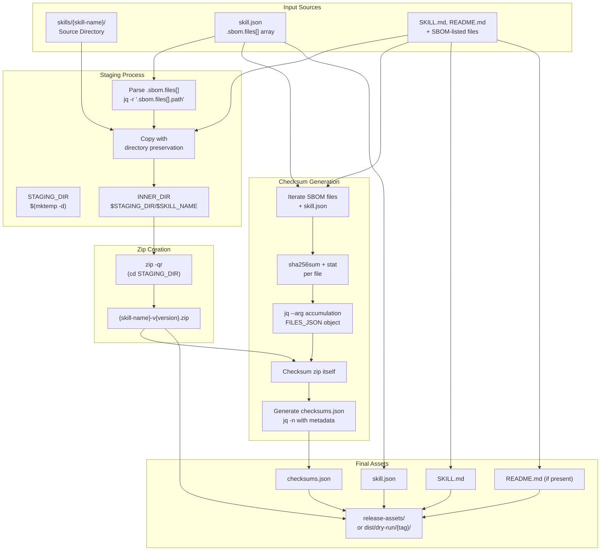
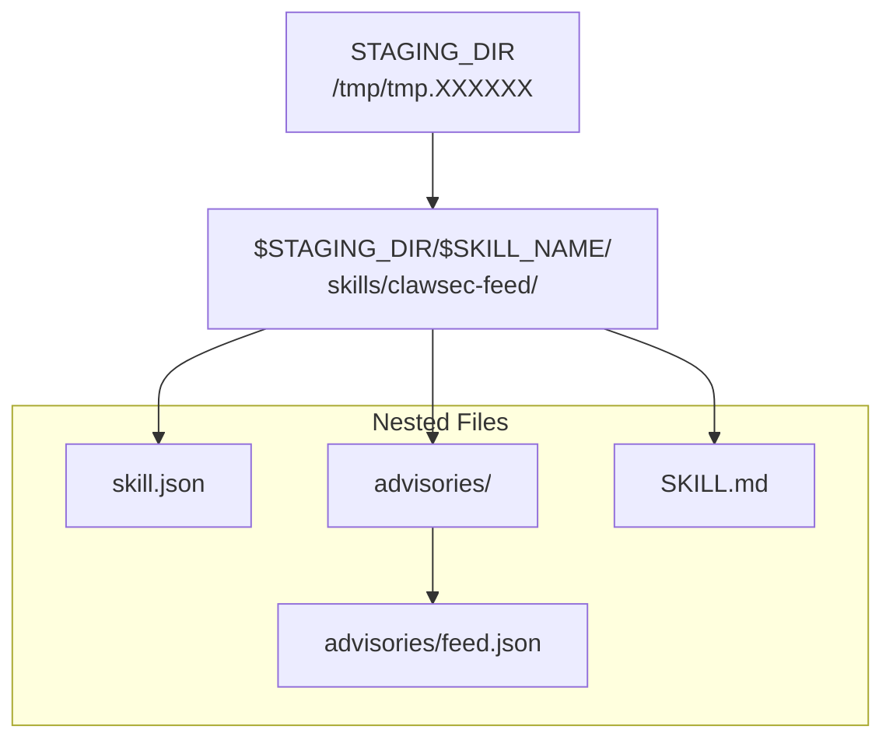
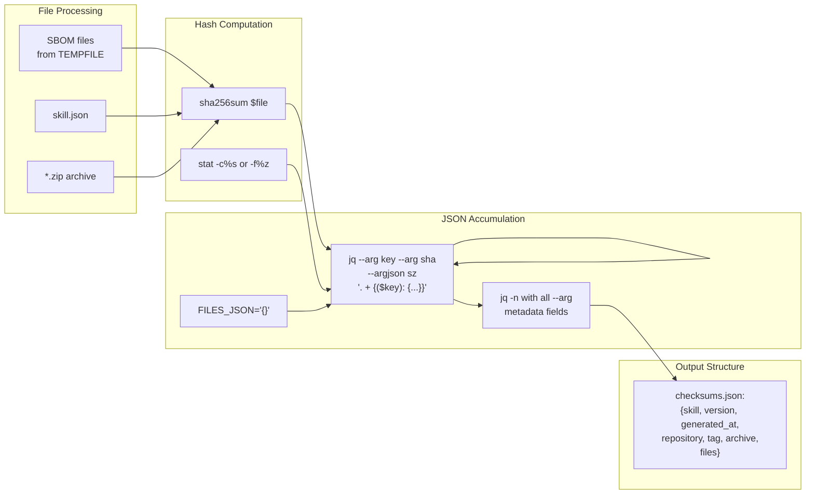
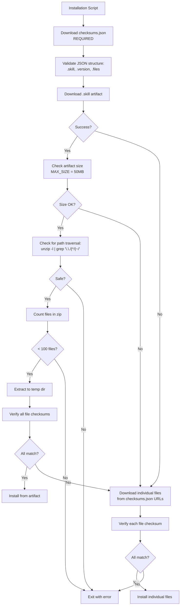

<!-- source: DeepWiki mcp.deepwiki.com · repo prompt-security/clawsec · extra page Release Asset Packaging · fetched 2026-10-27 -->

# Release Asset Packaging

<details>
<summary>Relevant source files</summary>

The following files were used as context for generating this wiki page:

- [.github/workflows/skill-release.yml](.github/workflows/skill-release.yml)
- [skills/clawsec-feed/SKILL.md](skills/clawsec-feed/SKILL.md)
- [skills/clawsec-feed/skill.json](skills/clawsec-feed/skill.json)

</details>


## Purpose and Scope

This document describes the technical mechanics of packaging ClawSec skills into distributable release assets during the CI/CD pipeline. It covers the creation of `.skill` zip archives, generation of `checksums.json` integrity manifests, and staging of release files. For version validation that occurs before packaging, see [Version Validation and PR Checks](#5.1.1). For publishing to ClawHub and GitHub Releases after packaging, see [Publishing and Distribution](#5.1.3).

**Sources:** [.github/workflows/skill-release.yml:1-706]()

---

## Overview of Release Assets

Each skill release produces a set of files that are published to GitHub Releases:

| Asset Type | Filename Pattern | Purpose |
|------------|-----------------|---------|
| **Zip Archive** | `{skill-name}-v{version}.zip` | Complete skill bundle with directory structure |
| **Checksums Manifest** | `checksums.json` | SHA256 hashes and metadata for all files |
| **Skill Metadata** | `skill.json` | Skill configuration and SBOM |
| **Installation Guide** | `SKILL.md` | Skill documentation |
| **Optional Documentation** | `README.md` | Additional documentation if present |

All files are packaged twice during the workflow: once during PR validation (dry-run) and once during tag-based release.

**Sources:** [.github/workflows/skill-release.yml:262-366](), [.github/workflows/skill-release.yml:494-599]()

---

## Packaging Flow Architecture



**Packaging Flow from Source to Release Assets**

This diagram shows how source files in `skills/{skill-name}/` are transformed into a complete release asset bundle through staging, zipping, and checksum generation.

**Sources:** [.github/workflows/skill-release.yml:266-366](), [.github/workflows/skill-release.yml:504-599]()

---

## SBOM File Staging with Directory Preservation

The packaging process preserves the directory structure of skill files by staging them in a nested temporary directory structure before creating the zip archive.

### Staging Directory Structure



**Staging Directory Nesting for Structure Preservation**

The nested `$SKILL_NAME` directory ensures that when the zip is extracted, it creates a top-level directory named after the skill.

**Sources:** [.github/workflows/skill-release.yml:505-507](), [.github/workflows/skill-release.yml:268-269]()

### Staging Implementation

The staging process reads the SBOM file list and copies each file while preserving its relative path:

```bash
# Parse SBOM file list from skill.json
TEMPFILE="$(mktemp)"
jq -r '.sbom.files[].path' "$SKILL_PATH/skill.json" > "$TEMPFILE"

# Copy each file preserving directory structure
while IFS= read -r file; do
  [ -z "$file" ] && continue
  FULL_PATH="$SKILL_PATH/$file"
  if [ -f "$FULL_PATH" ]; then
    mkdir -p "$INNER_DIR/$(dirname "$file")"
    cp "$FULL_PATH" "$INNER_DIR/$file"
  else
    echo "::error file=$SKILL_PATH/skill.json::SBOM references missing file: $file"
    exit 1
  fi
done < "$TEMPFILE"

# Copy skill.json itself
cp "$SKILL_PATH/skill.json" "$INNER_DIR/skill.json"
```

This code appears twice in the workflow: once in the dry-run job [.github/workflows/skill-release.yml:508-523]() and once in the release-tag job [.github/workflows/skill-release.yml:511-524]().

**Key implementation details:**
- `TEMPFILE` stores the list of SBOM files from `skill.json`
- `INNER_DIR` is `$STAGING_DIR/$SKILL_NAME` to create nested structure
- `mkdir -p` creates intermediate directories as needed
- Missing SBOM files cause workflow failure with `::error` annotation
- `skill.json` itself is copied explicitly (not listed in SBOM)

**Sources:** [.github/workflows/skill-release.yml:508-523](), [skills/clawsec-feed/skill.json:17-29]()

---

## Zip Archive Creation

After staging, the workflow creates a zip archive while preserving the directory structure.

### Zip Command Execution

```bash
ZIP_NAME="${SKILL_NAME}-v${VERSION}.zip"
(cd "$STAGING_DIR" && zip -qr "$OLDPWD/release-assets/$ZIP_NAME" .)
```

**Key aspects:**
- The `cd "$STAGING_DIR"` ensures the zip contains `$SKILL_NAME/` as the top-level directory
- `-q` flag suppresses zip output
- `-r` flag recursively includes all subdirectories
- `$OLDPWD` preserves the original working directory path for output
- Result is a zip like `clawsec-feed-v0.0.4.zip` containing `clawsec-feed/` directory

**Sources:** [.github/workflows/skill-release.yml:526-527](), [.github/workflows/skill-release.yml:288-289]()

### Example Archive Structure

For `clawsec-feed-v0.0.4.zip`:
```
clawsec-feed/
├── skill.json
├── SKILL.md
└── advisories/
    └── feed.json
```

This structure matches the SBOM specification in `skill.json` and allows extraction to create a properly structured skill directory.

**Sources:** [skills/clawsec-feed/skill.json:17-29]()

---

## Checksums.json Generation

The `checksums.json` file provides cryptographic integrity verification for all release assets. It is built incrementally using `jq` to accumulate file metadata.

### Checksums.json Data Flow



**Incremental JSON Construction for checksums.json**

Each SBOM file is hashed, and its metadata is accumulated into the `FILES_JSON` object using `jq` string concatenation.

**Sources:** [.github/workflows/skill-release.yml:530-581](), [.github/workflows/skill-release.yml:292-343]()

### Implementation Details

The checksums are generated through a multi-pass process:

**Pass 1: Process SBOM files**
```bash
FILES_JSON="{}"
while IFS= read -r file; do
  [ -z "$file" ] && continue
  FULL_PATH="$SKILL_PATH/$file"
  if [ -f "$FULL_PATH" ]; then
    SHA256=$(sha256sum "$FULL_PATH" | awk '{print $1}')
    SIZE=$(stat -c%s "$FULL_PATH" 2>/dev/null || stat -f%z "$FULL_PATH")
    FILES_JSON="$(echo "$FILES_JSON" | jq \
      --arg key "$file" \
      --arg sha "$SHA256" \
      --argjson sz "$SIZE" \
      '. + {($key): {sha256: $sha, size: $sz, path: $key}}')"
  fi
done < "$TEMPFILE"
```

**Pass 2: Add skill.json**
```bash
SKILL_JSON_SHA=$(sha256sum "$SKILL_PATH/skill.json" | awk '{print $1}')
SKILL_JSON_SIZE=$(stat -c%s "$SKILL_PATH/skill.json" 2>/dev/null || stat -f%z "$SKILL_PATH/skill.json")
FILES_JSON="$(echo "$FILES_JSON" | jq \
  --arg sha "$SKILL_JSON_SHA" \
  --argjson sz "$SKILL_JSON_SIZE" \
  '. + {"skill.json": {sha256: $sha, size: $sz}}')"
```

**Pass 3: Compute zip checksum**
```bash
ZIP_SHA=$(sha256sum "release-assets/$ZIP_NAME" | awk '{print $1}')
ZIP_SIZE=$(stat -c%s "release-assets/$ZIP_NAME" 2>/dev/null || stat -f%z "release-assets/$ZIP_NAME")
```

**Pass 4: Generate final JSON**
```bash
jq -n \
  --arg skill "$SKILL_NAME" \
  --arg version "$VERSION" \
  --arg generated "$(date -u +%Y-%m-%dT%H:%M:%SZ)" \
  --arg repo "${{ github.repository }}" \
  --arg tag "$TAG" \
  --arg zip_file "$ZIP_NAME" \
  --arg zip_sha "$ZIP_SHA" \
  --argjson zip_size "$ZIP_SIZE" \
  --arg zip_url "https://github.com/${{ github.repository }}/releases/download/$TAG/$ZIP_NAME" \
  --argjson files "$FILES_JSON" \
  '{
    skill: $skill,
    version: $version,
    generated_at: $generated,
    repository: $repo,
    tag: $tag,
    archive: {
      filename: $zip_file,
      sha256: $zip_sha,
      size: $zip_size,
      url: $zip_url
    },
    files: $files
  }' > "release-assets/checksums.json"
```

**Sources:** [.github/workflows/skill-release.yml:530-581]()

---

## Checksums.json Schema

The generated `checksums.json` file has the following structure:

```json
{
  "skill": "clawsec-feed",
  "version": "0.0.4",
  "generated_at": "2026-02-03T10:30:00Z",
  "repository": "prompt-security/clawsec",
  "tag": "clawsec-feed-v0.0.4",
  "archive": {
    "filename": "clawsec-feed-v0.0.4.zip",
    "sha256": "abc123...",
    "size": 12345,
    "url": "https://github.com/prompt-security/clawsec/releases/download/clawsec-feed-v0.0.4/clawsec-feed-v0.0.4.zip"
  },
  "files": {
    "SKILL.md": {
      "sha256": "def456...",
      "size": 25600
    },
    "advisories/feed.json": {
      "sha256": "789abc...",
      "size": 4096,
      "path": "advisories/feed.json"
    },
    "skill.json": {
      "sha256": "012def...",
      "size": 1024
    }
  }
}
```

### Schema Fields

| Field | Type | Description |
|-------|------|-------------|
| `skill` | string | Skill name (directory name) |
| `version` | string | Semantic version from `skill.json` |
| `generated_at` | string | ISO 8601 timestamp (UTC) |
| `repository` | string | GitHub repository (`owner/repo`) |
| `tag` | string | Git tag for this release |
| `archive.filename` | string | Zip filename |
| `archive.sha256` | string | SHA256 hash of zip file |
| `archive.size` | integer | Zip file size in bytes |
| `archive.url` | string | GitHub Release download URL |
| `files` | object | Per-file integrity data |
| `files.{path}.sha256` | string | SHA256 hash of file |
| `files.{path}.size` | integer | File size in bytes |
| `files.{path}.path` | string | Relative path (for nested files) |

**Key design decisions:**
- The `archive` object provides self-contained verification data for the zip
- The `files` object allows verification of individual files without extracting
- File keys use the actual path (`advisories/feed.json`) for nested files
- Both `stat -c%s` (Linux) and `stat -f%z` (macOS) are supported for portability

**Sources:** [.github/workflows/skill-release.yml:557-581]()

---

## Additional Documentation Files

Beyond the zip and checksums, the workflow copies standalone documentation files to the release assets directory:

```bash
# Copy skill.json and root-level docs alongside the zip
cp "$SKILL_PATH/skill.json" release-assets/skill.json
if [ -f "$SKILL_PATH/SKILL.md" ]; then
  cp "$SKILL_PATH/SKILL.md" release-assets/
fi
if [ -f "$SKILL_PATH/README.md" ]; then
  cp "$SKILL_PATH/README.md" release-assets/
fi
```

This allows agents to:
1. Inspect `skill.json` metadata before downloading the full archive
2. Read `SKILL.md` installation instructions directly from the release page
3. Access `README.md` for additional documentation

These files are **not checksummed separately** in `checksums.json` because they are also included inside the zip archive.

**Sources:** [.github/workflows/skill-release.yml:584-590](), [.github/workflows/skill-release.yml:354-360]()

---

## Dual Execution Context: Dry-Run vs Release

The packaging logic exists in two workflow jobs with identical implementation:

### Job Comparison

| Aspect | `release` Job (PR) | `release-tag` Job (Tag Push) |
|--------|-------------------|------------------------------|
| **Trigger** | Pull request with skill changes | Git tag push matching `*-v*.*.*` |
| **Output Directory** | `dist/dry-run/{tag}/release-assets/` | `release-assets/` |
| **Purpose** | Validate packaging logic | Create actual release assets |
| **Artifact Upload** | None (ephemeral) | GitHub Release via `softprops/action-gh-release` |
| **ClawHub Publish** | Skipped | Conditional on `openclaw.internal != true` |

### Code Duplication Rationale

The packaging code is intentionally duplicated [.github/workflows/skill-release.yml:266-366]() vs [.github/workflows/skill-release.yml:504-599]() to:

1. **Validate in PRs** - Catch packaging errors before merge
2. **Ensure consistency** - PR dry-run uses the exact same logic as release
3. **Prevent CI drift** - Changes to packaging logic are tested in both contexts
4. **Enable inspection** - Developers can examine dry-run output in PR logs

**Sources:** [.github/workflows/skill-release.yml:169-381](), [.github/workflows/skill-release.yml:383-669]()

---

## File Manifest and Release Assets

After packaging completes, the workflow outputs the contents of the release assets directory:

```bash
echo "=== checksums.json ==="
jq . "release-assets/checksums.json"
echo ""
echo "=== Release assets ==="
ls -la release-assets/
```

### Expected Output

```
=== checksums.json ===
{
  "skill": "clawsec-feed",
  "version": "0.0.4",
  ...
}

=== Release assets ===
total 32
-rw-r--r-- 1 runner docker 12345 Feb  3 10:30 clawsec-feed-v0.0.4.zip
-rw-r--r-- 1 runner docker  1245 Feb  3 10:30 checksums.json
-rw-r--r-- 1 runner docker  1024 Feb  3 10:30 skill.json
-rw-r--r-- 1 runner docker 25600 Feb  3 10:30 SKILL.md
-rw-r--r-- 1 runner docker  4096 Feb  3 10:30 README.md
```

All these files are then uploaded to the GitHub Release using the `softprops/action-gh-release` action.

**Sources:** [.github/workflows/skill-release.yml:594-598](), [.github/workflows/skill-release.yml:622-668]()

---

## Security Considerations in Packaging

The packaging process includes security validations documented in other subsections:

### SBOM Integrity Check

Missing SBOM files cause immediate workflow failure:
```bash
if [ -f "$FULL_PATH" ]; then
  # ... copy file ...
else
  echo "::error file=$SKILL_PATH/skill.json::SBOM references missing file: $file"
  exit 1
fi
```

This prevents incomplete packages from being released.

### Checksums Validation in Dry-Run

The dry-run job validates that checksums.json is valid JSON:
```bash
if ! jq -e . "${out_assets}/checksums.json" >/dev/null 2>&1; then
  echo "::error::Generated checksums.json is invalid JSON."
  failures=$((failures + 1))
  continue
fi
```

This catches JSON generation errors before they reach production releases.

### Size Tracking

The checksums include file sizes, which allows installation scripts to:
- Detect corrupted downloads (size mismatch)
- Prevent DoS attacks via unexpectedly large files
- Track bandwidth requirements

**Sources:** [.github/workflows/skill-release.yml:518-520](), [.github/workflows/skill-release.yml:345-351](), [.github/workflows/skill-release.yml:536-537]()

---

## Integration with Installation Scripts

The packaged assets are consumed by installation scripts in `SKILL.md` files. These scripts implement the verification flow:

### Installation Asset Selection



**Asset Selection Flow in Installation Scripts**

Installation scripts first attempt to use the `.skill` artifact with comprehensive security checks, then fall back to individual file downloads if the artifact is unavailable or fails validation.

**Sources:** [skills/clawsec-feed/SKILL.md:113-254]()

### Checksum Verification Example

The installation script verifies files using the checksums manifest:

```bash
for file in $(jq -r '.files | keys[]' "$TEMP_DIR/checksums.json"); do
  EXPECTED=$(jq -r --arg f "$file" '.files[$f].sha256' "$TEMP_DIR/checksums.json")
  FILE_PATH=$(jq -r --arg f "$file" '.files[$f].path' "$TEMP_DIR/checksums.json")
  
  ACTUAL=$(shasum -a 256 "$TEMP_DIR/extracted/clawsec-feed/$FILE_PATH" | cut -d' ' -f1)
  
  if [ "$EXPECTED" != "$ACTUAL" ]; then
    echo "  ✗ $file (checksum mismatch)"
    CHECKSUM_FAILED=1
  else
    echo "  ✓ $file"
  fi
done
```

This creates a verification loop:
1. CI generates checksums during packaging
2. Installation script downloads checksums.json
3. Installation script verifies each file against manifest
4. Any mismatch causes installation failure

**Sources:** [skills/clawsec-feed/SKILL.md:149-173]()

---

## File Path and Platform Compatibility

The packaging process uses portable shell commands to support both Linux and macOS:

### Platform-Specific Commands

```bash
# File size (Linux: -c%s, macOS: -f%z)
SIZE=$(stat -c%s "$FULL_PATH" 2>/dev/null || stat -f%z "$FULL_PATH")

# SHA256 (both use standard sha256sum)
SHA256=$(sha256sum "$FULL_PATH" | awk '{print $1}')
```

The `2>/dev/null ||` pattern attempts the Linux variant first, then falls back to macOS if it fails.

### Path Handling

All file paths in the SBOM use forward slashes (`/`) as separators, which work correctly on both Unix-like systems and Windows with Git Bash. The `mkdir -p` command creates intermediate directories:

```bash
mkdir -p "$INNER_DIR/$(dirname "$file")"
```

This ensures that nested files like `advisories/feed.json` are placed in `$INNER_DIR/advisories/feed.json`.

**Sources:** [.github/workflows/skill-release.yml:536-537](), [.github/workflows/skill-release.yml:515-516]()

---

## Summary

Release asset packaging transforms source skill directories into integrity-verified distribution bundles through:

1. **SBOM-driven staging** - Files are copied to a nested temporary directory based on `skill.json` declarations
2. **Structure-preserving zipping** - The zip archive maintains directory hierarchy for correct extraction
3. **Incremental checksum generation** - SHA256 hashes are computed and accumulated into a JSON manifest
4. **Multiple distribution formats** - Both zip archives and individual files are published
5. **Dual validation** - Packaging logic runs in both PR dry-runs and production releases
6. **Security checks** - Missing files, invalid JSON, and size constraints are enforced

The resulting assets enable secure, verifiable skill installation with fallback mechanisms and comprehensive integrity checking.

**Sources:** [.github/workflows/skill-release.yml:494-599](), [skills/clawsec-feed/SKILL.md:86-254]()

---

