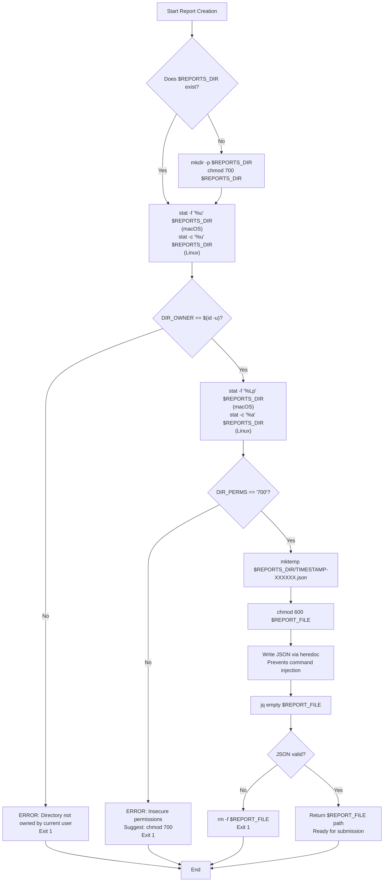
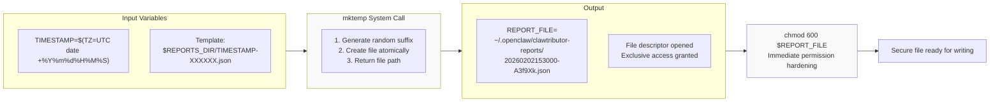
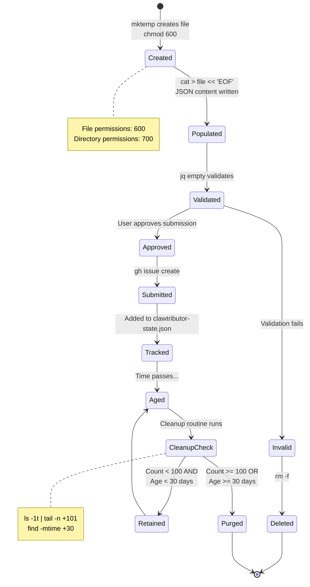
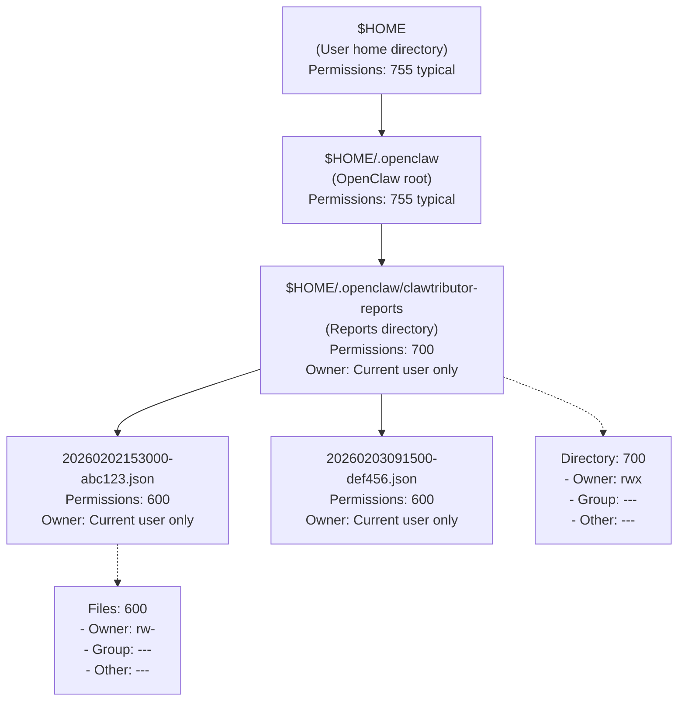

<!-- source: DeepWiki mcp.deepwiki.com · repo prompt-security/clawsec · extra page Report Creation and Security · fetched 2026-10-27 -->

# Report Creation and Security

<details>
<summary>Relevant source files</summary>

The following files were used as context for generating this wiki page:

- [skills/clawtributor/SKILL.md](skills/clawtributor/SKILL.md)
- [skills/clawtributor/skill.json](skills/clawtributor/skill.json)

</details>


This document describes the secure file creation mechanisms used by the `clawtributor` skill when agents prepare security incident reports. It covers atomic file operations, directory ownership verification, permission checks, and protections against symlink attacks and other file-based vulnerabilities.

For information about report content and classification, see [Report Types and Classification](#4.5.1). For information about GitHub submission and privacy considerations, see [GitHub Submission and Privacy](#4.5.3).

---

## Purpose and Scope

The `clawtributor` skill creates local report files in JSON format before submitting them to GitHub. These files may contain sensitive security information, making secure file creation critical. This page documents the technical implementation of:

- Secure directory initialization with proper ownership and permissions
- Atomic file creation that prevents symlink attacks
- Permission hardening to prevent unauthorized access
- JSON validation to ensure data integrity
- Automated cleanup to prevent disk bloat

---

## Report Storage Location

All report files are stored in a dedicated directory with restricted permissions:

```
$HOME/.openclaw/clawtributor-reports/
├── 20260202153000-abc123.json  # Timestamped report files
├── 20260203091500-def456.json
└── 20260205142200-ghi789.json
```

**Directory Path**: `$HOME/.openclaw/clawtributor-reports`

**Directory Permissions**: `700` (owner read/write/execute only)

**File Permissions**: `600` (owner read/write only)

Sources: [skills/clawtributor/SKILL.md:328-334]()

---

## Security Model

The report creation process defends against multiple file-based attack vectors:

| Threat | Mitigation |
|--------|-----------|
| **Symlink attacks** | Use `mktemp` for atomic file creation with unpredictable names |
| **Race conditions** | Check ownership and permissions before file creation |
| **Privilege escalation** | Verify directory owner matches current user |
| **Unauthorized access** | Enforce `700` on directory, `600` on files |
| **Command injection** | Use heredoc syntax for JSON content writing |
| **Disk exhaustion** | Implement cleanup policy (100 files or 30 days) |

Sources: [skills/clawtributor/SKILL.md:327-363](), [skills/clawtributor/SKILL.md:539-563]()

---

## Directory Security Verification Workflow

The following diagram shows the complete security verification sequence before creating a report file:

**Diagram: Directory Security Verification Flow**



Sources: [skills/clawtributor/SKILL.md:327-363](), [skills/clawtributor/SKILL.md:375-381]()

---

## Directory Initialization and Ownership Checks

### Directory Creation

When the reports directory doesn't exist, it is created with secure permissions immediately:

```bash
REPORTS_DIR="$HOME/.openclaw/clawtributor-reports"

if [ ! -d "$REPORTS_DIR" ]; then
  mkdir -p "$REPORTS_DIR"
  chmod 700 "$REPORTS_DIR"  # Owner-only access
fi
```

**Key Security Properties**:
- Permissions set immediately after creation
- No window where directory exists with default (insecure) permissions
- `-p` flag creates parent directories if needed

Sources: [skills/clawtributor/SKILL.md:331-334]()

### Ownership Verification

The system verifies that the current user owns the reports directory to prevent attacks where a malicious user creates the directory first:

```bash
DIR_OWNER=$(stat -f '%u' "$REPORTS_DIR" 2>/dev/null || stat -c '%u' "$REPORTS_DIR" 2>/dev/null)
if [ "$DIR_OWNER" != "$(id -u)" ]; then
  echo "Error: Reports directory not owned by current user" >&2
  echo "  Directory: $REPORTS_DIR" >&2
  echo "  Owner UID: $DIR_OWNER, Current UID: $(id -u)" >&2
  exit 1
fi
```

**Platform Compatibility**:
- macOS: `stat -f '%u'` (BSD stat)
- Linux: `stat -c '%u'` (GNU stat)
- Fallback pattern: `cmd1 || cmd2` tries both syntaxes

**Error Output**: Provides diagnostic information showing both the directory owner UID and current user UID for troubleshooting.

Sources: [skills/clawtributor/SKILL.md:336-343]()

### Permission Verification

After confirming ownership, the system verifies that directory permissions are exactly `700`:

```bash
DIR_PERMS=$(stat -f '%Lp' "$REPORTS_DIR" 2>/dev/null || stat -c '%a' "$REPORTS_DIR" 2>/dev/null)
if [ "$DIR_PERMS" != "700" ]; then
  echo "Error: Reports directory has insecure permissions: $DIR_PERMS" >&2
  echo "  Fix with: chmod 700 '$REPORTS_DIR'" >&2
  exit 1
fi
```

**Why Exact Match**: The check uses `!=` rather than comparing numeric values to catch any permission configuration that isn't exactly owner-only (e.g., `755` or `770` would both be rejected).

**User Guidance**: Error message includes the exact command to fix the issue.

Sources: [skills/clawtributor/SKILL.md:345-351]()

---

## Atomic File Creation with mktemp

**Diagram: Atomic File Creation Process**



Sources: [skills/clawtributor/SKILL.md:353-362]()

### mktemp Implementation

The system uses `mktemp` to create report files with unpredictable names:

```bash
TIMESTAMP=$(TZ=UTC date +%Y%m%d%H%M%S)
REPORT_FILE=$(mktemp "$REPORTS_DIR/${TIMESTAMP}-XXXXXX.json") || {
  echo "Error: Failed to create report file" >&2
  exit 1
}

chmod 600 "$REPORT_FILE"
```

**Why mktemp**:
- **Atomic creation**: File creation is a single system call
- **Unpredictable names**: `XXXXXX` replaced with random characters
- **Race condition prevention**: Impossible for attacker to predict filename
- **Symlink safety**: `mktemp` fails if target exists or is a symlink

**Timestamp + Random Suffix**: The filename includes both a readable timestamp (`20260202153000`) and a random suffix (`A3f9Xk`), balancing human readability with security.

**Error Handling**: The `|| { ... }` block ensures creation failures are caught immediately.

Sources: [skills/clawtributor/SKILL.md:353-362]()

---

## JSON Writing and Validation

### Heredoc Writing Pattern

Report content is written using heredoc syntax to prevent command injection:

```bash
cat > "$REPORT_FILE" << 'REPORT_EOF'
{
  "report_type": "vulnerable_skill",
  "severity": "high",
  "title": "Example report title",
  "description": "Detailed description here"
}
REPORT_EOF
```

**Security Properties**:
- **Single-quoted delimiter** (`'REPORT_EOF'`): Prevents variable expansion in content
- **No eval or echo**: Content written directly without shell interpretation
- **Safe for special characters**: JSON content can include `$`, `` ` ``, etc.

Sources: [skills/clawtributor/SKILL.md:364-373]()

### JSON Validation

After writing, the file is immediately validated:

```bash
if ! jq empty "$REPORT_FILE" 2>/dev/null; then
  echo "Error: Invalid JSON in report file"
  rm -f "$REPORT_FILE"
  exit 1
fi
```

**Validation Properties**:
- `jq empty` validates JSON structure without output
- Invalid files are deleted immediately
- Exit code signals failure to caller

**Why Validate Immediately**: Catching malformed JSON before user approval prevents submission of invalid reports.

Sources: [skills/clawtributor/SKILL.md:375-381]()

---

## Report File Lifecycle

**Diagram: Report File Lifecycle and Cleanup**



Sources: [skills/clawtributor/SKILL.md:327-381](), [skills/clawtributor/SKILL.md:539-563]()

---

## Automated Cleanup

To prevent unbounded disk usage, the system implements a cleanup policy:

### Cleanup Policy

| Condition | Action |
|-----------|--------|
| File count > 100 | Delete oldest files beyond 100 |
| File age > 30 days | Delete file regardless of count |

### Cleanup Implementation

```bash
cleanup_old_reports() {
  if [ ! -d "$REPORTS_DIR" ]; then
    return
  fi

  # Count total reports
  REPORT_COUNT=$(find "$REPORTS_DIR" -name "*.json" -type f 2>/dev/null | wc -l)

  if [ "$REPORT_COUNT" -gt 100 ]; then
    echo "Cleaning up old reports (keeping last 100)..."
    # Delete oldest files, keeping 100 most recent
    ls -1t "$REPORTS_DIR"/*.json 2>/dev/null | tail -n +101 | xargs rm -f 2>/dev/null
  fi

  # Also delete any reports older than 30 days
  find "$REPORTS_DIR" -name "*.json" -type f -mtime +30 -delete 2>/dev/null
}
```

**Cleanup Strategy**:
- `ls -1t`: List files sorted by modification time (newest first)
- `tail -n +101`: Skip first 100, output rest
- `xargs rm -f`: Delete old files
- `find -mtime +30`: Delete files older than 30 days

**When to Run**: Cleanup should be triggered periodically (e.g., during skill updates or audit runs).

Sources: [skills/clawtributor/SKILL.md:539-563]()

---

## Security Threat Mitigation Matrix

The following table maps specific threats to the implemented mitigations:

| Attack Vector | Technical Mitigation | Code Location |
|---------------|---------------------|---------------|
| **Symlink attack** | `mktemp` with unique suffix; fails on existing file/symlink | [SKILL.md:353-362]() |
| **TOCTOU race** | Directory ownership + permission checks before file creation | [SKILL.md:336-351]() |
| **Privilege escalation** | UID comparison: `DIR_OWNER != $(id -u)` check | [SKILL.md:337-343]() |
| **Information disclosure** | Directory `700`, files `600`, immediate permission setting | [SKILL.md:333,362]() |
| **Command injection** | Single-quoted heredoc delimiter (`'REPORT_EOF'`) | [SKILL.md:366]() |
| **Directory substitution** | Absolute path verification, not following symlinks | [SKILL.md:328]() |
| **Disk exhaustion DoS** | Cleanup at 100 files and 30 days | [SKILL.md:543-558]() |
| **JSON injection** | `jq empty` validation before use | [SKILL.md:376-381]() |

---

## Permission Model

**Diagram: Permission Hierarchy**



**Why This Hierarchy**:
- **Parent directories** (`$HOME`, `.openclaw`): Standard permissions allow directory traversal
- **Reports directory**: `700` prevents other users from listing contents
- **Report files**: `600` prevents other users from reading sensitive security data

Sources: [skills/clawtributor/SKILL.md:328-362]()

---

## Platform Compatibility

The implementation handles platform differences in `stat` command syntax:

| Platform | Owner Check | Permission Check |
|----------|-------------|------------------|
| **macOS** | `stat -f '%u' "$DIR"` | `stat -f '%Lp' "$DIR"` |
| **Linux** | `stat -c '%u' "$DIR"` | `stat -c '%a' "$DIR"` |
| **Pattern** | `cmd1 2>/dev/null \|\| cmd2 2>/dev/null` | Same fallback pattern |

**Why Fallback Pattern**: The `cmd1 || cmd2` pattern tries the BSD syntax first (macOS), then falls back to GNU syntax (Linux), ensuring the script works on both platforms without requiring runtime OS detection.

Sources: [skills/clawtributor/SKILL.md:337,346]()

---

## Integration with State Tracking

While report files are created in `clawtributor-reports/`, submitted reports are tracked in the state file:

**State File Location**: `$HOME/.openclaw/clawtributor-state.json`

**State File Permissions**: `600` (set during creation)

**State File Schema**:
```json
{
  "schema_version": "1.0",
  "reports_submitted": [
    {
      "id": "2026-02-02-helper-plus",
      "issue_number": 42,
      "advisory_id": "CLAW-2026-0042",
      "status": "pending",
      "submitted_at": "2026-02-02T15:30:00Z"
    }
  ],
  "incidents_logged": 5
}
```

**Separation of Concerns**:
- **Report files** (`clawtributor-reports/*.json`): Staging area for pre-submission content
- **State file** (`clawtributor-state.json`): Persistent tracking of submission history

This separation allows cleanup of old report files without losing submission history.

Sources: [skills/clawtributor/SKILL.md:486-531]()

---

## Error Messages and User Feedback

The implementation provides detailed error messages for troubleshooting:

### Directory Ownership Error

```
Error: Reports directory not owned by current user
  Directory: /home/user/.openclaw/clawtributor-reports
  Owner UID: 1001, Current UID: 1000
```

**Resolution**: Remove the directory and let the skill recreate it, or use `chown` to fix ownership.

### Permission Error

```
Error: Reports directory has insecure permissions: 755
  Fix with: chmod 700 '/home/user/.openclaw/clawtributor-reports'
```

**Resolution**: Run the suggested `chmod` command.

### File Creation Error

```
Error: Failed to create report file
```

**Possible Causes**: Disk full, filesystem read-only, or directory permissions changed after verification.

### JSON Validation Error

```
Error: Invalid JSON in report file
```

**Resolution**: Internal error; file is automatically deleted. Check for bugs in JSON generation code.

Sources: [skills/clawtributor/SKILL.md:339-350,357-358,377-381]()

---

This security-focused file creation mechanism ensures that even if an AI agent is compromised or misbehaving, report files cannot be used as an attack vector against the host system or other users.

---

