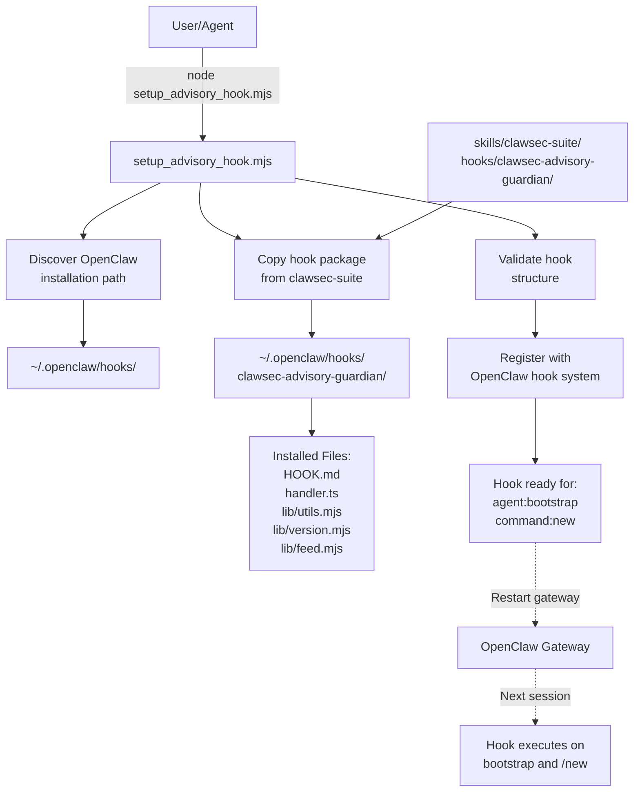
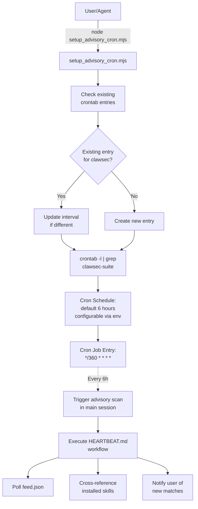
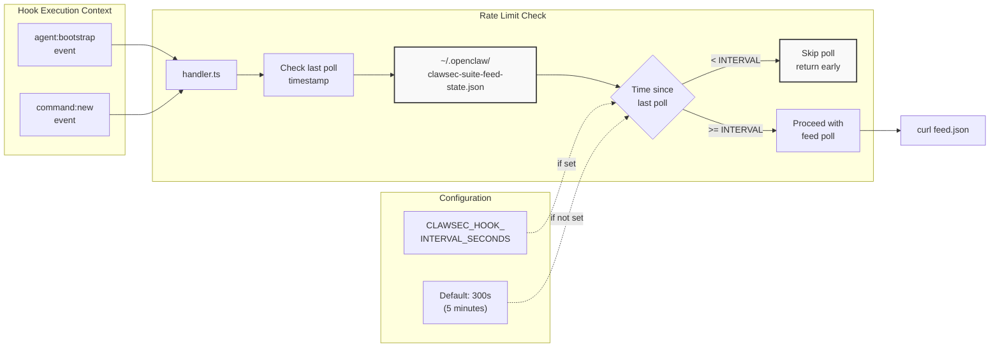

<!-- source: DeepWiki mcp.deepwiki.com · repo prompt-security/clawsec · extra page Suite Installation and Setup Scripts · fetched 2026-10-27 -->

# Suite Installation and Setup Scripts

<details>
<summary>Relevant source files</summary>

The following files were used as context for generating this wiki page:

- [skills/clawsec-suite/SKILL.md](skills/clawsec-suite/SKILL.md)
- [skills/clawsec-suite/skill.json](skills/clawsec-suite/skill.json)

</details>


## Purpose and Scope

This document describes the automation setup scripts bundled with `clawsec-suite` that enable continuous security monitoring for OpenClaw agents. These scripts configure the advisory guardian hook and optional periodic scanning.

For the hook handler implementation and logic, see [Advisory Guardian Hook](#4.1.3). For the guarded installation mechanism, see [Guarded Skill Installation](#4.1.2). For the heartbeat workflow, see [Heartbeat Workflow](#4.1.4).

**Sources:** [skills/clawsec-suite/SKILL.md:1-252](), [skills/clawsec-suite/skill.json:67-80]()

---

## Setup Scripts Overview

The suite includes two Node.js automation scripts located in `scripts/`:

| Script | Purpose | Idempotency | Required |
|--------|---------|-------------|----------|
| `setup_advisory_hook.mjs` | Installs the advisory guardian hook into OpenClaw's hook system | Yes | Recommended |
| `setup_advisory_cron.mjs` | Creates/updates a cron job for periodic advisory scans | Yes | Optional |

Both scripts are designed to be run post-installation and are idempotent—running them multiple times safely updates configuration without duplication.

**Sources:** [skills/clawsec-suite/SKILL.md:27-29](), [skills/clawsec-suite/skill.json:67-80]()

---

## Setup Advisory Hook Script

### setup_advisory_hook.mjs

**Diagram: Hook Installation Flow**



**Sources:** [skills/clawsec-suite/SKILL.md:115-137](), [skills/clawsec-suite/skill.json:42-65]()

### Execution

After installing `clawsec-suite`, run the hook setup script:

```bash
SUITE_DIR="${INSTALL_ROOT:-$HOME/.openclaw/skills}/clawsec-suite"
node "$SUITE_DIR/scripts/setup_advisory_hook.mjs"
```

**Sources:** [skills/clawsec-suite/SKILL.md:119-122]()

### Hook Package Structure

The script installs the complete hook package from the suite's embedded directory structure:

| File | Purpose |
|------|---------|
| `HOOK.md` | Hook metadata and documentation |
| `handler.ts` | Main hook handler for advisory checks |
| `lib/utils.mjs` | Utility functions (isObject, normalizeSkillName, uniqueStrings) |
| `lib/version.mjs` | Semver parsing and version matching |
| `lib/feed.mjs` | Advisory feed loading and validation |

**Sources:** [skills/clawsec-suite/skill.json:42-65]()

### Automation Behavior

Once the hook is installed and the gateway is restarted, the advisory guardian hook triggers on:

- **`agent:bootstrap`** - When the agent initializes
- **`command:new`** (triggered by `/new`) - When starting a new session

On each trigger, the hook:
1. Polls the advisory feed (rate-limited)
2. Compares advisories against installed skills
3. Notifies when new matches appear
4. Requires explicit user approval before any removal action

**Sources:** [skills/clawsec-suite/SKILL.md:131-137]()

---

## Setup Advisory Cron Script

### setup_advisory_cron.mjs

**Diagram: Cron Setup and Execution Flow**



**Sources:** [skills/clawsec-suite/SKILL.md:124-136](), [skills/clawsec-suite/skill.json:72-75]()

### Execution

To enable periodic advisory scans via cron:

```bash
SUITE_DIR="${INSTALL_ROOT:-$HOME/.openclaw/skills}/clawsec-suite"
node "$SUITE_DIR/scripts/setup_advisory_cron.mjs"
```

**Sources:** [skills/clawsec-suite/SKILL.md:126-129]()

### Default Configuration

| Parameter | Default | Environment Variable |
|-----------|---------|---------------------|
| Scan interval | 6 hours | `CLAWSEC_CRON_INTERVAL_HOURS` |
| Cron expression | `*/360 * * * *` | Calculated from interval |
| Target workflow | `HEARTBEAT.md` | N/A |

The cron job triggers the heartbeat workflow in the agent's main session, which then performs the complete advisory check workflow including feed polling, skill cross-referencing, and approval-gated response recommendations.

**Sources:** [skills/clawsec-suite/SKILL.md:124-129]()

### Integration with Heartbeat

The cron-triggered scan executes the suite's `HEARTBEAT.md` workflow (see [Heartbeat Workflow](#4.1.4)), which handles:

- Suite update checks
- Feed polling with rate limiting
- New advisory detection
- Affected skill cross-referencing
- Approval-gated response guidance
- Persistent state updates

**Sources:** [skills/clawsec-suite/SKILL.md:210-222]()

---

## Rate Limiting and State Management

### Hook Rate Limiting

**Diagram: Rate Limiting Architecture**



**Sources:** [skills/clawsec-suite/SKILL.md:164-169]()

### Configuration Parameters

The embedded feed monitoring uses these configuration points:

| Parameter | Default | Environment Variable | Purpose |
|-----------|---------|---------------------|---------|
| Feed URL | `https://raw.githubusercontent.com/prompt-security/clawsec/main/advisories/feed.json` | `CLAWSEC_FEED_URL` | Remote feed source |
| Local seed | `~/.openclaw/skills/clawsec-suite/advisories/feed.json` | N/A | Fallback when offline |
| State file | `~/.openclaw/clawsec-suite-feed-state.json` | `CLAWSEC_SUITE_STATE_FILE` | Tracks known advisories |
| Hook interval | `300` seconds | `CLAWSEC_HOOK_INTERVAL_SECONDS` | Minimum time between polls |

**Sources:** [skills/clawsec-suite/SKILL.md:164-169]()

### State File Schema

The state file at `~/.openclaw/clawsec-suite-feed-state.json` tracks feed check history:

```json
{
  "schema_version": "1.0",
  "known_advisories": ["CVE-2026-12345", "CLAW-2026-0042"],
  "last_feed_check": "2026-01-15T10:30:00Z",
  "last_feed_updated": "2026-01-15T10:30:00Z"
}
```

This state allows the system to:
- Detect new advisories since last check
- Avoid duplicate notifications
- Track feed freshness
- Persist across agent restarts

**Sources:** [skills/clawsec-suite/SKILL.md:189-193]()

---

## Post-Setup Requirements

### Gateway Restart

After running `setup_advisory_hook.mjs`, the OpenClaw gateway must be restarted for the hook to take effect:

```bash
# Restart gateway process
pkill -f "openclaw.*gateway"
# Or restart via systemd/launchd if applicable
```

### Initial Trigger

Run `/new` in the next session to force an immediate advisory scan:

```
/new
```

This ensures the hook executes at least once to verify installation and provide immediate security posture feedback.

**Sources:** [skills/clawsec-suite/SKILL.md:137]()

---

## Security Considerations

### Non-Destructive Defaults

Both setup scripts follow the principle of non-destructive automation:

- **Hook**: Only notifies about advisories; never auto-removes skills
- **Cron**: Only triggers checks; never performs actions without approval
- **State**: Maintains history without modifying skill installations

All destructive actions require explicit user confirmation (see [Guarded Skill Installation](#4.1.2) and [Advisory Guardian Hook](#4.1.3) for approval gate mechanisms).

**Sources:** [skills/clawsec-suite/SKILL.md:223-234]()

### Rate Limiting Enforcement

The default 5-minute (300-second) hook interval prevents:

- Advisory feed overload
- Excessive GitHub API requests
- Performance impact from frequent checks

The cron default of 6 hours provides periodic security checks without being intrusive.

**Sources:** [skills/clawsec-suite/SKILL.md:168-169](), [skills/clawsec-suite/SKILL.md:124](), [skills/clawsec-suite/SKILL.md:249]()

---

## Troubleshooting

### Verification Commands

After setup, verify installations:

```bash
# Check hook installation
ls -la ~/.openclaw/hooks/clawsec-advisory-guardian/

# Check cron installation
crontab -l | grep clawsec

# Check state file
cat ~/.openclaw/clawsec-suite-feed-state.json | jq .

# Manual feed check
SUITE_DIR="$HOME/.openclaw/skills/clawsec-suite"
curl -fsSL https://raw.githubusercontent.com/prompt-security/clawsec/main/advisories/feed.json | jq .
```

### Common Issues

| Issue | Diagnosis | Resolution |
|-------|-----------|------------|
| Hook not executing | Gateway not restarted | Restart OpenClaw gateway process |
| Cron not triggering | Invalid crontab syntax | Run `crontab -l` to verify entry |
| State file missing | Permissions or path issue | Check `~/.openclaw/` directory exists and is writable |
| Feed polling fails | Network or GitHub issue | Check connectivity; hook falls back to local seed |

**Sources:** [skills/clawsec-suite/SKILL.md:172-207]()

---

