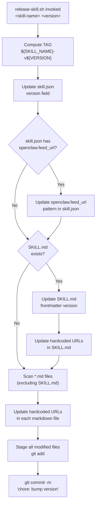
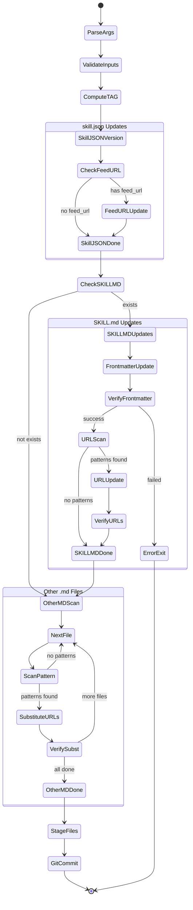
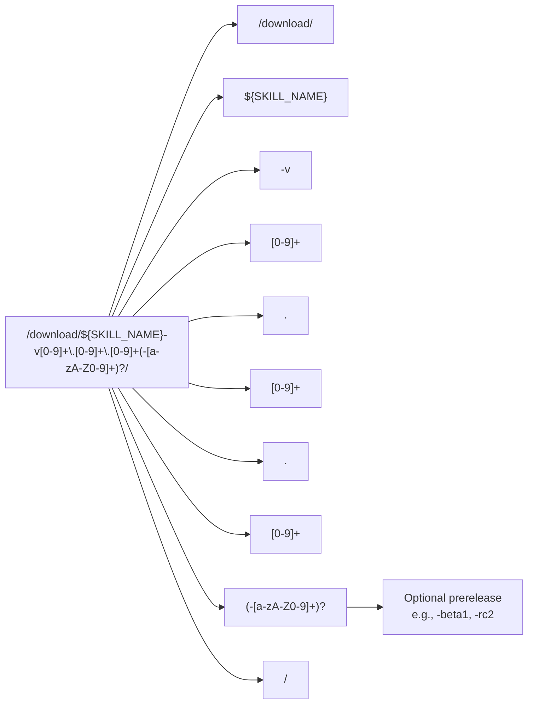
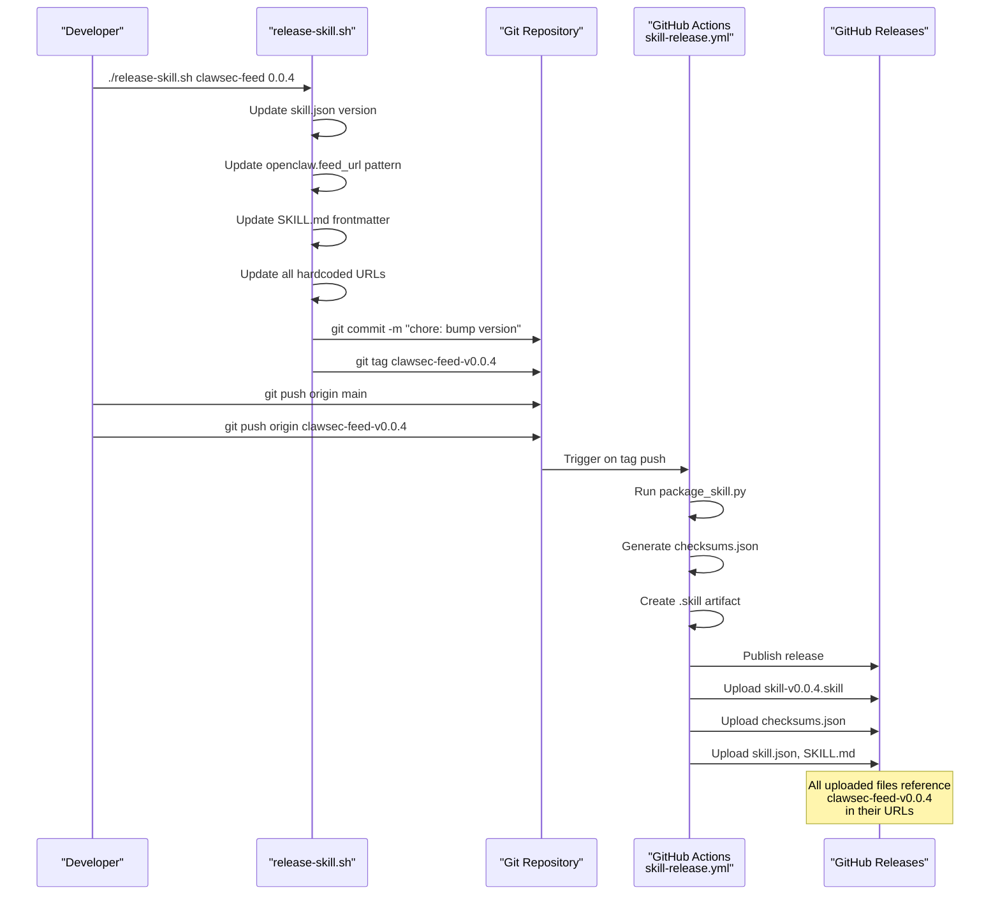

<!-- source: DeepWiki mcp.deepwiki.com · repo prompt-security/clawsec · extra page Version URL Pattern Updates · fetched 2026-10-27 -->

# Version URL Pattern Updates

<details>
<summary>Relevant source files</summary>

The following files were used as context for generating this wiki page:

- [scripts/release-skill.sh](scripts/release-skill.sh)

</details>


## Purpose and Scope

This document describes how [scripts/release-skill.sh]() automatically updates hardcoded version URLs across skill artifacts during the release process. When releasing a new skill version, the script ensures that all download URLs, feed URLs, and version references are consistently updated to point to the new version tag.

For information about the overall release script workflow and branch-aware behavior, see [Branch-Aware Release Workflow](#6.2.1). For general release script usage, see [Release Script Usage](#6.2).

---

## Overview

The release script performs URL pattern updates across three categories of files:
1. **skill.json**: Updates both the `version` field and any `openclaw.feed_url` patterns
2. **SKILL.md**: Updates frontmatter version and any hardcoded download URLs
3. **Other markdown files**: Updates hardcoded download URLs in supplementary documentation (e.g., `heartbeat.md`, `reporting.md`)

All URL updates use the same versioned tag pattern: `${SKILL_NAME}-v${VERSION}`, ensuring consistency across the entire skill artifact.

Sources: [scripts/release-skill.sh:1-290]()

---

## Tag Construction and URL Pattern

### Tag Format

The release script constructs a tag by combining the skill name with a semantic version:

```
TAG="${SKILL_NAME}-v${VERSION}"
```

**Examples:**
- `clawsec-feed-v1.1.0`
- `clawtributor-v0.0.2`
- `soul-guardian-v0.0.1-beta1`

The tag format supports prerelease versions (e.g., `1.0.0-beta1`) following semantic versioning conventions [scripts/release-skill.sh:71-74]().

Sources: [scripts/release-skill.sh:76]()

### URL Pattern Matching

The script searches for download URLs using a regex pattern that captures version numbers with optional prerelease suffixes:

```regex
/download/${SKILL_NAME}-v[0-9]+\.[0-9]+\.[0-9]+(-[a-zA-Z0-9]+)?/
```

This pattern matches:
- `/download/clawsec-feed-v1.0.0/` → `/download/clawsec-feed-v1.1.0/`
- `/download/prompt-agent-v1.0.0-beta1/` → `/download/prompt-agent-v1.0.0-beta2/`
- `/download/clawtributor-v0.0.1/` → `/download/clawtributor-v0.0.2/`

The pattern is skill-specific, preventing cross-contamination between different skills in the same repository.

Sources: [scripts/release-skill.sh:144, 173]()

---

## File Update Sequence

The following diagram shows the order and scope of file updates performed by the release script:



**File Update Sequence**: The script processes files in a deterministic order, starting with `skill.json` (version and feed URL), then `SKILL.md` (frontmatter and URLs), then all other markdown files. All changes are staged atomically before committing.

Sources: [scripts/release-skill.sh:100-221]()

---

## skill.json Updates

### Version Field Update

The script uses `jq` to update the `version` field in `skill.json` with atomic write operations:

```bash
jq --arg v "$VERSION" '.version = $v' "$SKILL_PATH/skill.json" > "$TEMP_DIR/skill.json"
mv "$TEMP_DIR/skill.json" "$SKILL_PATH/skill.json"
```

**Atomic Operation Flow:**
1. Write updated JSON to temporary file
2. Verify `jq` succeeded (exit code check)
3. Move temporary file to replace original (atomic on Unix systems)
4. Add to staging list

Sources: [scripts/release-skill.sh:100-107]()

### openclaw.feed_url Pattern Update

If the skill includes an `openclaw.feed_url` field (common in skills that embed feeds), the script updates the versioned portion of the URL:

```bash
jq --arg tag "$TAG" \
  '.openclaw.feed_url = (.openclaw.feed_url | gsub("/[^/]+-v[0-9.]+(-[a-zA-Z0-9]+)?/"; "/\($tag)/"))' \
  "$SKILL_PATH/skill.json" > "$TEMP_DIR/skill.json"
```

**Example Transformation:**
```json
{
  "openclaw": {
    "feed_url": "https://github.com/prompt-security/clawsec/releases/download/clawsec-feed-v0.0.3/advisories-feed.json"
  }
}
```
↓
```json
{
  "openclaw": {
    "feed_url": "https://github.com/prompt-security/clawsec/releases/download/clawsec-feed-v0.0.4/advisories-feed.json"
  }
}
```

The regex pattern `/[^/]+-v[0-9.]+(-[a-zA-Z0-9]+)?/` matches any skill tag in the path, then replaces it with the new tag.

Sources: [scripts/release-skill.sh:109-117]()

---

## SKILL.md Updates

### Frontmatter Version Update

The script updates the YAML frontmatter `version` field using `sed`:

```bash
sed "s/^version: .*/version: $VERSION/" "$SKILL_PATH/SKILL.md" > "$TEMP_DIR/SKILL.md"
```

**Verification Steps:**
1. Pre-check: Verify `version:` line exists before attempting substitution [scripts/release-skill.sh:124-128]()
2. Post-check: Verify new version appears in output [scripts/release-skill.sh:133-137]()
3. Error message includes expected format if validation fails

**Expected Frontmatter Format:**
```markdown
---
version: 1.1.0
---
```

The `^` anchor ensures only line-start matches, preventing accidental substitutions in documentation that mentions version numbers.

Sources: [scripts/release-skill.sh:119-140]()

### Hardcoded URL Updates in SKILL.md

The script updates all download URLs in `SKILL.md` that reference the skill itself:

```bash
PATTERN="/download/${SKILL_NAME}-v[0-9]+\.[0-9]+\.[0-9]+(-[a-zA-Z0-9]+)?/"
sed -E "s|$PATTERN|/download/${TAG}/|g" "$TEMP_DIR/SKILL.md" > "$TEMP_DIR/SKILL.md.tmp"
```

**Pattern Match Examples:**

| Before | After |
|--------|-------|
| `/download/clawsec-feed-v0.0.3/advisories-feed.json` | `/download/clawsec-feed-v0.0.4/advisories-feed.json` |
| `/download/clawtributor-v0.0.1/SKILL.md` | `/download/clawtributor-v0.0.2/SKILL.md` |
| `/download/soul-guardian-v1.0.0-beta1/checksums.json` | `/download/soul-guardian-v1.0.0-beta2/checksums.json` |

**Behavior Notes:**
- If no URL patterns found: Script emits informational message (not an error) [scripts/release-skill.sh:160]()
- Multiple URLs updated: Script reports count of substitutions [scripts/release-skill.sh:154-156]()
- Skill-specific pattern: Only updates URLs for the current skill, not other skills

Sources: [scripts/release-skill.sh:141-165]()

---

## Supplementary Markdown File Updates

The script scans all markdown files in the skill directory (excluding `SKILL.md`) and applies the same URL pattern updates:

```bash
for md_file in "$SKILL_PATH"/*.md; do
  if [ -f "$md_file" ] && [ "$md_file" != "$SKILL_PATH/SKILL.md" ]; then
    # Apply same pattern substitution
    sed -E "s|$PATTERN|/download/${TAG}/|g" "$md_file" > "$TEMP_DIR/$filename"
  fi
done
```

### Common Files Updated

| File | Typical Content with Version URLs |
|------|-----------------------------------|
| `heartbeat.md` | Installation instructions for suite updates |
| `reporting.md` | Links to current version's incident templates |
| `README.md` | Download links for manual installation |
| `CHANGELOG.md` | Release artifact links |

**Per-File Reporting:**
```
Updating hardcoded version URLs in heartbeat.md...
  ✓ Updated 3 URL(s) in heartbeat.md

Updating hardcoded version URLs in README.md...
  ℹ No hardcoded version URLs found in README.md (skipping)
```

The script tracks and stages each modified file individually, providing granular feedback on what changed [scripts/release-skill.sh:188, 190]().

Sources: [scripts/release-skill.sh:167-193]()

---

## URL Update State Machine

The following diagram shows how URL pattern updates flow through different file types with their specific update logic:



**State Machine Flow**: Each file type goes through pattern detection, substitution, verification, and staging. The script maintains a list of modified files (`FILES_TO_STAGE`) and stages them atomically before committing.

Sources: [scripts/release-skill.sh:98-221]()

---

## Atomic Operations and Error Handling

### Temporary Directory Usage

All file modifications use a temporary directory for atomic write operations:

```bash
TEMP_DIR=$(mktemp -d)
trap 'rm -rf "$TEMP_DIR"' EXIT
```

**Write Pattern:**
1. Process file → write to `$TEMP_DIR/filename`
2. Verify output (grep checks, substitution counts)
3. Move from temp directory to original location (atomic on Unix)
4. Add to `FILES_TO_STAGE` array

This pattern prevents partial writes if the script crashes mid-processing [scripts/release-skill.sh:94-95]().

Sources: [scripts/release-skill.sh:93-95, 102-106, 131-137, 147-158, 177-187]()

### Verification Matrix

Each update operation includes verification steps to ensure correctness:

| Update Type | Pre-Check | Post-Check | Failure Action |
|-------------|-----------|------------|----------------|
| skill.json version | File exists | jq exit code | Exit with error |
| openclaw.feed_url | Field exists (jq) | jq exit code | Exit with error |
| SKILL.md frontmatter | `version:` line exists | New version present | Exit with error |
| SKILL.md URLs | Pattern exists (optional) | Substitution count | Warn only |
| Other .md URLs | Pattern exists (optional) | Substitution count | Warn only |

**Error vs Warning Philosophy:**
- **Errors**: Structural issues (missing frontmatter, malformed JSON) cause immediate exit
- **Warnings**: Missing URL patterns are non-fatal since not all skills self-reference

Sources: [scripts/release-skill.sh:124-137, 151-156, 180-184]()

---

## Pattern Matching Details

### Regex Construction

The URL pattern is constructed dynamically for each skill:

```bash
PATTERN="/download/${SKILL_NAME}-v[0-9]+\.[0-9]+\.[0-9]+(-[a-zA-Z0-9]+)?/"
```

**Component Breakdown:**



**Regex Features:**
- `[0-9]+`: One or more digits (major, minor, patch)
- `(-[a-zA-Z0-9]+)?`: Optional prerelease (hyphen + alphanumeric)
- Skill-specific: `${SKILL_NAME}` prevents cross-skill matches
- Path-delimited: Requires `/download/` prefix and trailing `/`

Sources: [scripts/release-skill.sh:144, 173]()

### sed Invocation with Extended Regex

The script uses `sed -E` for extended regular expression syntax:

```bash
sed -E "s|$PATTERN|/download/${TAG}/|g"
```

**Options:**
- `-E`: Extended regex (allows `+`, `?`, `()` without escaping)
- `s|...|...|g`: Substitute with pipe delimiter (avoids escaping slashes)
- `g`: Global (all matches on each line)

The pipe delimiter (`|`) is used instead of the traditional slash (`/`) to avoid escaping issues when the pattern itself contains slashes [scripts/release-skill.sh:148, 177]().

Sources: [scripts/release-skill.sh:148, 177]()

---

## File Staging and Commit Flow

### Staged Files Tracking

The script maintains an array of modified files for atomic staging:

```bash
FILES_TO_STAGE=()

# After each update:
FILES_TO_STAGE+=("$SKILL_PATH/skill.json")
FILES_TO_STAGE+=("$SKILL_PATH/SKILL.md")
FILES_TO_STAGE+=("$md_file")
```

**Staging Process:**
```bash
for file in "${FILES_TO_STAGE[@]}"; do
  git add "$file"
done
```

This ensures:
1. Only intentionally modified files are staged
2. Files are staged after verification passes
3. Atomic commit includes all related changes

Sources: [scripts/release-skill.sh:98, 107, 164, 188, 202-205]()

### Commit Message Format

The script generates a conventional commit message:

```bash
git commit -m "chore($SKILL_NAME): bump version to $VERSION"
```

**Examples:**
- `chore(clawsec-feed): bump version to 0.0.4`
- `chore(clawtributor): bump version to 0.0.2`
- `chore(soul-guardian): bump version to 1.0.0-beta1`

The `chore` type indicates non-functional maintenance work, and the scope identifies the affected skill [scripts/release-skill.sh:215]().

Sources: [scripts/release-skill.sh:215]()

---

## Example: Complete URL Update Flow

### Scenario: clawsec-feed v0.0.3 → v0.0.4

**Input:**
```bash
./scripts/release-skill.sh clawsec-feed 0.0.4
```

**Computed Values:**
```bash
SKILL_NAME="clawsec-feed"
VERSION="0.0.4"
TAG="clawsec-feed-v0.0.4"
PATTERN="/download/clawsec-feed-v[0-9]+\.[0-9]+\.[0-9]+(-[a-zA-Z0-9]+)?/"
```

### File Transformations

#### skill.json
```json
// Before
{
  "version": "0.0.3",
  "openclaw": {
    "feed_url": "https://github.com/prompt-security/clawsec/releases/download/clawsec-feed-v0.0.3/advisories-feed.json"
  }
}

// After
{
  "version": "0.0.4",
  "openclaw": {
    "feed_url": "https://github.com/prompt-security/clawsec/releases/download/clawsec-feed-v0.0.4/advisories-feed.json"
  }
}
```

#### SKILL.md
```markdown
<!-- Before -->
---
version: 0.0.3
---

Download the feed:
https://github.com/prompt-security/clawsec/releases/download/clawsec-feed-v0.0.3/advisories-feed.json

<!-- After -->
---
version: 0.0.4
---

Download the feed:
https://github.com/prompt-security/clawsec/releases/download/clawsec-feed-v0.0.4/advisories-feed.json
```

#### heartbeat.md
```markdown
<!-- Before -->
curl -O https://github.com/prompt-security/clawsec/releases/download/clawsec-feed-v0.0.3/SKILL.md
curl -O https://github.com/prompt-security/clawsec/releases/download/clawsec-feed-v0.0.3/checksums.json

<!-- After -->
curl -O https://github.com/prompt-security/clawsec/releases/download/clawsec-feed-v0.0.4/SKILL.md
curl -O https://github.com/prompt-security/clawsec/releases/download/clawsec-feed-v0.0.4/checksums.json
```

### Console Output
```
Releasing clawsec-feed version 0.0.4
Branch: main
Mode: Full release (will create tag)
=======================================
Updating skills/clawsec-feed/skill.json version to 0.0.4...
Updating openclaw.feed_url to use tag clawsec-feed-v0.0.4...
Updating skills/clawsec-feed/SKILL.md frontmatter version to 0.0.4...
  ✓ Version updated to 0.0.4
Updating hardcoded version URLs in SKILL.md to use tag clawsec-feed-v0.0.4...
  ✓ Updated 2 hardcoded URL(s)
Updating hardcoded version URLs in heartbeat.md...
  ✓ Updated 3 URL(s) in heartbeat.md
Updating hardcoded version URLs in README.md...
  ℹ No hardcoded version URLs found in README.md (skipping)

Changes to skills/clawsec-feed/:
[git diff output showing changed lines]

Staging changes...
Committing changes...
Committed: abc123def456
Creating tag: clawsec-feed-v0.0.4

Done! To release, push the tag:
  git push origin main
  git push origin clawsec-feed-v0.0.4
```

Sources: [scripts/release-skill.sh:84-289]()

---

## Integration with CI/CD Pipeline

The URL updates prepared by the release script enable the CI/CD pipeline to build versioned artifacts:



**Pipeline Dependency**: The skill-release.yml workflow expects the tag to match the version in `skill.json` and `SKILL.md`. The release script ensures this consistency by updating all files atomically before tagging. See [Skill Release Pipeline](#5.1) for workflow details.

Sources: [scripts/release-skill.sh:1-290]()

---

## Summary

The version URL pattern update system ensures consistency across all skill artifacts through:

1. **Deterministic Tag Construction**: `${SKILL_NAME}-v${VERSION}` format used universally
2. **Skill-Specific Patterns**: Regex matches only current skill's URLs
3. **Multi-File Updates**: Handles skill.json, SKILL.md, and supplementary markdown files
4. **Atomic Operations**: Temp directory staging prevents partial writes
5. **Graduated Verification**: Structural errors fail, missing patterns warn
6. **Batch Staging**: All changes committed atomically

This architecture prevents version skew where documentation references old release URLs while code declares new versions, which would break installation instructions and feed subscriptions.

Sources: [scripts/release-skill.sh:1-290]()

---

