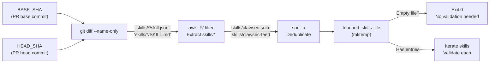
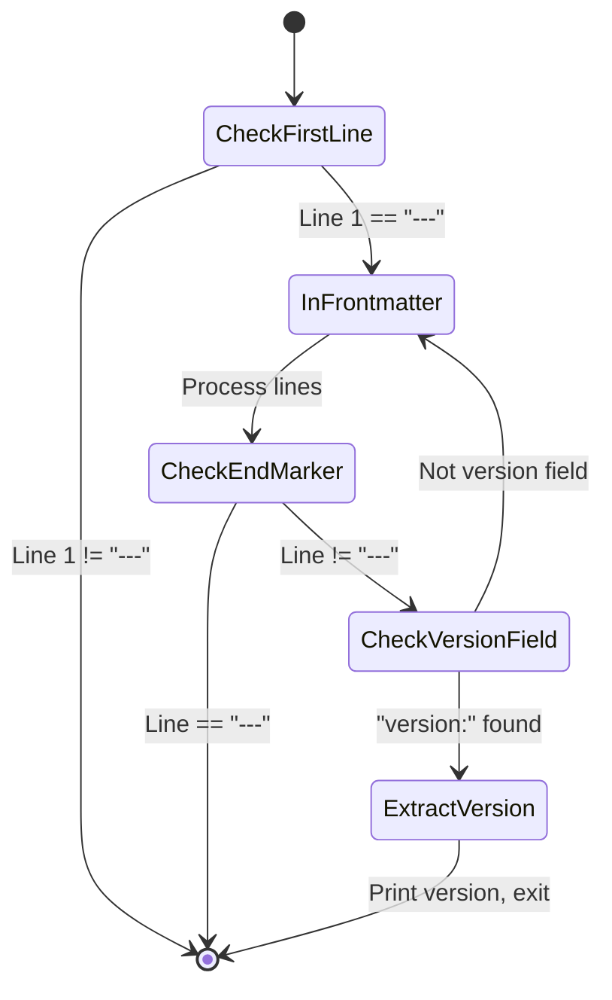
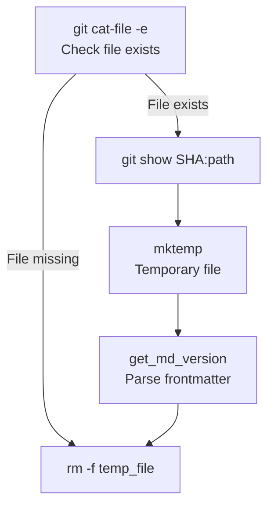
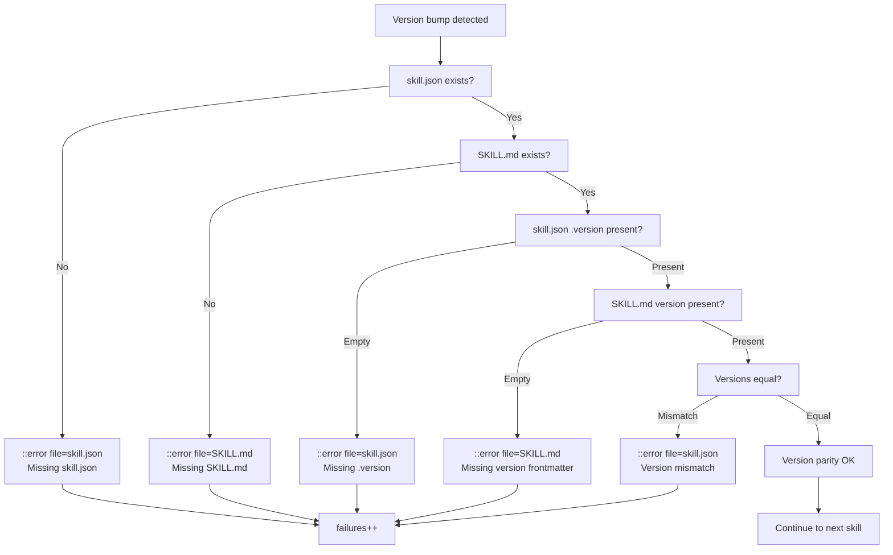
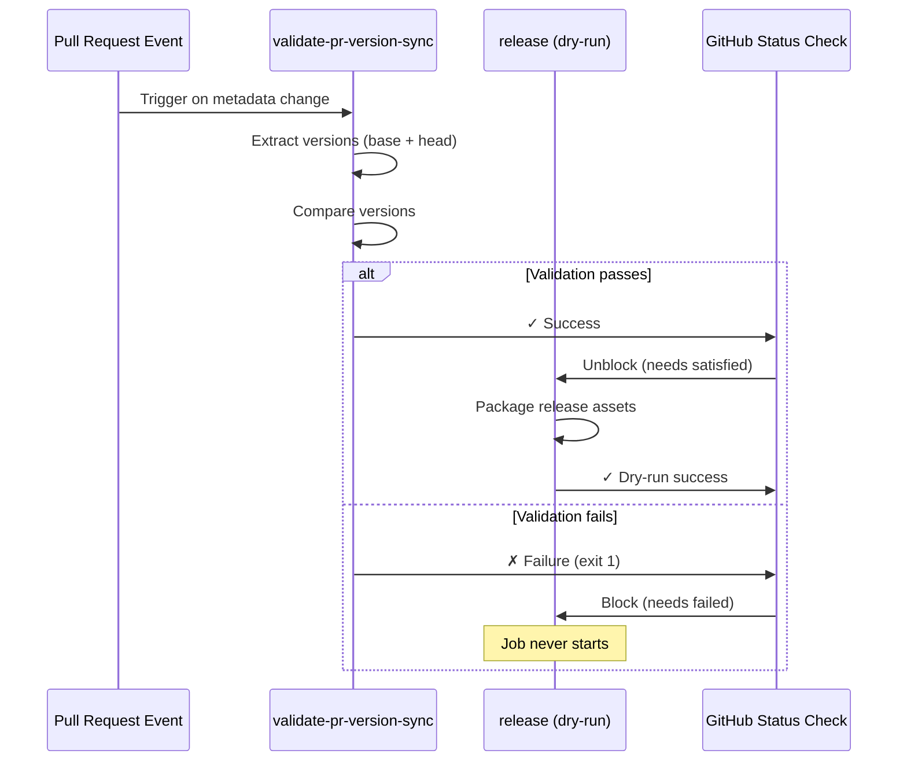

<!-- source: DeepWiki mcp.deepwiki.com · repo prompt-security/clawsec · extra page Version Validation and PR Checks · fetched 2026-10-27 -->

# Version Validation and PR Checks

<details>
<summary>Relevant source files</summary>

The following files were used as context for generating this wiki page:

- [.github/workflows/skill-release.yml](.github/workflows/skill-release.yml)

</details>


## Purpose and Scope

This document describes the **validate-pr-version-sync** job in the skill release pipeline, which enforces version consistency between `skill.json` and `SKILL.md` frontmatter during pull requests. This validation runs before any code is merged, preventing version mismatches from entering the main branch. For information about the actual packaging and release process triggered by tags, see [Release Asset Packaging](#5.1.2) and [Publishing and Distribution](#5.1.3).

---

## Overview

The version validation system implements a gate-keeping mechanism that ensures semantic versioning integrity across skill metadata files. When a pull request modifies skill metadata, the workflow automatically detects version bumps and validates that both `skill.json` and `SKILL.md` declare identical version strings.

**Sources:** [.github/workflows/skill-release.yml:22-168]()

---

## Workflow Trigger and Activation

### Trigger Configuration

The `validate-pr-version-sync` job activates exclusively on pull request events that modify specific skill metadata paths:

```yaml
on:
  pull_request:
    paths:
      - 'skills/*/skill.json'
      - 'skills/*/SKILL.md'
```

The workflow uses path filtering to minimize unnecessary CI runs, executing only when skill metadata changes are detected. The conditional `if: github.event_name == 'pull_request'` ensures the job never runs on tag pushes.

**Sources:** [.github/workflows/skill-release.yml:7-11](), [.github/workflows/skill-release.yml:22-23]()

---

## Git Diff Analysis and Skill Detection

### Changed Skill Identification

The workflow identifies modified skills by analyzing the git diff between the PR base and head commits:



**Diagram: Changed Skill Detection Pipeline**

The workflow extracts skill directory paths using awk field separation on `/` and collecting the first two segments (`skills/skill-name`), then deduplicates using `sort -u`.

**Sources:** [.github/workflows/skill-release.yml:68-77]()

---

## Version Extraction Mechanisms

### SKILL.md Frontmatter Parsing

The `get_md_version()` shell function extracts the `version` field from YAML frontmatter using awk-based state machine parsing:



**Diagram: SKILL.md Version Extraction State Machine**

The awk script implements a three-state parser:
1. **Initial state**: Validates first line is `---`
2. **Frontmatter parsing**: Searches for `version:` field
3. **Extraction**: Strips whitespace and prints version string

```bash
awk '
  NR == 1 && $0 == "---" { in_frontmatter = 1; next }
  in_frontmatter && $0 == "---" { exit }
  in_frontmatter && $0 ~ /^version:[[:space:]]*/ {
    sub(/^version:[[:space:]]*/, "", $0)
    gsub(/[[:space:]]+$/, "", $0)
    print $0
    exit
  }
' "$md_file"
```

**Sources:** [.github/workflows/skill-release.yml:40-52]()

### skill.json Version Extraction

The workflow uses `jq` to extract the `.version` field from skill.json with fallback handling:

```bash
jq -r '.version // empty' "${json_path}"
```

The `// empty` operator ensures that missing version fields return an empty string rather than `null`, simplifying validation logic.

**Sources:** [.github/workflows/skill-release.yml:88]()

### Git Historical Version Retrieval

The `get_md_version_from_git()` function retrieves versions from historical commits for comparison:



**Diagram: Historical Version Retrieval Flow**

This function enables comparison between PR base and head versions without checking out different commits, using git object database queries.

**Sources:** [.github/workflows/skill-release.yml:54-66](), [.github/workflows/skill-release.yml:96-101]()

---

## Validation Logic Flow

### Version Bump Detection

The workflow implements a change-detection algorithm that compares base and head versions for both files:

| Comparison | Result | Action |
|------------|--------|--------|
| `head_json_version != base_json_version` | `json_version_changed=true` | Proceed to validation |
| `head_md_version != base_md_version` | `md_version_changed=true` | Proceed to validation |
| Both unchanged | Skip skill | No validation needed |
| Either changed | Version bump detected | Run full validation suite |

The workflow skips skills where neither version field changed, optimizing for PRs that modify non-version metadata like descriptions or SBOM entries.

**Sources:** [.github/workflows/skill-release.yml:103-117]()

### Multi-Stage Validation Pipeline



**Diagram: Validation Pipeline with Error Paths**

Each validation stage increments the `failures` counter on error, allowing the workflow to accumulate all issues before exiting. This provides developers with comprehensive feedback rather than failing on the first error.

**Sources:** [.github/workflows/skill-release.yml:119-153]()

---

## GitHub Annotations and Error Reporting

### Workflow Commands

The workflow uses GitHub Actions workflow commands to create inline annotations on specific files:

```bash
echo "::error file=${json_path}::Version mismatch. skill.json=${head_json_version}, SKILL.md=${head_md_version}"
```

This syntax creates clickable annotations in the GitHub PR interface that appear directly on the affected file paths.

### Error Message Matrix

| Error Condition | Annotation Target | Message |
|----------------|-------------------|---------|
| Missing skill.json | `skills/skill-name/skill.json` | Missing skill.json after version bump |
| Missing SKILL.md | `skills/skill-name/SKILL.md` | Missing SKILL.md after version bump |
| Empty JSON version | `skills/skill-name/skill.json` | Missing .version in skill.json |
| Empty MD version | `skills/skill-name/SKILL.md` | Missing version in SKILL.md frontmatter |
| Version mismatch | `skills/skill-name/skill.json` | Version mismatch. skill.json=X.Y.Z, SKILL.md=A.B.C |

**Sources:** [.github/workflows/skill-release.yml:123-149]()

### Exit Code Strategy

The workflow accumulates failures and exits with code 1 only after processing all changed skills:

```bash
if [ "${failures}" -gt 0 ]; then
  echo "::error::Found ${failures} version parity issue(s) across ${checked_skills} bumped skill(s)."
  exit 1
fi
```

This "fail-late" strategy provides complete validation feedback in a single CI run.

**Sources:** [.github/workflows/skill-release.yml:162-165]()

---

## Integration with Release Dry-Run

### Job Dependencies

The workflow defines a dependency chain that ensures validation passes before dry-run execution:

```yaml
jobs:
  validate-pr-version-sync:
    if: github.event_name == 'pull_request'
    # ... validation logic ...
  
  release:
    if: github.event_name == 'pull_request'
    needs: validate-pr-version-sync
    # ... dry-run packaging ...
```

The `needs: validate-pr-version-sync` declaration creates a blocking dependency, preventing the release dry-run from executing if validation fails.

**Sources:** [.github/workflows/skill-release.yml:22-23](), [.github/workflows/skill-release.yml:169-171]()

### Validation State Propagation



**Diagram: Validation and Dry-Run Dependency Flow**

The dry-run job assumes that incoming versions are valid and synchronized, allowing it to focus on packaging logic without redundant version checks.

**Sources:** [.github/workflows/skill-release.yml:169-381]()

---

## Edge Cases and Handling

### No Version Bump Scenario

When a PR modifies `skill.json` or `SKILL.md` without changing version fields (e.g., updating description, fixing typos), the workflow detects this and skips validation:

```bash
if [ "${json_version_changed}" != "true" ] && [ "${md_version_changed}" != "true" ]; then
  echo "No version bump detected for ${skill_dir}; skipping."
  continue
fi
```

This allows documentation-only updates without requiring version bumps.

**Sources:** [.github/workflows/skill-release.yml:114-117]()

### Multiple Skills in Single PR

The workflow iterates through all changed skills independently, validating each one:

```bash
checked_skills=0
failures=0

while IFS= read -r skill_dir; do
  # ... validation logic ...
  checked_skills=$((checked_skills + 1))
done < "${touched_skills_file}"
```

The counters track both the number of validated skills and accumulated failures, providing aggregate statistics in the final output.

**Sources:** [.github/workflows/skill-release.yml:79-153]()

### Git Merge Scenarios

The workflow uses three-dot diff syntax (`BASE_SHA...HEAD_SHA`) to capture all changes introduced by the PR branch, including commits made after branch creation:

```bash
git diff --name-only "${BASE_SHA}...${HEAD_SHA}" -- 'skills/*/skill.json' 'skills/*/SKILL.md'
```

This ensures that version comparisons reflect the complete set of changes being merged, not just the latest commit.

**Sources:** [.github/workflows/skill-release.yml:69]()

---

## Validation Summary Output

### Success Path

When validation succeeds, the workflow outputs a summary message:

```
Validated ${checked_skills} bumped skill(s): skill.json and SKILL.md versions are present and equal.
Version parity OK for skills/clawsec-suite: 0.0.8
Version parity OK for skills/clawsec-feed: 0.0.5
```

**Sources:** [.github/workflows/skill-release.yml:152](), [.github/workflows/skill-release.yml:167]()

### Failure Path

On failure, the workflow provides diagnostic information:

```
Version bump detected for skills/clawsec-suite (skill.json changed: true, SKILL.md changed: true)
::error file=skills/clawsec-suite/skill.json::Version mismatch. skill.json=0.0.8, SKILL.md=0.0.7
::error::Found 1 version parity issue(s) across 1 bumped skill(s).
```

The multi-line error output helps developers identify which skill failed and the specific nature of the version inconsistency.

**Sources:** [.github/workflows/skill-release.yml:120](), [.github/workflows/skill-release.yml:146-148](), [.github/workflows/skill-release.yml:162-164]()

---

## Permissions and Security Model

The validation job uses minimal permissions:

```yaml
permissions:
  contents: read
```

This read-only permission model ensures the validation job cannot modify repository state, aligning with the principle of least privilege for PR checks.

**Sources:** [.github/workflows/skill-release.yml:25-26]()

---

