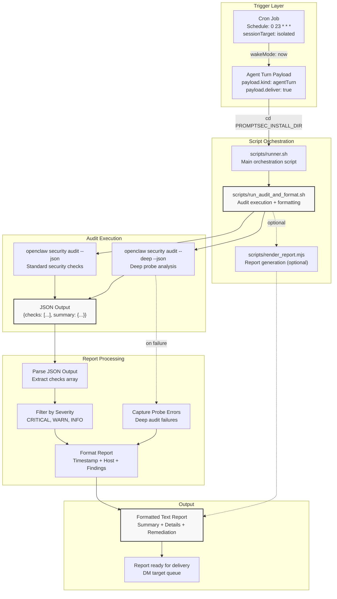
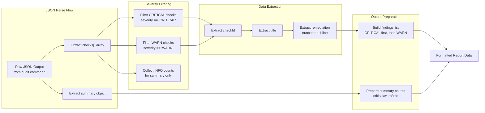
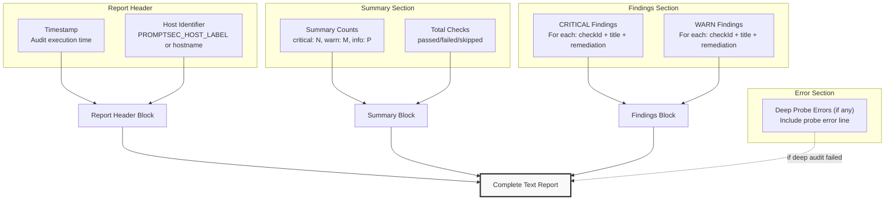
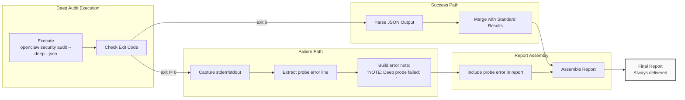

<!-- source: DeepWiki mcp.deepwiki.com · repo prompt-security/clawsec · extra page Audit Execution and Report Generation · fetched 2026-10-27 -->

# Audit Execution and Report Generation

<details>
<summary>Relevant source files</summary>

The following files were used as context for generating this wiki page:

- [skills/openclaw-audit-watchdog/SKILL.md](skills/openclaw-audit-watchdog/SKILL.md)
- [skills/openclaw-audit-watchdog/skill.json](skills/openclaw-audit-watchdog/skill.json)

</details>


## Purpose and Scope

This page documents how the `openclaw-audit-watchdog` skill executes security audits and generates formatted reports. It covers the audit execution pipeline, JSON output parsing, report formatting logic, and error handling for deep probes. For information about report delivery mechanisms (email/DM) and cron configuration, see [Report Delivery and Cron Configuration](#4.4.2). For an overview of the watchdog skill's purpose and architecture, see [openclaw-audit-watchdog: Automated Daily Audits](#4.4).

## Audit Execution Pipeline

The watchdog executes a two-stage audit process that runs both standard and deep security checks, then formats the results into a human-readable report.

### Audit Execution Flow



**Sources:** [skills/openclaw-audit-watchdog/SKILL.md:53-56](), [skills/openclaw-audit-watchdog/SKILL.md:99-114](), [skills/openclaw-audit-watchdog/skill.json:26-44]()

The execution is triggered by a cron job configured with `sessionTarget="isolated"` to ensure audits run in a clean environment without interfering with active agent sessions. The `wakeMode="now"` parameter ensures immediate execution at the scheduled time.

## Standard and Deep Audit Commands

The watchdog executes two distinct audit commands with different scope and depth:

| Audit Type | Command | Purpose | Output Format |
|------------|---------|---------|---------------|
| **Standard** | `openclaw security audit --json` | Fast checks of common security issues | JSON with check results |
| **Deep** | `openclaw security audit --deep --json` | Comprehensive probing including code analysis | JSON with extended probe data |

**Sources:** [skills/openclaw-audit-watchdog/SKILL.md:53-56](), [skills/openclaw-audit-watchdog/SKILL.md:103-105]()

### Audit Command Characteristics

Both commands output structured JSON for reliable parsing, preferring JSON over plain text to avoid parsing fragility. The `--json` flag ensures the output conforms to a predictable schema that the report formatter can process.

**Standard Audit Scope:**
- Configuration validation
- Permission checks
- Dependency verification
- Basic security posture assessment

**Deep Audit Scope:**
- All standard checks
- Code review probes (via `scripts/codex_review.sh` if available)
- Extended dependency analysis
- Advanced threat detection

**Sources:** [skills/openclaw-audit-watchdog/SKILL.md:103-105](), [skills/openclaw-audit-watchdog/skill.json:36-39]()

## JSON Output Structure and Parsing

### Audit JSON Schema

The audit commands produce JSON output with the following structure:

```json
{
  "checks": [
    {
      "checkId": "check-identifier",
      "title": "Check title",
      "severity": "CRITICAL|WARN|INFO",
      "status": "PASS|FAIL|SKIP",
      "message": "Detailed finding description",
      "remediation": "One-line fix suggestion"
    }
  ],
  "summary": {
    "total": 15,
    "passed": 10,
    "failed": 3,
    "skipped": 2,
    "critical": 1,
    "warn": 2,
    "info": 0
  }
}
```

**Sources:** [skills/openclaw-audit-watchdog/SKILL.md:103-105]()

### Parsing and Filtering Logic

The `scripts/run_audit_and_format.sh` script parses the JSON output and applies the following processing pipeline:



**Sources:** [skills/openclaw-audit-watchdog/SKILL.md:107-114]()

The filtering prioritizes actionable findings by focusing on `CRITICAL` and `WARN` severity checks, while `INFO` level checks are counted but not detailed in the report to maintain conciseness.

## Report Formatting and Structure

The formatted report follows a standardized template designed for quick scanning and actionable insights.

### Report Template Structure



**Sources:** [skills/openclaw-audit-watchdog/SKILL.md:107-114]()

### Report Component Details

| Component | Source | Format |
|-----------|--------|--------|
| **Timestamp** | Audit execution time | ISO 8601 or human-readable |
| **Host Identifier** | `PROMPTSEC_HOST_LABEL` env var, fallback to `hostname` command | Plain text label |
| **Summary Counts** | `summary.critical`, `summary.warn`, `summary.info` from JSON | `critical: N, warn: M, info: P` |
| **Check Details** | For each CRITICAL/WARN check: `checkId`, `title`, `remediation` | Multi-line, one check per block |
| **Remediation** | Extracted from check JSON, truncated to 1 line | Plain text suggestion |

**Sources:** [skills/openclaw-audit-watchdog/SKILL.md:77-78](), [skills/openclaw-audit-watchdog/SKILL.md:109-112]()

### Remediation Truncation

Remediation text is intentionally limited to one line to maintain report readability. The truncation ensures that the report remains scannable even with numerous findings. Full remediation details are available by running the audit command interactively.

**Sources:** [skills/openclaw-audit-watchdog/SKILL.md:112]()

## Deep Audit Error Handling

The deep audit probe may fail due to resource constraints, missing dependencies, or code analysis timeouts. The watchdog handles these failures gracefully to ensure report delivery continues.

### Probe Failure Handling



**Sources:** [skills/openclaw-audit-watchdog/SKILL.md:113-114]()

### Error Note Format

When the deep audit fails, the report includes a diagnostic line indicating the failure:

```
NOTE: Deep probe failed: [error message from probe]
```

This ensures that audit failures are visible to the user without blocking report delivery. The standard audit results are still included, providing partial security visibility even when deep analysis is unavailable.

**Sources:** [skills/openclaw-audit-watchdog/SKILL.md:113-114]()

## Environment-Driven Configuration

The audit execution and report formatting respect several environment variables that control behavior:

| Environment Variable | Purpose | Default | Impact on Execution |
|---------------------|---------|---------|---------------------|
| `PROMPTSEC_HOST_LABEL` | Host identifier in report header | `hostname` command output | Report labeling |
| `PROMPTSEC_INSTALL_DIR` | Working directory for cron execution | `~/.config/security-checkup` | `cd` target before running audit |
| `PROMPTSEC_GIT_PULL` | Auto-update watchdog from git before audit | unset | If set to `1`, runs `git pull --ff-only` |

**Sources:** [skills/openclaw-audit-watchdog/SKILL.md:77-79]()

### Git Auto-Update Behavior

When `PROMPTSEC_GIT_PULL=1` is set, the `scripts/runner.sh` orchestrator performs a `git pull --ff-only` before executing audits. This ensures the watchdog uses the latest audit logic and deep probe scripts without manual intervention. The `--ff-only` flag prevents merge conflicts by requiring a clean fast-forward update.

**Sources:** [skills/openclaw-audit-watchdog/SKILL.md:79]()

## Script Architecture and SBOM

The audit execution relies on a modular script architecture defined in the skill's Software Bill of Materials (SBOM):

| Script | Required | Purpose | Language |
|--------|----------|---------|----------|
| `scripts/runner.sh` | Yes | Main orchestration, git pull, directory handling | Bash |
| `scripts/run_audit_and_format.sh` | Yes | Execute audits, parse JSON, format report | Bash |
| `scripts/render_report.mjs` | No | Alternative Node.js-based report rendering | Node.js |
| `scripts/codex_review.sh` | No | Code review for deep audits | Bash |
| `scripts/sendmail_report.sh` | No | Sendmail fallback for email delivery | Bash |
| `scripts/send_smtp.mjs` | No | SMTP delivery for email reports | Node.js |
| `scripts/setup_cron.mjs` | No | Interactive cron job setup | Node.js |

**Sources:** [skills/openclaw-audit-watchdog/skill.json:18-59]()

### Core vs Optional Scripts

**Required scripts** (`runner.sh`, `run_audit_and_format.sh`) provide the essential audit execution and report generation pipeline. These must be present for the watchdog to function.

**Optional scripts** enhance functionality but are not mandatory:
- `render_report.mjs` provides an alternative Node.js rendering engine if preferred over bash formatting
- `codex_review.sh` enables deep code analysis during `--deep` audits
- Delivery scripts (`sendmail_report.sh`, `send_smtp.mjs`) are covered in [Report Delivery and Cron Configuration](#4.4.2)

**Sources:** [skills/openclaw-audit-watchdog/skill.json:22-44]()

## Non-Destructive Audit Philosophy

The watchdog strictly adheres to a read-only audit model. Reports suggest fixes but never apply them automatically.

### Auto-Fix Prohibition

The audit execution explicitly avoids using `openclaw security audit --fix` unless the user requests it interactively. This design principle ensures:

- No automated configuration changes during cron execution
- User maintains full control over remediation
- Audit reports serve as decision support, not automated enforcement
- Prevents cascading failures from incorrect auto-fixes

**Sources:** [skills/openclaw-audit-watchdog/SKILL.md:145-150]()

The report provides remediation suggestions for each finding, but the user must explicitly run fixes manually or through a separate interactive session. This preserves the principle that automated security tools should inform but not override human judgment.

**Sources:** [skills/openclaw-audit-watchdog/SKILL.md:145-150]()

---

