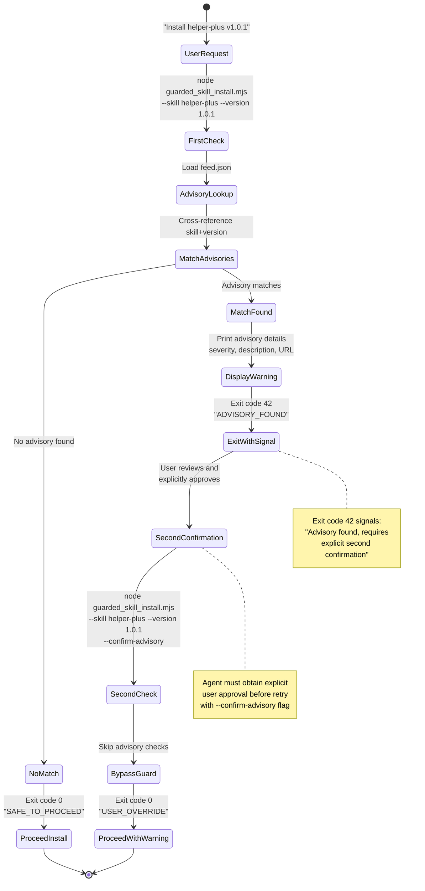
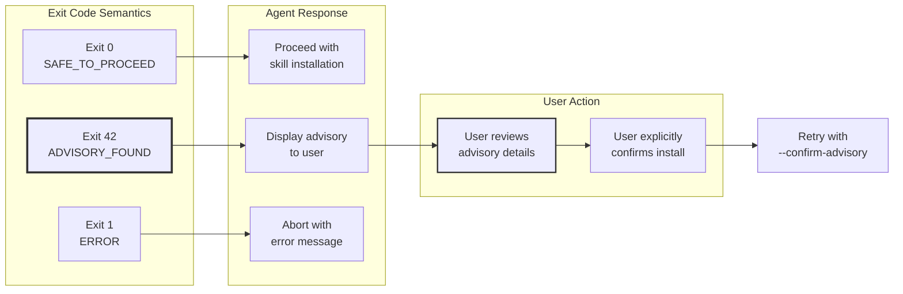
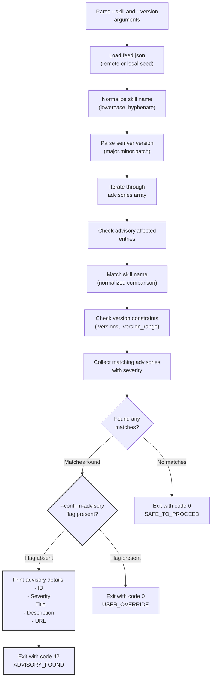
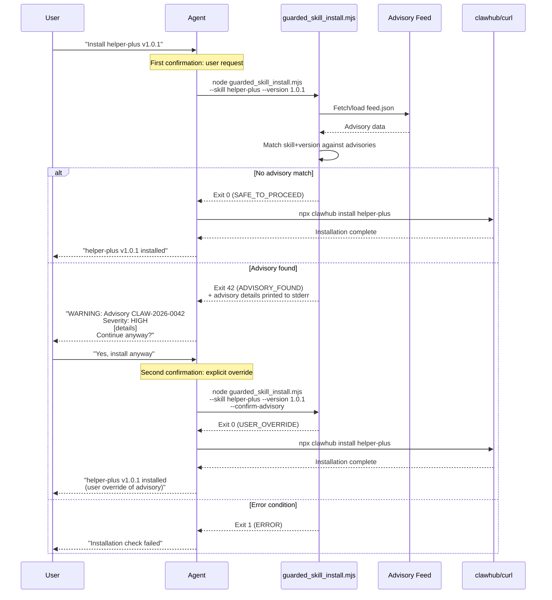
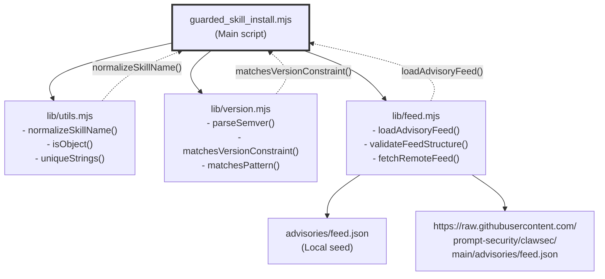
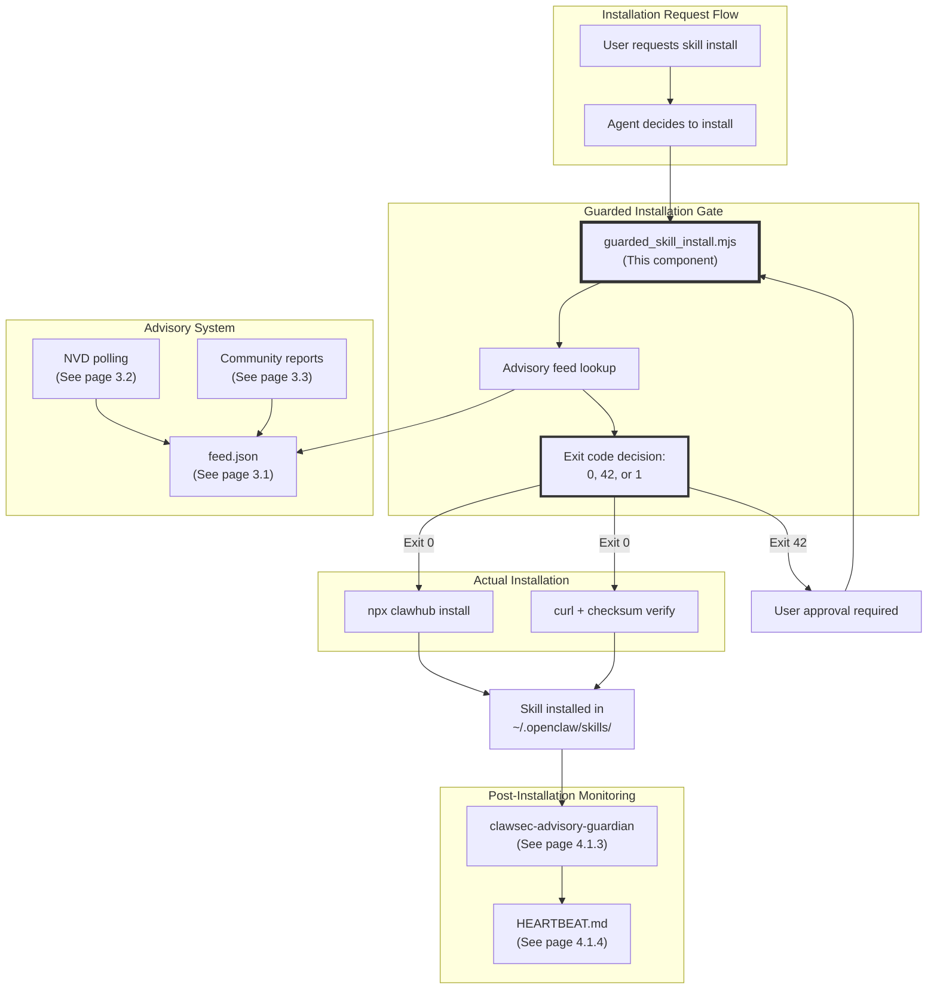

<!-- source: DeepWiki mcp.deepwiki.com · repo prompt-security/clawsec · extra page Guarded Skill Installation · fetched 2026-10-27 -->

# Guarded Skill Installation

<details>
<summary>Relevant source files</summary>

The following files were used as context for generating this wiki page:

- [skills/clawsec-suite/SKILL.md](skills/clawsec-suite/SKILL.md)
- [skills/clawsec-suite/skill.json](skills/clawsec-suite/skill.json)

</details>


## Purpose and Scope

This page documents the **guarded skill installation mechanism** implemented by `guarded_skill_install.mjs`, which enforces a double-confirmation pattern for installing skills with known security advisories. The script acts as a gatekeeper that blocks risky installations until the user explicitly acknowledges advisory warnings, preventing agents from autonomously installing malicious or vulnerable skills.

This page covers the installation guard's command-line interface, exit code signaling, advisory matching logic, and integration with agent workflows. For the broader advisory monitoring system that powers this guard, see [Advisory Feed Architecture](#3.1). For the OpenClaw hook that monitors installed skills post-installation, see [Advisory Guardian Hook](#4.1.3).

---

## Two-Step Confirmation Model

The guarded installer implements a state machine with two explicit user confirmations:



**Sources:** [skills/clawsec-suite/SKILL.md:139-159]()

---

## Command-Line Interface

The `guarded_skill_install.mjs` script accepts three command-line arguments:

| Argument | Required | Description |
|----------|----------|-------------|
| `--skill <name>` | Yes | Skill name (normalized: lowercase, hyphens for spaces) |
| `--version <version>` | Yes | Target version in semver format (e.g., `1.0.1`) |
| `--confirm-advisory` | No | Bypass advisory checks (requires prior exit code 42) |

### Usage Examples

**First attempt (advisory check):**
```bash
SUITE_DIR="$HOME/.openclaw/skills/clawsec-suite"
node "$SUITE_DIR/scripts/guarded_skill_install.mjs" \
  --skill helper-plus \
  --version 1.0.1
```

**Exit scenarios:**
- Exit code `0`: Safe to proceed (no advisory match)
- Exit code `42`: Advisory found, requires second confirmation
- Exit code `1`: Invalid arguments or system error

**Second attempt (user override after seeing advisory):**
```bash
node "$SUITE_DIR/scripts/guarded_skill_install.mjs" \
  --skill helper-plus \
  --version 1.0.1 \
  --confirm-advisory
```

**Exit:** Code `0` (proceeds with user override)

**Sources:** [skills/clawsec-suite/SKILL.md:142-155]()

---

## Exit Code 42: Advisory Found Signal

The script uses **exit code 42** as a structured signaling mechanism to communicate "advisory found, requires explicit user confirmation" to the calling agent or script.

### Exit Code Convention



### Why Exit Code 42?

Exit code 42 is chosen to be:
1. **Unambiguous:** Not a standard POSIX exit code (0=success, 1-2=errors, 126-130=reserved)
2. **Memorable:** References "The Answer" from The Hitchhiker's Guide to the Galaxy
3. **Grep-friendly:** Easily searchable in logs and agent code
4. **Non-destructive:** Signals "pause and confirm" rather than "error and abort"

**Agent workflow pattern:**
```bash
if node guarded_skill_install.mjs --skill foo --version 1.0.0; then
  # Exit 0: proceed with installation
  npx clawhub install foo
elif [ $? -eq 42 ]; then
  # Exit 42: show advisory and wait for user confirmation
  echo "WARNING: Advisory found. Review above details."
  echo "Confirm with: --confirm-advisory flag"
else
  # Exit 1: error condition
  echo "ERROR: Installation check failed"
fi
```

**Sources:** [skills/clawsec-suite/SKILL.md:148-151]()

---

## Advisory Matching Decision Flow

The guarded installer performs skill and version matching against the advisory feed:



### Version Matching Logic

The script checks three version constraint patterns from advisory entries:

| Advisory Field | Matching Strategy | Example |
|----------------|-------------------|---------|
| `.versions[]` | Exact match array | `["1.0.0", "1.0.1"]` matches if `version` is in array |
| `.version_range.min` / `.max` | Semver range | `min: "1.0.0", max: "2.0.0"` matches `1.5.0` |
| `.version_range.pattern` | Wildcard patterns | `1.0.*` matches `1.0.0` through `1.0.999` |

**Normalization rules:**
- Skill names: lowercase, spaces → hyphens (e.g., `"Helper Plus"` → `"helper-plus"`)
- Versions: strict semver parsing, no prefixes (e.g., `v1.0.0` → `1.0.0`)

**Sources:** [skills/clawsec-suite/SKILL.md:148-155]()

---

## Integration with Agent Workflows

### Recommended Agent Pattern

Agents should implement the following workflow when handling skill installation requests:



### Shell Script Example

```bash
#!/bin/bash
set -euo pipefail

SKILL_NAME="$1"
SKILL_VERSION="$2"
SUITE_DIR="${HOME}/.openclaw/skills/clawsec-suite"
GUARD_SCRIPT="${SUITE_DIR}/scripts/guarded_skill_install.mjs"

# First attempt: check for advisories
if node "$GUARD_SCRIPT" --skill "$SKILL_NAME" --version "$SKILL_VERSION" 2>/tmp/advisory_warning; then
  # Exit 0: safe to proceed
  echo "No advisories found. Proceeding with installation."
  npx clawhub@latest install "$SKILL_NAME"
  exit 0
fi

EXIT_CODE=$?

if [ "$EXIT_CODE" -eq 42 ]; then
  # Advisory found: display warning and prompt for confirmation
  cat /tmp/advisory_warning
  echo ""
  echo "An advisory was found for this skill. Install anyway? (yes/no)"
  read -r CONFIRMATION
  
  if [ "$CONFIRMATION" = "yes" ]; then
    # Second attempt with explicit override
    node "$GUARD_SCRIPT" --skill "$SKILL_NAME" --version "$SKILL_VERSION" --confirm-advisory
    npx clawhub@latest install "$SKILL_NAME"
    echo "Installed $SKILL_NAME v$SKILL_VERSION (user override)"
  else
    echo "Installation cancelled by user."
    exit 1
  fi
else
  # Other error
  echo "ERROR: Installation guard failed with exit code $EXIT_CODE"
  cat /tmp/advisory_warning
  exit 1
fi
```

**Sources:** [skills/clawsec-suite/SKILL.md:139-159]()

---

## Implementation Details

### Script Location and Permissions

- **Path:** `skills/clawsec-suite/scripts/guarded_skill_install.mjs`
- **Type:** Node.js module script (`.mjs` extension)
- **Permissions:** Should be readable and executable (`644` or `755`)
- **Dependencies:** Shared libraries from `hooks/clawsec-advisory-guardian/lib/`

### Shared Library Dependencies

The guarded installer reuses code from the advisory guardian hook:



### Feed Loading Priority

The script attempts to load the advisory feed in this order:

1. **Remote feed:** `$CLAWSEC_FEED_URL` or default GitHub raw URL
2. **Local seed:** `~/.openclaw/skills/clawsec-suite/advisories/feed.json`
3. **Fail:** Exit with code 1 if both sources unavailable

### Advisory Matching Algorithm

The core matching logic follows this pseudocode:

```
function matchAdvisories(skillName, version, advisories):
    matches = []
    normalizedSkill = normalizeSkillName(skillName)
    parsedVersion = parseSemver(version)
    
    for advisory in advisories:
        if not advisory.affected:
            continue
            
        for affectedEntry in advisory.affected:
            if normalizeSkillName(affectedEntry.skill) != normalizedSkill:
                continue
                
            if matchesVersionConstraint(affectedEntry, parsedVersion):
                matches.append({
                    id: advisory.id,
                    severity: advisory.severity,
                    title: advisory.title,
                    description: advisory.description,
                    url: advisory.url
                })
                break  # One match per advisory is sufficient
    
    return matches
```

**Sources:** [skills/clawsec-suite/skill.json:77-80](), [skills/clawsec-suite/SKILL.md:139-159]()

---

## Output Format

The script outputs advisory details to **stderr** when exit code 42 is triggered:

### Sample Output (Exit Code 42)

```
ADVISORY FOUND: Installation blocked pending user confirmation

Advisory ID: CLAW-2026-0042
Severity: HIGH
Title: Data Exfiltration in helper-plus v1.0.0-1.0.2
Description: The helper-plus skill versions 1.0.0 through 1.0.2 contain a
             vulnerability that allows unauthorized transmission of workspace
             data to external servers.
URL: https://github.com/prompt-security/clawsec/issues/42

To proceed anyway, retry with: --confirm-advisory

Exit code: 42
```

### Sample Output (Exit Code 0, No Match)

```
SAFE_TO_PROCEED: No advisories found for helper-plus v1.0.1
Exit code: 0
```

### Sample Output (Exit Code 0, User Override)

```
USER_OVERRIDE: Proceeding with installation despite advisory (--confirm-advisory flag)
Exit code: 0
```

**Sources:** [skills/clawsec-suite/SKILL.md:148-155]()

---

## Security Considerations

### Non-Destructive Default

The guarded installer is **non-destructive by default**:
- Exit code 42 does not install anything
- Exit code 42 does not modify any files
- Only informs and requests explicit user approval

### Bypass Prevention

The `--confirm-advisory` flag does not bypass the guard; it **requires prior knowledge** of the advisory:

1. First invocation without flag → Exit 42 displays advisory details
2. User reviews advisory content
3. Second invocation with flag → User has explicitly acknowledged risk

This prevents automated bypass scenarios where an agent might add `--confirm-advisory` preemptively without showing advisory details to the user.

### Rate Limiting Considerations

The guarded installer makes one feed fetch per invocation. For frequent installation checks, consider:
- Using the local seed (`advisories/feed.json`) as fallback
- Implementing client-side caching with the suite's state file
- Rate-limiting installation attempts at the agent level

**Sources:** [skills/clawsec-suite/SKILL.md:223-234]()

---

## Relationship to Other Components



The guarded installer operates as a **pre-installation gate**, complementing:
- **Advisory guardian hook** ([#4.1.3](#4.1.3)): Monitors already-installed skills
- **Heartbeat workflow** ([#4.1.4](#4.1.4)): Periodic advisory checks
- **Advisory feed** ([#3.1](#3.1)): Source of threat intelligence

**Sources:** [skills/clawsec-suite/SKILL.md:1-252](), [skills/clawsec-suite/skill.json:1-175]()

---

