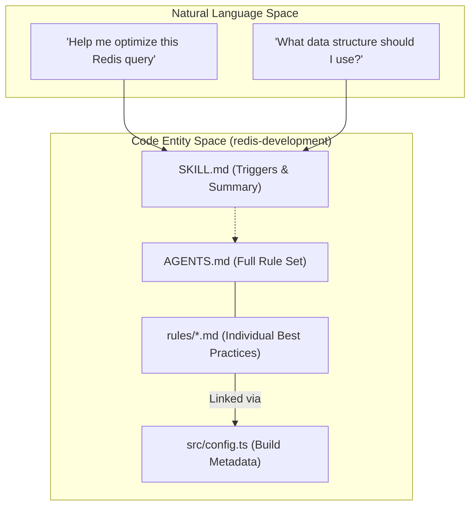
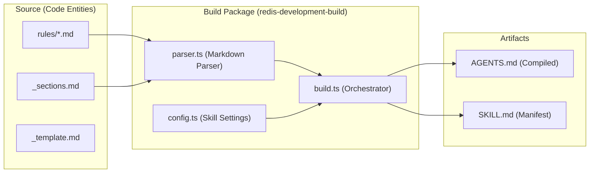

<!-- source: DeepWiki mcp.deepwiki.com · repo redis/agent-skills · page 1 Overview · fetched 2026-10-27 -->

# Overview

Relevant source files

The following files were used as context for generating this wiki page:

- [AGENTS.md](AGENTS.md)
- [CLAUDE.md](CLAUDE.md)
- [LICENSE](LICENSE)
- [README.md](README.md)

The `redis/agent-skills` repository is a centralized collection of packaged instructions, best practices, and resources designed to extend the capabilities of AI coding agents (such as Claude Code, Cursor, and GitHub Copilot) when working with Redis [README.md:1-5](). These skills are structured according to the [Agent Skills](https://agentskills.io/) format to ensure agents can efficiently parse, prioritize, and apply technical guidance during development tasks [README.md:5-7]().

## Purpose and Scope

The primary goal of this repository is to bridge the gap between general LLM knowledge and specific, high-performance Redis development patterns. By providing a "source of truth" for Redis expertise, the repository enables agents to:
*   Optimize Redis queries and data structure selection [README.md:44-50]().
*   Enforce security and performance best practices automatically [README.md:51-53]().
*   Reduce hallucinations by providing concrete code examples and quantified impact metrics [AGENTS.md:168-174]().

### Conceptual Flow: From Natural Language to Agent Action

The following diagram illustrates how a developer's natural language request is mapped to the code entities within this repository to provide the agent with the necessary context.

**Natural Language to Code Entity Mapping**

Sources: [README.md:40-53](), [AGENTS.md:35-45](), [AGENTS.md:148-166]()

## Core Components

The repository is organized into three primary functional areas:

1.  **Skills Content**: The `skills/` directory contains the actual domain knowledge. The flagship skill is `redis-development`, which covers data structures, query engines, vector search, and performance [README.md:9-11]().
2.  **Build System**: A TypeScript-based pipeline located in `packages/redis-development-build/` that validates individual rule files and compiles them into a single `AGENTS.md` for consumption by agents [AGENTS.md:138-146]().
3.  **Plugin Integrations**: Packaging logic that allows these skills to be distributed via the Claude Code marketplace and Cursor plugin ecosystem [README.md:21-36]().

### System Architecture

The following diagram shows how the build system processes raw markdown rules into the final artifacts used by AI agents.

**Build and Distribution Pipeline**

Sources: [AGENTS.md:13-26](), [AGENTS.md:131-137](), [AGENTS.md:148-166]()

## Getting Started

Users can install these skills using several methods depending on their preferred agent environment:
*   **Agent Skills CLI**: `npx skills add redis/agent-skills` [README.md:15-19]().
*   **Claude Code**: Use the `/plugin` command to add the Redis marketplace [README.md:21-28]().
*   **Cursor**: Add the plugin via the `/add-plugin redis` chat command [README.md:30-36]().

For detailed setup instructions, including local development and contribution workflows, see **[Getting Started & Installation](#1.1)**.

## Repository Organization

The repository follows a strict directory structure to support both human readability and automated builds:
*   `skills/`: The source of truth for all skill content [README.md:38]().
*   `packages/`: Contains the build tooling logic [AGENTS.md:138-140]().
*   `plugins/`: Symlinked directories for platform-specific distribution (e.g., Claude, Cursor) [README.md:38]().

For a deep dive into naming conventions and directory roles, see **[Repository Structure & Conventions](#1.2)**.

## Documentation Map

*   **Skills Deep Dive**: To understand the specific Redis rules (Data Structures, Vector Search, etc.), see **[Skills Content: redis-development](#2)**.
*   **Developer Guide**: To learn how the build system works or how to add a new rule, see **[Build System & Tooling](#3)**.
*   **Integrations**: For technical details on how the plugins are validated and registered, see **[Plugin Integrations](#4)**.

Sources: [README.md:55-61](), [AGENTS.md:11-26](), [AGENTS.md:131-137]()

---

