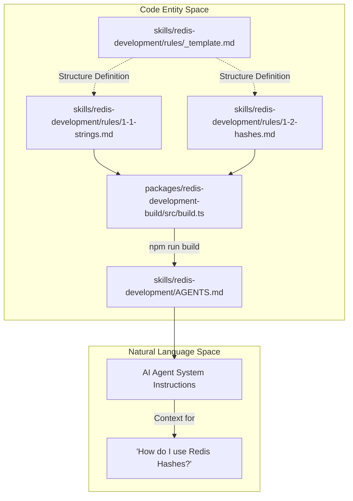
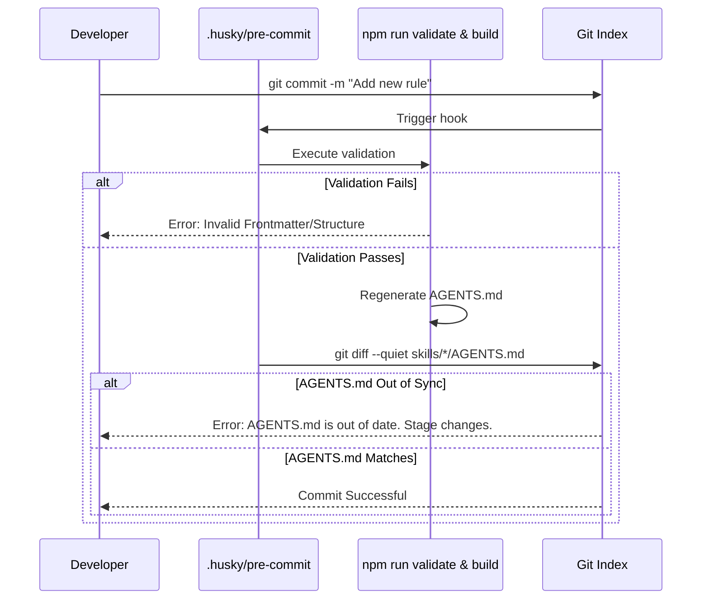

<!-- source: DeepWiki mcp.deepwiki.com · repo redis/agent-skills · page 1.1 Getting Started & Installation · fetched 2026-10-27 -->

# Getting Started & Installation

<details>
<summary>Relevant source files</summary>

The following files were used as context for generating this wiki page:

- [.husky/pre-commit](.husky/pre-commit)
- [CONTRIBUTING.md](CONTRIBUTING.md)
- [README.md](README.md)
- [package-lock.json](package-lock.json)
- [package.json](package.json)

</details>


This page provides a comprehensive guide for installing the Redis Agent Skills and setting up a local development environment. It covers installation methods for end-users via various agent platforms and the technical workflow for contributors to build and validate skills.

## User Installation Methods

The Redis Agent Skills are distributed through multiple channels to support different AI coding agents. The primary skill currently available is `redis-development`, which provides best practices for data structures, performance, and vector search [README.md:9-11]().

### 1. Agent Skills CLI
The standard way to add these skills to any compatible agent is via the Agent Skills CLI.
```bash
npx skills add redis/agent-skills
```
[README.md:15-19]()

### 2. Claude Code Plugin
For users of Anthropic's Claude Code, the skills can be installed as a dedicated plugin. This involves adding the Redis repository to the marketplace and then installing the specific skill.
```bash
/plugin marketplace add redis/agent-skills
/plugin install redis-development@redis
```
[README.md:21-28]()

### 3. Cursor Plugin
Cursor users can integrate the Redis development rules directly into their IDE chat experience.
```text
/add-plugin redis
```
[README.md:30-36]()

## Contributor Setup & Local Development

For developers looking to contribute new rules or modify existing ones, the repository uses a Node.js-based toolchain to manage skill compilation and validation.

### Prerequisites
- Node.js (Version 18 or higher) [package-lock.json:29-30]()
- npm

### Initial Setup
Clone the repository and install dependencies. This process automatically configures [Husky](https://github.com/typicode/husky) to manage Git hooks [package.json:14-18]().
```bash
npm install
```
[CONTRIBUTING.md:5-9]()

### Data Flow: From Rules to Plugins
The repository structure ensures that the `skills/` directory remains the source of truth. Plugin directories (like `.cursor-plugin/` or `.claude-plugin/`) utilize symlinks to expose the skill content without duplicating data [README.md:38-39]().

#### Rule Compilation Diagram
This diagram illustrates how individual markdown rules are processed into the final `AGENTS.md` file used by AI agents.


Sources: [README.md:55-61](), [CONTRIBUTING.md:11-22](), [package.json:8-10]()

## Development Workflow

The development lifecycle revolves around three main commands defined in the root `package.json`.

| Command | Description | Implementation |
| :--- | :--- | :--- |
| `npm run validate` | Runs all validation checks for skills and plugins. | Calls `validate:skills` and `validate:plugins` [package.json:9]() |
| `npm run build` | Compiles individual rule files into the `AGENTS.md` bundle. | Executes `redis-development-build` workspace [package.json:8]() |
| `npm run validate:plugins` | Validates marketplace manifests for Claude and Cursor. | Runs `scripts/validate-claude-plugins.mjs` and `scripts/validate-cursor-plugins.mjs` [package.json:11-13]() |

### Pre-commit Hook Workflow
To maintain consistency, a Husky pre-commit hook enforces that all rules are valid and that the compiled `AGENTS.md` is up-to-date before any code is committed.


Sources: [.husky/pre-commit:1-9](), [CONTRIBUTING.md:22-29]()

### Adding a New Rule
1. **Create File**: Add a new `.md` file in `skills/redis-development/rules/` using the naming convention `<prefix>-<name>.md` [CONTRIBUTING.md:17]().
2. **Apply Template**: Follow the structure defined in `rules/_template.md` [CONTRIBUTING.md:18]().
3. **Build**: Run `npm run build` to update the aggregate `AGENTS.md` file [CONTRIBUTING.md:19]().
4. **Stage**: You must `git add` both the new rule file and the modified `AGENTS.md` for the pre-commit hook to pass [.husky/pre-commit:5-8]().

Sources:
- [README.md:1-76]()
- [package.json:1-20]()
- [CONTRIBUTING.md:1-29]()
- [.husky/pre-commit:1-9]()

---

