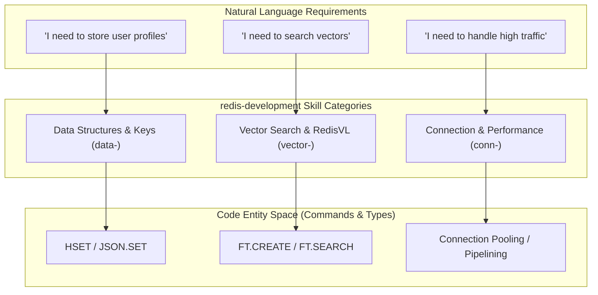
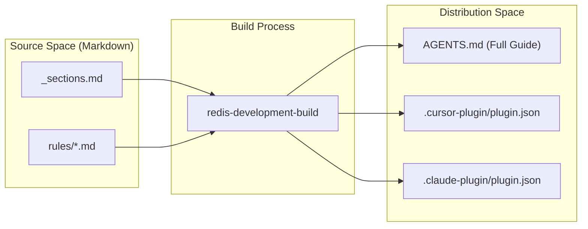

<!-- source: DeepWiki mcp.deepwiki.com · repo redis/agent-skills · page 2 Skills Content: redis-development · fetched 2026-10-27 -->

# Skills Content: redis-development

Relevant source files

The following files were used as context for generating this wiki page:

- [skills/redis-development/AGENTS.md](skills/redis-development/AGENTS.md)
- [skills/redis-development/SKILL.md](skills/redis-development/SKILL.md)
- [skills/redis-development/metadata.json](skills/redis-development/metadata.json)
- [skills/redis-development/rules/_sections.md](skills/redis-development/rules/_sections.md)

This page provides a high-level overview of the `redis-development` skill, which serves as the core knowledge base for this repository. It contains a comprehensive set of 29 rules organized into 11 categories, designed to guide both human developers and AI agents in optimizing Redis performance, memory usage, and feature implementation [skills/redis-development/SKILL.md:10-12]().

The skill is defined in `skills/redis-development/SKILL.md` and is compiled into a single, machine-readable `AGENTS.md` file for use by LLMs and IDE plugins [skills/redis-development/SKILL.md:1-8](), [skills/redis-development/AGENTS.md:1-11]().

### Skill Architecture: From Intent to Implementation

The following diagram illustrates how natural language requirements are mapped to specific Redis code entities and commands through the rule categories defined in this skill.

**Requirement to Code Entity Mapping**

Sources: [skills/redis-development/SKILL.md:24-38](), [skills/redis-development/AGENTS.md:77-147]()

---

### Rule Categories and Domain Areas

The `redis-development` skill is partitioned into 11 distinct sections, each mapped to a filename prefix (e.g., `data-`, `ram-`, `rqe-`) to facilitate automated organization [skills/redis-development/rules/_sections.md:1-50]().

#### 1. Data Structures, Keys & Memory
These rules form the foundation of Redis development. They focus on selecting the optimal data type (String, Hash, List, Set, etc.) for specific use cases and managing the lifecycle of that data through TTLs and eviction policies.
*   **Key Rules:** `data-choose-structure`, `ram-limits`, `ram-ttl`.
*   **For details, see [Data Structures, Keys & Memory Rules](#2.1).**

#### 2. Connection & Performance
This section addresses how applications interact with the Redis server. It emphasizes efficiency through connection pooling, multiplexing, and the use of pipelining to reduce round-trip times.
*   **Key Rules:** `conn-pooling`, `conn-pipelining`, `conn-blocking`.
*   **For details, see [Connection & Performance Rules](#2.2).**

#### 3. JSON, Query Engine & Indexing
Covers advanced data modeling using RedisJSON and the Redis Query Engine (RQE). It provides guidance on when to use JSON over traditional Hashes and how to build efficient secondary indexes using `FT.CREATE`.
*   **Key Rules:** `json-vs-hash`, `rqe-index-creation`, `rqe-query-optimization`.
*   **For details, see [JSON, Query Engine & Index Rules](#2.3).**

#### 4. Vector Search, Semantic Caching & Streams
Focuses on modern AI-driven patterns, including vector similarity search with `RedisVL` and semantic caching for LLMs using `LangCache`. It also covers real-time messaging patterns using Redis Streams.
*   **Key Rules:** `vector-algorithm-choice`, `semantic-cache-langcache-usage`, `stream-choosing-pattern`.
*   **For details, see [Vector Search, Semantic Caching & Streams Rules](#2.4).**

#### 5. Clustering, Security & Observability
Addresses production-grade concerns such as horizontal scaling via Redis Cluster, securing data with ACLs and TLS, and monitoring system health using `INFO` and `SLOWLOG` commands.
*   **Key Rules:** `cluster-hash-tags`, `security-acls`, `observe-metrics`.
*   **For details, see [Clustering, Security & Observability Rules](#2.5).**

---

### System Component Interaction

The following diagram shows how the internal rule definitions relate to the final distribution formats used by developers.

**Skill Definition to Plugin Distribution**

Sources: [skills/redis-development/SKILL.md:104-122](), [skills/redis-development/rules/_sections.md:1-5]()

### Impact Levels
Each category and rule is assigned an impact level (HIGH or MEDIUM) to help prioritize optimizations during automated code reviews or refactoring [skills/redis-development/SKILL.md:26-38]().

| Category | Impact | Purpose |
| :--- | :--- | :--- |
| Data Structures & Keys | **HIGH** | Prevents architectural debt and memory bloat [skills/redis-development/rules/_sections.md:7-9]() |
| Connection & Performance | **HIGH** | Prevents application-level bottlenecks and latency [skills/redis-development/rules/_sections.md:15-17]() |
| Security | **HIGH** | Ensures production readiness and data safety [skills/redis-development/rules/_sections.md:43-45]() |
| JSON Documents | **MEDIUM** | Optimizes developer ergonomics for nested data [skills/redis-development/rules/_sections.md:19-21]() |

Sources: [skills/redis-development/SKILL.md:26-38](), [skills/redis-development/rules/_sections.md:1-50]()

---

