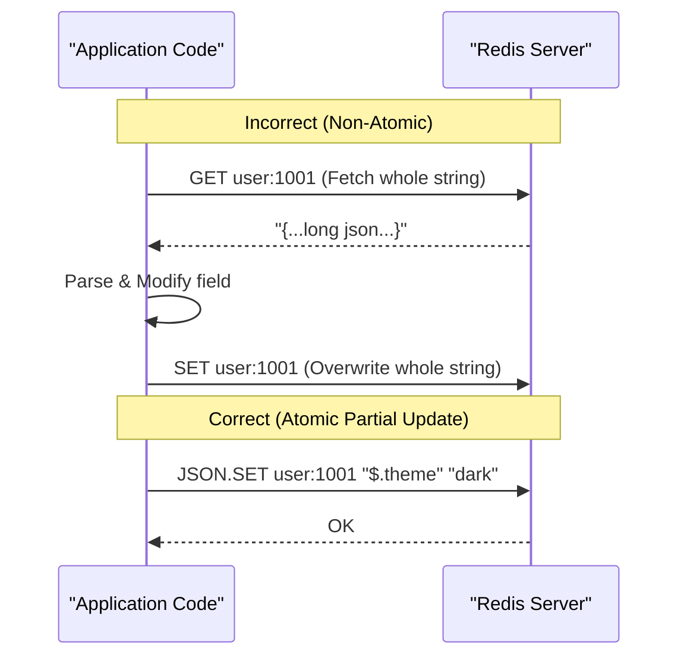

<!-- source: DeepWiki mcp.deepwiki.com · repo redis/agent-skills · page 2.3 JSON, Query Engine & Index Rules · fetched 2026-10-27 -->

# JSON, Query Engine & Index Rules

<details>
<summary>Relevant source files</summary>

The following files were used as context for generating this wiki page:

- [skills/redis-development/rules/json-partial-updates.md](skills/redis-development/rules/json-partial-updates.md)
- [skills/redis-development/rules/json-vs-hash.md](skills/redis-development/rules/json-vs-hash.md)
- [skills/redis-development/rules/rqe-dialect.md](skills/redis-development/rules/rqe-dialect.md)
- [skills/redis-development/rules/rqe-field-types.md](skills/redis-development/rules/rqe-field-types.md)
- [skills/redis-development/rules/rqe-index-creation.md](skills/redis-development/rules/rqe-index-creation.md)
- [skills/redis-development/rules/rqe-index-management.md](skills/redis-development/rules/rqe-index-management.md)
- [skills/redis-development/rules/rqe-query-optimization.md](skills/redis-development/rules/rqe-query-optimization.md)
- [skills/redis-development/rules/rqe-skip-initial-scan.md](skills/redis-development/rules/rqe-skip-initial-scan.md)

</details>


This page covers the implementation and best practices for using Redis as a document database and search engine. It details the selection criteria between JSON and Hash structures, the mechanics of partial updates, and the configuration of the Redis Query Engine (RQE) for optimal performance and zero-downtime management.

## JSON vs. Hash vs. String Selection

Choosing the correct data structure is the foundation of performance and functionality in Redis. While Strings are the most compact, they lack the ability to perform atomic partial updates or be indexed by the Query Engine.

### Data Structure Comparison

| Feature | JSON | Hash | String (serialized JSON) |
| :--- | :--- | :--- | :--- |
| **Structure** | Nested objects and arrays | Flat key-value pairs | Any structure |
| **Atomic partial reads** | Yes (`$.field`) | Yes (`HGET`) | No (must fetch entire value) |
| **Atomic partial writes** | Yes (`JSON.SET $.field`) | Yes (`HSET`) | No (must rewrite entire value) |
| **RQE indexing** | Yes | Yes | No |
| **Memory efficiency** | Higher overhead | More efficient | Most compact |
| **Field-level expiration**| No | Yes (`HEXPIRE`) | No |

### Implementation Flow: JSON vs Hash

The following diagram illustrates the decision logic for choosing a data structure based on application requirements.

**Data Structure Decision Flow**
```mermaid
graph TD
    "Start" --> "Need Indexing/Search?"
    "Need Indexing/Search?" -- "No" --> "Partial Updates Needed?"
    "Need Indexing/Search?" -- "Yes" --> "Nested Structure?"
    "Partial Updates Needed?" -- "No" --> "String (SET/GET)"
    "Partial Updates Needed?" -- "Yes" --> "Nested Structure?"
    "Nested Structure?" -- "Yes" --> "JSON (JSON.SET)"
    "Nested Structure?" -- "No" --> "Hash (HSET)"

    subgraph "Code Entities"
        "JSON (JSON.SET)"
        "Hash (HSET)"
        "String (SET/GET)"
    end
```
Sources: [skills/redis-development/rules/json-vs-hash.md:14-27]()

## JSON Documents & Partial Updates

RedisJSON allows for targeted manipulation of nested data without the overhead of fetching and re-writing the entire document (Read-Modify-Write anti-pattern).

### Partial Update Mechanics
Instead of using `json.loads()` and `json.dumps()` in application code, developers should use JSON Path syntax to target specific nodes.

*   **Targeted Updates**: `JSON.SET key path value` [skills/redis-development/rules/json-partial-updates.md:25-25]()
*   **Atomic Increments**: `JSON.NUMINCRBY key path value` [skills/redis-development/rules/json-partial-updates.md:31-31]()
*   **Array Manipulation**: `JSON.ARRAPPEND key path value` [skills/redis-development/rules/json-partial-updates.md:34-34]()

**Correct vs. Incorrect JSON Pattern**

Sources: [skills/redis-development/rules/json-partial-updates.md:16-47](), [skills/redis-development/rules/json-vs-hash.md:92-103]()

## Redis Query Engine (RQE)

The Redis Query Engine enables full-text search, complex filtering, and secondary indexing over HASH and JSON types.

### Field Types & Indexing
Selecting the correct field type is critical for performance. Using `TAG` instead of `TEXT` for exact matches can improve query speed by up to 10x.

| Field Type | Use Case | Implementation Detail |
| :--- | :--- | :--- |
| `TEXT` | Full-text search | Tokenized and stemmed [skills/redis-development/rules/rqe-field-types.md:16-16]() |
| `TAG` | Exact match / Filtering | Faster than TEXT; use `SORTABLE` for performance [skills/redis-development/rules/rqe-field-types.md:17-17]() |
| `NUMERIC` | Range queries | Used for prices, counts, timestamps [skills/redis-development/rules/rqe-field-types.md:18-18]() |
| `GEO` | Point locations | Lat/long pairs [skills/redis-development/rules/rqe-field-types.md:19-19]() |
| `GEOSHAPE` | Regional areas | Polygons and circles [skills/redis-development/rules/rqe-field-types.md:20-20]() |
| `VECTOR` | Similarity search | Requires `DIALECT 2` [skills/redis-development/rules/rqe-field-types.md:21-21]() |

Sources: [skills/redis-development/rules/rqe-field-types.md:14-21]()

### Index Creation Best Practices
1.  **Prefix Filtering**: Always use `PREFIX` in `FT.CREATE` to prevent the engine from scanning every key in the database. [skills/redis-development/rules/rqe-index-creation.md:70-70]()
2.  **Skip Initial Scan**: Use `SKIPINITIALSCAN` for new features where historical data does not need to be searchable, speeding up index creation. [skills/redis-development/rules/rqe-skip-initial-scan.md:10-12]()
3.  **Dialect Selection**: Use `DIALECT 2` for consistent query behavior and vector search support. [skills/redis-development/rules/rqe-dialect.md:10-12]()

### Zero-Downtime Index Management
Index updates should be handled via Aliases to prevent application-side changes during re-indexing.

**Index Alias Lifecycle**
```mermaid
graph LR
    "App" -- "Queries" --> "Alias: products"
    "Alias: products" -- "Points To" --> "Index: products_v1"
    "Index: products_v2" -- "Background Build" --> "Redis Data"
    "FT.ALIASUPDATE" -- "Switch" --> "Alias: products"
    "Alias: products" -. "New Path" .-> "Index: products_v2"
```
Sources: [skills/redis-development/rules/rqe-index-management.md:14-32]()

## Query Optimization

Efficient queries reduce the result set early in the execution pipeline.

*   **Limit Fields**: Use `RETURN` to fetch only necessary fields instead of the whole document. [skills/redis-development/rules/rqe-query-optimization.md:20-20]()
*   **Limit Rows**: Always use `LIMIT` to avoid broad scans. [skills/redis-development/rules/rqe-query-optimization.md:19-19]()
*   **Profiling**: Use `FT.PROFILE` to identify slow query components. [skills/redis-development/rules/rqe-query-optimization.md:45-45]()

### Code Example: Optimized Index and Query (Jedis)
```java
// Define schema with appropriate types
Schema schema = new Schema()
    .addTextField("name", 1.0)
    .addTagField("category"); // TAG for exact matching

// Use Prefix to limit index scope
IndexDefinition def = new IndexDefinition(IndexDefinition.Type.HASH)
    .setPrefixes("product:");

// Create index
jedis.ftCreate("idx:products", IndexOptions.defaultOptions().setDefinition(def), schema);

// Query with specific filters and limits
SearchResult result = jedis.ftSearch("idx:products", "@category:{electronics}", 
    new Query().limit(0, 20).setDialect(2));
```
Sources: [skills/redis-development/rules/rqe-index-creation.md:30-38](), [skills/redis-development/rules/rqe-field-types.md:37-47](), [skills/redis-development/rules/rqe-query-optimization.md:18-20]()

---

