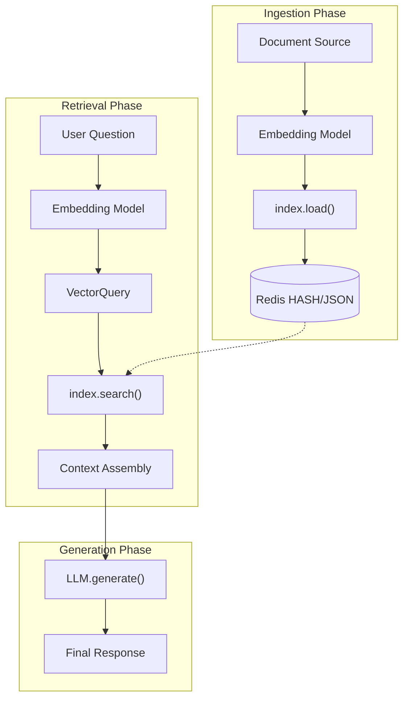
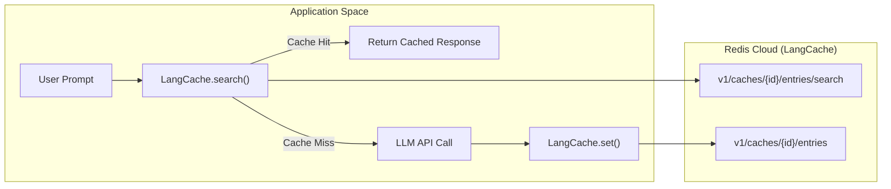

<!-- source: DeepWiki mcp.deepwiki.com · repo redis/agent-skills · page 2.4 Vector Search, Semantic Caching & Streams Rules · fetched 2026-10-27 -->

# Vector Search, Semantic Caching & Streams Rules

Relevant source files

The following files were used as context for generating this wiki page:

- [skills/redis-development/rules/semantic-cache-best-practices.md](skills/redis-development/rules/semantic-cache-best-practices.md)
- [skills/redis-development/rules/semantic-cache-langcache-usage.md](skills/redis-development/rules/semantic-cache-langcache-usage.md)
- [skills/redis-development/rules/stream-choosing-pattern.md](skills/redis-development/rules/stream-choosing-pattern.md)
- [skills/redis-development/rules/vector-algorithm-choice.md](skills/redis-development/rules/vector-algorithm-choice.md)
- [skills/redis-development/rules/vector-hybrid-search.md](skills/redis-development/rules/vector-hybrid-search.md)
- [skills/redis-development/rules/vector-index-creation.md](skills/redis-development/rules/vector-index-creation.md)
- [skills/redis-development/rules/vector-rag-pattern.md](skills/redis-development/rules/vector-rag-pattern.md)

This section covers the implementation of advanced AI-driven features and real-time messaging patterns using Redis. It focuses on Vector Search (RedisVL), Semantic Caching (LangCache), and the selection between Redis Streams and Pub/Sub for event-driven architectures.

## 1. Vector Search & RedisVL

Redis provides powerful vector search capabilities through the Redis Query Engine, allowing for high-performance Retrieval-Augmented Generation (RAG) and similarity search.

### Algorithm Selection: HNSW vs FLAT
Choosing the right indexing algorithm is critical for balancing search latency, memory consumption, and result accuracy.

| Algorithm | Speed | Accuracy | Memory | Best For |
|-----------|-------|----------|--------|----------|
| **HNSW** | Fast (Approximate) | ~95%+ recall (tunable) | Higher | Large datasets (>10k vectors), production workloads |
| **FLAT** | Slower (Brute-force) | 100% (Exact) | Lower | Small datasets, accuracy-critical applications |

### Vector Index Configuration
Indices must be configured with specific dimensions (`DIM`), a distance metric (`DISTANCE_METRIC`), and the underlying data type (`TYPE`).

**Correct: Index Creation via RedisVL**
The `redisvl` library provides a high-level `SearchIndex` and `IndexSchema` for managing vector indices.
[skills/redis-development/rules/vector-index-creation.md:53-71]()

**Correct: Index Creation via Redis CLI**
[skills/redis-development/rules/vector-index-creation.md:16-24]()

### Hybrid Search Patterns
Hybrid search combines vector similarity with traditional attribute filtering (e.g., tags, numeric ranges) to improve relevance and performance by reducing the search space before vector computation.

**Correct: Applying Filters in RedisVL**
[skills/redis-development/rules/vector-hybrid-search.md:16-28]()

**Incorrect: Client-side Filtering**
Searching the entire vector space and filtering results in application code is inefficient and increases latency.
[skills/redis-development/rules/vector-hybrid-search.md:32-41]()

### Data Flow: RAG Implementation
The following diagram illustrates the data flow for a Retrieval-Augmented Generation (RAG) pattern using `redisvl.index.SearchIndex` and `redisvl.query.VectorQuery`.

**RAG Pipeline Flow**

Sources: [skills/redis-development/rules/vector-rag-pattern.md:14-41]()

## 2. Semantic Caching (LangCache)

LangCache is a managed service on Redis Cloud designed to cache LLM responses based on semantic similarity rather than exact string matching.

### Implementation and Threshold Tuning
The `similarity_threshold` determines how close a new prompt must be to a cached prompt to trigger a hit.
*   **High Threshold (e.g., 0.95):** Stricter matching, fewer false positives, lower hit rate.
*   **Lower Threshold (e.g., 0.80):** Looser matching, higher hit rate, risk of irrelevant responses.

**Correct: Using the LangCache SDK**
[skills/redis-development/rules/semantic-cache-langcache-usage.md:24-49]()

### Cache Isolation
Using a single cache for disparate LLM tasks can lead to "cross-talk" where a coding query returns a customer support response. Use unique `cache_id` values to isolate contexts.
[skills/redis-development/rules/semantic-cache-best-practices.md:40-55]()

**Semantic Cache Architecture**

Sources: [skills/redis-development/rules/semantic-cache-langcache-usage.md:16-21](), [skills/redis-development/rules/semantic-cache-best-practices.md:16-38]()

## 3. Streams vs. Pub/Sub Selection

Choosing the correct messaging primitive depends on requirements for durability, replayability, and consumer scaling.

### Comparison Table

| Requirement | Use **Streams** | Use **Pub/Sub** |
|-------------|:---:|:---:|
| **Durability** | Yes (Persistent) | No (Fire-and-forget) |
| **Message Replay** | Yes | No |
| **Consumer Groups** | Yes (Distributed load) | No (Fan-out only) |
| **Connectivity** | Consumers can be offline | Consumers must be online |
| **Complexity** | Higher | Lower |

### Stream Processing with Consumer Groups
For reliable processing where messages must be acknowledged, use `XADD` to produce and `XREADGROUP` to consume.

**Correct: Reliable Stream Consumption**
[skills/redis-development/rules/stream-choosing-pattern.md:23-30]()

**Incorrect: Pub/Sub for Critical Data**
[skills/redis-development/rules/stream-choosing-pattern.md:16-19]()

Sources: [skills/redis-development/rules/stream-choosing-pattern.md:10-43]()

---

