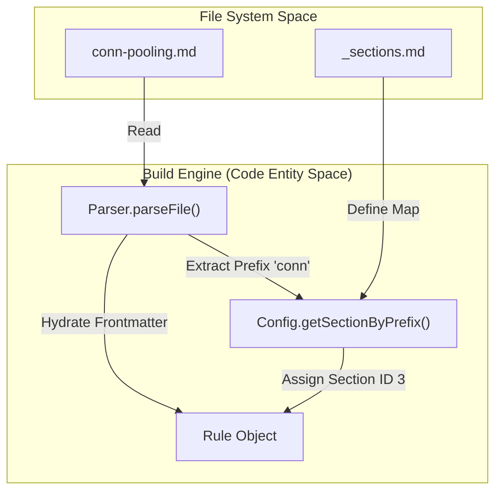
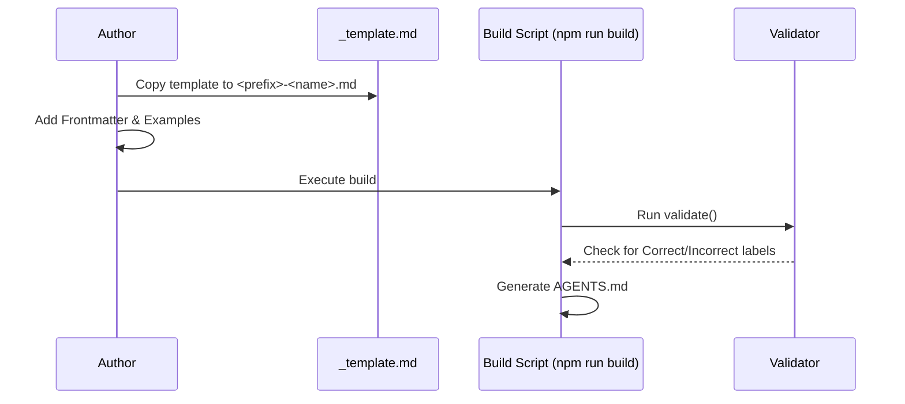

<!-- source: DeepWiki mcp.deepwiki.com · repo redis/agent-skills · page 3.2 Rule File Format & Authoring Guide · fetched 2026-10-27 -->

# Rule File Format & Authoring Guide

Relevant source files

The following files were used as context for generating this wiki page:

- [CONTRIBUTING.md](CONTRIBUTING.md)
- [skills/redis-development/rules/_contributing.md](skills/redis-development/rules/_contributing.md)
- [skills/redis-development/rules/_sections.md](skills/redis-development/rules/_sections.md)
- [skills/redis-development/rules/_template.md](skills/redis-development/rules/_template.md)

This page provides a technical specification for the markdown-based rule system used in the `agent-skills` repository. It covers the frontmatter schema, file naming conventions, and the structural requirements for authoring high-quality Redis best practice rules that are consumable by AI agents.

## Rule File Structure

Every rule is defined in an individual Markdown file located within a skill's `rules/` directory [CONTRIBUTING.md:11-13](). These files use a combination of YAML frontmatter and structured Markdown content to ensure consistency during the build process.

### 1. Markdown Frontmatter Schema
The frontmatter defines the metadata used by the `Parser` class in `packages/redis-development-build/src/parser.ts` to categorize and rank rules.

| Field | Type | Description |
| :--- | :--- | :--- |
| `title` | String | Action-oriented title (e.g., "Use Connection Pooling") [skills/redis-development/rules/_template.md:2](). |
| `impact` | Enum | `HIGH`, `MEDIUM`, or `LOW`. Determines priority in `AGENTS.md` [skills/redis-development/rules/_template.md:3](). |
| `impactDescription` | String | Quantified benefit (e.g., "Reduces overhead by 10x") [skills/redis-development/rules/_template.md:4](). |
| `tags` | List | Keywords for search and filtering [skills/redis-development/rules/_template.md:5](). |
| `description` | String | Brief summary of the rule's intent [skills/redis-development/rules/_template.md:6](). |
| `alwaysApply` | Boolean | If `true`, the agent should consider this rule globally [skills/redis-development/rules/_template.md:7](). |

### 2. Content Organization
The body of the rule file follows a strict pattern to assist LLM comprehension [skills/redis-development/rules/_contributing.md:14-16]():
1.  **Rule Title**: Repeated as an H2 header [skills/redis-development/rules/_template.md:10]().
2.  **Context**: 1-2 sentences explaining the problem and practical impact [skills/redis-development/rules/_template.md:12]().
3.  **Correct Pattern**: Labeled with `**Correct:**` followed by a code block [skills/redis-development/rules/_template.md:14-21]().
4.  **Alternative Pattern**: Either `**Incorrect:**` (for harmful anti-patterns) or `**When to use:**` (for feature introductions) [skills/redis-development/rules/_template.md:26-47]().

**Sources:** [skills/redis-development/rules/_template.md:1-53](), [skills/redis-development/rules/_contributing.md:1-98]()

---

## Filename Convention & Section Mapping

Rules are automatically assigned to categories based on their filename prefix. This mapping is defined in the `_sections.md` file within the skill's rules directory [skills/redis-development/rules/_sections.md:1-3]().

### Prefix Mapping Table
The build system parses the filename (format: `<prefix>-<name>.md`) and associates it with the following sections [CONTRIBUTING.md:17]():

| Prefix | Section Name | Focus Area |
| :--- | :--- | :--- |
| `data` | Data Structures & Keys | Type selection and naming [skills/redis-development/rules/_sections.md:7-9](). |
| `ram` | Memory & Expiration | TTL, eviction, and optimization [skills/redis-development/rules/_sections.md:11-13](). |
| `conn` | Connection & Performance | Pooling, pipelining, and blocking [skills/redis-development/rules/_sections.md:15-17](). |
| `json` | JSON Documents | RedisJSON and partial updates [skills/redis-development/rules/_sections.md:19-21](). |
| `rqe` | Redis Query Engine | Index design and FT.SEARCH [skills/redis-development/rules/_sections.md:23-25](). |
| `vector` | Vector Search | HNSW/FLAT and RedisVL [skills/redis-development/rules/_sections.md:27-29](). |
| `semantic-cache` | Semantic Caching | LangCache and LLM caching [skills/redis-development/rules/_sections.md:31-33](). |

### Rule Resolution Flow
The following diagram illustrates how a raw Markdown file is transformed into a structured `Rule` object and assigned to a `Section`.

**Rule Ingestion and Mapping Logic**

**Sources:** [CONTRIBUTING.md:11-20](), [skills/redis-development/rules/_sections.md:1-51]()

---

## Authoring Guidelines

To maintain high quality, authors must adhere to the "Problem-First" structure and provide concrete, runnable examples [skills/redis-development/rules/_contributing.md:7-16]().

### Impact Levels
Impact levels help the agent prioritize rules during execution [skills/redis-development/rules/_contributing.md:28-30]().

*   **HIGH**: 5-100x improvement. Focus on missing indexes, connection leaks, or blocking commands [skills/redis-development/rules/_contributing.md:80]().
*   **MEDIUM**: 2-5x improvement. Focus on suboptimal data structures or missing TTLs [skills/redis-development/rules/_contributing.md:81]().
*   **LOW**: Incremental improvements or advanced edge cases [skills/redis-development/rules/_contributing.md:82]().

### Code Example Standards
*   **Language Tags**: Use `python` (preferred), `javascript`, or `bash` [skills/redis-development/rules/_contributing.md:61-66]().
*   **Semantic Naming**: Avoid generic names like `key1`. Use `user:1001:profile` or `order:items` [skills/redis-development/rules/_contributing.md:50-55]().
*   **Comments**: Focus on *why* a pattern is used rather than *what* the code does [skills/redis-development/rules/_contributing.md:68-72]().

**Rule Authoring Data Flow**

**Sources:** [skills/redis-development/rules/_template.md:1-53](), [skills/redis-development/rules/_contributing.md:86-98](), [CONTRIBUTING.md:24-29]()

---

## Review Checklist
Before submitting a pull request, ensure the rule meets these criteria:
- [ ] Title is action-oriented [skills/redis-development/rules/_contributing.md:90]().
- [ ] Impact level includes quantification (e.g., "10x faster") [skills/redis-development/rules/_contributing.md:92]().
- [ ] Contains at least one **Correct** and one **Incorrect** (or **When to use**) example [skills/redis-development/rules/_contributing.md:93-94]().
- [ ] Uses semantic naming for Redis keys [skills/redis-development/rules/_contributing.md:95]().
- [ ] Includes reference links to official Redis documentation [skills/redis-development/rules/_contributing.md:97]().

**Sources:** [skills/redis-development/rules/_contributing.md:86-98]()

---

