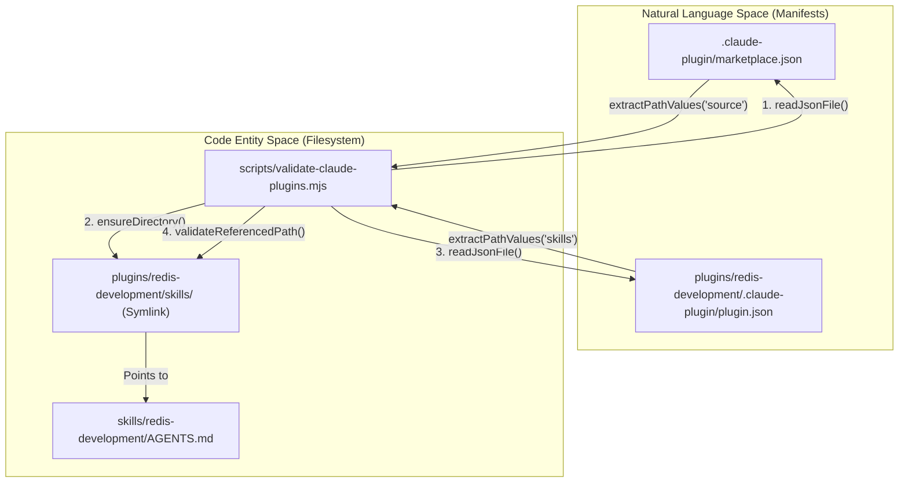
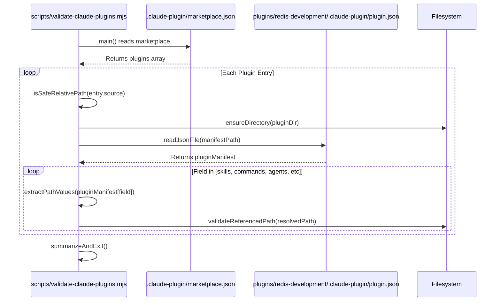

<!-- source: DeepWiki mcp.deepwiki.com · repo redis/agent-skills · page 4.2 Claude Code Plugin · fetched 2026-10-27 -->

# Claude Code Plugin

<details>
<summary>Relevant source files</summary>

The following files were used as context for generating this wiki page:

- [.claude-plugin/marketplace.json](.claude-plugin/marketplace.json)
- [plugins/redis-development/.claude-plugin/plugin.json](plugins/redis-development/.claude-plugin/plugin.json)
- [scripts/validate-claude-plugins.mjs](scripts/validate-claude-plugins.mjs)

</details>


The Claude Code integration allows the Redis development best practices contained in this repository to be consumed by Anthropic's Claude Code CLI. This integration is managed through a central marketplace registry and specific plugin manifests that define how Claude should interpret and load the skills.

## Marketplace Registry

The entry point for Claude Code integrations is the marketplace manifest located at `.claude-plugin/marketplace.json` [111-115](). This file acts as a registry for all Claude-compatible plugins within the repository.

### Marketplace Schema
The marketplace file defines the following structure:
- **`name`**: Must be lowercase kebab-case [125-132]().
- **`owner`**: Contains the organization name and support email [3-6]().
- **`plugins`**: An array of plugin objects, each specifying a `source` path relative to the repository root [11-20]().

| Field | Description | Source |
| :--- | :--- | :--- |
| `name` | "redis" | [.claude-plugin/marketplace.json:2]() |
| `plugins[].name` | "redis-development" | [.claude-plugin/marketplace.json:13]() |
| `plugins[].source` | Path to the plugin directory (`./plugins/redis-development`) | [.claude-plugin/marketplace.json:14]() |

**Sources:** [.claude-plugin/marketplace.json:1-21](), [scripts/validate-claude-plugins.mjs:110-144]()

## Plugin Manifest

Each plugin listed in the marketplace must have its own manifest located at `[plugin-source]/.claude-plugin/plugin.json` [182-186](). For the Redis development skill, this is found at `plugins/redis-development/.claude-plugin/plugin.json`.

### Plugin Manifest Structure
The manifest defines the metadata and the entry points for the agent's capabilities:
- **Metadata**: Name, description, author, and keywords [2-11]().
- **Skills**: The `skills` field points to the directory containing the actual markdown rules. In this repository, it points to `./skills/` [12]().

**Sources:** [plugins/redis-development/.claude-plugin/plugin.json:1-13]()

## Skill Integration via Symlinks

To avoid duplicating the rule content, the repository uses a symlink strategy. The `plugins/redis-development/skills/` directory is a symlink that points back to the top-level `skills/redis-development/` directory.

The `plugin.json` manifest references this symlinked directory:
```json
{
  "skills": "./skills/"
}
```
[plugins/redis-development/.claude-plugin/plugin.json:12]()

This ensures that when the Claude Code agent loads the plugin, it has direct access to the compiled `AGENTS.md` and the individual rule files within the `redis-development` skill folder.

**Sources:** [plugins/redis-development/.claude-plugin/plugin.json:12](), [scripts/validate-claude-plugins.mjs:200-203]()

## Validation Logic

The integrity of the Claude Code integration is enforced by `scripts/validate-claude-plugins.mjs`. This script is executed during the CI/CD pipeline to ensure that manifests are well-formed and all referenced paths exist.

### Key Validation Functions
- **`isSafeRelativePath(value)`**: Ensures that paths referenced in manifests do not escape the plugin directory using `../` or absolute paths [59-68]().
- **`extractPathValues(value)`**: Recursively extracts path strings from manifest fields (supporting strings, arrays, or objects with `path`/`file` keys) [70-88]().
- **`validateReferencedPath(...)`**: Resolves the relative path and checks for the physical existence of the file or directory on disk [90-108]().

### Validation Data Flow
The following diagram illustrates how the validation script traverses the "Natural Language Space" (manifests) to verify the "Code Entity Space" (filesystem).

**Claude Plugin Validation Flow**


**Sources:** [scripts/validate-claude-plugins.mjs:40-108](), [scripts/validate-claude-plugins.mjs:110-207]()

## Implementation Detail: Plugin Loading

When the validation script or the Claude agent processes the plugin, it follows a specific sequence to resolve the skills.

**Plugin Resolution Sequence**


**Sources:** [scripts/validate-claude-plugins.mjs:110-218](), [plugins/redis-development/.claude-plugin/plugin.json:1-13]()

---

