# Page: Overview

# Overview

<details>
<summary>Relevant source files</summary>

The following files were used as context for generating this wiki page:

- [AGENTS.md](AGENTS.md)
- [CLAUDE.md](CLAUDE.md)
- [LICENSE](LICENSE)
- [README.md](README.md)

</details>


The `redis/agent-skills` repository is a centralized collection of packaged instructions, best practices, and resources designed to extend the capabilities of AI coding agents (such as Claude Code, Cursor, and GitHub Copilot) when working with Redis [README.md:1-5](). These skills are structured according to the [Agent Skills](https://agentskills.io/) format to ensure agents can efficiently parse, prioritize, and apply technical guidance during development tasks [README.md:5-7]().

## Purpose and Scope

The primary goal of this repository is to bridge the gap between general LLM knowledge and specific, high-performance Redis development patterns. By providing a "source of truth" for Redis expertise, the repository enables agents to:
*   Optimize Redis queries and data structure selection [README.md:44-50]().
*   Enforce security and performance best practices automatically [README.md:51-53]().
*   Reduce hallucinations by providing concrete code examples and quantified impact metrics [AGENTS.md:168-174]().

### Conceptual Flow: From Natural Language to Agent Action

The following diagram illustrates how a developer's natural language request is mapped to the code entities within this repository to provide the agent with the necessary context.

**Natural Language to Code Entity Mapping**
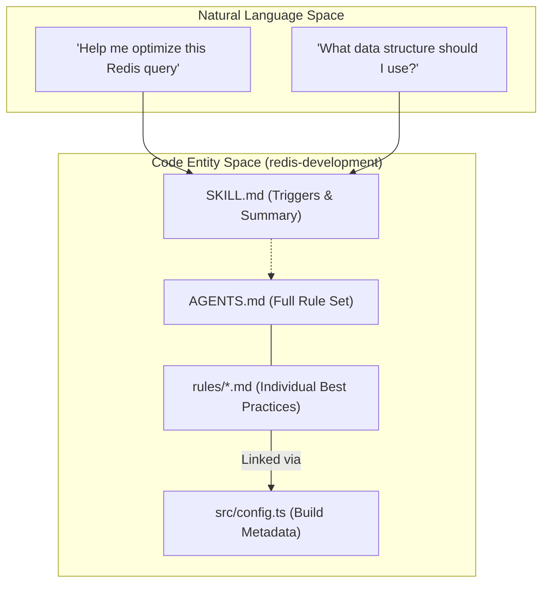
Sources: [README.md:40-53](), [AGENTS.md:35-45](), [AGENTS.md:148-166]()

## Core Components

The repository is organized into three primary functional areas:

1.  **Skills Content**: The `skills/` directory contains the actual domain knowledge. The flagship skill is `redis-development`, which covers data structures, query engines, vector search, and performance [README.md:9-11]().
2.  **Build System**: A TypeScript-based pipeline located in `packages/redis-development-build/` that validates individual rule files and compiles them into a single `AGENTS.md` for consumption by agents [AGENTS.md:138-146]().
3.  **Plugin Integrations**: Packaging logic that allows these skills to be distributed via the Claude Code marketplace and Cursor plugin ecosystem [README.md:21-36]().

### System Architecture

The following diagram shows how the build system processes raw markdown rules into the final artifacts used by AI agents.

**Build and Distribution Pipeline**
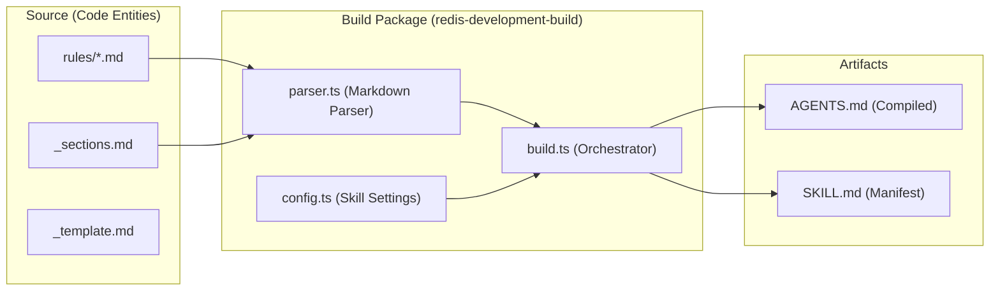
Sources: [AGENTS.md:13-26](), [AGENTS.md:131-137](), [AGENTS.md:148-166]()

## Getting Started

Users can install these skills using several methods depending on their preferred agent environment:
*   **Agent Skills CLI**: `npx skills add redis/agent-skills` [README.md:15-19]().
*   **Claude Code**: Use the `/plugin` command to add the Redis marketplace [README.md:21-28]().
*   **Cursor**: Add the plugin via the `/add-plugin redis` chat command [README.md:30-36]().

For detailed setup instructions, including local development and contribution workflows, see **[Getting Started & Installation](#1.1)**.

## Repository Organization

The repository follows a strict directory structure to support both human readability and automated builds:
*   `skills/`: The source of truth for all skill content [README.md:38]().
*   `packages/`: Contains the build tooling logic [AGENTS.md:138-140]().
*   `plugins/`: Symlinked directories for platform-specific distribution (e.g., Claude, Cursor) [README.md:38]().

For a deep dive into naming conventions and directory roles, see **[Repository Structure & Conventions](#1.2)**.

## Documentation Map

*   **Skills Deep Dive**: To understand the specific Redis rules (Data Structures, Vector Search, etc.), see **[Skills Content: redis-development](#2)**.
*   **Developer Guide**: To learn how the build system works or how to add a new rule, see **[Build System & Tooling](#3)**.
*   **Integrations**: For technical details on how the plugins are validated and registered, see **[Plugin Integrations](#4)**.

Sources: [README.md:55-61](), [AGENTS.md:11-26](), [AGENTS.md:131-137]()

---

# Page: Getting Started & Installation

# Getting Started & Installation

<details>
<summary>Relevant source files</summary>

The following files were used as context for generating this wiki page:

- [.husky/pre-commit](.husky/pre-commit)
- [CONTRIBUTING.md](CONTRIBUTING.md)
- [README.md](README.md)
- [package-lock.json](package-lock.json)
- [package.json](package.json)

</details>


This page provides a comprehensive guide for installing the Redis Agent Skills and setting up a local development environment. It covers installation methods for end-users via various agent platforms and the technical workflow for contributors to build and validate skills.

## User Installation Methods

The Redis Agent Skills are distributed through multiple channels to support different AI coding agents. The primary skill currently available is `redis-development`, which provides best practices for data structures, performance, and vector search [README.md:9-11]().

### 1. Agent Skills CLI
The standard way to add these skills to any compatible agent is via the Agent Skills CLI.
```bash
npx skills add redis/agent-skills
```
[README.md:15-19]()

### 2. Claude Code Plugin
For users of Anthropic's Claude Code, the skills can be installed as a dedicated plugin. This involves adding the Redis repository to the marketplace and then installing the specific skill.
```bash
/plugin marketplace add redis/agent-skills
/plugin install redis-development@redis
```
[README.md:21-28]()

### 3. Cursor Plugin
Cursor users can integrate the Redis development rules directly into their IDE chat experience.
```text
/add-plugin redis
```
[README.md:30-36]()

## Contributor Setup & Local Development

For developers looking to contribute new rules or modify existing ones, the repository uses a Node.js-based toolchain to manage skill compilation and validation.

### Prerequisites
- Node.js (Version 18 or higher) [package-lock.json:29-30]()
- npm

### Initial Setup
Clone the repository and install dependencies. This process automatically configures [Husky](https://github.com/typicode/husky) to manage Git hooks [package.json:14-18]().
```bash
npm install
```
[CONTRIBUTING.md:5-9]()

### Data Flow: From Rules to Plugins
The repository structure ensures that the `skills/` directory remains the source of truth. Plugin directories (like `.cursor-plugin/` or `.claude-plugin/`) utilize symlinks to expose the skill content without duplicating data [README.md:38-39]().

#### Rule Compilation Diagram
This diagram illustrates how individual markdown rules are processed into the final `AGENTS.md` file used by AI agents.

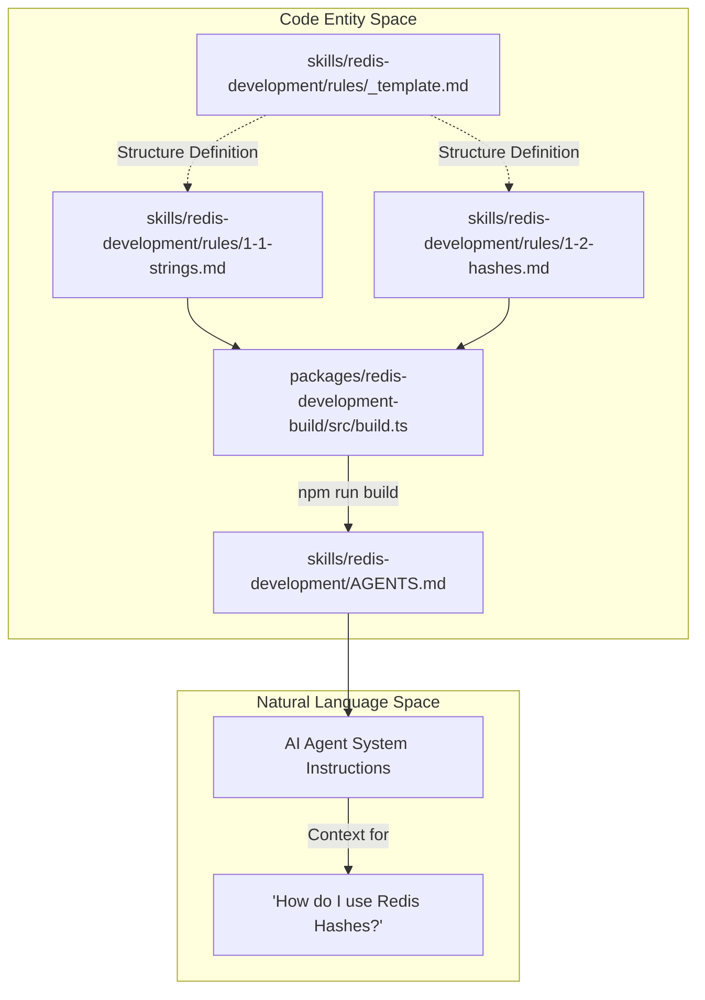
Sources: [README.md:55-61](), [CONTRIBUTING.md:11-22](), [package.json:8-10]()

## Development Workflow

The development lifecycle revolves around three main commands defined in the root `package.json`.

| Command | Description | Implementation |
| :--- | :--- | :--- |
| `npm run validate` | Runs all validation checks for skills and plugins. | Calls `validate:skills` and `validate:plugins` [package.json:9]() |
| `npm run build` | Compiles individual rule files into the `AGENTS.md` bundle. | Executes `redis-development-build` workspace [package.json:8]() |
| `npm run validate:plugins` | Validates marketplace manifests for Claude and Cursor. | Runs `scripts/validate-claude-plugins.mjs` and `scripts/validate-cursor-plugins.mjs` [package.json:11-13]() |

### Pre-commit Hook Workflow
To maintain consistency, a Husky pre-commit hook enforces that all rules are valid and that the compiled `AGENTS.md` is up-to-date before any code is committed.

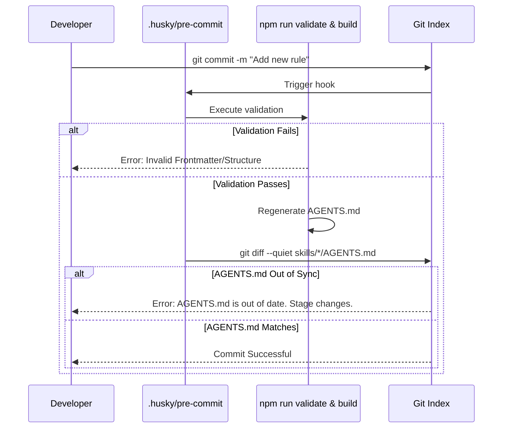
Sources: [.husky/pre-commit:1-9](), [CONTRIBUTING.md:22-29]()

### Adding a New Rule
1. **Create File**: Add a new `.md` file in `skills/redis-development/rules/` using the naming convention `<prefix>-<name>.md` [CONTRIBUTING.md:17]().
2. **Apply Template**: Follow the structure defined in `rules/_template.md` [CONTRIBUTING.md:18]().
3. **Build**: Run `npm run build` to update the aggregate `AGENTS.md` file [CONTRIBUTING.md:19]().
4. **Stage**: You must `git add` both the new rule file and the modified `AGENTS.md` for the pre-commit hook to pass [.husky/pre-commit:5-8]().

Sources:
- [README.md:1-76]()
- [package.json:1-20]()
- [CONTRIBUTING.md:1-29]()
- [.husky/pre-commit:1-9]()

---

# Page: Repository Structure & Conventions

# Repository Structure & Conventions

<details>
<summary>Relevant source files</summary>

The following files were used as context for generating this wiki page:

- [CLAUDE.md](CLAUDE.md)
- [README.md](README.md)
- [skills/redis-development/AGENTS.md](skills/redis-development/AGENTS.md)
- [skills/redis-development/SKILL.md](skills/redis-development/SKILL.md)
- [skills/redis-development/metadata.json](skills/redis-development/metadata.json)

</details>


This page details the organization of the `redis/agent-skills` repository, the naming conventions used for skill development, and the technical implementation of the plugin distribution strategy.

## Directory Layout

The repository is organized into a modular structure that separates the core skill content from the build tooling and platform-specific plugin packaging.

| Directory | Purpose |
|:---|:---|
| `skills/` | The source of truth for all skill content. Each subdirectory represents a standalone skill (e.g., `redis-development`). [README.md:38-38](), [CLAUDE.md:14-15]() |
| `plugins/` | Contains platform-specific plugin wrappers (e.g., for Claude Code) that symlink to the `skills/` directory. [README.md:38-38]() |
| `packages/` | Houses internal TypeScript packages, such as the build system used to compile rules. [CLAUDE.md:138-140]() |
| `scripts/` | Utility scripts for validation and CI/CD automation. [README.md:61-61]() |
| `.cursor-plugin/` | Global configuration and marketplace registry for Cursor IDE integration. |
| `.claude-plugin/` | Global configuration and marketplace registry for Claude Code integration. |

### Skill Directory Structure
Each skill within `skills/{skill-name}/` must follow a strict internal structure to be compatible with the build system and CLI:

*   `SKILL.md`: The primary entry point for agents, containing high-level instructions and a rule index. [CLAUDE.md:16-16]()
*   `AGENTS.md`: A generated, monolithic file containing the full text of all expanded rules, optimized for LLM context. [CLAUDE.md:17-17]()
*   `metadata.json`: Machine-readable versioning and reference data. [CLAUDE.md:19-19]()
*   `rules/`: A directory containing individual markdown files for each rule, along with `_sections.md` for category definitions. [CLAUDE.md:20-23]()

**Sources:** [README.md:55-61](), [CLAUDE.md:11-26]()

---

## Naming Conventions

Consistency in naming is enforced to ensure the build system can correctly map rule files to their respective sections in the compiled `AGENTS.md`.

### Core Entities
*   **Skill Directories**: Must use `kebab-case` (e.g., `redis-development`). [CLAUDE.md:30-30]()
*   **Rule Files**: Must follow the pattern `{prefix}-{description}.md`. [CLAUDE.md:32-32]()
*   **Section Prefixes**: Short identifiers (e.g., `rqe-` for Redis Query Engine) that map a file to a specific chapter in the documentation. [skills/redis-development/SKILL.md:26-38]()

### Rule File Mapping
The build system uses a `sectionMap` defined in the build configuration to route files based on their prefix.

**Data Flow: Rule File to AGENTS.md Section**
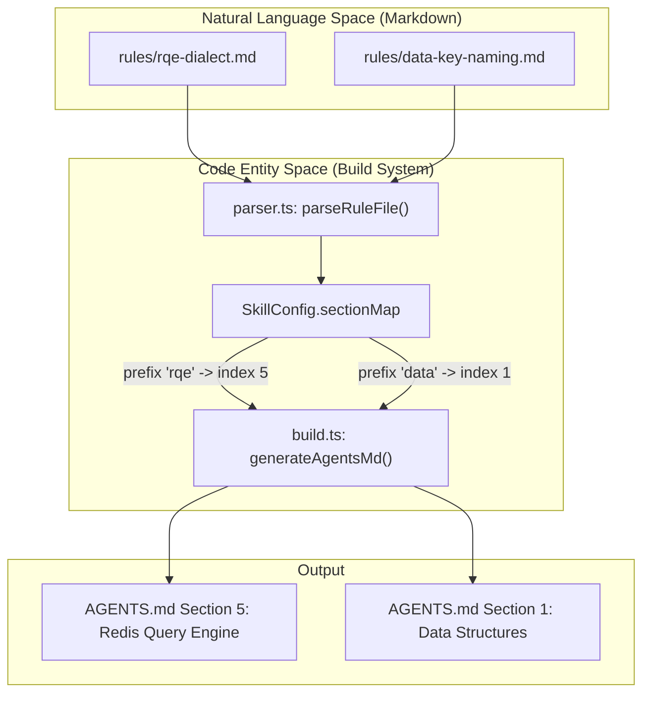

**Sources:** [CLAUDE.md:28-34](), [CLAUDE.md:150-165](), [skills/redis-development/SKILL.md:26-38]()

---

## Symlink & Plugin Strategy

To avoid duplicating content while supporting multiple agent platforms (Cursor, Claude Code, etc.), the repository uses a symlink-based strategy.

### Implementation
1.  **Source of Truth**: All content resides in `skills/`. [README.md:38-38]()
2.  **Plugin Folders**: Directories like `plugins/redis-development/` do not contain copies of the rules. Instead, they contain a `.claude-plugin/` or `.cursor-plugin/` directory with a `plugin.json` manifest.
3.  **Symlinking**: The plugin folder symlinks the relevant skill directory. This allows platform-specific metadata to live alongside the shared content without fragmentation. [README.md:38-38]()

### Plugin Structure Overview
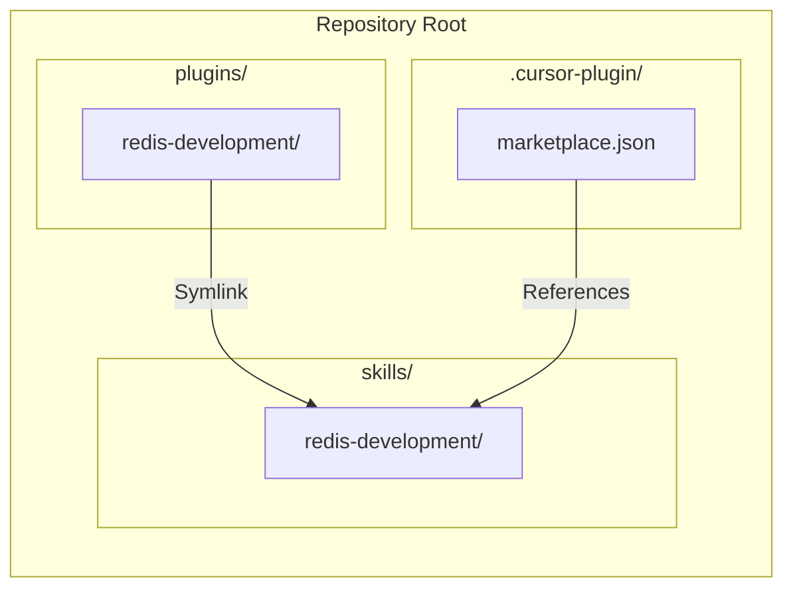

**Sources:** [README.md:30-38](), [CLAUDE.md:175-180]()

---

## Build System Integration

The build system is a TypeScript application located in `packages/redis-development-build/`. It bridges the gap between individual rule files and the final distributed assets.

### Key Functions
*   **`validate`**: Checks rule files for required frontmatter (title, impact, tags) and ensures the markdown structure follows the `_template.md`. [CLAUDE.md:144-144]()
*   **`build`**: Orchestrates the reading of `metadata.json`, `SKILL.md`, and the `rules/` directory to produce the consolidated `AGENTS.md`. [CLAUDE.md:145-145]()

### Configuration Example
New skills must be registered in the build system's configuration to be included in the automated pipeline.

```typescript
// packages/redis-development-build/src/config.ts
export const SKILLS: Record<string, SkillConfig> = {
  'redis-development': {
    name: 'redis-development',
    skillDir: join(SKILLS_DIR, 'redis-development'),
    rulesDir: join(SKILLS_DIR, 'redis-development/rules'),
    outputFile: join(SKILLS_DIR, 'redis-development/AGENTS.md'),
    sectionMap: {
      'data': 1,
      'ram': 2,
      'conn': 3
      // ... maps prefix to TOC number
    }
  }
}
```

**Sources:** [CLAUDE.md:138-165](), [README.md:63-71]()

---

# Page: Skills Content: redis-development

# Skills Content: redis-development

<details>
<summary>Relevant source files</summary>

The following files were used as context for generating this wiki page:

- [skills/redis-development/AGENTS.md](skills/redis-development/AGENTS.md)
- [skills/redis-development/SKILL.md](skills/redis-development/SKILL.md)
- [skills/redis-development/metadata.json](skills/redis-development/metadata.json)
- [skills/redis-development/rules/_sections.md](skills/redis-development/rules/_sections.md)

</details>


This page provides a high-level overview of the `redis-development` skill, which serves as the core knowledge base for this repository. It contains a comprehensive set of 29 rules organized into 11 categories, designed to guide both human developers and AI agents in optimizing Redis performance, memory usage, and feature implementation [skills/redis-development/SKILL.md:10-12]().

The skill is defined in `skills/redis-development/SKILL.md` and is compiled into a single, machine-readable `AGENTS.md` file for use by LLMs and IDE plugins [skills/redis-development/SKILL.md:1-8](), [skills/redis-development/AGENTS.md:1-11]().

### Skill Architecture: From Intent to Implementation

The following diagram illustrates how natural language requirements are mapped to specific Redis code entities and commands through the rule categories defined in this skill.

**Requirement to Code Entity Mapping**
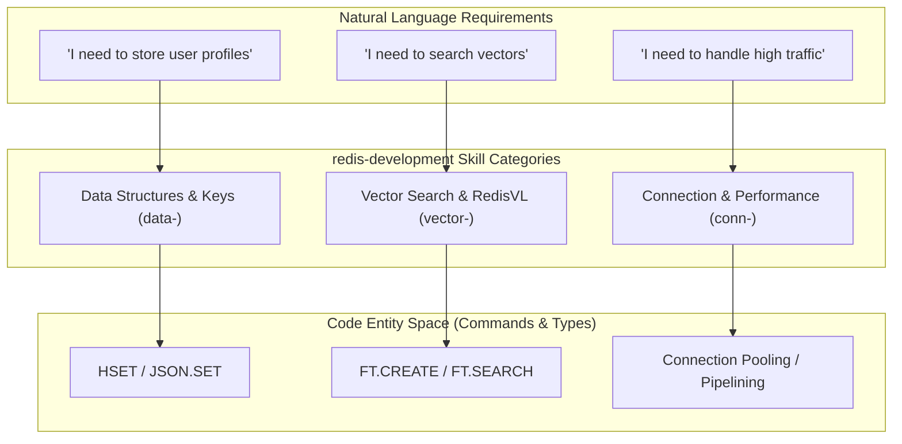
Sources: [skills/redis-development/SKILL.md:24-38](), [skills/redis-development/AGENTS.md:77-147]()

---

### Rule Categories and Domain Areas

The `redis-development` skill is partitioned into 11 distinct sections, each mapped to a filename prefix (e.g., `data-`, `ram-`, `rqe-`) to facilitate automated organization [skills/redis-development/rules/_sections.md:1-50]().

#### 1. Data Structures, Keys & Memory
These rules form the foundation of Redis development. They focus on selecting the optimal data type (String, Hash, List, Set, etc.) for specific use cases and managing the lifecycle of that data through TTLs and eviction policies.
*   **Key Rules:** `data-choose-structure`, `ram-limits`, `ram-ttl`.
*   **For details, see [Data Structures, Keys & Memory Rules](#2.1).**

#### 2. Connection & Performance
This section addresses how applications interact with the Redis server. It emphasizes efficiency through connection pooling, multiplexing, and the use of pipelining to reduce round-trip times.
*   **Key Rules:** `conn-pooling`, `conn-pipelining`, `conn-blocking`.
*   **For details, see [Connection & Performance Rules](#2.2).**

#### 3. JSON, Query Engine & Indexing
Covers advanced data modeling using RedisJSON and the Redis Query Engine (RQE). It provides guidance on when to use JSON over traditional Hashes and how to build efficient secondary indexes using `FT.CREATE`.
*   **Key Rules:** `json-vs-hash`, `rqe-index-creation`, `rqe-query-optimization`.
*   **For details, see [JSON, Query Engine & Index Rules](#2.3).**

#### 4. Vector Search, Semantic Caching & Streams
Focuses on modern AI-driven patterns, including vector similarity search with `RedisVL` and semantic caching for LLMs using `LangCache`. It also covers real-time messaging patterns using Redis Streams.
*   **Key Rules:** `vector-algorithm-choice`, `semantic-cache-langcache-usage`, `stream-choosing-pattern`.
*   **For details, see [Vector Search, Semantic Caching & Streams Rules](#2.4).**

#### 5. Clustering, Security & Observability
Addresses production-grade concerns such as horizontal scaling via Redis Cluster, securing data with ACLs and TLS, and monitoring system health using `INFO` and `SLOWLOG` commands.
*   **Key Rules:** `cluster-hash-tags`, `security-acls`, `observe-metrics`.
*   **For details, see [Clustering, Security & Observability Rules](#2.5).**

---

### System Component Interaction

The following diagram shows how the internal rule definitions relate to the final distribution formats used by developers.

**Skill Definition to Plugin Distribution**
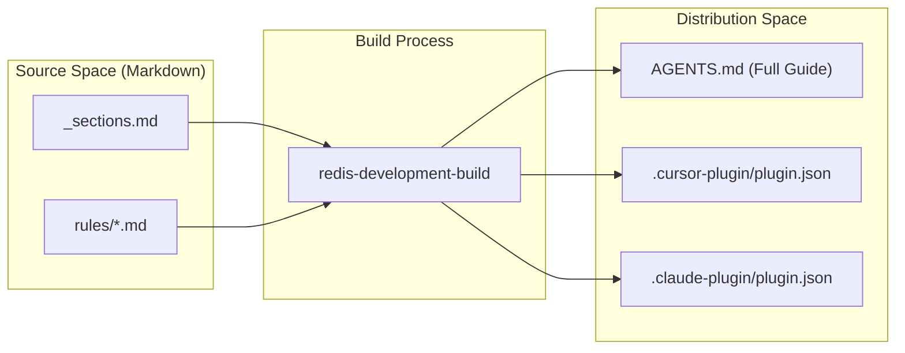
Sources: [skills/redis-development/SKILL.md:104-122](), [skills/redis-development/rules/_sections.md:1-5]()

### Impact Levels
Each category and rule is assigned an impact level (HIGH or MEDIUM) to help prioritize optimizations during automated code reviews or refactoring [skills/redis-development/SKILL.md:26-38]().

| Category | Impact | Purpose |
| :--- | :--- | :--- |
| Data Structures & Keys | **HIGH** | Prevents architectural debt and memory bloat [skills/redis-development/rules/_sections.md:7-9]() |
| Connection & Performance | **HIGH** | Prevents application-level bottlenecks and latency [skills/redis-development/rules/_sections.md:15-17]() |
| Security | **HIGH** | Ensures production readiness and data safety [skills/redis-development/rules/_sections.md:43-45]() |
| JSON Documents | **MEDIUM** | Optimizes developer ergonomics for nested data [skills/redis-development/rules/_sections.md:19-21]() |

Sources: [skills/redis-development/SKILL.md:26-38](), [skills/redis-development/rules/_sections.md:1-50]()

---

# Page: Data Structures, Keys & Memory Rules

# Data Structures, Keys & Memory Rules

<details>
<summary>Relevant source files</summary>

The following files were used as context for generating this wiki page:

- [skills/redis-development/rules/conn-client-cache.md](skills/redis-development/rules/conn-client-cache.md)
- [skills/redis-development/rules/data-choose-structure.md](skills/redis-development/rules/data-choose-structure.md)
- [skills/redis-development/rules/data-hash-field-expiry.md](skills/redis-development/rules/data-hash-field-expiry.md)
- [skills/redis-development/rules/data-incr.md](skills/redis-development/rules/data-incr.md)
- [skills/redis-development/rules/data-key-naming.md](skills/redis-development/rules/data-key-naming.md)
- [skills/redis-development/rules/data-transactions.md](skills/redis-development/rules/data-transactions.md)
- [skills/redis-development/rules/ram-limits.md](skills/redis-development/rules/ram-limits.md)
- [skills/redis-development/rules/ram-ttl.md](skills/redis-development/rules/ram-ttl.md)

</details>


This page outlines the technical standards for data modeling, key management, and memory optimization within the `redis-development` skill. It covers the fundamental rules for choosing Redis data types, naming conventions, and implementing expiration strategies to ensure performance and prevent unbounded memory growth.

## 1. Data Structure Selection

Choosing the correct Redis data type is the most critical factor in determining the performance and memory footprint of an application. The system provides specific guidance on mapping application use cases to Redis types.

### Recommended Mappings

| Use Case | Recommended Type | Why |
|----------|------------------|-----|
| Simple values, counters | **String** | Fast, atomic operations |
| Object with fields | **Hash** | Memory efficient, partial updates, field-level expiration |
| Queue, recent items | **List** | O(1) push/pop at ends |
| Unique items, membership | **Set** | O(1) add/remove/check |
| Rankings, ranges | **Sorted Set** | Score-based ordering |
| Nested/hierarchical data | **JSON** | Path queries, nested structures |
| Event logs, messaging | **Stream** | Persistent, consumer groups |
| Similarity search | **Vector Set** | Native vector storage with built-in HNSW indexing |

### Implementation Logic: Objects and Counters
Avoid using Strings for complex objects (e.g., serializing a whole JSON blob into a String). This pattern forces a full read-modify-write cycle for any update [skills/redis-development/rules/data-choose-structure.md:25-36](). Instead, use **Hashes** to allow atomic field-level updates [skills/redis-development/rules/data-choose-structure.md:47-56]().

For numeric values, use `INCR` or `INCRBY` to perform atomic increments directly on the server, avoiding race conditions inherent in client-side calculation [skills/redis-development/rules/data-incr.md:10-14]().

### Atomic Multi-Command Operations
When multiple keys must be updated as a single unit, use `MULTI`/`EXEC` transactions. This ensures that no other client requests are processed during execution, preventing partial state reads [skills/redis-development/rules/data-transactions.md:10-13]().

**Data Flow: Atomic Counter vs. Race Condition**

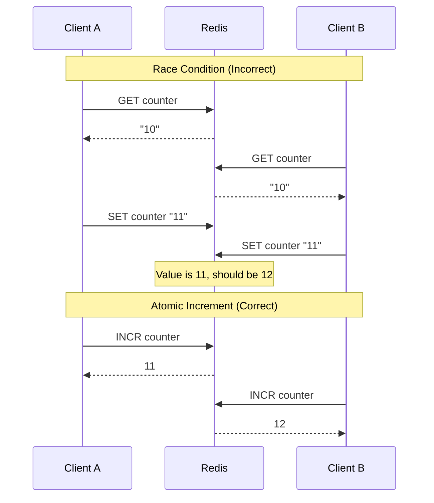
Sources: [skills/redis-development/rules/data-choose-structure.md:10-24](), [skills/redis-development/rules/data-incr.md:10-15](), [skills/redis-development/rules/data-transactions.md:10-13]()

---

## 2. Key Naming Conventions

Consistent key naming is required for maintainability and efficient scanning. The repository enforces a hierarchical structure using colons as separators.

### The Hierarchy Pattern
Keys should follow the pattern: `service:entity:id:attribute` [skills/redis-development/rules/data-key-naming.md:17-23]().

*   **Correct:** `user:1001:profile`, `order:2024:items`
*   **Incorrect:** `User_1001_Profile` (inconsistent), `my key with spaces` (wasteful/fragile), or using full URLs as keys [skills/redis-development/rules/data-key-naming.md:41-53]().

### Memory Optimization for Keys
*   Keep keys short but readable, as they consume RAM [skills/redis-development/rules/data-key-naming.md:56-56]().
*   For large binary values, use a hash digest (e.g., SHA-256) as the key instead of the value itself [skills/redis-development/rules/data-key-naming.md:59-59]().

Sources: [skills/redis-development/rules/data-key-naming.md:10-23](), [skills/redis-development/rules/data-key-naming.md:55-61]()

---

## 3. Memory & Expiration Rules

Unbounded memory growth is prevented through mandatory TTL (Time-To-Live) settings and explicit server-side eviction policies.

### TTL Strategies
All cache keys must have an expiration set at write time [skills/redis-development/rules/ram-ttl.md:12-14]().

*   **Standard Cache:** 1-24 hours [skills/redis-development/rules/ram-ttl.md:49-49]().
*   **Sessions:** 30 minutes to 24 hours [skills/redis-development/rules/ram-ttl.md:50-50]().
*   **Hash Field Expiration:** For Redis 7.4+, use `HEXPIRE` to set TTLs on individual fields within a hash, which is more efficient than managing multiple keys [skills/redis-development/rules/data-hash-field-expiry.md:10-14]().

### Eviction Policies
Redis must be configured with `maxmemory` and a `maxmemory-policy` to prevent Out-Of-Memory (OOM) crashes [skills/redis-development/rules/ram-limits.md:10-12]().

| Policy | Use Case |
|--------|----------|
| `allkeys-lru` | General purpose; evicts any least recently used key |
| `volatile-lru` | Evicts only keys with an expiration set |
| `noeviction` | Returns errors when full (use for critical/non-cache data) |

### Client-Side Caching
For data that is read frequently but updated rarely (e.g., config flags), use **Client-Side Caching** with the RESP3 protocol. This allows the client to store a local copy of the data, with Redis sending invalidation messages only when the data changes [skills/redis-development/rules/conn-client-cache.md:10-12]().

**Code Entity Mapping: Memory Management**

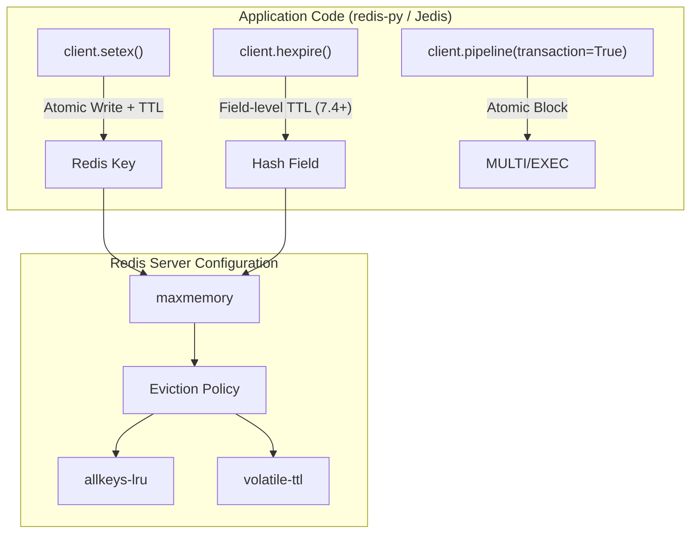

Sources: [skills/redis-development/rules/ram-ttl.md:10-24](), [skills/redis-development/rules/ram-limits.md:10-27](), [skills/redis-development/rules/data-hash-field-expiry.md:10-14](), [skills/redis-development/rules/conn-client-cache.md:10-30]()

---

# Page: Connection & Performance Rules

# Connection & Performance Rules

<details>
<summary>Relevant source files</summary>

The following files were used as context for generating this wiki page:

- [skills/redis-development/README.md](skills/redis-development/README.md)
- [skills/redis-development/rules/cluster-read-replicas.md](skills/redis-development/rules/cluster-read-replicas.md)
- [skills/redis-development/rules/conn-blocking.md](skills/redis-development/rules/conn-blocking.md)
- [skills/redis-development/rules/conn-client-cache.md](skills/redis-development/rules/conn-client-cache.md)
- [skills/redis-development/rules/conn-pipelining.md](skills/redis-development/rules/conn-pipelining.md)
- [skills/redis-development/rules/conn-pooling.md](skills/redis-development/rules/conn-pooling.md)
- [skills/redis-development/rules/conn-timeouts.md](skills/redis-development/rules/conn-timeouts.md)
- [skills/redis-development/rules/data-hash-field-expiry.md](skills/redis-development/rules/data-hash-field-expiry.md)
- [skills/redis-development/rules/data-incr.md](skills/redis-development/rules/data-incr.md)

</details>


This page details the implementation and best practices for managing Redis connections and optimizing command performance. It focuses on reducing network overhead, preventing server blocking, and leveraging advanced client-side features to ensure high-throughput, low-latency applications.

## Connection Management: Pooling & Multiplexing

Efficient connection management is critical for Redis performance. Creating a new TCP connection for every request introduces significant latency and CPU overhead. The codebase recommends two primary patterns: **Connection Pooling** and **Multiplexing**.

### Implementation Patterns

*   **Connection Pooling**: Maintains a set of established connections that are checked out and returned. This is the standard for thread-per-request models like those used in `redis-py` or `Jedis` [skills/redis-development/rules/conn-pooling.md:14-33]().
*   **Multiplexing**: A single connection handles all traffic asynchronously. This is the default for libraries like `Lettuce` (Java) or `NRedisStack` [skills/redis-development/rules/conn-pooling.md:35-44](). Note that multiplexing cannot support blocking commands (e.g., `BLPOP`) as they would stall the shared connection [skills/redis-development/rules/conn-pooling.md:69-69]().

### Connection Logic Flow

The following diagram illustrates how different client types handle the transition from "Natural Language Space" (the intent to connect) to "Code Entity Space" (the specific classes used).

**Connection Strategy Mapping**

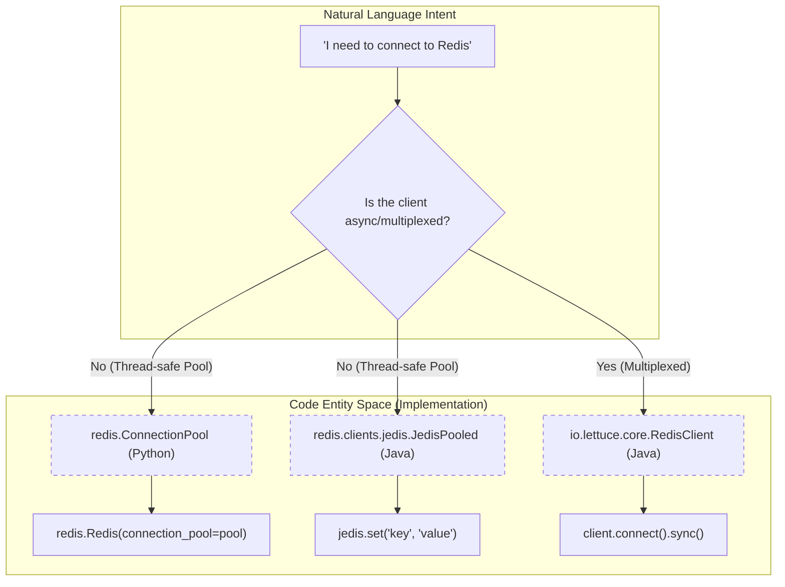
**Sources:** [skills/redis-development/rules/conn-pooling.md:16-44]()

## Performance Optimization: Pipelining & Batching

Pipelining allows a client to send multiple commands to the server without waiting for the replies. This reduces the number of network round trips, often resulting in a 5-10x speedup for bulk operations [skills/redis-development/rules/conn-pipelining.md:4-4]().

| Feature | Description | Code Entity (Python) | Code Entity (Java) |
| :--- | :--- | :--- | :--- |
| **Pipelining** | Buffer commands and send in one batch | `redis.pipeline()` | `jedis.pipelined()` |
| **Execution** | Send buffered commands to server | `pipe.execute()` | `pipe.sync()` |

**Sources:** [skills/redis-development/rules/conn-pipelining.md:16-37]()

## Avoiding Blocking Operations

Redis is single-threaded for command execution. Slow commands block all other clients. The ruleset mandates replacing O(N) commands that scan the entire keyspace with incremental alternatives [skills/redis-development/rules/conn-blocking.md:12-12]().

### Slow Command Alternatives

| Blocking Command | Recommended Alternative | Implementation Detail |
| :--- | :--- | :--- |
| `KEYS *` | `SCAN` | Use `cursor` to iterate without blocking [skills/redis-development/rules/conn-blocking.md:16-16]() |
| `SMEMBERS` | `SSCAN` | For large Sets [skills/redis-development/rules/conn-blocking.md:17-17]() |
| `HGETALL` | `HSCAN` | For large Hashes [skills/redis-development/rules/conn-blocking.md:18-18]() |
| `LRANGE 0 -1` | `LRANGE 0 100` | Paginate large Lists [skills/redis-development/rules/conn-blocking.md:19-19]() |

**Non-Blocking Iteration Flow**

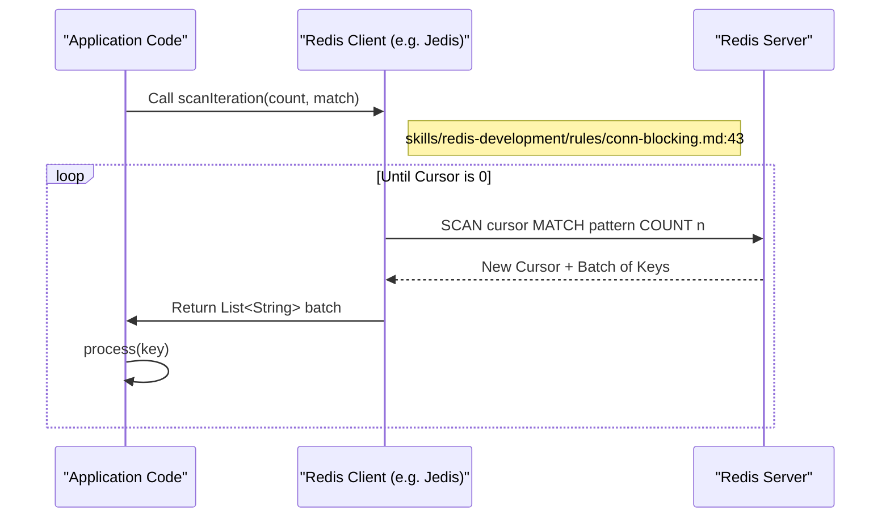
**Sources:** [skills/redis-development/rules/conn-blocking.md:23-52]()

## Client-Side Caching (RESP3)

For frequently read but rarely updated data (e.g., configuration or session flags), client-side caching significantly reduces network traffic [skills/redis-development/rules/conn-client-cache.md:10-12](). This requires the **RESP3** protocol to allow the server to send invalidation messages to the client [skills/redis-development/rules/conn-client-cache.md:24-24]().

### Configuration Parameters
*   **Protocol**: Must be set to `3` [skills/redis-development/rules/conn-client-cache.md:24-24]().
*   **CacheConfig**: Defines `max_size` for the local memory cache [skills/redis-development/rules/conn-client-cache.md:25-25]().

**Sources:** [skills/redis-development/rules/conn-client-cache.md:17-50]()

## Connection Resilience & Timeouts

Hardcoding or relying on default timeouts can lead to application hanging during network partitions. The guidelines suggest tuning three specific parameters:

1.  **`socket_connect_timeout`**: Shorter duration for fast failure detection [skills/redis-development/rules/conn-timeouts.md:20-20]().
2.  **`socket_timeout`**: Read/write timeout tuned to expected operation time [skills/redis-development/rules/conn-timeouts.md:19-19]().
3.  **`retry_on_timeout`**: Boolean flag for automatic recovery [skills/redis-development/rules/conn-timeouts.md:21-21]().

**Sources:** [skills/redis-development/rules/conn-timeouts.md:16-23]()

## Atomic Operations & Field Expiry

Performance is also gained by reducing the number of round trips for logic-heavy operations.

*   **Atomic Counters**: Use `INCR` or `INCRBY` instead of a read-modify-write pattern to avoid race conditions and extra network calls [skills/redis-development/rules/data-incr.md:10-12]().
*   **Hash Field Expiration**: In Redis 7.4+, use `HEXPIRE` to set TTLs on individual fields within a Hash, avoiding the need for manual cleanup logic or multiple keys [skills/redis-development/rules/data-hash-field-expiry.md:10-14]().

**Sources:** [skills/redis-development/rules/data-incr.md:17-45](), [skills/redis-development/rules/data-hash-field-expiry.md:17-48]()

---

# Page: JSON, Query Engine & Index Rules

# JSON, Query Engine & Index Rules

<details>
<summary>Relevant source files</summary>

The following files were used as context for generating this wiki page:

- [skills/redis-development/rules/json-partial-updates.md](skills/redis-development/rules/json-partial-updates.md)
- [skills/redis-development/rules/json-vs-hash.md](skills/redis-development/rules/json-vs-hash.md)
- [skills/redis-development/rules/rqe-dialect.md](skills/redis-development/rules/rqe-dialect.md)
- [skills/redis-development/rules/rqe-field-types.md](skills/redis-development/rules/rqe-field-types.md)
- [skills/redis-development/rules/rqe-index-creation.md](skills/redis-development/rules/rqe-index-creation.md)
- [skills/redis-development/rules/rqe-index-management.md](skills/redis-development/rules/rqe-index-management.md)
- [skills/redis-development/rules/rqe-query-optimization.md](skills/redis-development/rules/rqe-query-optimization.md)
- [skills/redis-development/rules/rqe-skip-initial-scan.md](skills/redis-development/rules/rqe-skip-initial-scan.md)

</details>


This page covers the implementation and best practices for using Redis as a document database and search engine. It details the selection criteria between JSON and Hash structures, the mechanics of partial updates, and the configuration of the Redis Query Engine (RQE) for optimal performance and zero-downtime management.

## JSON vs. Hash vs. String Selection

Choosing the correct data structure is the foundation of performance and functionality in Redis. While Strings are the most compact, they lack the ability to perform atomic partial updates or be indexed by the Query Engine.

### Data Structure Comparison

| Feature | JSON | Hash | String (serialized JSON) |
| :--- | :--- | :--- | :--- |
| **Structure** | Nested objects and arrays | Flat key-value pairs | Any structure |
| **Atomic partial reads** | Yes (`$.field`) | Yes (`HGET`) | No (must fetch entire value) |
| **Atomic partial writes** | Yes (`JSON.SET $.field`) | Yes (`HSET`) | No (must rewrite entire value) |
| **RQE indexing** | Yes | Yes | No |
| **Memory efficiency** | Higher overhead | More efficient | Most compact |
| **Field-level expiration**| No | Yes (`HEXPIRE`) | No |

### Implementation Flow: JSON vs Hash

The following diagram illustrates the decision logic for choosing a data structure based on application requirements.

**Data Structure Decision Flow**
```mermaid
graph TD
    "Start" --> "Need Indexing/Search?"
    "Need Indexing/Search?" -- "No" --> "Partial Updates Needed?"
    "Need Indexing/Search?" -- "Yes" --> "Nested Structure?"
    "Partial Updates Needed?" -- "No" --> "String (SET/GET)"
    "Partial Updates Needed?" -- "Yes" --> "Nested Structure?"
    "Nested Structure?" -- "Yes" --> "JSON (JSON.SET)"
    "Nested Structure?" -- "No" --> "Hash (HSET)"

    subgraph "Code Entities"
        "JSON (JSON.SET)"
        "Hash (HSET)"
        "String (SET/GET)"
    end
```
Sources: [skills/redis-development/rules/json-vs-hash.md:14-27]()

## JSON Documents & Partial Updates

RedisJSON allows for targeted manipulation of nested data without the overhead of fetching and re-writing the entire document (Read-Modify-Write anti-pattern).

### Partial Update Mechanics
Instead of using `json.loads()` and `json.dumps()` in application code, developers should use JSON Path syntax to target specific nodes.

*   **Targeted Updates**: `JSON.SET key path value` [skills/redis-development/rules/json-partial-updates.md:25-25]()
*   **Atomic Increments**: `JSON.NUMINCRBY key path value` [skills/redis-development/rules/json-partial-updates.md:31-31]()
*   **Array Manipulation**: `JSON.ARRAPPEND key path value` [skills/redis-development/rules/json-partial-updates.md:34-34]()

**Correct vs. Incorrect JSON Pattern**
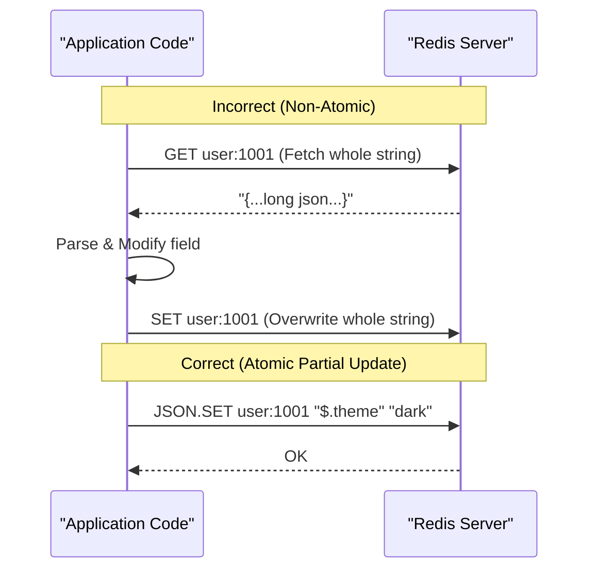
Sources: [skills/redis-development/rules/json-partial-updates.md:16-47](), [skills/redis-development/rules/json-vs-hash.md:92-103]()

## Redis Query Engine (RQE)

The Redis Query Engine enables full-text search, complex filtering, and secondary indexing over HASH and JSON types.

### Field Types & Indexing
Selecting the correct field type is critical for performance. Using `TAG` instead of `TEXT` for exact matches can improve query speed by up to 10x.

| Field Type | Use Case | Implementation Detail |
| :--- | :--- | :--- |
| `TEXT` | Full-text search | Tokenized and stemmed [skills/redis-development/rules/rqe-field-types.md:16-16]() |
| `TAG` | Exact match / Filtering | Faster than TEXT; use `SORTABLE` for performance [skills/redis-development/rules/rqe-field-types.md:17-17]() |
| `NUMERIC` | Range queries | Used for prices, counts, timestamps [skills/redis-development/rules/rqe-field-types.md:18-18]() |
| `GEO` | Point locations | Lat/long pairs [skills/redis-development/rules/rqe-field-types.md:19-19]() |
| `GEOSHAPE` | Regional areas | Polygons and circles [skills/redis-development/rules/rqe-field-types.md:20-20]() |
| `VECTOR` | Similarity search | Requires `DIALECT 2` [skills/redis-development/rules/rqe-field-types.md:21-21]() |

Sources: [skills/redis-development/rules/rqe-field-types.md:14-21]()

### Index Creation Best Practices
1.  **Prefix Filtering**: Always use `PREFIX` in `FT.CREATE` to prevent the engine from scanning every key in the database. [skills/redis-development/rules/rqe-index-creation.md:70-70]()
2.  **Skip Initial Scan**: Use `SKIPINITIALSCAN` for new features where historical data does not need to be searchable, speeding up index creation. [skills/redis-development/rules/rqe-skip-initial-scan.md:10-12]()
3.  **Dialect Selection**: Use `DIALECT 2` for consistent query behavior and vector search support. [skills/redis-development/rules/rqe-dialect.md:10-12]()

### Zero-Downtime Index Management
Index updates should be handled via Aliases to prevent application-side changes during re-indexing.

**Index Alias Lifecycle**
```mermaid
graph LR
    "App" -- "Queries" --> "Alias: products"
    "Alias: products" -- "Points To" --> "Index: products_v1"
    "Index: products_v2" -- "Background Build" --> "Redis Data"
    "FT.ALIASUPDATE" -- "Switch" --> "Alias: products"
    "Alias: products" -. "New Path" .-> "Index: products_v2"
```
Sources: [skills/redis-development/rules/rqe-index-management.md:14-32]()

## Query Optimization

Efficient queries reduce the result set early in the execution pipeline.

*   **Limit Fields**: Use `RETURN` to fetch only necessary fields instead of the whole document. [skills/redis-development/rules/rqe-query-optimization.md:20-20]()
*   **Limit Rows**: Always use `LIMIT` to avoid broad scans. [skills/redis-development/rules/rqe-query-optimization.md:19-19]()
*   **Profiling**: Use `FT.PROFILE` to identify slow query components. [skills/redis-development/rules/rqe-query-optimization.md:45-45]()

### Code Example: Optimized Index and Query (Jedis)
```java
// Define schema with appropriate types
Schema schema = new Schema()
    .addTextField("name", 1.0)
    .addTagField("category"); // TAG for exact matching

// Use Prefix to limit index scope
IndexDefinition def = new IndexDefinition(IndexDefinition.Type.HASH)
    .setPrefixes("product:");

// Create index
jedis.ftCreate("idx:products", IndexOptions.defaultOptions().setDefinition(def), schema);

// Query with specific filters and limits
SearchResult result = jedis.ftSearch("idx:products", "@category:{electronics}", 
    new Query().limit(0, 20).setDialect(2));
```
Sources: [skills/redis-development/rules/rqe-index-creation.md:30-38](), [skills/redis-development/rules/rqe-field-types.md:37-47](), [skills/redis-development/rules/rqe-query-optimization.md:18-20]()

---

# Page: Vector Search, Semantic Caching & Streams Rules

# Vector Search, Semantic Caching & Streams Rules

<details>
<summary>Relevant source files</summary>

The following files were used as context for generating this wiki page:

- [skills/redis-development/rules/semantic-cache-best-practices.md](skills/redis-development/rules/semantic-cache-best-practices.md)
- [skills/redis-development/rules/semantic-cache-langcache-usage.md](skills/redis-development/rules/semantic-cache-langcache-usage.md)
- [skills/redis-development/rules/stream-choosing-pattern.md](skills/redis-development/rules/stream-choosing-pattern.md)
- [skills/redis-development/rules/vector-algorithm-choice.md](skills/redis-development/rules/vector-algorithm-choice.md)
- [skills/redis-development/rules/vector-hybrid-search.md](skills/redis-development/rules/vector-hybrid-search.md)
- [skills/redis-development/rules/vector-index-creation.md](skills/redis-development/rules/vector-index-creation.md)
- [skills/redis-development/rules/vector-rag-pattern.md](skills/redis-development/rules/vector-rag-pattern.md)

</details>


This section covers the implementation of advanced AI-driven features and real-time messaging patterns using Redis. It focuses on Vector Search (RedisVL), Semantic Caching (LangCache), and the selection between Redis Streams and Pub/Sub for event-driven architectures.

## 1. Vector Search & RedisVL

Redis provides powerful vector search capabilities through the Redis Query Engine, allowing for high-performance Retrieval-Augmented Generation (RAG) and similarity search.

### Algorithm Selection: HNSW vs FLAT
Choosing the right indexing algorithm is critical for balancing search latency, memory consumption, and result accuracy.

| Algorithm | Speed | Accuracy | Memory | Best For |
|-----------|-------|----------|--------|----------|
| **HNSW** | Fast (Approximate) | ~95%+ recall (tunable) | Higher | Large datasets (>10k vectors), production workloads |
| **FLAT** | Slower (Brute-force) | 100% (Exact) | Lower | Small datasets, accuracy-critical applications |

### Vector Index Configuration
Indices must be configured with specific dimensions (`DIM`), a distance metric (`DISTANCE_METRIC`), and the underlying data type (`TYPE`).

**Correct: Index Creation via RedisVL**
The `redisvl` library provides a high-level `SearchIndex` and `IndexSchema` for managing vector indices.
[skills/redis-development/rules/vector-index-creation.md:53-71]()

**Correct: Index Creation via Redis CLI**
[skills/redis-development/rules/vector-index-creation.md:16-24]()

### Hybrid Search Patterns
Hybrid search combines vector similarity with traditional attribute filtering (e.g., tags, numeric ranges) to improve relevance and performance by reducing the search space before vector computation.

**Correct: Applying Filters in RedisVL**
[skills/redis-development/rules/vector-hybrid-search.md:16-28]()

**Incorrect: Client-side Filtering**
Searching the entire vector space and filtering results in application code is inefficient and increases latency.
[skills/redis-development/rules/vector-hybrid-search.md:32-41]()

### Data Flow: RAG Implementation
The following diagram illustrates the data flow for a Retrieval-Augmented Generation (RAG) pattern using `redisvl.index.SearchIndex` and `redisvl.query.VectorQuery`.

**RAG Pipeline Flow**
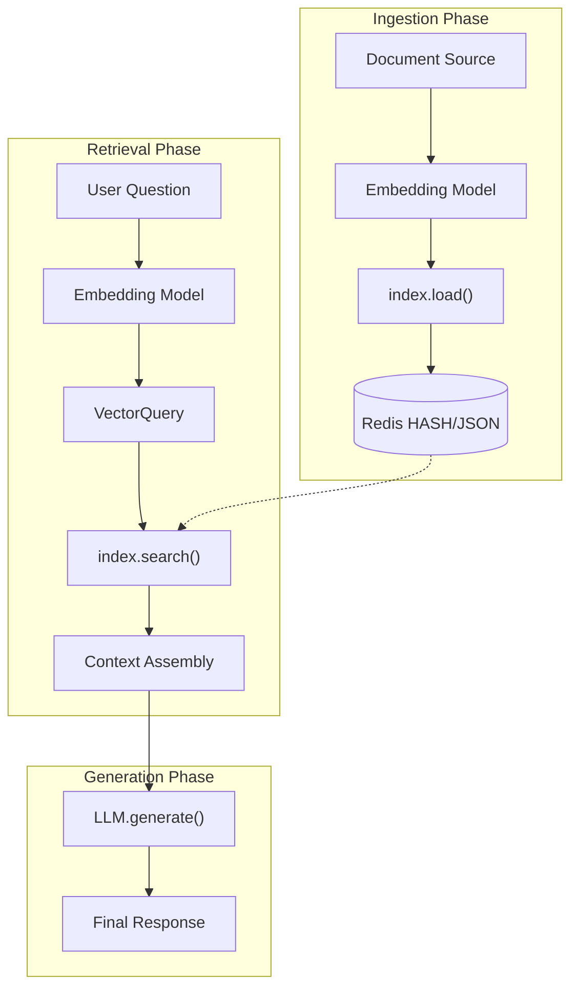
Sources: [skills/redis-development/rules/vector-rag-pattern.md:14-41]()

## 2. Semantic Caching (LangCache)

LangCache is a managed service on Redis Cloud designed to cache LLM responses based on semantic similarity rather than exact string matching.

### Implementation and Threshold Tuning
The `similarity_threshold` determines how close a new prompt must be to a cached prompt to trigger a hit.
*   **High Threshold (e.g., 0.95):** Stricter matching, fewer false positives, lower hit rate.
*   **Lower Threshold (e.g., 0.80):** Looser matching, higher hit rate, risk of irrelevant responses.

**Correct: Using the LangCache SDK**
[skills/redis-development/rules/semantic-cache-langcache-usage.md:24-49]()

### Cache Isolation
Using a single cache for disparate LLM tasks can lead to "cross-talk" where a coding query returns a customer support response. Use unique `cache_id` values to isolate contexts.
[skills/redis-development/rules/semantic-cache-best-practices.md:40-55]()

**Semantic Cache Architecture**
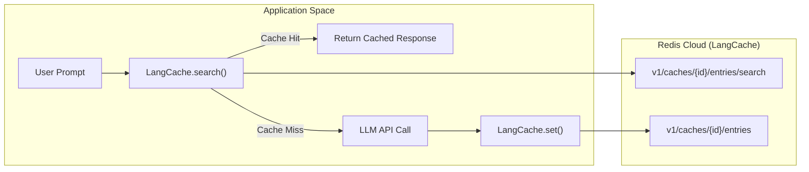
Sources: [skills/redis-development/rules/semantic-cache-langcache-usage.md:16-21](), [skills/redis-development/rules/semantic-cache-best-practices.md:16-38]()

## 3. Streams vs. Pub/Sub Selection

Choosing the correct messaging primitive depends on requirements for durability, replayability, and consumer scaling.

### Comparison Table

| Requirement | Use **Streams** | Use **Pub/Sub** |
|-------------|:---:|:---:|
| **Durability** | Yes (Persistent) | No (Fire-and-forget) |
| **Message Replay** | Yes | No |
| **Consumer Groups** | Yes (Distributed load) | No (Fan-out only) |
| **Connectivity** | Consumers can be offline | Consumers must be online |
| **Complexity** | Higher | Lower |

### Stream Processing with Consumer Groups
For reliable processing where messages must be acknowledged, use `XADD` to produce and `XREADGROUP` to consume.

**Correct: Reliable Stream Consumption**
[skills/redis-development/rules/stream-choosing-pattern.md:23-30]()

**Incorrect: Pub/Sub for Critical Data**
[skills/redis-development/rules/stream-choosing-pattern.md:16-19]()

Sources: [skills/redis-development/rules/stream-choosing-pattern.md:10-43]()

---

# Page: Clustering, Security & Observability Rules

# Clustering, Security & Observability Rules

<details>
<summary>Relevant source files</summary>

The following files were used as context for generating this wiki page:

- [skills/redis-development/README.md](skills/redis-development/README.md)
- [skills/redis-development/rules/cluster-hash-tags.md](skills/redis-development/rules/cluster-hash-tags.md)
- [skills/redis-development/rules/cluster-read-replicas.md](skills/redis-development/rules/cluster-read-replicas.md)
- [skills/redis-development/rules/conn-timeouts.md](skills/redis-development/rules/conn-timeouts.md)
- [skills/redis-development/rules/observe-commands.md](skills/redis-development/rules/observe-commands.md)
- [skills/redis-development/rules/observe-metrics.md](skills/redis-development/rules/observe-metrics.md)
- [skills/redis-development/rules/security-acls.md](skills/redis-development/rules/security-acls.md)
- [skills/redis-development/rules/security-auth.md](skills/redis-development/rules/security-auth.md)
- [skills/redis-development/rules/security-network.md](skills/redis-development/rules/security-network.md)

</details>


This page covers the architectural and operational requirements for Redis deployments, focusing on **Clustering & Replication** (Section 9), **Security** (Section 10), and **Observability** (Section 11). These rules ensure that Redis applications are scalable, secure, and maintainable in production environments.

## 1. Clustering & Replication

Redis Cluster provides a way to run a Redis installation where data is automatically sharded across multiple Redis nodes. Replication provides high availability and read scaling.

### 1.1 Multi-Key Operations and Hash Tags
In a Redis Cluster, the keyspace is divided into 16,384 hash slots. To perform multi-key operations (like `MGET`, `SUNION`, or Transactions), all involved keys must map to the same hash slot to avoid a `CROSSSLOT` error [skills/redis-development/rules/cluster-hash-tags.md:12-12](). 

**Hash Tags** allow you to force multiple keys into the same slot by wrapping a specific part of the key in curly braces `{}`. Only the string inside the braces is hashed [skills/redis-development/rules/cluster-hash-tags.md:74-74]().

**Implementation Example:**
```python
# Correct: Both keys hash based on 'user:1001'
redis.set("{user:1001}:profile", "data")
redis.set("{user:1001}:settings", "data")

# This multi-key operation succeeds in a Cluster
pipe = redis.pipeline()
pipe.get("{user:1001}:profile")
pipe.get("{user:1001}:settings")
pipe.execute()
```
*Sources: [skills/redis-development/rules/cluster-hash-tags.md:17-31]()*

### 1.2 Read Scaling with Replicas
For read-heavy workloads, applications should distribute `GET` operations to replica nodes while directing all writes to the primary node. This scales throughput without needing to add more primary shards [skills/redis-development/rules/cluster-read-replicas.md:12-12]().

**Key Considerations:**
*   **Consistency:** Replica reads are eventually consistent [skills/redis-development/rules/cluster-read-replicas.md:51-51]().
*   **Usage:** Ideal for caches, analytics, and dashboards where slightly stale data is acceptable [skills/redis-development/rules/cluster-read-replicas.md:53-53]().

### 1.3 Cluster Interaction Flow

The following diagram illustrates how a client interacts with a Redis Cluster using Hash Tags and Read Replicas.

**Title: Cluster Data Flow and Entity Mapping**
```mermaid
graph TD
    subgraph "Client Space (Python/Java)"
        "RC[RedisCluster Class]" --> "PT[Pipeline/Transaction]"
        "RC" --> "RF[read_from_replicas=True]"
    end

    subgraph "Redis Cluster Nodes"
        subgraph "Shard 1"
            "P1[Primary Node]" -- "Replication" --> "R1[Replica Node]"
        end
        subgraph "Shard 2"
            "P2[Primary Node]" -- "Replication" --> "R2[Replica Node]"
        end
    end

    "PT" -- "SET {user:1001}:profile" --> "P1"
    "PT" -- "SET {user:1001}:settings" --> "P1"
    "RF" -- "GET {user:1001}:profile" --> "R1"

    style P1 stroke-width:4px
    style P2 stroke-width:4px
```
*Sources: [skills/redis-development/rules/cluster-hash-tags.md:16-31](), [skills/redis-development/rules/cluster-read-replicas.md:16-30]()*

---

## 2. Security

Security in Redis relies on a layered approach involving authentication, authorization (ACLs), and network isolation.

### 2.1 Authentication and TLS
Never run Redis without authentication in production [skills/redis-development/rules/security-auth.md:12-12](). Use `requirepass` or ACLs combined with TLS (Transport Layer Security) to encrypt data in transit.

| Component | Configuration Requirement |
| :--- | :--- |
| **Password** | Use a strong password via `requirepass` [skills/redis-development/rules/security-auth.md:71-71]() |
| **Encryption** | Enable `tls-port` and provide `tls-cert-file` [skills/redis-development/rules/security-auth.md:72-74]() |
| **Client** | Set `ssl=True` and `ssl_cert_reqs='required'` [skills/redis-development/rules/security-auth.md:22-23]() |

### 2.2 Access Control Lists (ACLs)
The principle of least privilege should be applied using Redis ACLs. Instead of a single global password, create users with specific command and keyspace permissions [skills/redis-development/rules/security-acls.md:12-12]().

**ACL Examples:**
*   **Read-only:** `ACL SETUSER app_readonly on >pass ~cache:* +get +mget` [skills/redis-development/rules/security-acls.md:18-18]()
*   **Restricted Writer:** `ACL SETUSER app_writer on >pass ~* +@all -@dangerous` [skills/redis-development/rules/security-acls.md:21-21]()

### 2.3 Network Isolation
*   **Binding:** Bind Redis to specific internal IP addresses, never `0.0.0.0` [skills/redis-development/rules/security-network.md:18-18]().
*   **Protected Mode:** Ensure `protected-mode yes` is active [skills/redis-development/rules/security-network.md:19-19]().
*   **Command Renaming:** Disable dangerous commands like `FLUSHALL` or `CONFIG` in production [skills/redis-development/rules/security-network.md:46-49]().

*Sources: [skills/redis-development/rules/security-auth.md](), [skills/redis-development/rules/security-acls.md](), [skills/redis-development/rules/security-network.md]()*

---

## 3. Observability

Observability ensures performance issues are detected early through metrics and built-in diagnostic commands.

### 3.1 Diagnostic Commands
Redis provides several commands for real-time debugging:

| Command | Purpose |
| :--- | :--- |
| `SLOWLOG GET` | Identifies commands exceeding the execution time threshold [skills/redis-development/rules/observe-commands.md:18-18]() |
| `INFO` | Provides stats on memory, clients, and replication [skills/redis-development/rules/observe-commands.md:23-27]() |
| `MEMORY STATS` | Detailed breakdown of memory consumption [skills/redis-development/rules/observe-commands.md:31-31]() |
| `CLIENT LIST` | Lists all connected clients and their states [skills/redis-development/rules/observe-commands.md:35-35]() |

### 3.2 Key Metrics to Monitor
Monitoring systems should alert on the following thresholds:
*   **used_memory:** Alert when > 80% of `maxmemory` [skills/redis-development/rules/observe-metrics.md:16-16]().
*   **blocked_clients:** Should be 0; sustained values indicate performance bottlenecks [skills/redis-development/rules/observe-metrics.md:18-18]().
*   **hit_ratio:** (keyspace_hits / (hits + misses)). Alert if < 80% [skills/redis-development/rules/observe-metrics.md:20-20]().

### 3.3 Observability Entity Mapping

The following diagram maps observability concepts to the specific Redis commands and client-side implementations used to track them.

**Title: Observability Commands and Metrics Mapping**
```mermaid
graph LR
    subgraph "Redis Server Entities"
        "SL[Slow Log Buffer]"
        "MS[Memory Subsystem]"
        "CS[Client Selector]"
    end

    subgraph "Observability Actions"
        "O1[SLOWLOG GET]" -- "Inspects" --> "SL"
        "O2[INFO memory]" -- "Queries" --> "MS"
        "O3[CLIENT LIST]" -- "Inspects" --> "CS"
    end

    subgraph "Client Logic (redis-py)"
        "RC[redis.Redis]" -- "slowlog_get()" --> "O1"
        "RC" -- "info()" --> "O2"
        "RC" -- "client_list()" --> "O3"
    end

    "O2" --> "M1[used_memory]"
    "O2" --> "M2[keyspace_hits/misses]"
```
*Sources: [skills/redis-development/rules/observe-commands.md:17-37](), [skills/redis-development/rules/observe-metrics.md:27-32]()*

---

## 4. Connection Resilience

To ensure high availability, clients must be configured with appropriate timeouts and retry logic [skills/redis-development/rules/conn-timeouts.md:12-12]().

*   **socket_connect_timeout:** Should be short (e.g., 2.0s) for fast failure detection [skills/redis-development/rules/conn-timeouts.md:20-20]().
*   **socket_timeout:** Read/write timeout tuned to expected operation time (e.g., 5.0s) [skills/redis-development/rules/conn-timeouts.md:19-19]().
*   **retry_on_timeout:** Enable automatic retries for idempotent operations [skills/redis-development/rules/conn-timeouts.md:21-21]().

*Sources: [skills/redis-development/rules/conn-timeouts.md:16-23]()*

---

# Page: Build System & Tooling

# Build System & Tooling

<details>
<summary>Relevant source files</summary>

The following files were used as context for generating this wiki page:

- [.github/workflows/ci.yml](.github/workflows/ci.yml)
- [package.json](package.json)
- [packages/redis-development-build/package.json](packages/redis-development-build/package.json)

</details>


The **agent-skills** repository utilizes a TypeScript-based build pipeline to transform a collection of modular markdown rule files into a single, cohesive `AGENTS.md` file for each skill. This system ensures that high-level guidance for LLMs is maintained in a structured, easy-to-edit format while remaining compatible with agentic platforms that require a monolithic instruction file.

The build system is centralized within the `redis-development-build` package and is integrated into the development workflow via Husky hooks and GitHub Actions.

### Build Architecture Overview

The pipeline follows a "Source -> Validate -> Assemble" pattern. Individual rules are authored as markdown files with YAML frontmatter in the `rules/` directory of a skill. The build tool parses these files, validates their schema and cross-references, and then concatenates them into a final output based on a predefined section map.

#### Logic Flow: Natural Language to Code Entities
The following diagram illustrates how the build system bridges the gap between the natural language markdown files and the TypeScript entities that process them.

**Diagram: Build Pipeline Entity Mapping**
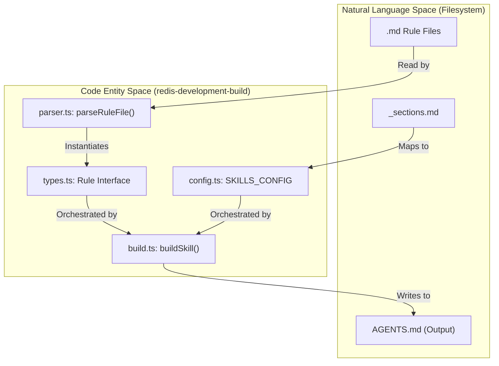
**Sources:** [packages/redis-development-build/package.json:7-9](), [package.json:8-10]()

---

### Core Components

#### 1. Build Orchestration
The primary entry point for the build system is `src/build.ts` within the `redis-development-build` workspace. It is responsible for iterating through the configured skills, loading the rules, and generating the `AGENTS.md` file.

*   **Command:** `npm run build` (invokes `tsx src/build.ts --all`).
*   **Key Logic:** The builder uses a configuration object to determine the sort order of sections and which files to include in the final bundle.

For details, see [Build Package Internals (redis-development-build)](#3.1).

#### 2. Validation Tooling
Before a build is finalized, the system runs a validation suite located in `src/validate.ts`. This ensures that all rules adhere to the required frontmatter schema (e.g., impact levels, descriptions) and that code examples are correctly formatted.

*   **Command:** `npm run validate:skills` (invokes `tsx src/validate.ts`).
*   **Scope:** Checks for missing metadata, invalid section prefixes, and broken links between rules and the contributing guide.

For details, see [Rule File Format & Authoring Guide](#3.2).

#### 3. Plugin Verification
Beyond the core build, the repository includes scripts to validate the integrity of Cursor and Claude Code plugins. These scripts ensure that the `marketplace.json` and `plugin.json` manifests are correctly configured and that relative paths to skill content are safe and valid.

*   **Scripts:** `scripts/validate-claude-plugins.mjs` and `scripts/validate-cursor-plugins.mjs`.

For details, see [CI/CD Pipeline & Pre-commit Hooks](#3.3).

---

### Automation & CI/CD Integration

The build system is strictly enforced through two layers of automation to prevent `AGENTS.md` from drifting out of sync with the source rules.

**Diagram: Automation Workflow**
```mermaid
graph LR
    subgraph "Local Development"
        H["Husky Hook"] -->|"npm run build"| I["Local AGENTS.md"]
    end

    subgraph "GitHub Actions (ci.yml)"
        J["validate:skills"] --> K["build"]
        K --> L["git diff check"]
        L --> M["validate:plugins"]
    end

    I -.->|"Git Push"| J
```

| Component | File/Path | Purpose |
| :--- | :--- | :--- |
| **Pre-commit Hook** | `package.json:14` | Uses `husky` to trigger validation and builds before every commit. |
| **CI Workflow** | `.github/workflows/ci.yml` | Runs on every PR to `main` to ensure the committed `AGENTS.md` matches the source files. |
| **Workspaces** | `package.json:4-5` | Manages `packages/*` to allow the build tool to be shared across different skills. |

**Sources:** [package.json:4-14](), [.github/workflows/ci.yml:25-40](), [packages/redis-development-build/package.json:1-10]()

---

### Child Pages
*   **[Build Package Internals (redis-development-build)](#3.1)**: Deep dive into the TypeScript source code, including the parser, configuration maps, and data models.
*   **[Rule File Format & Authoring Guide](#3.2)**: Technical specification for the markdown frontmatter, section definitions, and example conventions.
*   **[CI/CD Pipeline & Pre-commit Hooks](#3.3)**: Details on the GitHub Actions workflow and how idempotency is checked in the pipeline.

---

# Page: Build Package Internals (redis-development-build)

# Build Package Internals (redis-development-build)

<details>
<summary>Relevant source files</summary>

The following files were used as context for generating this wiki page:

- [packages/redis-development-build/src/build.ts](packages/redis-development-build/src/build.ts)
- [packages/redis-development-build/src/config.ts](packages/redis-development-build/src/config.ts)
- [packages/redis-development-build/src/parser.ts](packages/redis-development-build/src/parser.ts)
- [packages/redis-development-build/src/types.ts](packages/redis-development-build/src/types.ts)
- [packages/redis-development-build/src/validate.ts](packages/redis-development-build/src/validate.ts)
- [packages/redis-development-build/tsconfig.json](packages/redis-development-build/tsconfig.json)

</details>


The `redis-development-build` package is a TypeScript-based build pipeline responsible for transforming a collection of individual Markdown rule files into a single, cohesive `AGENTS.md` file optimized for LLM consumption. It provides the data models, parsing logic, and validation routines used across the repository.

## Data Model (types.ts)

The system uses a structured data model to represent Redis best practices. The hierarchy flows from a `GuidelinesDocument` down to individual `CodeExample` objects.

| Type | Description | Key Properties |
|:---|:---|:---|
| `Rule` | Represents a single optimization or best practice. | `id`, `title`, `impact`, `explanation`, `examples` |
| `Section` | A grouping of related rules (e.g., "Memory & Expiration"). | `number`, `title`, `impact`, `rules` |
| `CodeExample` | A code snippet demonstrating correct or incorrect usage. | `label`, `code`, `language`, `description` |
| `ImpactLevel` | Enum defining the severity of a rule. | `CRITICAL`, `HIGH`, `MEDIUM-HIGH`, `MEDIUM`, `LOW-MEDIUM`, `LOW` |

Sources: [packages/redis-development-build/src/types.ts:5-44]()

## Configuration & Mapping (config.ts)

The build system is multi-skill aware. It defines a `SkillConfig` interface to manage different sets of rules and their output destinations.

The `SKILLS` constant maps skill names (like `redis-development`) to their directory structures and `sectionMap`. The `sectionMap` is critical for the parser: it maps filename prefixes (e.g., `data-`, `ram-`) to the logical section numbers (1, 2, etc.) used in the final document.

### Section Map Example
For the `redis-development` skill, the mapping is defined as:
- `data`: Section 1 (Data Structures)
- `ram`: Section 2 (Memory)
- `conn`: Section 3 (Connection)
- ...and so on up to `observe`: Section 11.

Sources: [packages/redis-development-build/src/config.ts:15-49]()

## Rule Parser (parser.ts)

The `parseRuleFile` function is the core engine that converts Markdown source into the `Rule` object. It handles three distinct parts of a rule file:

1.  **Frontmatter**: Extracts metadata like `id` or `tags` if present [packages/redis-development-build/src/parser.ts:43-60]().
2.  **Metadata Extraction**: Identifies the `title` from headings and the `impact` level from bolded text [packages/redis-development-build/src/parser.ts:66-111]().
3.  **Example Parsing**: A stateful loop that detects code blocks and labels (e.g., `**Correct:**`). It uses a `smartJoin` helper to preserve Markdown table formatting while managing whitespace between paragraphs [packages/redis-development-build/src/parser.ts:12-22](), [packages/redis-development-build/src/parser.ts:147-184]().

### Parser Data Flow
The following diagram shows how raw Markdown is transformed into the internal `RuleFile` interface.

**Diagram: Markdown to Code Entity Transformation**
```mermaid
graph TD
    subgraph "Natural Language Space (Markdown File)"
        MD["rule-file.md"]
        FM["--- frontmatter ---"]
        H2["## Title"]
        IMP["**Impact: HIGH**"]
        EXP["Explanation text..."]
        CB["```python\n# code\n```"]
    end

    subgraph "Code Entity Space (parser.ts)"
        PRF["parseRuleFile()"]
        RO["Rule Object"]
        CEO["CodeExample Object"]
    end

    MD --> PRF
    FM -- "Extracted to" --> RO
    H2 -- "Sets rule.title" --> RO
    IMP -- "Sets rule.impact" --> RO
    EXP -- "Sets rule.explanation" --> RO
    CB -- "Becomes" --> CEO
    CEO -- "Pushed to" --> RO
```
Sources: [packages/redis-development-build/src/parser.ts:33-225]()

## Build Orchestrator (build.ts)

The `build.ts` script acts as the conductor for the compilation process. It performs the following sequence:

1.  **Discovery**: Scans the `rules/` directory for `.md` files, excluding those starting with `_` (templates/internal docs) [packages/redis-development-build/src/build.ts:169-171]().
2.  **Parsing**: Iterates through files, calling `parseRuleFile` for each.
3.  **Aggregation**: Groups rules into `Section` objects based on the `sectionMap` [packages/redis-development-build/src/build.ts:197-200]().
4.  **Markdown Generation**: The `generateMarkdown` function takes the aggregated sections and metadata to produce the final `AGENTS.md` string [packages/redis-development-build/src/build.ts:32-130]().
5.  **Persistence**: Writes the result to the `outputFile` defined in `config.ts`.

### Build Pipeline Logic
**Diagram: Build Process Orchestration**
```mermaid
graph LR
    subgraph "Input"
        DIR["rules/*.md"]
        CFG["config.ts (SkillConfig)"]
    end

    subgraph "Processing (build.ts)"
        BS["buildSkill()"]
        VAL["validate()"]
        GMD["generateMarkdown()"]
    end

    subgraph "Output"
        AMD["AGENTS.md"]
    end

    DIR --> BS
    CFG --> BS
    BS --> VAL
    VAL -- "If Valid" --> GMD
    GMD --> AMD
```
Sources: [packages/redis-development-build/src/build.ts:135-195]()

## Validation (validate.ts)

The validation logic ensures that the content meets the strict requirements for AI-assisted workflows. The `validateRule` function enforces:

*   **Content Presence**: Rules must have a title, explanation, and at least one code example [packages/redis-development-build/src/validate.ts:26-35]().
*   **Example Quality**: At least one "good" or "correct" example must be present. The validator checks for labels like `Correct`, `Usage`, or specific language names (Python, Java, etc.) [packages/redis-development-build/src/validate.ts:50-65]().
*   **Impact Levels**: Validates that the impact string matches the allowed `ImpactLevel` enum [packages/redis-development-build/src/validate.ts:82-85]().

The validation script exits with code `1` if any errors are found, preventing the CI/CD pipeline from publishing invalid rules [packages/redis-development-build/src/validate.ts:129-134]().

Sources: [packages/redis-development-build/src/validate.ts:21-88](), [packages/redis-development-build/src/validate.ts:93-142]()

---

# Page: Rule File Format & Authoring Guide

# Rule File Format & Authoring Guide

<details>
<summary>Relevant source files</summary>

The following files were used as context for generating this wiki page:

- [CONTRIBUTING.md](CONTRIBUTING.md)
- [skills/redis-development/rules/_contributing.md](skills/redis-development/rules/_contributing.md)
- [skills/redis-development/rules/_sections.md](skills/redis-development/rules/_sections.md)
- [skills/redis-development/rules/_template.md](skills/redis-development/rules/_template.md)

</details>


This page provides a technical specification for the markdown-based rule system used in the `agent-skills` repository. It covers the frontmatter schema, file naming conventions, and the structural requirements for authoring high-quality Redis best practice rules that are consumable by AI agents.

## Rule File Structure

Every rule is defined in an individual Markdown file located within a skill's `rules/` directory [CONTRIBUTING.md:11-13](). These files use a combination of YAML frontmatter and structured Markdown content to ensure consistency during the build process.

### 1. Markdown Frontmatter Schema
The frontmatter defines the metadata used by the `Parser` class in `packages/redis-development-build/src/parser.ts` to categorize and rank rules.

| Field | Type | Description |
| :--- | :--- | :--- |
| `title` | String | Action-oriented title (e.g., "Use Connection Pooling") [skills/redis-development/rules/_template.md:2](). |
| `impact` | Enum | `HIGH`, `MEDIUM`, or `LOW`. Determines priority in `AGENTS.md` [skills/redis-development/rules/_template.md:3](). |
| `impactDescription` | String | Quantified benefit (e.g., "Reduces overhead by 10x") [skills/redis-development/rules/_template.md:4](). |
| `tags` | List | Keywords for search and filtering [skills/redis-development/rules/_template.md:5](). |
| `description` | String | Brief summary of the rule's intent [skills/redis-development/rules/_template.md:6](). |
| `alwaysApply` | Boolean | If `true`, the agent should consider this rule globally [skills/redis-development/rules/_template.md:7](). |

### 2. Content Organization
The body of the rule file follows a strict pattern to assist LLM comprehension [skills/redis-development/rules/_contributing.md:14-16]():
1.  **Rule Title**: Repeated as an H2 header [skills/redis-development/rules/_template.md:10]().
2.  **Context**: 1-2 sentences explaining the problem and practical impact [skills/redis-development/rules/_template.md:12]().
3.  **Correct Pattern**: Labeled with `**Correct:**` followed by a code block [skills/redis-development/rules/_template.md:14-21]().
4.  **Alternative Pattern**: Either `**Incorrect:**` (for harmful anti-patterns) or `**When to use:**` (for feature introductions) [skills/redis-development/rules/_template.md:26-47]().

**Sources:** [skills/redis-development/rules/_template.md:1-53](), [skills/redis-development/rules/_contributing.md:1-98]()

---

## Filename Convention & Section Mapping

Rules are automatically assigned to categories based on their filename prefix. This mapping is defined in the `_sections.md` file within the skill's rules directory [skills/redis-development/rules/_sections.md:1-3]().

### Prefix Mapping Table
The build system parses the filename (format: `<prefix>-<name>.md`) and associates it with the following sections [CONTRIBUTING.md:17]():

| Prefix | Section Name | Focus Area |
| :--- | :--- | :--- |
| `data` | Data Structures & Keys | Type selection and naming [skills/redis-development/rules/_sections.md:7-9](). |
| `ram` | Memory & Expiration | TTL, eviction, and optimization [skills/redis-development/rules/_sections.md:11-13](). |
| `conn` | Connection & Performance | Pooling, pipelining, and blocking [skills/redis-development/rules/_sections.md:15-17](). |
| `json` | JSON Documents | RedisJSON and partial updates [skills/redis-development/rules/_sections.md:19-21](). |
| `rqe` | Redis Query Engine | Index design and FT.SEARCH [skills/redis-development/rules/_sections.md:23-25](). |
| `vector` | Vector Search | HNSW/FLAT and RedisVL [skills/redis-development/rules/_sections.md:27-29](). |
| `semantic-cache` | Semantic Caching | LangCache and LLM caching [skills/redis-development/rules/_sections.md:31-33](). |

### Rule Resolution Flow
The following diagram illustrates how a raw Markdown file is transformed into a structured `Rule` object and assigned to a `Section`.

**Rule Ingestion and Mapping Logic**
```mermaid
graph TD
    subgraph "File System Space"
        F["conn-pooling.md"]
        S["_sections.md"]
    end

    subgraph "Build Engine (Code Entity Space)"
        P["Parser.parseFile()"]
        C["Config.getSectionByPrefix()"]
        R["Rule Object"]
    end

    F -->|Read| P
    P -->|Extract Prefix 'conn'| C
    S -->|Define Map| C
    C -->|Assign Section ID 3| R
    P -->|Hydrate Frontmatter| R
```
**Sources:** [CONTRIBUTING.md:11-20](), [skills/redis-development/rules/_sections.md:1-51]()

---

## Authoring Guidelines

To maintain high quality, authors must adhere to the "Problem-First" structure and provide concrete, runnable examples [skills/redis-development/rules/_contributing.md:7-16]().

### Impact Levels
Impact levels help the agent prioritize rules during execution [skills/redis-development/rules/_contributing.md:28-30]().

*   **HIGH**: 5-100x improvement. Focus on missing indexes, connection leaks, or blocking commands [skills/redis-development/rules/_contributing.md:80]().
*   **MEDIUM**: 2-5x improvement. Focus on suboptimal data structures or missing TTLs [skills/redis-development/rules/_contributing.md:81]().
*   **LOW**: Incremental improvements or advanced edge cases [skills/redis-development/rules/_contributing.md:82]().

### Code Example Standards
*   **Language Tags**: Use `python` (preferred), `javascript`, or `bash` [skills/redis-development/rules/_contributing.md:61-66]().
*   **Semantic Naming**: Avoid generic names like `key1`. Use `user:1001:profile` or `order:items` [skills/redis-development/rules/_contributing.md:50-55]().
*   **Comments**: Focus on *why* a pattern is used rather than *what* the code does [skills/redis-development/rules/_contributing.md:68-72]().

**Rule Authoring Data Flow**
```mermaid
sequenceDiagram
    participant A as Author
    participant T as _template.md
    participant B as Build Script (npm run build)
    participant V as Validator

    A->>T: Copy template to <prefix>-<name>.md
    A->>A: Add Frontmatter & Examples
    A->>B: Execute build
    B->>V: Run validate()
    V-->>B: Check for Correct/Incorrect labels
    B->>B: Generate AGENTS.md
```
**Sources:** [skills/redis-development/rules/_template.md:1-53](), [skills/redis-development/rules/_contributing.md:86-98](), [CONTRIBUTING.md:24-29]()

---

## Review Checklist
Before submitting a pull request, ensure the rule meets these criteria:
- [ ] Title is action-oriented [skills/redis-development/rules/_contributing.md:90]().
- [ ] Impact level includes quantification (e.g., "10x faster") [skills/redis-development/rules/_contributing.md:92]().
- [ ] Contains at least one **Correct** and one **Incorrect** (or **When to use**) example [skills/redis-development/rules/_contributing.md:93-94]().
- [ ] Uses semantic naming for Redis keys [skills/redis-development/rules/_contributing.md:95]().
- [ ] Includes reference links to official Redis documentation [skills/redis-development/rules/_contributing.md:97]().

**Sources:** [skills/redis-development/rules/_contributing.md:86-98]()

---

# Page: CI/CD Pipeline & Pre-commit Hooks

# CI/CD Pipeline & Pre-commit Hooks

<details>
<summary>Relevant source files</summary>

The following files were used as context for generating this wiki page:

- [.github/workflows/ci.yml](.github/workflows/ci.yml)
- [.husky/pre-commit](.husky/pre-commit)
- [package-lock.json](package-lock.json)
- [package.json](package.json)

</details>


The `redis/agent-skills` repository utilizes a multi-stage validation and build pipeline to ensure that all Redis development rules are syntactically correct, consistent across distribution formats (Markdown and JSON), and properly synchronized. This is enforced through both local Git hooks via Husky and remote automation via GitHub Actions.

## GitHub Actions Workflow

The primary CI pipeline is defined in `.github/workflows/ci.yml`. It executes on every push to the `main` branch and for all pull requests targeting `main` `[.github/workflows/ci.yml:3-7]()`.

### Pipeline Stages

The workflow consists of a single job `validate-and-build` running on `ubuntu-latest` with Node.js v22 `[.github/workflows/ci.yml:10-20]()`. The execution order is critical to ensure that generated files match the source definitions.

1.  **Dependency Installation**: Runs `npm ci` to ensure a clean, reproducible environment `[.github/workflows/ci.yml:23]()`.
2.  **Skill Validation**: Executes `npm run validate:skills`. This triggers the validation logic within the `redis-development-build` workspace to check the integrity of the raw rule files `[.github/workflows/ci.yml:26]()`.
3.  **Artifact Generation**: Runs `npm run build` to compile the individual rule files into the consolidated `AGENTS.md` files for each skill `[.github/workflows/ci.yml:29]()`.
4.  **Idempotency & Sync Check**: A critical check that performs a `git diff` on the generated `AGENTS.md` files. If the build step produced any changes not already committed by the developer, the CI fails. This ensures the committed `AGENTS.md` always reflects the current state of the source rules `[.github/workflows/ci.yml:31-37]()`.
5.  **Plugin Validation**: Executes `npm run validate:plugins`, which runs the validation scripts for Cursor and Claude Code marketplace manifests and plugin manifests `[.github/workflows/ci.yml:40]()`.

### CI Data Flow Diagram

The following diagram illustrates how data flows through the GitHub Actions pipeline, associating high-level stages with specific scripts and file outputs.

"CI Pipeline Data Flow"
```mermaid
graph TD
    subgraph "Source Space"
        "rules/*.md"["rules/*.md"]
        "manifests"["plugin.json / marketplace.json"]
    end

    subgraph "Validation & Build (Code Space)"
        "validate:skills"["npm run validate:skills"]
        "build_script"["npm run build"]
        "validate:plugins"["npm run validate:plugins"]
    end

    subgraph "Verification"
        "git_diff"["git diff --quiet skills/*/AGENTS.md"]
    end

    "rules/*.md" --> "validate:skills"
    "validate:skills" --> "build_script"
    "build_script" -- "Generates" --> "AGENTS.md"["AGENTS.md"]
    "AGENTS.md" --> "git_diff"
    "manifests" --> "validate:plugins"
    
    style "git_diff" stroke-dasharray: 5 5
```
Sources: `[.github/workflows/ci.yml:25-41]()`, `[package.json:7-13]()`

---

## Local Pre-commit Hooks

To prevent CI failures and maintain repository hygiene, the project uses **Husky** `[package.json:17]()` to manage Git hooks. The pre-commit hook is initialized via the `prepare` script `[package.json:14]()`.

### Pre-commit Logic
The hook located at `.husky/pre-commit` mirrors the logic of the CI pipeline to catch errors before they are pushed to the remote server.

1.  **Validate**: Runs `npm run validate` which encompasses both skill and plugin validation `[.husky/pre-commit:1]()`.
2.  **Build**: Runs `npm run build` to regenerate `AGENTS.md` `[.husky/pre-commit:2]()`.
3.  **Staging Check**: Executes `git diff --quiet` on `AGENTS.md`. If the build script updated the file, the hook exits with code `1`, forcing the developer to `git add` the updated `AGENTS.md` before committing `[.husky/pre-commit:5-8]()`.

### Hook Execution Flow

"Pre-commit Execution Flow"
```mermaid
sequenceDiagram
    participant "Developer" as Dev
    participant "Git Hook" as .husky/pre-commit
    participant "Build System" as redis-development-build
    participant "FileSystem" as FS

    Dev->>+Git Hook: git commit
    Git Hook->>Build System: npm run validate
    Build System-->>Git Hook: Success
    Git Hook->>Build System: npm run build
    Build System->>FS: Write AGENTS.md
    Git Hook->>FS: git diff --quiet
    alt Changes detected
        FS-->>Git Hook: Diff exists
        Git Hook-->>-Dev: Fail: "AGENTS.md is out of date"
    else No changes
        FS-->>Git Hook: No diff
        Git Hook-->>-Dev: Commit Successful
    end
```
Sources: `[.husky/pre-commit:1-9]()`, `[package.json:8-10]()`

---

## Script Mapping & Workspaces

The root `package.json` acts as an orchestrator for scripts defined in specific packages and standalone scripts.

| Script | Command | Purpose |
| :--- | :--- | :--- |
| `build` | `npm run build --workspace=redis-development-build` | Triggers the TypeScript build orchestrator to merge rules into `AGENTS.md` `[package.json:8]()`. |
| `validate:skills` | `npm run validate --workspace=redis-development-build` | Validates rule frontmatter and structure in the `skills/` directory `[package.json:10]()`. |
| `validate:plugins` | `node scripts/validate-claude-plugins.mjs` & `node scripts/validate-cursor-plugins.mjs` | Runs JS scripts to verify IDE-specific plugin manifests and marketplace files `[package.json:11-13]()`. |
| `validate` | `npm run validate:skills && npm run validate:plugins` | Comprehensive check of all skill and plugin metadata `[package.json:9]()`. |

Sources: `[package.json:7-15]()`

---

# Page: Plugin Integrations

# Plugin Integrations

<details>
<summary>Relevant source files</summary>

The following files were used as context for generating this wiki page:

- [.claude-plugin/marketplace.json](.claude-plugin/marketplace.json)
- [.cursor-plugin/marketplace.json](.cursor-plugin/marketplace.json)
- [README.md](README.md)

</details>


The `redis/agent-skills` repository serves as a centralized hub for Redis development best practices, which are distributed to various AI coding assistants through specialized plugin architectures. While the `skills/` directory remains the primary source of truth for the rule content, the repository provides integration manifests and structural layouts required by Cursor and Claude Code.

### Plugin Architecture Overview

The integration strategy relies on mapping the core skill content—specifically the `AGENTS.md` and `SKILL.md` files—into the specific directory structures and metadata formats expected by different AI platforms. This is managed through top-level configuration directories and automated validation scripts to ensure path safety and manifest integrity.

The following diagram illustrates how the core code entities in the `skills/` directory are mapped to the platform-specific plugin manifests.

**Skill-to-Plugin Mapping**
```mermaid
graph TD
    subgraph "Code Entity Space (Source)"
        [SKILL_DIR] --> [AGENTS_MD_FILE]
        [SKILL_DIR] --> [SKILL_MD_FILE]
        [SKILL_DIR] --> [PLUGIN_JSON]
    end

    subgraph "Natural Language Space (Platforms)"
        [CURSOR_IDE]
        [CLAUDE_CODE]
    end

    [SKILL_DIR] -- "referenced by" --> [CURSOR_MARKETPLACE_JSON]
    [CURSOR_MARKETPLACE_JSON] -- "defines" --> [CURSOR_IDE]
    
    [SKILL_DIR] -- "symlinked in" --> [CLAUDE_PLUGIN_DIR]
    [CLAUDE_PLUGIN_DIR] -- "referenced by" --> [CLAUDE_MARKETPLACE_JSON]
    [CLAUDE_MARKETPLACE_JSON] -- "defines" --> [CLAUDE_CODE]

    style [SKILL_DIR] stroke-dasharray: 5 5
```
Sources: [README.md:38-38](), [.cursor-plugin/marketplace.json:10-15](), [.claude-plugin/marketplace.json:13-14]()

---

### Cursor Plugin Integration

Cursor integration is facilitated through the `.cursor-plugin/` directory. It uses a centralized `marketplace.json` to define the available plugins and their metadata. Each skill within the `skills/` directory (e.g., `redis-development`) contains its own `.cursor-plugin/plugin.json` manifest which specifies the rules and files Cursor should ingest.

Key components include:
*   **Marketplace Registry**: Located at [.cursor-plugin/marketplace.json:1-22](), it defines the plugin owner and lists the `redis-development` plugin.
*   **Skill Manifest**: Found within the skill's own directory, providing the fine-grained configuration for Cursor's rule engine.

For details on manifest schemas and path safety, see [Cursor Plugin](#4.1).

---

### Claude Code Plugin Integration

Claude Code integration utilizes the `.claude-plugin/` directory. Unlike Cursor, which points directly to the `skills/` root, the Claude Code marketplace points to a dedicated `plugins/` directory. This directory contains symlinks back to the primary `skills/` content to avoid duplication while satisfying Claude's expected directory structure.

Key components include:
*   **Marketplace Registry**: Located at [.claude-plugin/marketplace.json:1-21](), it points the `source` field to the `./plugins/` path.
*   **Symlink Strategy**: The `plugins/redis-development` folder symlinks the necessary files from `skills/redis-development` to maintain a single source of truth.

For details on the symlink structure and Claude-specific manifests, see [Claude Code Plugin](#4.2).

---

### Plugin Validation Logic

To maintain repository integrity, automated scripts validate the plugin configurations during the CI/CD pipeline. These scripts ensure that all paths referenced in the marketplace and plugin manifests are safe, exist on disk, and follow the repository's security constraints.

**Validation Workflow**
```mermaid
graph LR
    [validate_cursor_plugins_mjs] -- "checks" --> [CURSOR_MARKETPLACE_JSON]
    [validate_claude_plugins_mjs] -- "checks" --> [CLAUDE_MARKETPLACE_JSON]
    
    subgraph "Validation Functions"
        [isSafeRelativePath]
        [validatePluginManifest]
        [extractPathValues]
    end

    [validate_cursor_plugins_mjs] --> [validatePluginManifest]
    [validate_claude_plugins_mjs] --> [validatePluginManifest]
    [validatePluginManifest] --> [isSafeRelativePath]
```
Sources: [README.md:69-69]()

The validation process involves:
1.  **Entry Point**: `main()` functions in platform-specific scripts.
2.  **Path Extraction**: Using `extractPathValues()` to find all file references.
3.  **Safety Checks**: Using `isSafeRelativePath()` to prevent directory traversal attacks or out-of-bounds references.

For a detailed reference of the validation scripts and their exit codes, see [Plugin Validation Scripts](#4.3).

---

# Page: Cursor Plugin

# Cursor Plugin

<details>
<summary>Relevant source files</summary>

The following files were used as context for generating this wiki page:

- [.cursor-plugin/marketplace.json](.cursor-plugin/marketplace.json)
- [scripts/validate-cursor-plugins.mjs](scripts/validate-cursor-plugins.mjs)
- [skills/redis-development/.cursor-plugin/plugin.json](skills/redis-development/.cursor-plugin/plugin.json)
- [skills/redis-development/assets/logo.png](skills/redis-development/assets/logo.png)

</details>


The Cursor Plugin integration provides a seamless way for developers using the [Cursor IDE](https://cursor.com/) to access Redis development best practices directly within their AI-assisted coding environment. This integration is managed through a marketplace registry and individual plugin manifests that define how the IDE should interpret and apply the "agent skills" contained in the repository.

## Overview and Data Flow

The Cursor integration operates on a two-tier manifest system. A root-level marketplace manifest acts as a registry for all available plugins, while each skill directory contains its own specific plugin configuration.

### System Architecture

The following diagram illustrates the relationship between the Cursor marketplace configuration, the plugin manifests, and the validation logic that ensures path safety and schema compliance.

**Cursor Integration Architecture**

```mermaid
graph TD
    subgraph "Registry Space"
        M[".cursor-plugin/marketplace.json"]
    end

    subgraph "Skill Space (redis-development)"
        P["skills/redis-development/.cursor-plugin/plugin.json"]
        A["skills/redis-development/AGENTS.md"]
        L["skills/redis-development/assets/logo.png"]
    end

    subgraph "Validation Space (Code Entities)"
        V["scripts/validate-cursor-plugins.mjs"]
        V_M["validateMarketplace()"]
        V_P["validatePluginManifest()"]
        V_S["isSafeRelativePath()"]
    end

    M -- "references source" --> P
    P -- "defines rules path" --> A
    P -- "defines logo path" --> L

    V --> V_M
    V_M -- "reads" --> M
    V_M --> V_P
    V_P -- "reads" --> P
    V_P --> V_S
```

**Sources:** [scripts/validate-cursor-plugins.mjs:235-248](), [.cursor-plugin/marketplace.json:12-21](), [skills/redis-development/.cursor-plugin/plugin.json:1-14]()

---

## Marketplace Registry

The marketplace manifest located at `.cursor-plugin/marketplace.json` serves as the central directory for Cursor. It defines the owner of the plugins and lists the individual skills available for installation.

### Schema Details
*   **`owner`**: Information about the organization providing the skills [`.cursor-plugin/marketplace.json:3-6`]().
*   **`metadata.pluginRoot`**: Specifies the base directory where plugin sources are located (set to `skills`) [`.cursor-plugin/marketplace.json:10-10`]().
*   **`plugins`**: An array of plugin entries. Each entry must include:
    *   `name`: A kebab-case identifier (e.g., `redis-development`) [`.cursor-plugin/marketplace.json:14-14`]().
    *   `source`: The relative path from `pluginRoot` to the skill folder [`.cursor-plugin/marketplace.json:15-15`]().
    *   `description`: A high-level summary of the skill's purpose [`.cursor-plugin/marketplace.json:16-16`]().

**Sources:** [.cursor-plugin/marketplace.json:1-22]()

---

## Plugin Manifest Schema

Each skill folder contains its own `.cursor-plugin/plugin.json` file. This manifest provides the specific metadata required by Cursor to display and utilize the skill.

| Field | Type | Description |
| :--- | :--- | :--- |
| `name` | String | Must be lowercase, using only alphanumerics, hyphens, and periods [scripts/validate-cursor-plugins.mjs:120-127](). |
| `version` | String | Semantic version of the plugin [skills/redis-development/.cursor-plugin/plugin.json:3-3](). |
| `description` | String | Detailed description shown in the Cursor UI [skills/redis-development/.cursor-plugin/plugin.json:4-4](). |
| `keywords` | Array | Tags used for search and categorization [skills/redis-development/.cursor-plugin/plugin.json:12-12](). |
| `logo` | String | Relative path to the plugin icon [skills/redis-development/.cursor-plugin/plugin.json:13-13](). |
| `rules` | String | (Optional) Path to the markdown file containing the AI rules. |

**Sources:** [skills/redis-development/.cursor-plugin/plugin.json:1-14](), [scripts/validate-cursor-plugins.mjs:151-163]()

---

## Validation and Path Safety

To ensure repository integrity and prevent directory traversal vulnerabilities, the `scripts/validate-cursor-plugins.mjs` script performs rigorous checks on all manifest files.

### Path Safety Validation Logic
The function `isSafeRelativePath` [scripts/validate-cursor-plugins.mjs:58-67]() enforces the following rules:
1.  **No Absolute Paths**: Paths must not start with `/` or drive letters like `C:` [scripts/validate-cursor-plugins.mjs:62-64]().
2.  **No Upward Traversal**: Paths are normalized and checked to ensure they do not start with `../` or equal `..` [scripts/validate-cursor-plugins.mjs:65-66]().

### Validation Workflow
The validation script follows this execution flow:

**Validation Execution Flow**

```mermaid
sequenceDiagram
    participant Main as main()
    participant VM as validateMarketplace()
    participant VP as validatePluginManifest()
    participant Safe as isSafeRelativePath()

    Main->>VM: marketplace.json
    loop For each plugin entry
        VM->>Safe: Check "source" path
        VM->>VP: Validate plugin.json
        loop For path fields (logo, rules, etc.)
            VP->>Safe: Validate field path
            VP->>VP: pathExists(resolvedPath)
        end
    end
    Note over Main: Aggregate and report errors
```

**Key Functions:**
*   `validateMarketplace(marketplacePath)`: Validates the root registry and iterates through all listed plugins [scripts/validate-cursor-plugins.mjs:166-233]().
*   `validatePluginManifest(manifestPath, pluginDir, context)`: Checks individual plugin schemas, ensuring required fields like `author.name`, `version`, and `description` are present [scripts/validate-cursor-plugins.mjs:112-164]().
*   `extractPathValues(value)`: A recursive utility that extracts file paths from various JSON structures (strings, arrays, or objects with `.path`/`.file` keys) [scripts/validate-cursor-plugins.mjs:69-87]().

**Sources:** [scripts/validate-cursor-plugins.mjs:58-67](), [scripts/validate-cursor-plugins.mjs:69-87](), [scripts/validate-cursor-plugins.mjs:112-164](), [scripts/validate-cursor-plugins.mjs:166-233]()

---

# Page: Claude Code Plugin

# Claude Code Plugin

<details>
<summary>Relevant source files</summary>

The following files were used as context for generating this wiki page:

- [.claude-plugin/marketplace.json](.claude-plugin/marketplace.json)
- [plugins/redis-development/.claude-plugin/plugin.json](plugins/redis-development/.claude-plugin/plugin.json)
- [scripts/validate-claude-plugins.mjs](scripts/validate-claude-plugins.mjs)

</details>


The Claude Code integration allows the Redis development best practices contained in this repository to be consumed by Anthropic's Claude Code CLI. This integration is managed through a central marketplace registry and specific plugin manifests that define how Claude should interpret and load the skills.

## Marketplace Registry

The entry point for Claude Code integrations is the marketplace manifest located at `.claude-plugin/marketplace.json` [111-115](). This file acts as a registry for all Claude-compatible plugins within the repository.

### Marketplace Schema
The marketplace file defines the following structure:
- **`name`**: Must be lowercase kebab-case [125-132]().
- **`owner`**: Contains the organization name and support email [3-6]().
- **`plugins`**: An array of plugin objects, each specifying a `source` path relative to the repository root [11-20]().

| Field | Description | Source |
| :--- | :--- | :--- |
| `name` | "redis" | [.claude-plugin/marketplace.json:2]() |
| `plugins[].name` | "redis-development" | [.claude-plugin/marketplace.json:13]() |
| `plugins[].source` | Path to the plugin directory (`./plugins/redis-development`) | [.claude-plugin/marketplace.json:14]() |

**Sources:** [.claude-plugin/marketplace.json:1-21](), [scripts/validate-claude-plugins.mjs:110-144]()

## Plugin Manifest

Each plugin listed in the marketplace must have its own manifest located at `[plugin-source]/.claude-plugin/plugin.json` [182-186](). For the Redis development skill, this is found at `plugins/redis-development/.claude-plugin/plugin.json`.

### Plugin Manifest Structure
The manifest defines the metadata and the entry points for the agent's capabilities:
- **Metadata**: Name, description, author, and keywords [2-11]().
- **Skills**: The `skills` field points to the directory containing the actual markdown rules. In this repository, it points to `./skills/` [12]().

**Sources:** [plugins/redis-development/.claude-plugin/plugin.json:1-13]()

## Skill Integration via Symlinks

To avoid duplicating the rule content, the repository uses a symlink strategy. The `plugins/redis-development/skills/` directory is a symlink that points back to the top-level `skills/redis-development/` directory.

The `plugin.json` manifest references this symlinked directory:
```json
{
  "skills": "./skills/"
}
```
[plugins/redis-development/.claude-plugin/plugin.json:12]()

This ensures that when the Claude Code agent loads the plugin, it has direct access to the compiled `AGENTS.md` and the individual rule files within the `redis-development` skill folder.

**Sources:** [plugins/redis-development/.claude-plugin/plugin.json:12](), [scripts/validate-claude-plugins.mjs:200-203]()

## Validation Logic

The integrity of the Claude Code integration is enforced by `scripts/validate-claude-plugins.mjs`. This script is executed during the CI/CD pipeline to ensure that manifests are well-formed and all referenced paths exist.

### Key Validation Functions
- **`isSafeRelativePath(value)`**: Ensures that paths referenced in manifests do not escape the plugin directory using `../` or absolute paths [59-68]().
- **`extractPathValues(value)`**: Recursively extracts path strings from manifest fields (supporting strings, arrays, or objects with `path`/`file` keys) [70-88]().
- **`validateReferencedPath(...)`**: Resolves the relative path and checks for the physical existence of the file or directory on disk [90-108]().

### Validation Data Flow
The following diagram illustrates how the validation script traverses the "Natural Language Space" (manifests) to verify the "Code Entity Space" (filesystem).

**Claude Plugin Validation Flow**
```mermaid
graph TD
    subgraph "Natural Language Space (Manifests)"
        M[".claude-plugin/marketplace.json"]
        P["plugins/redis-development/.claude-plugin/plugin.json"]
    end

    subgraph "Code Entity Space (Filesystem)"
        V["scripts/validate-claude-plugins.mjs"]
        S["plugins/redis-development/skills/ (Symlink)"]
        R["skills/redis-development/AGENTS.md"]
    end

    V -- "1. readJsonFile()" --> M
    M -- "extractPathValues('source')" --> V
    V -- "2. ensureDirectory()" --> S
    V -- "3. readJsonFile()" --> P
    P -- "extractPathValues('skills')" --> V
    V -- "4. validateReferencedPath()" --> S
    S -- "Points to" --> R
```

**Sources:** [scripts/validate-claude-plugins.mjs:40-108](), [scripts/validate-claude-plugins.mjs:110-207]()

## Implementation Detail: Plugin Loading

When the validation script or the Claude agent processes the plugin, it follows a specific sequence to resolve the skills.

**Plugin Resolution Sequence**
```mermaid
sequenceDiagram
    participant Script as scripts/validate-claude-plugins.mjs
    participant Market as .claude-plugin/marketplace.json
    participant Manifest as plugins/redis-development/.claude-plugin/plugin.json
    participant FS as Filesystem

    Script->>Market: main() reads marketplace
    Market-->>Script: Returns plugins array
    loop Each Plugin Entry
        Script->>Script: isSafeRelativePath(entry.source)
        Script->>FS: ensureDirectory(pluginDir)
        Script->>Manifest: readJsonFile(manifestPath)
        Manifest-->>Script: Returns pluginManifest
        loop Field in [skills, commands, agents, etc]
            Script->>Script: extractPathValues(pluginManifest[field])
            Script->>FS: validateReferencedPath(resolvedPath)
        end
    end
    Script->>Script: summarizeAndExit()
```

**Sources:** [scripts/validate-claude-plugins.mjs:110-218](), [plugins/redis-development/.claude-plugin/plugin.json:1-13]()

---

# Page: Plugin Validation Scripts

# Plugin Validation Scripts

<details>
<summary>Relevant source files</summary>

The following files were used as context for generating this wiki page:

- [package.json](package.json)
- [scripts/validate-claude-plugins.mjs](scripts/validate-claude-plugins.mjs)
- [scripts/validate-cursor-plugins.mjs](scripts/validate-cursor-plugins.mjs)

</details>


The `agent-skills` repository utilizes specialized Node.js scripts to ensure the integrity of plugin manifests and marketplace registries. These scripts validate that all JSON metadata follows the required schema and that all file references (e.g., logos, skill files, MCP servers) point to existing, safe paths within the repository.

## Overview

Validation is split into two primary scripts located in the `scripts/` directory:
- `validate-cursor-plugins.mjs`: Validates Cursor IDE plugin integrations [scripts/validate-cursor-plugins.mjs:1-244]().
- `validate-claude-plugins.mjs`: Validates Claude Code plugin integrations [scripts/validate-claude-plugins.mjs:1-220]().

These scripts are executed as part of the `npm run validate:plugins` command [package.json:13-13]() and are typically triggered during CI/CD or via pre-commit hooks [package.json:9-14]().

### Validation Logic Flow

The following diagram illustrates the common execution flow used by both validation scripts to traverse from a marketplace registry to individual plugin manifests.

**Plugin Discovery and Validation Flow**
```mermaid
graph TD
    subgraph "Entry Point"
        START["main()"]
    end

    subgraph "Marketplace Validation"
        VM["validateMarketplace()"]
        RJF1["readJsonFile(marketplace.json)"]
        CHECK_MKT["Check owner & name"]
    end

    subgraph "Plugin Loop"
        LOOP["For each plugin in marketplace.plugins"]
        VPM["validatePluginManifest()"]
        RJF2["readJsonFile(plugin.json)"]
        EXTRACT["extractPathValues()"]
        VRP["validateReferencedPath()"]
    end

    subgraph "Path Safety"
        SAFE["isSafeRelativePath()"]
        EXIST["pathExists()"]
    end

    START --> VM
    VM --> RJF1
    RJF1 --> CHECK_MKT
    CHECK_MKT --> LOOP
    LOOP --> VPM
    VPM --> RJF2
    RJF2 --> EXTRACT
    EXTRACT --> VRP
    VRP --> SAFE
    VRP --> EXIST
    
    VRP -- "Error" --> ERR["addError()"]
    SAFE -- "False" --> ERR
    EXIST -- "False" --> ERR
```
Sources: [scripts/validate-cursor-plugins.mjs:166-233](), [scripts/validate-claude-plugins.mjs:110-207]()

---

## Key Validation Functions

### `isSafeRelativePath(value)`
This function prevents path traversal attacks by ensuring that all paths defined in JSON manifests remain within the plugin's directory. It checks that paths are not absolute and do not use `../` to escape the root [scripts/validate-cursor-plugins.mjs:58-67](), [scripts/validate-claude-plugins.mjs:59-68]().

### `extractPathValues(value)`
Manifests often contain paths in different formats: simple strings, arrays of strings, or objects containing `path` or `file` keys. This utility flattens these diverse structures into a single array of strings for validation [scripts/validate-cursor-plugins.mjs:69-87](), [scripts/validate-claude-plugins.mjs:70-88]().

### `validatePluginManifest()`
Performs deep inspection of a `plugin.json` file. It verifies:
1.  **Naming**: Ensures the `name` matches the `pluginNamePattern` (lowercase, alphanumerics, hyphens, and periods) [scripts/validate-cursor-plugins.mjs:10-10](), [scripts/validate-cursor-plugins.mjs:120-127]().
2.  **Metadata**: Checks for required fields like `version`, `description`, `license`, `author.name`, and `keywords` [scripts/validate-cursor-plugins.mjs:129-149]().
3.  **Asset References**: Iterates through fields such as `logo`, `rules`, `skills`, `agents`, `commands`, `hooks`, and `mcpServers` to ensure every referenced file exists on disk [scripts/validate-cursor-plugins.mjs:151-163]().

---

## Script Specifics

### Cursor Plugin Validation (`validate-cursor-plugins.mjs`)

The Cursor script is designed to handle both a single root plugin or a multi-plugin marketplace.

1.  **Entry Point**: `main()` checks for the existence of `.cursor-plugin/marketplace.json`. If missing, it falls back to validating a standalone `.cursor-plugin/plugin.json` [scripts/validate-cursor-plugins.mjs:235-246]().
2.  **Marketplace Metadata**: It supports a `metadata.pluginRoot` field in the marketplace manifest, which provides a base directory for all plugin source paths [scripts/validate-cursor-plugins.mjs:188-193]().
3.  **Source Resolution**: Resolves the plugin directory by combining `repoRoot`, `pluginRoot`, and the plugin's `source` path [scripts/validate-cursor-plugins.mjs:220-220]().

Sources: [scripts/validate-cursor-plugins.mjs:166-247]()

### Claude Code Plugin Validation (`validate-claude-plugins.mjs`)

The Claude script focuses on the marketplace structure required for Claude Code integrations.

1.  **Marketplace Schema**: Enforces a strict `marketplaceNamePattern` [scripts/validate-claude-plugins.mjs:11-11]() and ensures the `owner.name` is present [scripts/validate-claude-plugins.mjs:133-139]().
2.  **Duplicate Detection**: Uses a `Set` named `seenNames` to ensure that no two plugins in the marketplace share the same name [scripts/validate-claude-plugins.mjs:146-164]().
3.  **LSP Support**: Unlike the Cursor script, this specifically validates `lspServers` paths [scripts/validate-claude-plugins.mjs:197-197]().

Sources: [scripts/validate-claude-plugins.mjs:110-207]()

---

## Data Model & Logic Mapping

The scripts bridge the gap between the JSON configuration files and the physical file system.

**Entity Relationship: Manifest to File System**
```mermaid
classDiagram
    class MarketplaceManifest {
        +String name
        +Object owner
        +Array plugins
        +Object metadata
    }
    class PluginEntry {
        +String name
        +String source
    }
    class PluginManifest {
        +String name
        +String version
        +Array skills
        +Array mcpServers
        +String logo
    }
    class FileSystem {
        +isSafeRelativePath()
        +pathExists()
    }

    MarketplaceManifest "1" -- "*" PluginEntry : contains
    PluginEntry "1" -- "1" PluginManifest : points to via source
    PluginManifest ..> FileSystem : validates paths in fields
```
Sources: [scripts/validate-cursor-plugins.mjs:112-164](), [scripts/validate-cursor-plugins.mjs:166-233](), [scripts/validate-claude-plugins.mjs:147-204]()

---

## Error Aggregation and Exit Codes

Both scripts utilize a centralized error handling mechanism:
-   **`errors` Array**: A global array that collects strings describing validation failures [scripts/validate-cursor-plugins.mjs:8-8](), [scripts/validate-claude-plugins.mjs:8-8]().
-   **`addError(message)`**: A helper function to push new messages to the array [scripts/validate-cursor-plugins.mjs:12-14](), [scripts/validate-claude-plugins.mjs:13-15]().
-   **`summarizeAndExit()`**: Called at the end of execution. If `errors.length > 0`, it prints all messages to `stderr` and exits with code `1`. Otherwise, it exits with code `0` [scripts/validate-claude-plugins.mjs:209-218]().

| Condition | Action | Exit Code |
| :--- | :--- | :--- |
| All files exist and JSON is valid | Log "Validation passed." | `0` |
| Missing manifest file | Log error to `errors` | `1` |
| Invalid JSON syntax | Log error with JSON.parse message | `1` |
| Path traversal detected (`../`) | Log "invalid relative path" | `1` |
| Referenced asset missing | Log "references missing path" | `1` |

Sources: [scripts/validate-cursor-plugins.mjs:8-14](), [scripts/validate-claude-plugins.mjs:209-218]()

---

# Page: Glossary

# Glossary

<details>
<summary>Relevant source files</summary>

The following files were used as context for generating this wiki page:

- [README.md](README.md)
- [packages/redis-development-build/src/build.ts](packages/redis-development-build/src/build.ts)
- [packages/redis-development-build/src/config.ts](packages/redis-development-build/src/config.ts)
- [scripts/validate-cursor-plugins.mjs](scripts/validate-cursor-plugins.mjs)
- [skills/redis-development/.cursor-plugin/plugin.json](skills/redis-development/.cursor-plugin/plugin.json)
- [skills/redis-development/AGENTS.md](skills/redis-development/AGENTS.md)
- [skills/redis-development/SKILL.md](skills/redis-development/SKILL.md)
- [skills/redis-development/assets/logo.png](skills/redis-development/assets/logo.png)
- [skills/redis-development/rules/_sections.md](skills/redis-development/rules/_sections.md)

</details>


This glossary defines the technical terms, abbreviations, and domain-specific concepts used within the `redis/agent-skills` repository. It provides a bridge between high-level Redis concepts and their specific implementations or representations in the codebase.

## Codebase Terminology

### Skill
A "Skill" is a packaged set of instructions, rules, and resources designed to extend the capabilities of an AI coding agent [README.md:3-5](). In this repository, skills are located in the `skills/` directory [README.md:38]().
*   **Implementation**: A skill directory must contain a `SKILL.md` (agent instructions) and `AGENTS.md` (compiled rules) [README.md:57-60]().
*   **Code Pointer**: [skills/redis-development/SKILL.md:1-8]() defines the manifest for the core Redis skill.

### Rule
An individual best-practice guideline. Rules are authored as standalone Markdown files in a skill's `rules/` subdirectory [README.md:60]().
*   **Implementation**: Represented by the `Rule` interface in the build system [packages/redis-development-build/src/types.ts]().
*   **Data Flow**: `parser.ts` reads these files, extracts frontmatter and content, and `build.ts` aggregates them into a single `AGENTS.md` file [packages/redis-development-build/src/build.ts:6-9]().

### Section
A logical grouping of rules based on a functional domain (e.g., "Memory & Expiration").
*   **Implementation**: Sections are defined in `_sections.md` [skills/redis-development/rules/_sections.md:1-4]().
*   **Mapping**: The build system uses a `sectionMap` in `config.ts` to associate filename prefixes (like `ram-` or `conn-`) with specific section numbers [packages/redis-development-build/src/config.ts:35-47]().

### Plugin
A distribution-ready package of a skill tailored for specific AI IDEs like Cursor or Claude Code [README.md:21-32]().
*   **Structure**: Plugins often use symlinks to reference the source-of-truth in the `skills/` directory [README.md:38]().
*   **Validation**: Scripts like `validate-cursor-plugins.mjs` ensure that plugin manifests (`plugin.json`) are valid and safe [scripts/validate-cursor-plugins.mjs:112-164]().

## Redis Domain Concepts

### RQE (Redis Query Engine)
Refers to the querying and indexing capabilities of Redis (formerly known as RediSearch).
*   **Key Commands**: `FT.CREATE`, `FT.SEARCH`, `FT.AGGREGATE` [skills/redis-development/SKILL.md:19]().
*   **Code Pointer**: Rules prefixed with `rqe-` in `skills/redis-development/rules/` [skills/redis-development/SKILL.md:64-71]().

### RedisVL
The Redis Vector Library, a client-side library used for building applications with vector search and RAG (Retrieval-Augmented Generation) patterns [skills/redis-development/SKILL.md:20]().
*   **Concepts**: HNSW (Hierarchical Navigable Small World) vs FLAT indexing algorithms [skills/redis-development/AGENTS.md:49]().

### Semantic Caching (LangCache)
A technique for caching LLM responses based on semantic similarity rather than exact string matches.
*   **Implementation**: Leveraged via the `LangCache` library [skills/redis-development/SKILL.md:21]().
*   **Code Pointer**: Rules prefixed with `semantic-cache-` [skills/redis-development/SKILL.md:79-83]().

---

## Technical Architecture Diagrams

### From Natural Language to Code Entities
This diagram illustrates how a user's intent is mapped to specific code structures within the repository.

**Intent Mapping Architecture**
```mermaid
graph TD
    UserIntent["'Optimize my Redis query'"] -- "Agent triggers" --> SkillEntity["Skill: redis-development"]
    
    subgraph "Code Entity Space"
        SkillEntity --> Manifest["SKILL.md (Instructions)"]
        SkillEntity --> Compiled["AGENTS.md (Compiled Rules)"]
        Compiled --> Section["Section 5: Redis Query Engine"]
        Section --> RuleFile["rules/rqe-query-optimization.md"]
    end

    subgraph "Build System Space"
        RuleFile -- "Parsed by" --> Parser["parser.ts:parseRuleFile()"]
        Parser -- "Aggregated by" --> Builder["build.ts:generateMarkdown()"]
        Builder -- "Writes to" --> Compiled
    end
```
**Sources**: [README.md:57-60](), [packages/redis-development-build/src/build.ts:32-42](), [skills/redis-development/SKILL.md:64-71]()

### Plugin Validation Data Flow
This diagram shows how the validation scripts process the marketplace and plugin manifests to ensure integrity.

**Validation Logic Flow**
```mermaid
graph TD
    subgraph "Validation Script (validate-cursor-plugins.mjs)"
        Main["main()"] --> CheckMarket["validateMarketplace()"]
        CheckMarket --> ReadMarket["readJsonFile('.cursor-plugin/marketplace.json')"]
        ReadMarket --> LoopPlugins["Loop: marketplace.plugins"]
        LoopPlugins --> ValidateManifest["validatePluginManifest()"]
        ValidateManifest --> PathSafety["isSafeRelativePath()"]
        PathSafety --> CheckExists["pathExists()"]
    end

    subgraph "Filesystem"
        MarketFile[".cursor-plugin/marketplace.json"]
        PluginFile["skills/redis-development/.cursor-plugin/plugin.json"]
    end

    ReadMarket -.-> MarketFile
    ValidateManifest -.-> PluginFile
```
**Sources**: [scripts/validate-cursor-plugins.mjs:235-246](), [scripts/validate-cursor-plugins.mjs:166-186](), [scripts/validate-cursor-plugins.mjs:112-120]()

---

## Summary Table of Key Symbols

| Symbol | Definition | Context | Code Reference |
| :--- | :--- | :--- | :--- |
| `AGENTS.md` | The final compiled output of all rules in a skill. | Build Artifact | [packages/redis-development-build/src/config.ts:34]() |
| `SKILL.md` | High-level instructions for the AI agent. | Skill Definition | [skills/redis-development/SKILL.md:1-8]() |
| `SectionMap` | A mapping of filename prefixes to section numbers. | Build Config | [packages/redis-development-build/src/config.ts:35-47]() |
| `ImpactLevel` | Enum defining the severity of a rule (HIGH, MEDIUM, LOW). | Rule Metadata | [packages/redis-development-build/src/types.ts]() |
| `Dialect 2` | A specific version of the Redis Query Engine syntax. | Query Optimization | [skills/redis-development/SKILL.md:66]() |

**Sources**: [README.md:57-60](), [packages/redis-development-build/src/config.ts:35-47](), [skills/redis-development/SKILL.md:64-71]()