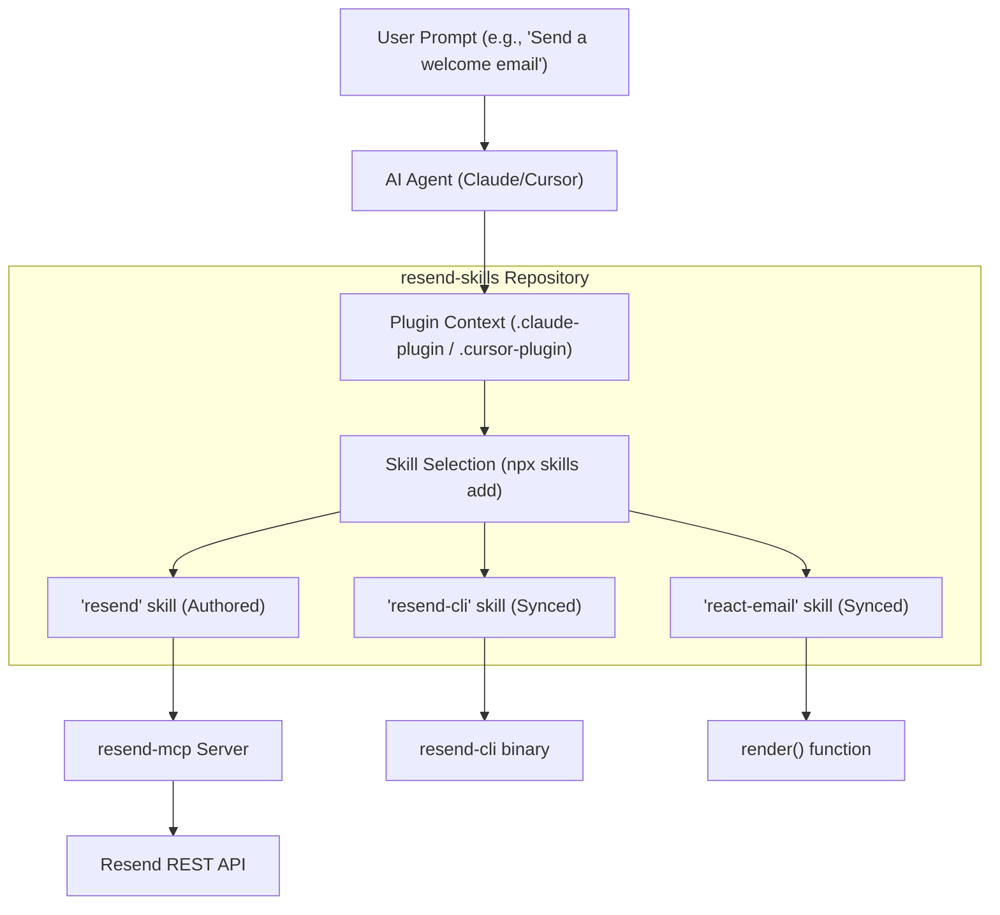
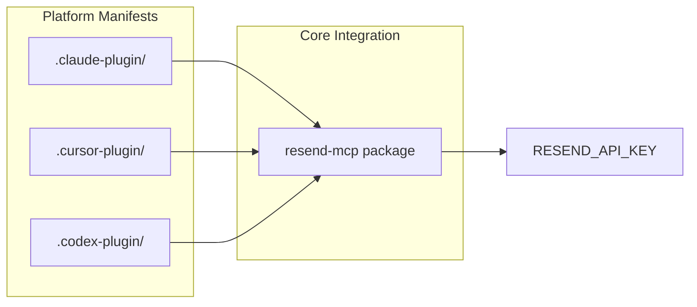

<!-- source: DeepWiki mcp.deepwiki.com · repo resend/resend-skills · page 1 Overview · fetched 2026-10-27 -->

# Overview

<details>
<summary>Relevant source files</summary>

The following files were used as context for generating this wiki page:

- [.gitignore](.gitignore)
- [AGENTS.md](AGENTS.md)
- [CLAUDE.md](CLAUDE.md)
- [LICENSE](LICENSE)
- [README.md](README.md)

</details>


`resend-skills` is a specialized collection of AI agent skills following the [Agent Skills](https://agentskills.io) format. It is designed to empower AI coding agents—such as Claude Code, Cursor, and OpenAI Codex—with the ability to send emails, manage communication infrastructure, and implement best practices for deliverability and security directly from a developer's workflow [README.md:3-5]().

The repository functions as a centralized distribution hub, combining skills authored specifically for this project with skills synchronized from external Resend ecosystem repositories [README.md:17-23]().

### System Architecture Overview

The following diagram illustrates how the `resend-skills` repository bridges natural language requests from an AI agent to the underlying code entities and external services.

**Natural Language to Code Entity Mapping**

Sources: [README.md:3-35](), [AGENTS.md:1-13]()

## Skill Categories

The available skills are categorized by their origin and primary function. Some are "Authored" (native to this repo) and some are "Synced" (mirrored from other sources).

| Skill | Category | Primary Code Entities / Purpose |
|---|---|---|
| `resend` | Authored | Interface for the Resend Email API [README.md:19]() |
| `agent-email-inbox` | Authored | Security-focused inbound email framework [README.md:20]() |
| `resend-cli` | Synced | Terminal-based operations via `resend/resend-cli` [README.md:21]() |
| `react-email` | Synced | HTML email component library via `resend/react-email` [README.md:22]() |
| `email-best-practices` | Synced | Knowledge base for deliverability and compliance [README.md:23]() |

For details on the distinction between authored and synced content, see [Skill Authoring vs. Synced Skills](#1.3).

## Platform Integration

`resend-skills` integrates with various AI platforms through specific manifest directories. It also includes an MCP (Model Context Protocol) server to provide agents with direct tool access to the Resend API [README.md:25-35]().

**Integration Map**

Sources: [README.md:25-48]()

For details on how these manifests work and how the MCP server is bootstrapped, see [Platform Plugin Integration](#1.2).

## Prerequisites & Installation

To use these skills, you must meet the following environment requirements:
*   **Resend Account:** A valid account at [resend.com](https://resend.com).
*   **Verified Domain:** A domain configured with appropriate DNS records in the Resend dashboard [README.md:45]().
*   **API Key:** A valid key stored in the `RESEND_API_KEY` environment variable [README.md:46-48]().

Installation is handled via the `npx skills` CLI:
```bash
npx skills add resend/resend-skills
```
[README.md:9-10]()

For a step-by-step setup guide, see [Getting Started & Installation](#1.1).

## Child Pages

*   **[Getting Started & Installation](#1.1)**: Detailed setup for `RESEND_API_KEY`, domain verification, and the `npx` installation flow.
*   **[Platform Plugin Integration](#1.2)**: Deep dive into `.claude-plugin`, `.cursor-plugin`, and the `resend-mcp` server architecture.
*   **[Skill Authoring vs. Synced Skills](#1.3)**: Guidelines for contributing to authored skills and understanding the sync workflow for external skills like `react-email`.

---

