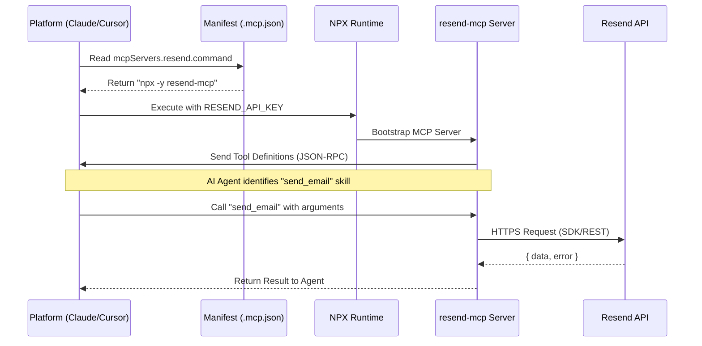

<!-- source: DeepWiki mcp.deepwiki.com · repo resend/resend-skills · page 1.2 Platform Plugin Integration · fetched 2026-10-27 -->

# Platform Plugin Integration

<details>
<summary>Relevant source files</summary>

The following files were used as context for generating this wiki page:

- [.claude-plugin/marketplace.json](.claude-plugin/marketplace.json)
- [.claude-plugin/plugin.json](.claude-plugin/plugin.json)
- [.codex-plugin/plugin.json](.codex-plugin/plugin.json)
- [.cursor-plugin/marketplace.json](.cursor-plugin/marketplace.json)
- [.cursor-plugin/plugin.json](.cursor-plugin/plugin.json)
- [.mcp.json](.mcp.json)
- [mcp.json](mcp.json)

</details>


The `resend-skills` repository integrates with AI development platforms by acting as a Model Context Protocol (MCP) host. This allows tools like Claude Code, Cursor, and OpenAI Codex to discover and execute email-related tasks—such as sending emails, managing domains, or rendering React Email components—directly within their agentic workflows.

## Plugin Manifest Architecture

The repository uses a multi-manifest strategy to support different AI IDEs and agents. Each platform looks for a specific hidden directory containing metadata and configuration files.

### Claude Code Integration
Claude Code utilizes the `.claude-plugin/` directory to identify the skill set.
*   **`marketplace.json`**: Defines the high-level metadata for the Resend skill package, including the owner information and the source path for the plugin [ .claude-plugin/marketplace.json:1-17 ]().
*   **`plugin.json`**: Contains versioning, repository links, and keywords that categorize the plugin as an email and notification tool [ .claude-plugin/plugin.json:1-13 ]().

### Cursor Integration
Cursor uses a similar structure within the `.cursor-plugin/` directory.
*   **`marketplace.json`**: Registers the "resend" plugin under the Resend owner [ .cursor-plugin/marketplace.json:1-13 ]().
*   **`plugin.json`**: Provides the display name "Resend" and links to the official documentation and repository [ .cursor-plugin/plugin.json:1-15 ]().

### OpenAI Codex Integration
Codex integration is defined in `.codex-plugin/`.
*   **`plugin.json`**: Uniquely specifies the path to the skill definitions (`./skills/`) and explicitly points to the MCP configuration file (`./.mcp.json`) used to bridge the agent to the Resend API [ .codex-plugin/plugin.json:1-17 ]().

**Sources:**
* [ .claude-plugin/marketplace.json:1-17 ]()
* [ .claude-plugin/plugin.json:1-13 ]()
* [ .cursor-plugin/marketplace.json:1-13 ]()
* [ .cursor-plugin/plugin.json:1-15 ]()
* [ .codex-plugin/plugin.json:1-17 ]()

---

## MCP Server Configuration

The core of the integration is the **Model Context Protocol (MCP)**. This protocol allows the AI agent to call external tools (the "skills") through a standardized interface.

### Bootstrapping the Server
The integration relies on the `resend-mcp` package. Instead of requiring a manual installation of a heavy binary, the platforms are configured to bootstrap the server using `npx`.

The configuration is defined in `mcp.json` and `.mcp.json`. These files instruct the host platform on how to spawn the MCP process:
*   **Command**: `npx` [ mcp.json:4-4 ]().
*   **Arguments**: `-y resend-mcp`. The `-y` flag ensures the package is installed/executed without an interactive prompt [ mcp.json:5-5 ]().
*   **Environment**: The server requires a `RESEND_API_KEY` to authenticate with the Resend platform. This is passed from the user's environment to the MCP process [ mcp.json:6-9 ]().

### Diagram: Plugin Manifest to Code Entity Mapping

The following diagram shows how the natural language request from a user in an IDE (like Cursor or Claude) maps through the manifest files to the actual MCP execution.

**Platform Plugin Mapping**
```mermaid
graph TD
    subgraph "Natural Language Space (IDE)"
        "UserPrompt"["'Send a welcome email'"]
    end

    subgraph "Manifest Layer"
        "Claude"["'.claude-plugin/plugin.json'"]
        "Cursor"["'.cursor-plugin/plugin.json'"]
        "Codex"["'.codex-plugin/plugin.json'"]
    end

    subgraph "Code Entity Space (Execution)"
        "MCPConfig"["'mcp.json'"]
        "NPX"["'npx -y resend-mcp'"]
        "APIKey"["'RESEND_API_KEY'"]
    end

    "UserPrompt" --> "Claude"
    "UserPrompt" --> "Cursor"
    "UserPrompt" --> "Codex"
    
    "Claude" --> "MCPConfig"
    "Cursor" --> "MCPConfig"
    "Codex" --> "MCPConfig"
    
    "MCPConfig" --> "NPX"
    "NPX" --> "APIKey"
```

**Sources:**
* [ mcp.json:1-11 ]()
* [ .mcp.json:1-11 ]()
* [ .codex-plugin/plugin.json:6-7 ]()

---

## Data Flow: Platform to Resend API

When a platform like Claude Code initializes the `resend-skills` plugin, it follows a specific sequence to establish a secure communication channel between the AI model and the Resend infrastructure.

### Execution Sequence
1.  **Discovery**: The IDE scans the root directory for `.claude-plugin`, `.cursor-plugin`, or `.codex-plugin`.
2.  **Configuration**: The IDE reads the `mcpServers` definition in `mcp.json` [ mcp.json:2-10 ]().
3.  **Instantiation**: The IDE executes `npx -y resend-mcp` [ .mcp.json:4-5 ]().
4.  **Authentication**: The `RESEND_API_KEY` is injected into the process environment [ mcp.json:7-7 ]().
5.  **Skill Exposure**: The `resend-mcp` server describes available tools (skills) to the LLM.

### Diagram: MCP Bootstrap and Tool Invocation

This diagram traces the flow from the initial platform boot to the invocation of the `resend-mcp` logic.

**MCP Bootstrap Flow**


**Sources:**
* [ mcp.json:1-11 ]()
* [ .mcp.json:1-11 ]()
* [ .codex-plugin/plugin.json:2-7 ]()

## Integration Metadata Summary

| Platform | Manifest Path | Key File | Purpose |
| :--- | :--- | :--- | :--- |
| **Claude Code** | `.claude-plugin/` | `marketplace.json` | Registration in Claude's tool ecosystem [ .claude-plugin/marketplace.json:1-17 ](). |
| **Cursor** | `.cursor-plugin/` | `plugin.json` | Integration with Cursor's agentic IDE features [ .cursor-plugin/plugin.json:1-15 ](). |
| **OpenAI Codex** | `.codex-plugin/` | `plugin.json` | Linking skill directories and MCP configs [ .codex-plugin/plugin.json:1-17 ](). |
| **Generic MCP** | `/` | `mcp.json` | Universal configuration for any MCP-compliant host [ mcp.json:1-11 ](). |

**Sources:**
* [ .claude-plugin/marketplace.json:1-17 ]()
* [ .cursor-plugin/plugin.json:1-15 ]()
* [ .codex-plugin/plugin.json:1-17 ]()
* [ mcp.json:1-11 ]()

---

