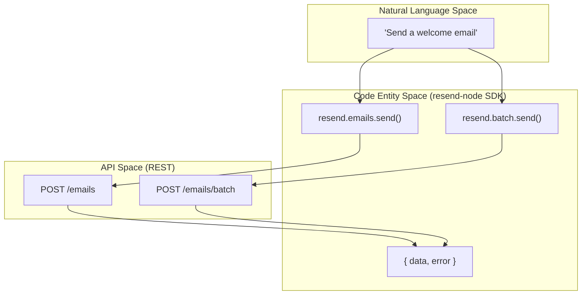
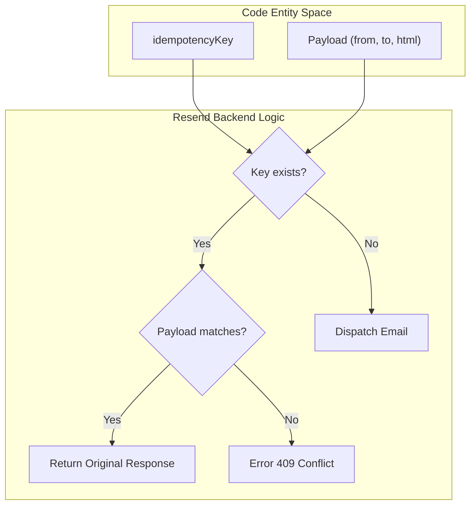

<!-- source: DeepWiki mcp.deepwiki.com · repo resend/resend-skills · page 2.1 Sending Emails · fetched 2026-10-27 -->

# Sending Emails

<details>
<summary>Relevant source files</summary>

The following files were used as context for generating this wiki page:

- [skills/resend/SKILL.md](skills/resend/SKILL.md)
- [skills/resend/references/automations.md](skills/resend/references/automations.md)
- [skills/resend/references/events.md](skills/resend/references/events.md)
- [skills/resend/references/logs.md](skills/resend/references/logs.md)
- [skills/resend/references/sending/batch-email-examples.md](skills/resend/references/sending/batch-email-examples.md)
- [skills/resend/references/sending/best-practices.md](skills/resend/references/sending/best-practices.md)
- [skills/resend/references/sending/email-management.md](skills/resend/references/sending/email-management.md)
- [skills/resend/references/sending/overview.md](skills/resend/references/sending/overview.md)
- [skills/resend/references/sending/single-email-examples.md](skills/resend/references/sending/single-email-examples.md)

</details>


This page provides a detailed technical reference for sending transactional emails using the Resend SDK and REST API. It covers the core architectural patterns, including single and batch sending, idempotency, and the unique error handling model employed by the SDK.

## Core Sending Patterns

Resend provides two primary paths for dispatching emails, optimized for different use cases.

| Approach | Endpoint | Use Case |
|----------|----------|----------|
| **Single** | `POST /emails` | Individual transactional emails, emails with attachments, scheduled sends [skills/resend/references/sending/overview.md:9-9](). |
| **Batch** | `POST /emails/batch` | 2-100 distinct emails in one request, bulk notifications [skills/resend/references/sending/overview.md:10-10](). |

### Decision Matrix

*   **Choose Single when:** Sending exactly one email, requiring file attachments, or needing to schedule a send for a future time [skills/resend/references/sending/overview.md:17-21]().
*   **Choose Batch when:** Sending between 2 and 100 distinct emails at once to reduce API roundtrips (the default rate limit is 2 requests per second) [skills/resend/references/sending/overview.md:12-15]().

### Data Flow: SDK to API
The following diagram illustrates the flow from a natural language request (e.g., "Send a welcome email") to the code entities that execute the request.

**Code Entity Mapping: Sending Workflow**

Sources: [skills/resend/SKILL.md:60-68](), [skills/resend/references/sending/overview.md:7-11]()

---

## The `{ data, error }` SDK Pattern

A critical technical detail of the Resend Node.js SDK is that it **does not throw exceptions** for API-level errors [skills/resend/SKILL.md:77-77](). Instead, it returns an object containing either `data` or `error`.

### Implementation Example
```typescript
const { data, error } = await resend.emails.send({
  from: 'Acme <onboarding@resend.dev>',
  to: ['delivered@resend.dev'],
  subject: 'Hello World',
  html: '<p>Email body</p>',
});

if (error) {
  // Handle validation_error, rate_limit_exceeded, etc.
  console.error(error.message);
  return;
}
console.log(data.id);
```
Sources: [skills/resend/SKILL.md:55-75](), [skills/resend/references/sending/best-practices.md:153-192]()

---

## Idempotency and Reliability

Idempotency keys are mandatory for production-grade implementations to prevent duplicate emails during retries [skills/resend/SKILL.md:104-106]().

### Key Mechanics
*   **Format:** Use the pattern `<event-type>/<entity-id>` (e.g., `welcome-email/user-123`) [skills/resend/references/sending/best-practices.md:18-18]().
*   **Expiration:** Keys expire after 24 hours [skills/resend/SKILL.md:112-112]().
*   **Conflict:** Sending the same key with a **different** payload returns a `409 Conflict` (`invalid_idempotent_request`) [skills/resend/references/sending/best-practices.md:20-20]().
*   **Success:** Sending the same key with the **same** payload returns the original response without re-sending the email [skills/resend/SKILL.md:114-114]().

**Entity Mapping: Idempotency Logic**

Sources: [skills/resend/references/sending/best-practices.md:10-31](), [skills/resend/SKILL.md:108-116]()

---

## Batch Sending Constraints

Batch sends are **atomic**. If a single email in the batch fails validation (e.g., an invalid email format), the entire batch request fails [skills/resend/SKILL.md:102-102]().

### Batch Limitations
*   **Max Size:** 100 emails per request [skills/resend/references/sending/overview.md:69-69]().
*   **Recipients:** Max 50 recipients per individual email within the batch [skills/resend/references/sending/overview.md:70-70]().
*   **Feature Gaps:** Batch sending does **not** support attachments or `scheduled_at` [skills/resend/references/sending/overview.md:66-67]().

### Chunking Strategy
For sends exceeding 100 emails, implementations must chunk the data:
1.  Split the list into chunks of 100.
2.  Assign unique idempotency keys per chunk: `campaign-id/chunk-0`, `campaign-id/chunk-1`.
3.  Process chunks in parallel to optimize throughput [skills/resend/references/sending/overview.md:81-90]().

Sources: [skills/resend/references/sending/overview.md:60-90](), [skills/resend/references/sending/batch-email-examples.md:11-89]()

---

## Attachments and Scheduling

Single sends (`POST /emails`) support advanced features not available in batch.

### File Attachments
*   **Total Limit:** 40MB total per email [skills/resend/references/sending/overview.md:51-51]().
*   **Retrieval:** After sending, attachments can be retrieved via `resend.emails.attachments.get()`. This returns a **signed download URL** that expires (check the `expires_at` field) [skills/resend/references/sending/email-management.md:75-112]().

### Scheduling
*   **Parameter:** `scheduled_at` (ISO 8601 string) [skills/resend/references/sending/overview.md:50-50]().
*   **Management:** Scheduled emails can be updated (to change the time) via `resend.emails.update()` or cancelled before the send time via `resend.emails.cancel()` [skills/resend/references/sending/email-management.md:47-73]().

Sources: [skills/resend/references/sending/overview.md:30-58](), [skills/resend/references/sending/email-management.md:1-126]()

---

## React Component Rendering

While the Resend API accepts `html` and `text`, the SDK supports a `react` parameter to render components directly.

### Mutually Exclusive Content
When sending, you must provide exactly one of the following content types:
*   `html`: Raw HTML string.
*   `text`: Plain text string.
*   `template`: Reference to a stored Resend template ID/alias with variables.
*   `react`: A React component (Node.js SDK only) [skills/resend/references/sending/overview.md:142-159]().

### Template Variables
When using `template`, variables are **case-sensitive** and must match the template definition exactly [skills/resend/references/sending/overview.md:153-153]().

Sources: [skills/resend/references/sending/overview.md:142-159](), [skills/resend/SKILL.md:3-3]()

---

