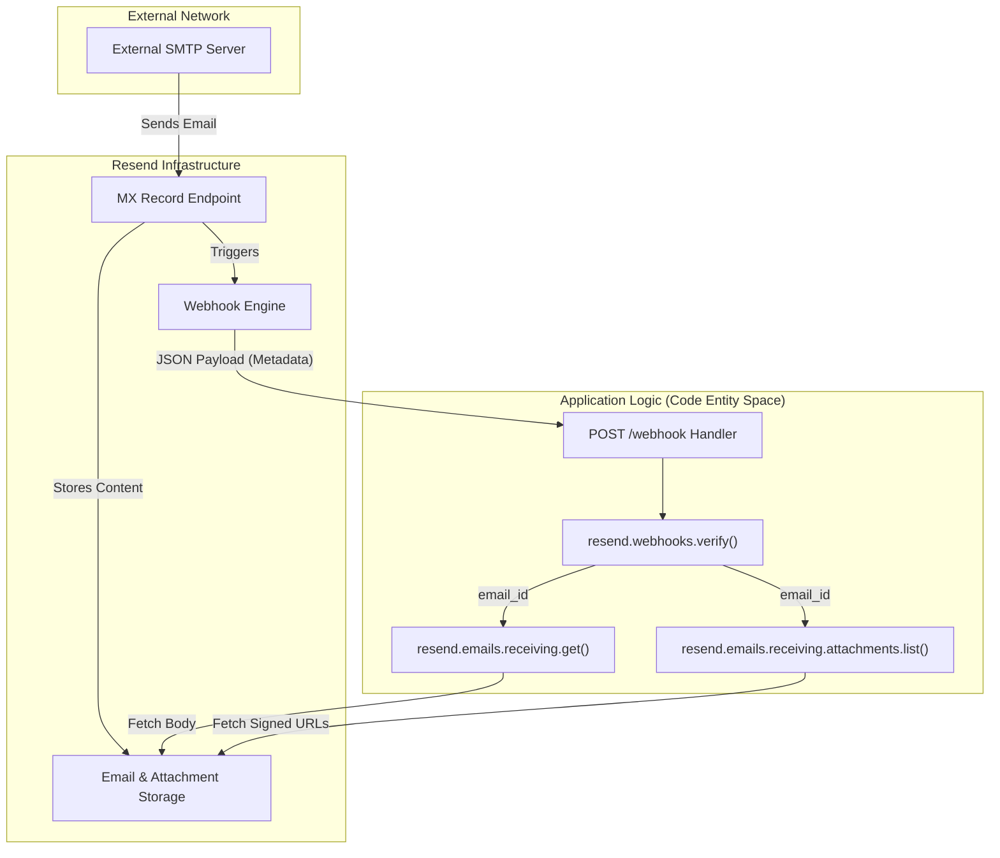
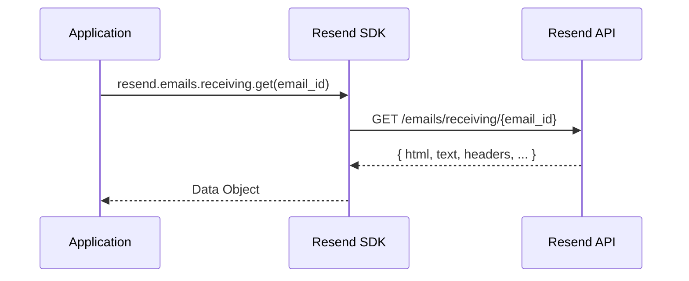

<!-- source: DeepWiki mcp.deepwiki.com · repo resend/resend-skills · page 2.2 Receiving Inbound Emails · fetched 2026-10-27 -->

# Receiving Inbound Emails

<details>
<summary>Relevant source files</summary>

The following files were used as context for generating this wiki page:

- [skills/resend/references/receiving.md](skills/resend/references/receiving.md)

</details>


The Resend platform provides a robust infrastructure for receiving inbound emails, processing them, and delivering notifications to your application via webhooks. This system is designed to handle large payloads and attachments by utilizing a "notification-first" pattern, where the initial webhook contains metadata and the application subsequently fetches full content and signed download URLs for attachments.

## Overview of the Receiving Flow

Resend implements a two-step retrieval pattern to ensure compatibility with serverless environments that often impose strict request body size limits.

1.  **Notification**: Resend receives an email and triggers an `email.received` webhook event containing metadata (sender, recipient, subject, and attachment metadata).
2.  **Retrieval**: The application uses the `email_id` from the webhook to call `resend.emails.receiving.get()` for the HTML/Text body and `resend.emails.receiving.attachments.get()` for signed, expiring download URLs.

### Data Flow Diagram: Inbound Email Processing

This diagram illustrates the transition from the external SMTP event to the internal Resend SDK entities and API calls.


**Sources:** [skills/resend/references/receiving.md:1-12](), [skills/resend/references/receiving.md:143-160]()

---

## Domain Configuration

To receive emails, you must configure a domain to route traffic to Resend's MX servers.

### 1. Resend-Managed Domains (`.resend.app`)
For rapid prototyping and testing, Resend provides an auto-generated managed domain.
*   **Address Format**: `<anything>@<your-id>.resend.app` [skills/resend/references/receiving.md:17-17]()
*   **Setup**: No DNS configuration is required. The address is available directly in the Resend Dashboard under **Emails → Receiving** [skills/resend/references/receiving.md:19-19]().

### 2. Custom Domains
To use a custom domain (e.g., `support@example.com`), you must configure MX records in your DNS provider.

| Setting | Value |
| :--- | :--- |
| **Type** | MX |
| **Host** | Your domain (e.g., `@`) or subdomain (e.g., `support`) |
| **Value** | Provided in the Resend Dashboard |
| **Priority** | 10 (Must be the lowest number if other MX records exist) |

**Subdomain Recommendation**: If your root domain already handles email (e.g., via Google Workspace), use a subdomain like `inbound.example.com` to avoid breaking existing mailbox routing [skills/resend/references/receiving.md:34-48]().

**Sources:** [skills/resend/references/receiving.md:13-48]()

---

## Webhook Implementation

The `email.received` event is the primary trigger for inbound processing.

### Webhook Payload Structure
The payload is restricted to metadata to prevent delivery failures due to size constraints.

| Field | Description |
| :--- | :--- |
| `type` | Always `email.received` |
| `data.email_id` | Unique identifier used to fetch full content |
| `data.from` | Sender's email address |
| `data.to` | Array of recipient addresses |
| `data.attachments` | Array of metadata (ID, filename, content_type) |

**Sources:** [skills/resend/references/receiving.md:62-86]()

### Security and Verification
Applications should use `resend.webhooks.verify()` to validate the `svix-signature` header, ensuring the request originated from Resend and has not been tampered with.

```typescript
// Example Verification in Next.js/Node
const event = resend.webhooks.verify({
  payload: await req.text(),
  headers: {
    'svix-id': req.headers.get('svix-id'),
    'svix-timestamp': req.headers.get('svix-timestamp'),
    'svix-signature': req.headers.get('svix-signature'),
  },
  secret: process.env.RESEND_WEBHOOK_SECRET,
});
```
**Sources:** [skills/resend/references/receiving.md:88-116]()

---

## Retrieving Email Content and Attachments

Once a valid `email_id` is obtained, the full content must be retrieved via the Resend SDK.

### Content Retrieval Logic
The `resend.emails.receiving.get()` method returns the full HTML and plain text bodies, along with the raw email headers.


**Sources:** [skills/resend/references/receiving.md:143-160]()

### Attachment Handling
Attachments are not served directly. Instead, the API provides a `download_url` which is a signed URL pointing to the file in Resend's storage.

*   **List Attachments**: `resend.emails.receiving.attachments.list({ emailId })` returns metadata for all files [skills/resend/references/receiving.md:166-175]().
*   **Expiration**: The `download_url` includes an `expires_at` timestamp. If the URL expires before the application downloads it, a new call to the `get` or `list` endpoint must be made to generate a fresh signed URL [skills/resend/references/receiving.md:199-199]().

### Listing Received Emails
For scenarios where webhooks are missed or for building an inbox UI, the `list` method supports cursor-based pagination using `after` and `before` cursors.

```typescript
const { data: emails } = await resend.emails.receiving.list({
  limit: 20,
  after: 'cursor_abc123',
});
```
**Sources:** [skills/resend/references/receiving.md:118-141]()

---

## Summary of Key Functions

| Function | File Reference | Purpose |
| :--- | :--- | :--- |
| `resend.webhooks.verify()` | [skills/resend/references/receiving.md:100-108]() | Validates Svix signatures on incoming webhooks. |
| `resend.emails.receiving.list()` | [skills/resend/references/receiving.md:123-126]() | Paginated list of all received emails. |
| `resend.emails.receiving.get()` | [skills/resend/references/receiving.md:149-151]() | Fetches full HTML/Text content for a specific email. |
| `resend.emails.receiving.attachments.list()` | [skills/resend/references/receiving.md:166-168]() | Retrieves signed download URLs for all attachments. |

**Sources:** [skills/resend/references/receiving.md:1-203]()

---

