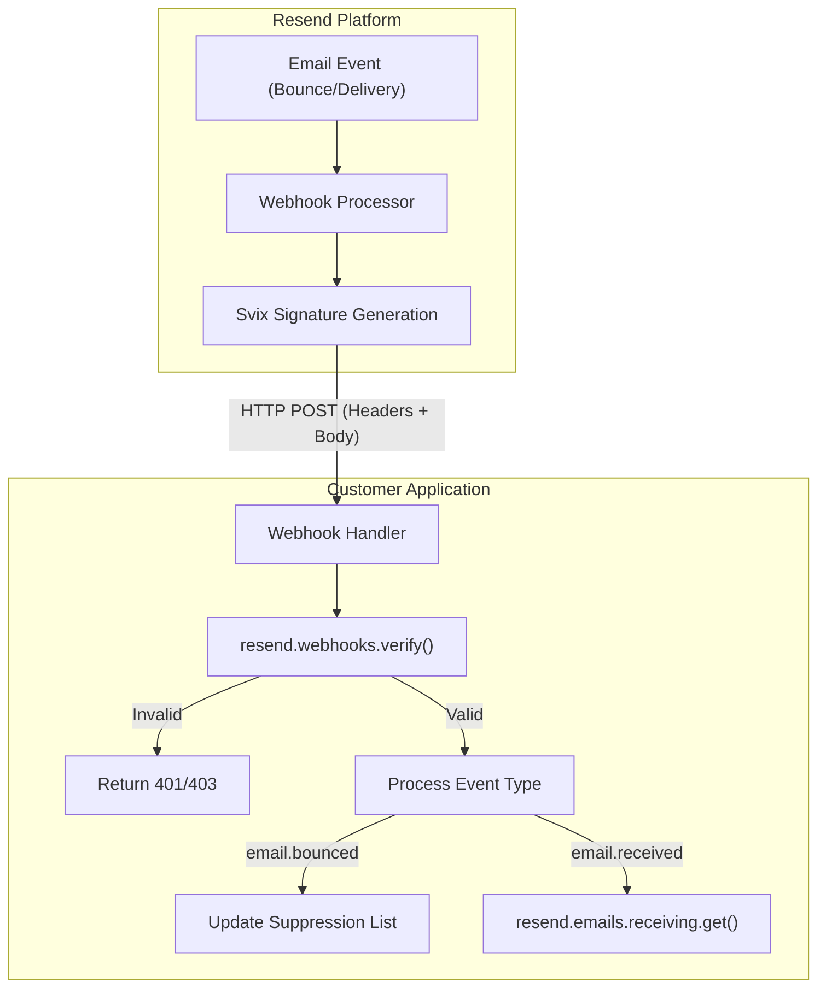
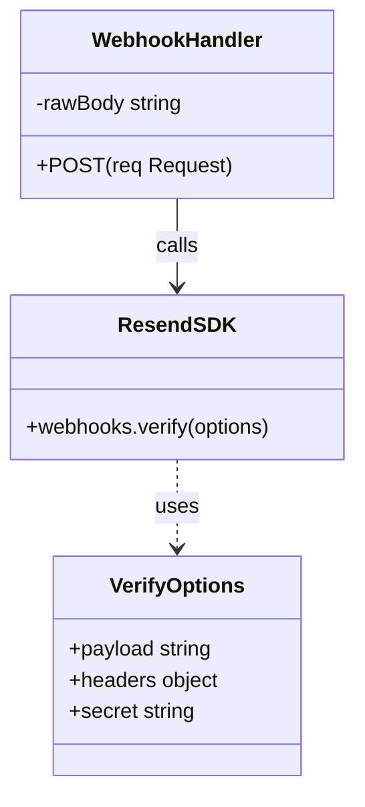

<!-- source: DeepWiki mcp.deepwiki.com · repo resend/resend-skills · page 2.3 Webhooks & Event Tracking · fetched 2026-10-27 -->

# Webhooks & Event Tracking

<details>
<summary>Relevant source files</summary>

The following files were used as context for generating this wiki page:

- [skills/resend/SKILL.md](skills/resend/SKILL.md)
- [skills/resend/references/logs.md](skills/resend/references/logs.md)
- [skills/resend/references/webhooks.md](skills/resend/references/webhooks.md)

</details>


The Resend platform uses webhooks to provide real-time notifications for email delivery events, inbound processing, and resource changes. This system allows applications to maintain list hygiene, track engagement, and automate workflows based on email lifecycle transitions.

## Overview & Data Flow

Webhooks are unauthenticated HTTP POST requests sent from Resend to a configured endpoint. Because these requests are unauthenticated, **signature verification** is a mandatory security requirement to ensure the payload originated from Resend and has not been tampered with [skills/resend/references/webhooks.md:170-172]().

### Event Delivery Pipeline

The following diagram illustrates the flow from an email event to a verified application action.

**Figure 1: Webhook Event Processing Flow**

Sources: [skills/resend/references/webhooks.md:1-12](), [skills/resend/references/webhooks.md:170-180](), [skills/resend/SKILL.md:117-146]()

## Event Types & Use Cases

Resend categorizes events into delivery, inbound, and resource management groups.

### Email Delivery Events
| Event | Trigger | Use Case |
|:---|:---|:---|
| `email.sent` | API request successful | Confirm email accepted by Resend [skills/resend/references/webhooks.md:20-20]() |
| `email.delivered` | Reached recipient server | Confirm successful delivery [skills/resend/references/webhooks.md:21-21]() |
| `email.bounced` | Permanent rejection | **List Hygiene:** Remove address immediately [skills/resend/references/webhooks.md:22-22]() |
| `email.complained` | Marked as spam | **Compliance:** Unsubscribe user [skills/resend/references/webhooks.md:23-23]() |
| `email.delivery_delayed` | Soft bounce | Monitor temporary issues [skills/resend/references/webhooks.md:26-26]() |

### List Hygiene: Bounces & Suppressions
Handling `email.bounced` events is critical for maintaining sender reputation. Resend distinguishes between Hard and Soft bounces:
*   **Hard Bounces (`email.bounced`):** Permanent failures (e.g., `NoEmail` subtype). You must remove these addresses immediately and never retry [skills/resend/references/webhooks.md:41-41]().
*   **Soft Bounces (`email.delivery_delayed`):** Temporary issues (e.g., `MailboxFull`). Resend retries these automatically. If they fail after retries, an `email.bounced` event is triggered [skills/resend/references/webhooks.md:52-53]().

Sources: [skills/resend/references/webhooks.md:14-62]()

## Implementation & Signature Verification

### Verifying Signatures with `resend.webhooks.verify()`
Resend uses **Svix** for webhook signing. Every request includes three critical headers: `svix-id`, `svix-timestamp`, and `svix-signature` [skills/resend/references/webhooks.md:181-190]().

**Key Implementation Requirements:**
1.  **Raw Body:** You must use the raw request body text, not a parsed JSON object [skills/resend/SKILL.md:125-125]().
2.  **Signing Secret:** Use the `RESEND_WEBHOOK_SECRET` (prefixed with `whsec_`) obtained during webhook creation [skills/resend/SKILL.md:29-31]().

**Figure 2: Verification Code Entity Map**

Sources: [skills/resend/SKILL.md:119-135](), [skills/resend/references/webhooks.md:170-190]()

### Node.js Implementation Example
```typescript
import { Resend } from 'resend';
const resend = new Resend(process.env.RESEND_API_KEY);

export async function POST(req: Request) {
  const payload = await req.text(); // Raw text required [skills/resend/SKILL.md:125]()
  
  try {
    const event = resend.webhooks.verify({
      payload,
      headers: {
        'svix-id': req.headers.get('svix-id'),
        'svix-timestamp': req.headers.get('svix-timestamp'),
        'svix-signature': req.headers.get('svix-signature'),
      },
      secret: process.env.RESEND_WEBHOOK_SECRET,
    });

    if (event.type === 'email.bounced') {
      // Logic to update local suppression list
    }
  } catch (e) {
    return new Response('Invalid signature', { status: 400 });
  }
  return new Response('OK', { status: 200 });
}
```
Sources: [skills/resend/SKILL.md:119-146](), [skills/resend/references/webhooks.md:71-75]()

## Webhook Management

Webhooks can be managed via the Resend Dashboard or programmatically via the SDK.

### Programmatic CRUD Operations
The SDK provides methods to manage the lifecycle of webhook endpoints. Note that the `signing_secret` is **only** returned during the initial creation [skills/resend/references/webhooks.md:137-137]().

| Operation | Node.js SDK Method |
|:---|:---|
| **Create** | `resend.webhooks.create({ endpoint, events })` [skills/resend/references/webhooks.md:87-90]() |
| **List** | `resend.webhooks.list()` [skills/resend/references/webhooks.md:150-150]() |
| **Update** | `resend.webhooks.update(id, { endpoint, events })` [skills/resend/references/webhooks.md:153-159]() |
| **Delete** | `resend.webhooks.remove(id)` [skills/resend/references/webhooks.md:162-162]() |

### Troubleshooting with Logs
For debugging webhook delivery issues or verifying payload structure, the `resend.logs` API can be used to inspect the original request and response bodies of API calls related to webhook configuration [skills/resend/references/logs.md:85-98]().

Sources: [skills/resend/references/webhooks.md:76-169](), [skills/resend/references/logs.md:1-12]()

---

