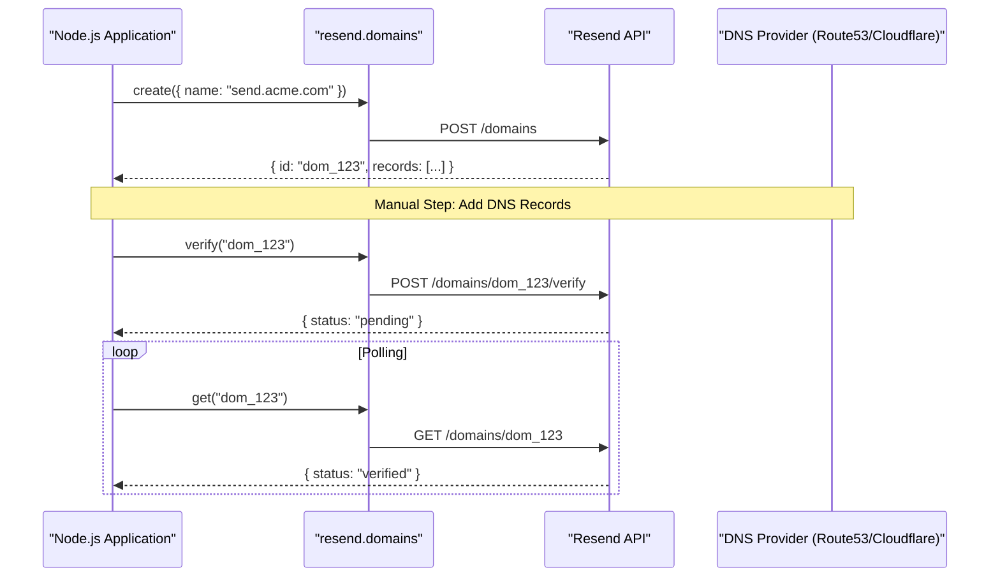
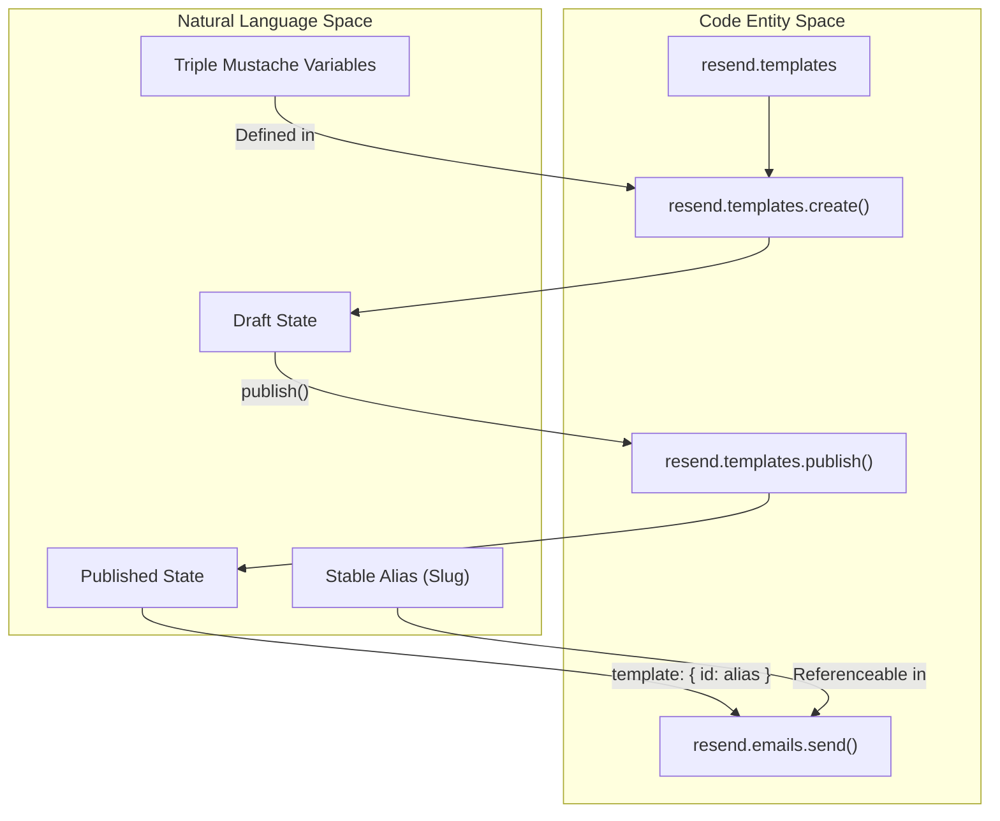
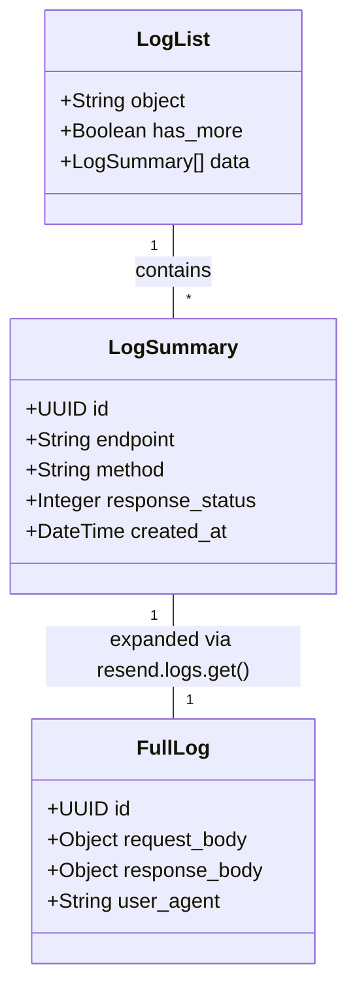

<!-- source: DeepWiki mcp.deepwiki.com · repo resend/resend-skills · page 2.6 Domains, API Keys & Templates · fetched 2026-10-27 -->

# Domains, API Keys & Templates

<details>
<summary>Relevant source files</summary>

The following files were used as context for generating this wiki page:

- [skills/resend/SKILL.md](skills/resend/SKILL.md)
- [skills/resend/references/api-keys.md](skills/resend/references/api-keys.md)
- [skills/resend/references/domains.md](skills/resend/references/domains.md)
- [skills/resend/references/fetch-all-templates.mjs](skills/resend/references/fetch-all-templates.mjs)
- [skills/resend/references/logs.md](skills/resend/references/logs.md)
- [skills/resend/references/templates.md](skills/resend/references/templates.md)

</details>


This section covers the management of infrastructure and assets within the Resend platform, specifically focusing on domain verification for email deliverability, the creation and scoping of API keys, the lifecycle of reusable email templates, and the retrieval of API request logs for auditing and debugging.

## Domains

Before sending emails through Resend, domains must be verified to ensure deliverability and security. This process involves configuring DNS records (SPF, DKIM, and MX) and polling for status updates.

### Domain Lifecycle & Workflow
The workflow for domain setup follows a linear progression:
1.  **Create**: Register the domain with Resend to generate required DNS records [skills/resend/references/domains.md:8-8]().
2.  **Configure**: Add the generated MX, TXT, and CNAME records to your DNS provider [skills/resend/references/domains.md:51-55]().
3.  **Verify**: Trigger an asynchronous verification check [skills/resend/references/domains.md:22-22]().
4.  **Poll**: Check the domain status until it moves from `pending` to `verified` [skills/resend/references/domains.md:77-79]().

### Technical Implementation
The `resend.domains` object provides methods for managing these resources.

| Operation | SDK Method (Node.js) | Notes |
| :--- | :--- | :--- |
| Create | `resend.domains.create(params)` | Returns DNS records [skills/resend/references/domains.md:17-17]() |
| Get | `resend.domains.get(id)` | Returns status and DNS records [skills/resend/references/domains.md:18-18]() |
| Verify | `resend.domains.verify(id)` | Triggers async DNS check [skills/resend/references/domains.md:22-22]() |
| Update | `resend.domains.update(params)` | Modifies tracking, TLS, and capabilities [skills/resend/references/domains.md:20-20]() |
| Remove | `resend.domains.remove(id)` | Permanent deletion (Note: not `.delete()`) [skills/resend/references/domains.md:21-21]() |

### Best Practices: Subdomains vs. Root Domains
It is recommended to use a subdomain (e.g., `send.example.com`) rather than a root domain [skills/resend/references/domains.md:30-30](). This provides:
*   **Reputation Isolation**: Transactional email reputation does not affect the root domain [skills/resend/references/domains.md:33-33]().
*   **No MX Conflicts**: Avoids interference with existing mail providers like Google Workspace [skills/resend/references/domains.md:32-32]().

### Domain Configuration Diagram
The following diagram illustrates the interaction between the Resend SDK, the API, and the DNS Provider.

**Domain Verification Data Flow**

Sources: [skills/resend/references/domains.md:7-9](), [skills/resend/references/domains.md:39-55](), [skills/resend/references/domains.md:72-79]()

## API Keys

API keys provide authenticated access to the Resend API. They can be scoped for security to limit the impact of a compromised key.

### Key Types and Scoping
*   **Full Access**: Allows all operations across the account [skills/resend/references/api-keys.md:19-19]().
*   **Sending Access**: Restricted to sending emails only. Can be further scoped to a specific `domainId` [skills/resend/references/api-keys.md:20-20]().

### Critical Implementation Details
*   **One-time Token**: The API token (`re_...`) is only returned during the `create` call. It cannot be retrieved later [skills/resend/references/api-keys.md:43-44]().
*   **Metadata Only**: The `list` method returns metadata (ID, name, usage timestamps) but does not include the tokens [skills/resend/references/api-keys.md:47-48]().

### API Key Management Table
| Feature | Detail |
| :--- | :--- |
| **Max Name Length** | 50 characters [skills/resend/references/api-keys.md:21-21]() |
| **Permission Levels** | `full_access`, `sending_access` [skills/resend/references/api-keys.md:19-20]() |
| **SDK Method (Remove)** | `resend.apiKeys.remove(id)` [skills/resend/references/api-keys.md:11-11]() |

Sources: [skills/resend/references/api-keys.md:1-22](), [skills/resend/references/api-keys.md:32-52]()

## Email Templates

Templates allow for reusable email structures with dynamic variable substitution using triple-mustache syntax.

### Template Lifecycle
Templates exist in two states: **Draft** and **Published** [skills/resend/references/templates.md:21-25]().
*   Only **Published** templates can be used for sending [skills/resend/references/templates.md:24-24]().
*   Editing a published template creates a new draft; the previous version remains live until the new draft is published [skills/resend/references/templates.md:19-19]().

### Variable Syntax and Constraints
Resend uses triple mustaches `{{{VARIABLE}}}` for substitution [skills/resend/references/templates.md:28-28](). Double mustaches are not supported [skills/resend/references/templates.md:34-36]().

| Constraint | Limit |
| :--- | :--- |
| **Max Variables** | 50 per template [skills/resend/references/templates.md:57-57]() |
| **String Value Max** | 2,000 characters [skills/resend/references/templates.md:60-60]() |
| **Reserved Names** | `FIRST_NAME`, `LAST_NAME`, `EMAIL`, `UNSUBSCRIBE_URL` [skills/resend/references/templates.md:65-65]() |
| **Control Flow** | None (no `if` or `each`). Must pre-render HTML server-side [skills/resend/references/templates.md:38-38]() |

### Implementation Example: Create and Publish
```typescript
const { data } = await resend.templates.create({
  name: 'Welcome Email',
  alias: 'welcome-new-user',
  html: '<h1>Welcome {{{NAME}}}!</h1>',
  variables: [{ key: 'NAME', type: 'string', fallbackValue: 'User' }]
}).publish(); // Chainable publish [skills/resend/references/templates.md:136-142]()
```

### Template Logic Diagram
This diagram maps the Template management entities to their code representations.

**Template Entity Mapping**

Sources: [skills/resend/references/templates.md:11-25](), [skills/resend/references/templates.md:87-101](), [skills/resend/references/templates.md:134-142]()

## API Request Logs

Logs provide a history of API interactions, including request/response bodies and status codes.

### Log Access Patterns
*   **List Logs**: Returns a summary (method, endpoint, status) of recent requests [skills/resend/references/logs.md:41-43]().
*   **Retrieve Log**: Returns the full `request_body` and `response_body` for a specific log ID [skills/resend/references/logs.md:95-97]().

### Pagination
Logs use cursor-based pagination via `after` or `before` parameters [skills/resend/references/logs.md:145-148]().
*   `after`: Paginate forward from a specific log ID [skills/resend/references/logs.md:23-23]().
*   `before`: Paginate backward from a specific log ID [skills/resend/references/logs.md:24-24]().
*   **Note**: These parameters are mutually exclusive; combining them returns a 422 error [skills/resend/references/logs.md:149-149]().

### SDK Support Matrix
| SDK | Logs Support |
| :--- | :--- |
| **Node.js** | Supported (`resend.logs.list`, `resend.logs.get`) [skills/resend/references/logs.md:8-10]() |
| **cURL** | Supported [skills/resend/references/logs.md:52-58]() |
| **Other SDKs** | Not yet available (Python, Go, etc.) [skills/resend/references/logs.md:12-12]() |

### Log Data Model
The `GET /logs/{id}` endpoint provides a detailed view of the request lifecycle.

**Log Retrieval Entity Relationship**

Sources: [skills/resend/references/logs.md:62-77](), [skills/resend/references/logs.md:110-128](), [skills/resend/references/logs.md:132-142]()

---

