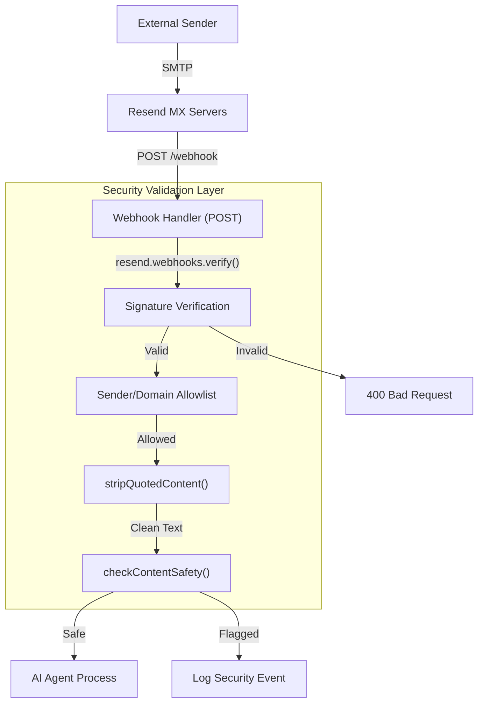
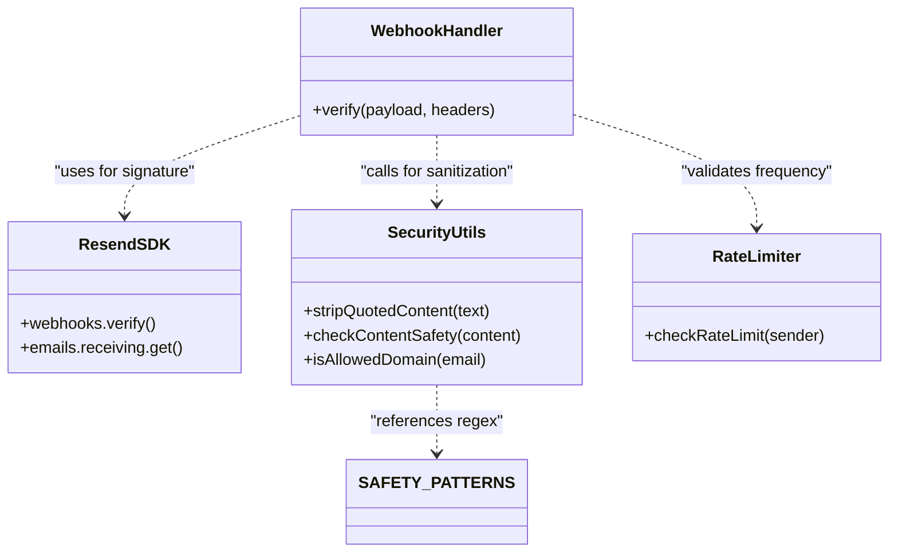

<!-- source: DeepWiki mcp.deepwiki.com · repo resend/resend-skills · page 3.2 Security Levels & Advanced Patterns · fetched 2026-10-27 -->

# Security Levels & Advanced Patterns

Relevant source files

The following files were used as context for generating this wiki page:

- [skills/agent-email-inbox/SKILL.md](skills/agent-email-inbox/SKILL.md)
- [skills/agent-email-inbox/references/advanced-patterns.md](skills/agent-email-inbox/references/advanced-patterns.md)
- [skills/agent-email-inbox/references/security-levels.md](skills/agent-email-inbox/references/security-levels.md)
- [skills/agent-email-inbox/references/webhook-setup.md](skills/agent-email-inbox/references/webhook-setup.md)

This page details the multi-tier security classification system for handling inbound emails within the `agent-email-inbox` skill. It covers implementation strategies for protecting AI agents from malicious inputs, ensuring reliability through idempotency, and managing advanced routing and content scenarios.

## Five-Tier Security Classification

When an AI agent receives email, it is processing untrusted input. The following tiers allow developers to balance functionality with system safety.

### Level 1: Strict Allowlist
The most secure configuration. Only emails from explicitly approved addresses are processed; all others are rejected or logged.

*   **Implementation:** Compare the `from` field of the `EmailReceivedEvent` against a hardcoded or environment-based list [skills/agent-email-inbox/references/security-levels.md:20-32]().
*   **Use Case:** Personal assistants or private administrative tools.

### Level 2: Domain Allowlist
Allows any sender from a specific organization or trusted domain.

*   **Implementation:** Extract the domain from the sender's email string and verify it against an `ALLOWED_DOMAINS` array [skills/agent-email-inbox/references/security-levels.md:57-65]().
*   **Use Case:** Internal company tools or B2B integrations.

### Level 3: Content Filtering & Sanitization
Accepts emails from broader sources but applies aggressive sanitization to prevent prompt injection and "token stuffing."

*   **Quoted Thread Stripping:** Removes lines starting with `>` or `On ... wrote:` blocks to prevent old instructions from being re-interpreted as new commands [skills/agent-email-inbox/references/security-levels.md:92-103]().
*   **Pattern Matching:** Uses regex-based `SAFETY_PATTERNS` to flag suspicious language or known exploit attempts [skills/agent-email-inbox/references/security-levels.md:113-126]().

### Level 4: Sandboxed Processing
The agent is given different "capabilities" based on the sender's trust level.

*   **Implementation:** Define a `capabilities` object (e.g., `canExecuteCode`, `canAccessSecrets`). Trusted senders get full access; untrusted senders get a restricted set (e.g., `read-only`) [skills/agent-email-inbox/references/security-levels.md:156-178]().

### Level 5: Human-in-the-Loop
The highest security tier for sensitive actions. The agent processes the email but pauses for human approval before executing any downstream effects [skills/agent-email-inbox/references/security-levels.md:206-208]().

**Sources:** [skills/agent-email-inbox/references/security-levels.md:1-208](), [skills/agent-email-inbox/SKILL.md:22-33]()

---

## Data Flow: Webhook to Agent
The following diagram illustrates the flow from an inbound email event to a secured agent action, highlighting the security validation layer.

**Inbound Security Pipeline**

**Sources:** [skills/agent-email-inbox/SKILL.md:69-75](), [skills/agent-email-inbox/references/webhook-setup.md:85-96](), [skills/agent-email-inbox/references/security-levels.md:92-126]()

---

## Advanced Implementation Patterns

### Webhook Idempotency & Retries
Resend employs an exponential backoff strategy for failed webhook deliveries, retrying up to 7 times over approximately 20 hours [skills/agent-email-inbox/references/webhook-setup.md:118-129]().

*   **svix-id:** Every webhook request includes a unique `svix-id` [skills/agent-email-inbox/references/webhook-setup.md:91]().
*   **Pattern:** To prevent duplicate processing during retries, store the `svix-id` in a database or cache (like Redis). If a request arrives with an ID that has already been processed, return a `2xx` status immediately without re-triggering the agent.

### Rate Limiting per Sender
To prevent Denial of Wallet (DoW) or resource exhaustion via email floods, implement a per-sender rate limit.

*   **Mechanism:** Maintain a map of sender addresses to hit counts and reset timestamps. If a sender exceeds a threshold (e.g., 10 emails per hour), reject further processing for that window [skills/agent-email-inbox/references/advanced-patterns.md:8-26]().

### Content Length Constraints
Large emails can cause high token costs or buffer overflows.
*   **Pattern:** Truncate content at a hard limit (e.g., 10,000 characters) and append a security notice [skills/agent-email-inbox/references/advanced-patterns.md:33-41]().

**Sources:** [skills/agent-email-inbox/references/webhook-setup.md:87-134](), [skills/agent-email-inbox/references/advanced-patterns.md:1-41]()

---

## Entity Mapping: Logic to Code

This diagram maps the abstract security concepts to the specific functions and classes provided in the `agent-email-inbox` skill.

**Code Entity Relationship**

**Sources:** [skills/agent-email-inbox/references/webhook-setup.md:25-43](), [skills/agent-email-inbox/references/security-levels.md:62-65](), [skills/agent-email-inbox/references/security-levels.md:92-103](), [skills/agent-email-inbox/references/advanced-patterns.md:8-26]()

---

## Attachment Handling & Security

When an email contains attachments, the `EmailReceivedEvent` provides metadata, but the actual content must be retrieved securely.

1.  **Metadata Receipt:** The webhook payload contains attachment names and sizes.
2.  **Secure Retrieval:** Use `resend.emails.receiving.get(emailId)` to fetch the full email object, which includes attachment details [skills/agent-email-inbox/SKILL.md:79]().
3.  **Expiring URLs:** If the agent needs to "see" an attachment (e.g., a PDF), the system should generate a temporary, expiring download URL rather than exposing a persistent file path.
4.  **Sandbox Warning:** Agents should never execute attachments. Only parsing (via OCR or text extraction) should occur within a restricted environment.

**Sources:** [skills/agent-email-inbox/SKILL.md:79-85](), [skills/agent-email-inbox/references/advanced-patterns.md:74-82]()

---

