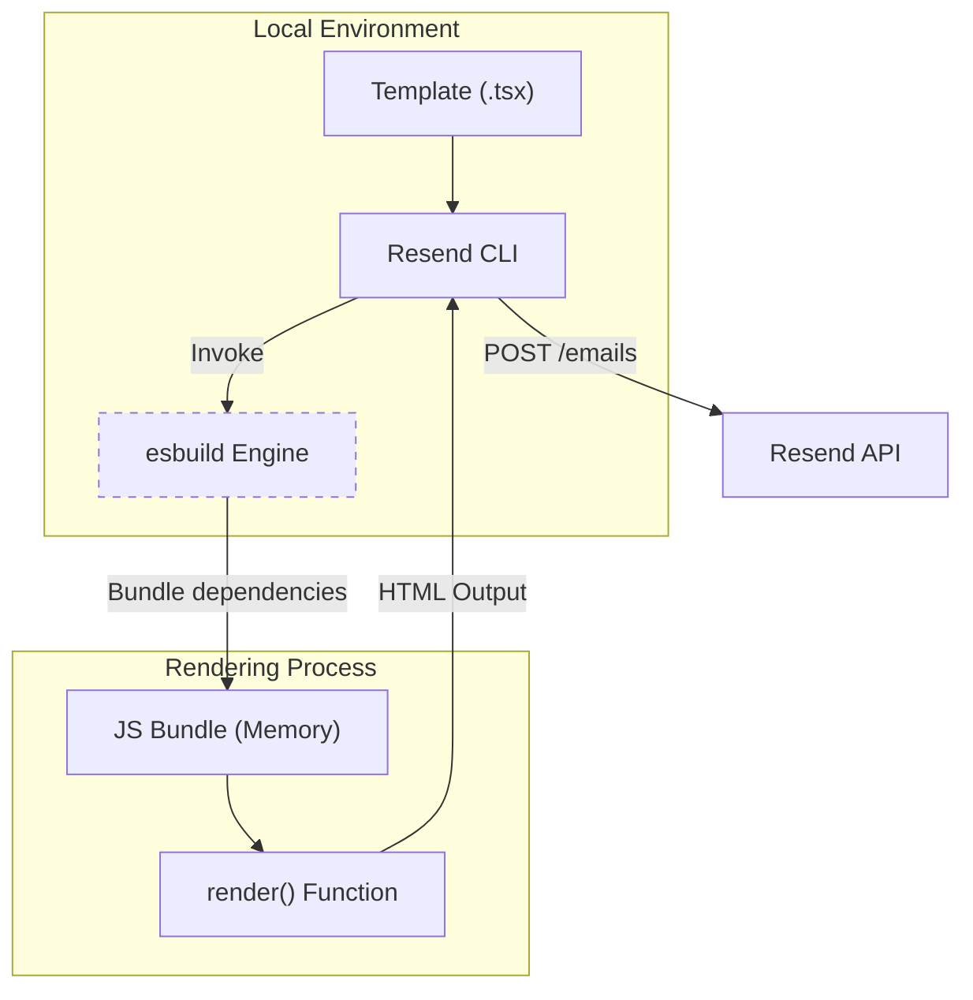
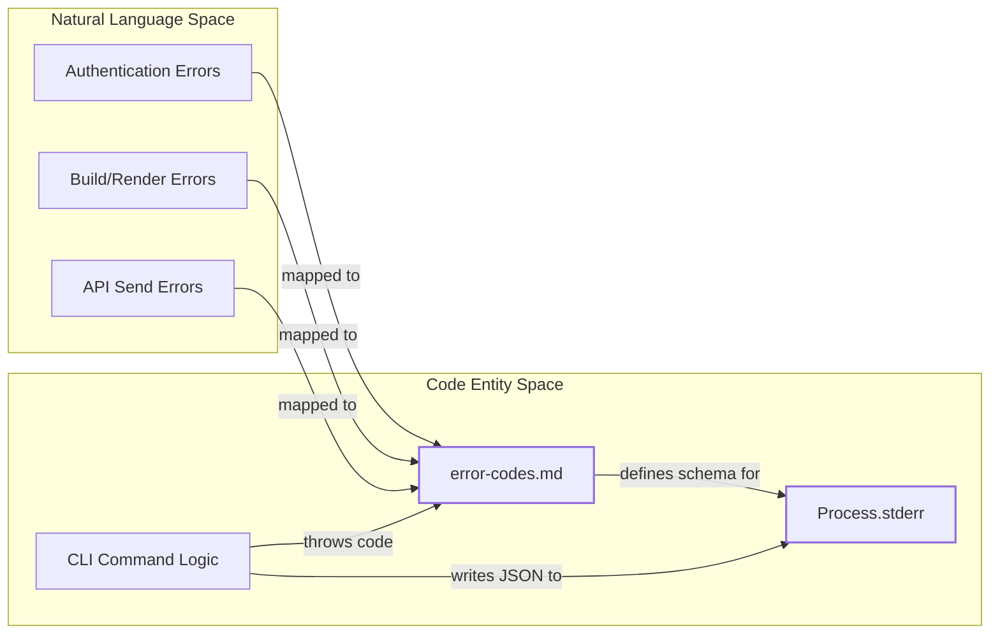

<!-- source: DeepWiki mcp.deepwiki.com · repo resend/resend-skills · page 4.3 CLI Error Codes & CI/CD Integration · fetched 2026-10-27 -->

# CLI Error Codes & CI/CD Integration

<details>
<summary>Relevant source files</summary>

The following files were used as context for generating this wiki page:

- [skills/resend-cli/references/error-codes.md](skills/resend-cli/references/error-codes.md)

</details>


The Resend CLI is designed for seamless integration into CI/CD pipelines, automated scripts, and AI agent workflows. To facilitate this, it implements a standardized error reporting protocol and a non-interactive "Agent Protocol" that ensures predictable behavior in non-TTY environments. This page details the error schema, specific error codes, and the technical implementation of React Email rendering within the CLI.

## Standardized Error Reporting

The Resend CLI follows a strict error reporting convention to allow parent processes (such as GitHub Actions or AI agents) to parse failures programmatically.

### Execution Flow and Output
1.  **Exit Codes**: Any operation that fails will result in the process exiting with code `1` [skills/resend-cli/references/error-codes.md:3-3]().
2.  **Output Stream**: Error details are exclusively written to **stderr** [skills/resend-cli/references/error-codes.md:3-3]().
3.  **Data Format**: Errors are formatted as a JSON object containing an `error` property with `message` and `code` fields [skills/resend-cli/references/error-codes.md:5-7]().

**Standard Error JSON Schema:**
```json
{
  "error": {
    "message": "Human-readable description of the failure",
    "code": "error_code"
  }
}
```

### CI/CD and Agent Protocol (Non-TTY)
When the CLI detects a non-interactive environment (non-TTY), it shifts behavior to prevent process hanging:
*   **No Interactive Prompts**: The CLI will not prompt for missing API keys or required flags. If a required parameter is missing, it returns a `missing_key` or validation error immediately [skills/resend-cli/references/error-codes.md:43-48]().
*   **Safety Flags**: Destructive actions (e.g., `delete` or `rm`) require the `--yes` flag in non-interactive mode. Without this flag, the command will fail to prevent accidental resource deletion [skills/resend-cli/references/error-codes.md:49-51]().

---

## Error Code Reference

Errors are categorized by the functional area of the CLI they originate from.

### Authentication & Authorization
| Code | Cause | Resolution |
| :--- | :--- | :--- |
| `auth_error` | No API key found in environment, flags, or config | Set `RESEND_API_KEY` or use `--api-key` [skills/resend-cli/references/error-codes.md:13-13]() |
| `missing_key` | Non-interactive `login` call without `--key` | Provide the `--key` flag [skills/resend-cli/references/error-codes.md:14-14]() |
| `invalid_key_format` | Key does not follow the `re_` prefix convention | Use a valid Resend API key [skills/resend-cli/references/error-codes.md:15-15]() |
| `validation_failed` | API rejected the key during the login handshake | Verify key status in Resend Dashboard [skills/resend-cli/references/error-codes.md:16-16]() |

### Email & Rendering
| Code | Cause | Resolution |
| :--- | :--- | :--- |
| `missing_body` | No content provided (text, html, or react) | Provide at least one body flag [skills/resend-cli/references/error-codes.md:22-22]() |
| `react_email_build_error` | `esbuild` failed to bundle the `.tsx` template | Check template syntax and dependencies [skills/resend-cli/references/error-codes.md:23-23]() |
| `react_email_render_error` | Bundled template crashed during `render()` | Ensure default export returns valid React [skills/resend-cli/references/error-codes.md:24-24]() |
| `send_error` | API rejected the send request (e.g., unverified domain) | Check sender domain and recipient [skills/resend-cli/references/error-codes.md:26-26]() |

### General & Infrastructure
| Code | Cause | Resolution |
| :--- | :--- | :--- |
| `domain_error` | DNS or domain management operation failed | Check DNS records/validity [skills/resend-cli/references/error-codes.md:32-32]() |
| `unexpected_error` | Unhandled CLI exception | Update CLI or report issue [skills/resend-cli/references/error-codes.md:38-38]() |

**Sources:** [skills/resend-cli/references/error-codes.md:1-57]()

---

## React Email Rendering Pipeline

The CLI includes a built-in rendering engine for React Email templates. This allows developers to send emails using local `.tsx` components without a separate build step.

### Rendering Data Flow
The CLI uses `esbuild` to bundle the React component and its dependencies into a temporary executable format before invoking the `@react-email/render` utility.

**CLI Rendering Architecture**


### Requirements for Success
For the rendering pipeline to function, the local environment must satisfy these conditions:
1.  **Dependencies**: The project folder must have `react` and one of the following installed: `react-email` (v6.0+), `@react-email/components`, or `@react-email/render` [skills/resend-cli/references/error-codes.md:23-23]().
2.  **Exports**: The template file must provide a **default function export** that returns the React Email component [skills/resend-cli/references/error-codes.md:24-24]().

**Sources:** [skills/resend-cli/references/error-codes.md:22-26]()

---

## Implementation Mapping: Code to Error Logic

The following diagram maps high-level error categories to the specific internal logic and response structures used by the CLI.

**Error Mapping Diagram**


**Sources:** [skills/resend-cli/references/error-codes.md:3-7](), [skills/resend-cli/references/error-codes.md:9-40]()

---

