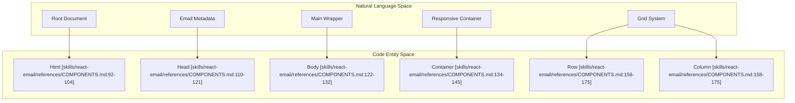
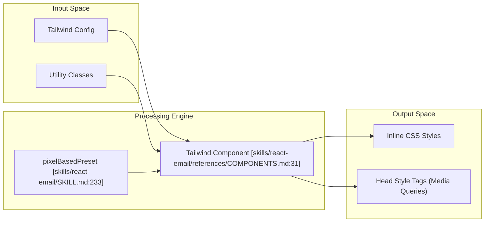

<!-- source: DeepWiki mcp.deepwiki.com · repo resend/resend-skills · page 5.1 Component Library · fetched 2026-10-27 -->

# Component Library

Relevant source files

The following files were used as context for generating this wiki page:

- [skills/react-email/SKILL.md](skills/react-email/SKILL.md)
- [skills/react-email/references/COMPONENTS.md](skills/react-email/references/COMPONENTS.md)

The **Component Library** (Section 5.1) provides a comprehensive reference for the React components used to build cross-client compatible HTML emails within the `react-email` skill. These components abstract away the complexities of email-specific HTML (such as nested tables and Outlook-specific VML) while providing a modern React development experience.

## System Architecture: Component Hierarchy

The following diagram illustrates how components are structured within a typical email template and how they map to standard HTML concepts.

### Component Structure Mapping

**Sources:** [skills/react-email/references/COMPONENTS.md:92-175]()

## Core Structural Components

Structural components provide the skeleton of the email. They ensure that the resulting HTML includes the necessary doctypes and wrappers for broad client support.

| Component | Purpose | Key Props / Features |
| :--- | :--- | :--- |
| `Html` | Root wrapper | `lang`, `dir` (LTR/RTL support) [skills/react-email/references/COMPONENTS.md:92-109]() |
| `Head` | Metadata container | Contains `<title>`, `<style>`, and `<meta>` [skills/react-email/references/COMPONENTS.md:110-121]() |
| `Body` | Content wrapper | Main background and font styling [skills/react-email/references/COMPONENTS.md:122-132]() |
| `Container` | Centering layout | Built-in `max-width: 37.5em` (600px) [skills/react-email/SKILL.md:157]() |
| `Section` | Content grouping | Logic blocks; translates to `<table>` [skills/react-email/references/COMPONENTS.md:146-156]() |
| `Row` | Horizontal layout | Must contain `Column` components [skills/react-email/references/COMPONENTS.md:158-175]() |
| `Column` | Vertical layout | Supports percentage-based widths [skills/react-email/references/COMPONENTS.md:177-181]() |

**Sources:** [skills/react-email/SKILL.md:153-161](), [skills/react-email/references/COMPONENTS.md:92-181]()

## Content Primitives

Content primitives are used to render text, images, and interactive elements. These components normalize CSS behavior across inconsistent email clients (e.g., handling line heights and margins).

*   **`Preview`**: Provides the "snippet" text shown in the inbox. It should always be the first child inside the `Body` component [skills/react-email/SKILL.md:163](), [skills/react-email/references/COMPONENTS.md:184-198]().
*   **`Heading`**: Renders `h1` through `h6` tags with normalized spacing [skills/react-email/references/COMPONENTS.md:199-217]().
*   **`Text`**: Standard paragraph component for body copy [skills/react-email/references/COMPONENTS.md:219-229]().
*   **`Img`**: Handles image rendering. It is critical to provide `width` and `height` to prevent layout shifts in Outlook [skills/react-email/SKILL.md:211-218]().
*   **`Button`**: A specialized link component that uses VML or table-padding hacks to ensure buttons look consistent in Outlook and Gmail [skills/react-email/references/COMPONENTS.md:230-244]().

**Sources:** [skills/react-email/SKILL.md:163-170](), [skills/react-email/references/COMPONENTS.md:184-244]()

## Advanced Utilities

The library includes advanced utilities for complex content types and styling.

### Tailwind & Styling Engine
The `Tailwind` component is the primary styling engine. It wraps the entire email and converts utility classes into inline styles during the rendering process [skills/react-email/references/COMPONENTS.md:31-34]().

### Styling Data Flow

*   **`pixelBasedPreset`**: This preset is mandatory because email clients do not support `rem` units. It converts standard Tailwind spacing to `px` [skills/react-email/SKILL.md:233-234]().
*   **`Markdown`**: Automatically converts Markdown strings into valid `react-email` components (e.g., converting `#` to `<Heading>`) [skills/react-email/references/COMPONENTS.md:24-24]().
*   **`CodeBlock`**: Uses Prism.js for syntax highlighting within emails [skills/react-email/references/COMPONENTS.md:13-13]().
*   **`Font`**: Simplifies the inclusion of web fonts by generating the necessary `@font-face` CSS in the `Head` [skills/react-email/references/COMPONENTS.md:17-17]().

**Sources:** [skills/react-email/SKILL.md:231-234](), [skills/react-email/references/COMPONENTS.md:13-34]()

## Implementation Constraints

When using the component library, developers must adhere to specific technical constraints enforced by the underlying rendering engine:

1.  **Box Sizing**: Buttons must always include the `box-border` class to ensure padding is calculated correctly across clients [skills/react-email/SKILL.md:107]().
2.  **Flexbox/Grid**: These CSS features are prohibited; layout must be achieved via `Section`, `Row`, and `Column` [skills/react-email/SKILL.md:234-234]().
3.  **Template Variables**: Never use `{{variable}}` directly in JSX. Variables should be passed as React props, and the mustache syntax should only reside in `PreviewProps` for testing [skills/react-email/SKILL.md:130-147]().
4.  **Static Assets**: Images must be hosted on a CDN for production. The `baseURL` pattern is used to switch between local development and production URLs [skills/react-email/SKILL.md:201-225]().

**Sources:** [skills/react-email/SKILL.md:107-147](), [skills/react-email/SKILL.md:201-234]()

---

