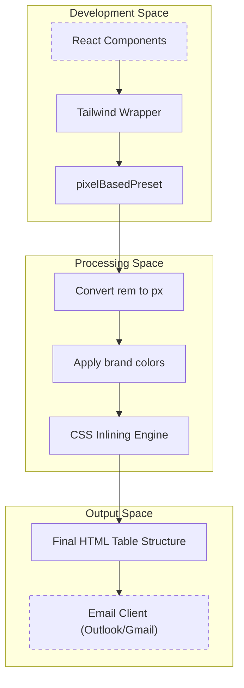
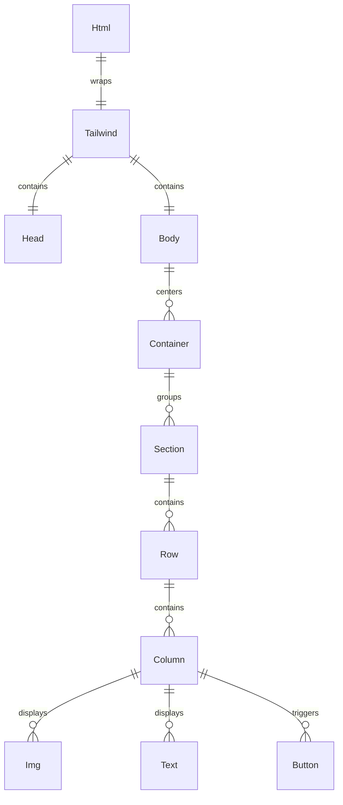

<!-- source: DeepWiki mcp.deepwiki.com · repo resend/resend-skills · page 5.2 Styling & Layout Patterns · fetched 2026-10-27 -->

# Styling & Layout Patterns

Relevant source files

The following files were used as context for generating this wiki page:

- [skills/react-email/references/PATTERNS.md](skills/react-email/references/PATTERNS.md)
- [skills/react-email/references/STYLING.md](skills/react-email/references/STYLING.md)

This page outlines the technical constraints and implementation strategies for styling HTML emails within the `react-email` skill. Due to the fragmented nature of email client support (especially Outlook and Gmail), standard web layout techniques like Flexbox and Grid are prohibited in favor of a table-first philosophy.

## Layout Philosophy: Table-First

Email clients often lack support for modern CSS layout engines. The `react-email` library abstracts complex HTML table structures into React components to ensure cross-client compatibility.

### Structural Components
*   **`Html`**: The root wrapper that sets the document type and language [skills/react-email/references/PATTERNS.md:17]().
*   **`Container`**: A fixed-width, centered wrapper (typically max-width 600px) used to house the main content [skills/react-email/references/STYLING.md:106-112]().
*   **`Section` / `Row` / `Column`**: These components replace `
`, Flexbox, and Grid. They render as `<table>`, `<tr>`, and `<td>` respectively to ensure alignment across legacy clients like Outlook [skills/react-email/references/STYLING.md:189-198]().

### Prohibited Features
To maintain deliverability and visual consistency, the following features must be avoided:
*   **Flexbox/Grid**: Use `Row` and `Column` instead [skills/react-email/references/STYLING.md:45]().
*   **SVG/WEBP**: Use only PNG or JPEG for image assets [skills/react-email/references/STYLING.md:44]().
*   **Media Queries**: Prefixes like `sm:`, `md:`, or `lg:` are largely unsupported in many mobile clients and should be avoided in favor of fluid, stacked layouts [skills/react-email/references/STYLING.md:46]().
*   **Theme Selectors**: `dark:` and `light:` prefixes do not work reliably [skills/react-email/references/STYLING.md:47]().

**Sources:** [skills/react-email/references/STYLING.md:38-49](), [skills/react-email/references/STYLING.md:189-198]()

## Styling Pipeline & `pixelBasedPreset`

The styling pipeline in `react-email` relies on the `Tailwind` component to inline CSS into the HTML elements before sending.

### The `rem` to `px` Problem
Most email clients do not support `rem` units. The `pixelBasedPreset` is a mandatory configuration for the `Tailwind` component that automatically converts Tailwind's default `rem` values (e.g., `p-4`) into pixel equivalents (e.g., `padding: 16px`) [skills/react-email/references/STYLING.md:28-36]().

### CSS Inlining Pattern
The `<Head />` component must be placed *inside* the `<Tailwind>` wrapper to ensure that any generated styles are correctly processed and inlined [skills/react-email/references/STYLING.md:67-78]().

### Styling Flow Diagram
"CSS Processing and Inlining Flow"

**Sources:** [skills/react-email/references/STYLING.md:9-26](), [skills/react-email/references/STYLING.md:28-36](), [skills/react-email/references/STYLING.md:67-78]()

## Outlook & Box-Sizing Gotchas

Outlook for Windows uses the Word rendering engine, which presents specific challenges for padding and borders.

### Button Constraints
When styling buttons, always use the `box-border` utility. This prevents padding from expanding the element beyond its intended width, which often breaks layouts in Outlook [skills/react-email/references/STYLING.md:168-177]().

### Border Definitions
Borders must be explicitly defined with a style (e.g., `border-solid`). Shorthand like `border` without a style often fails to render [skills/react-email/references/STYLING.md:50-63]().

| Feature | Correct Implementation | File Reference |
| :--- | :--- | :--- |
| **Borders** | `className="border-solid border border-gray-300"` | [STYLING.md:55-56]() |
| **Buttons** | `className="... box-border block text-center"` | [STYLING.md:171-174]() |
| **Layout** | Use `<Row>` and `<Column>` | [STYLING.md:194-197]() |

**Sources:** [skills/react-email/references/STYLING.md:50-63](), [skills/react-email/references/STYLING.md:166-178]()

## Standard Template Patterns

The following patterns represent the recommended implementation for common transactional and marketing use cases.

### 1. Password Reset
Focuses on a single, clear Call to Action (CTA) using the `Button` component with `box-border` [skills/react-email/references/PATTERNS.md:13-71]().

### 2. Order Confirmation
Demonstrates complex data mapping using `Section`, `Row`, and `Column` to create a product grid that remains aligned in legacy clients [skills/react-email/references/PATTERNS.md:80-193]().

### 3. Team Invitation
Combines user avatars (`Img`) with descriptive text and a primary action button, utilizing `Container` for consistent centering [skills/react-email/references/PATTERNS.md:297-362]().

### Entity Relationship Diagram
"Template Component Hierarchy"

**Sources:** [skills/react-email/references/PATTERNS.md:15-71](), [skills/react-email/references/PATTERNS.md:83-193](), [skills/react-email/references/PATTERNS.md:297-362]()

## Brand Consistency Configuration

To maintain consistency across multiple templates, a centralized `tailwind.config.ts` should be used. This file should export the `TailwindConfig` and any `brandAssets` (like logos) [skills/react-email/references/STYLING.md:225-255]().

### Implementation Pattern
1.  **Define Config**: Create a configuration file that satisfies `TailwindConfig` [skills/react-email/references/STYLING.md:229-245]().
2.  **Import Config**: Pass the imported config to the `<Tailwind>` component in every template [skills/react-email/references/STYLING.md:262-272]().
3.  **Semantic Naming**: Use names like `bg-brand-primary` instead of hardcoded hex codes to allow for global updates [skills/react-email/references/STYLING.md:274-280]().

**Sources:** [skills/react-email/references/STYLING.md:212-280]()

---

