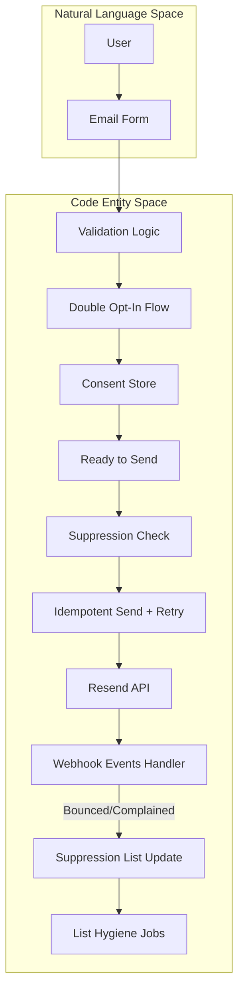
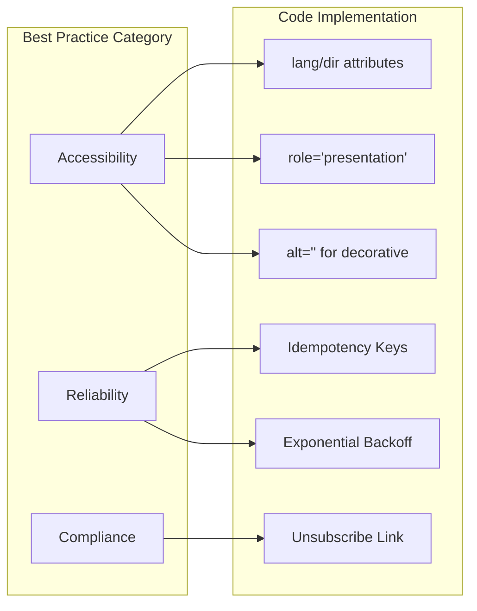

<!-- source: DeepWiki mcp.deepwiki.com · repo resend/resend-skills · page 6 Email Best Practices Skill · fetched 2026-10-27 -->

# Email Best Practices Skill

Relevant source files

The following files were used as context for generating this wiki page:

- [skills/email-best-practices/SKILL.md](skills/email-best-practices/SKILL.md)
- [skills/email-best-practices/references/accessibility.md](skills/email-best-practices/references/accessibility.md)

The `email-best-practices` skill serves as a comprehensive knowledge base for building deliverable, compliant, and accessible email systems. It provides guidance on the technical requirements for inbox placement (SPF, DKIM, DMARC), legal compliance (CAN-SPAM, GDPR), and the reliability patterns required for production-grade email pipelines.

## Architecture Overview

The email lifecycle involves multiple stages of validation, consent, and feedback loops. The following diagram maps the logical flow of an email from capture to delivery tracking, identifying key system responsibilities.

### Email Pipeline Flow

Sources: [skills/email-best-practices/SKILL.md:20-40]()

## Skill Topics

The `email-best-practices` skill is organized into four primary areas, each covering a critical phase of the email lifecycle.

### Deliverability & Authentication
This section focuses on ensuring emails reach the inbox rather than the spam folder. It covers the mandatory DNS records required by major providers like Gmail and Yahoo. Key concepts include domain warm-up strategies for new sending identities and managing sender reputation through bounce and complaint monitoring.

For details, see [Deliverability & Authentication](#6.1).

### Transactional vs. Marketing Emails
Different types of emails require different infrastructure and legal treatments. This topic helps developers distinguish between transactional messages (triggered by user actions like password resets or order confirmations) and marketing messages (newsletters and broadcasts). It provides a catalog of common transactional patterns to help plan application requirements.

For details, see [Transactional vs. Marketing Emails](#6.2).

### Compliance, Capture & List Management
Covers the legal frameworks (CAN-SPAM, GDPR, CASL) that govern email communication. It details the implementation of "Double Opt-In" flows to ensure valid consent and the technical requirements for unsubscribe mechanisms. Additionally, it describes how to maintain list hygiene by processing suppression events from webhooks.

For details, see [Compliance, Capture & List Management](#6.3).

### Sending Reliability, Webhooks & Accessibility
Focuses on the "last mile" of email: reliable delivery and content quality. This includes implementing idempotent send patterns to prevent duplicate emails and exponential backoff for retries. It also defines strict accessibility standards, such as proper `lang` and `dir` attribute usage and presentational table roles, to ensure emails are readable by screen readers and AI agents.

For details, see [Sending Reliability, Webhooks & Accessibility](#6.4).

## Technical Implementation Mapping

The following diagram bridges high-level best practices to specific implementation requirements within the email content and delivery logic.

### Content & Delivery Requirements

Sources: [skills/email-best-practices/SKILL.md:69-74](), [skills/email-best-practices/references/accessibility.md:7-44]()

## Quick Reference Summary

| Goal | Primary Reference |
| :--- | :--- |
| Fix spam issues / Set up DNS | [Deliverability & Authentication](#6.1) |
| Distinguish email types | [Transactional vs. Marketing Emails](#6.2) |
| Legal compliance (GDPR/CAN-SPAM) | [Compliance, Capture & List Management](#6.3) |
| Handle retries and webhooks | [Sending Reliability, Webhooks & Accessibility](#6.4) |
| Screen reader / Dark mode support | [Sending Reliability, Webhooks & Accessibility](#6.4) |

Sources: [skills/email-best-practices/SKILL.md:44-56]()

---

