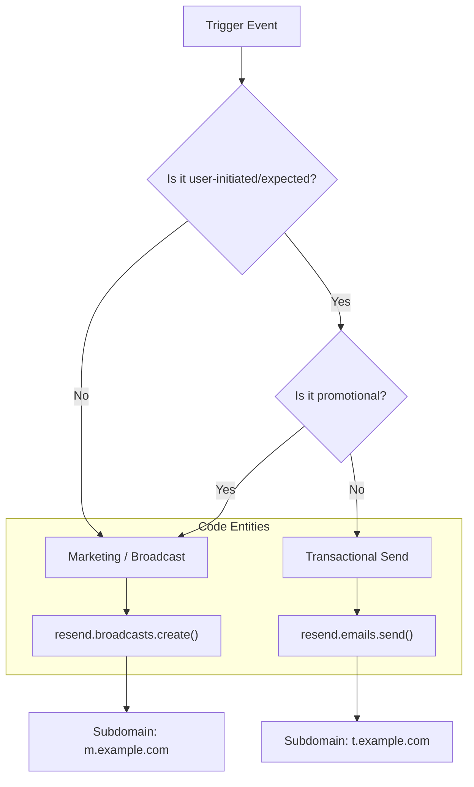
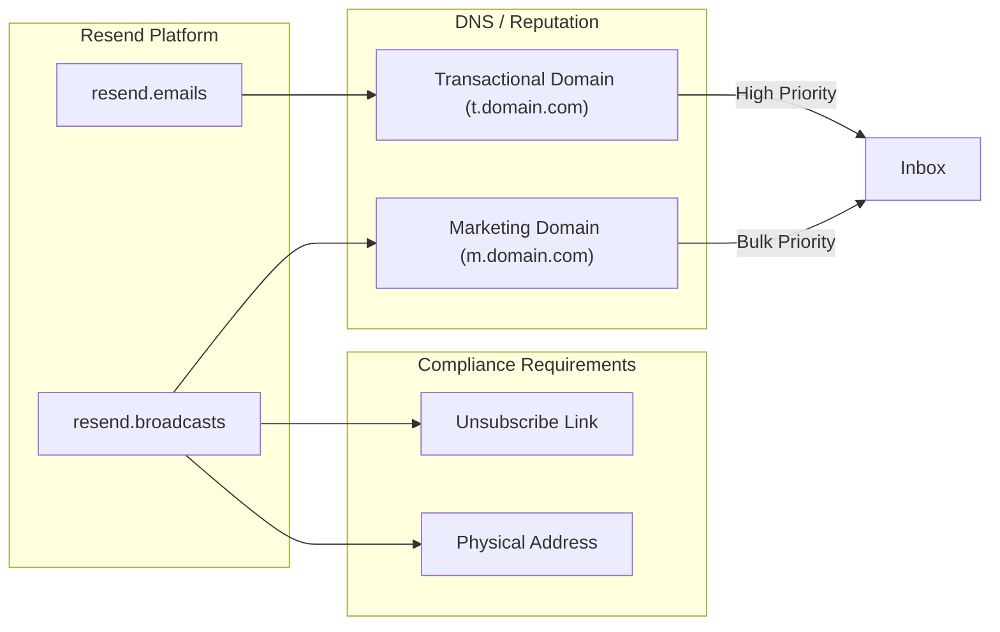

<!-- source: DeepWiki mcp.deepwiki.com · repo resend/resend-skills · page 6.2 Transactional vs. Marketing Emails · fetched 2026-10-27 -->

# Transactional vs. Marketing Emails

Relevant source files

The following files were used as context for generating this wiki page:

- [skills/email-best-practices/references/email-types.md](skills/email-best-practices/references/email-types.md)
- [skills/email-best-practices/references/marketing-emails.md](skills/email-best-practices/references/marketing-emails.md)
- [skills/email-best-practices/references/transactional-email-catalog.md](skills/email-best-practices/references/transactional-email-catalog.md)
- [skills/email-best-practices/references/transactional-emails.md](skills/email-best-practices/references/transactional-emails.md)

This page provides a technical distinction between transactional and marketing emails within the Resend ecosystem. It covers the classification of email types, legal compliance requirements, and the recommended infrastructure for maintaining high deliverability for critical system notifications.

## 1. Core Distinctions

The primary difference between transactional and marketing emails lies in the **intent** and **expectation** of the recipient.

### Transactional Emails
Transactional emails are functional messages triggered by a specific user action or a system event that the user expects to receive to complete a process [skills/email-best-practices/references/email-types.md:15-17]().

*   **Characteristics:** Time-sensitive, actionable, and required for service delivery [skills/email-best-practices/references/email-types.md:19-24]().
*   **Infrastructure:** Should be sent via a dedicated path to ensure near-instant delivery [skills/email-best-practices/references/transactional-emails.md:9-9]().
*   **Examples:** OTP codes, password resets, and order confirmations [skills/email-best-practices/references/email-types.md:26-31]().

### Marketing Emails
Marketing emails (or "Broadcasts" in Resend) are promotional or informational messages sent to a list of subscribers who have given explicit consent [skills/email-best-practices/references/marketing-emails.md:3-9]().

*   **Characteristics:** Promotional content, non-urgent, and require an unsubscribe mechanism [skills/email-best-practices/references/email-types.md:40-45]().
*   **Infrastructure:** Often subject to lower priority or batch processing compared to transactional traffic.
*   **Examples:** Newsletters, product announcements, and discount offers [skills/email-best-practices/references/email-types.md:47-53]().

### Comparison Table

| Feature | Transactional | Marketing |
| :--- | :--- | :--- |
| **Trigger** | User action or system event | Scheduled campaign or broadcast |
| **Consent** | Not strictly required (functional) | Explicit opt-in required |
| **Unsubscribe** | Optional (often omitted) | Mandatory by law |
| **Speed** | Immediate (seconds) | Less time-sensitive |
| **Primary Goal** | Utility / Completion of task | Conversion / Engagement |

**Sources:** [skills/email-best-practices/references/email-types.md:13-53](), [skills/email-best-practices/references/marketing-emails.md:5-10]()

---

## 2. Technical Implementation & Data Flow

When implementing these in a codebase using the Resend SDK, the classification determines which API endpoints and sender configurations are utilized.

### Email Type Classification Flow

The following diagram illustrates how an application should decide which sending path to use based on the message intent.

"Decision Logic for Email Classification"

**Sources:** [skills/email-best-practices/references/email-types.md:97-113](), [skills/email-best-practices/references/email-types.md:144-156]()

---

## 3. Transactional Email Catalog

The codebase provides a comprehensive catalog of essential transactional emails organized by application type [skills/email-best-practices/references/transactional-email-catalog.md:1-3]().

### Essential Catalog by Category
| Category | Essential Emails |
| :--- | :--- |
| **Authentication** | Email Verification, Password Reset, OTP/2FA, Security Alerts [skills/email-best-practices/references/transactional-email-catalog.md:155-231]() |
| **Account Management** | Welcome Email (non-promotional), Account Update Notifications [skills/email-best-practices/references/transactional-email-catalog.md:232-269]() |
| **E-commerce** | Order Confirmation, Shipping Notifications, Invoices [skills/email-best-practices/references/transactional-email-catalog.md:270-276]() |
| **SaaS/Dev Tools** | API Key notifications, Usage alerts, Subscription renewals [skills/email-best-practices/references/transactional-email-catalog.md:63-81]() |

### Implementation Best Practices
*   **OTP/Codes:** Use large (24-32px) monospace fonts and include an expiration notice [skills/email-best-practices/references/transactional-emails.md:65-70]().
*   **Subject Lines:** Be specific. Instead of "Action Required", use "Reset your password for [App]" [skills/email-best-practices/references/transactional-emails.md:15-20]().
*   **Error Handling:** Implement resend functionality only after 60 seconds and limit attempts (e.g., 3 per hour) [skills/email-best-practices/references/transactional-emails.md:79-82]().

**Sources:** [skills/email-best-practices/references/transactional-email-catalog.md:12-140](), [skills/email-best-practices/references/transactional-emails.md:11-53]()

---

## 4. Sending Infrastructure

To protect the deliverability of critical transactional emails, it is a best practice to isolate sending reputations.

### Subdomain Separation
Applications should use separate subdomains for different traffic types [skills/email-best-practices/references/email-types.md:146-152]():
1.  **Transactional:** `t.example.com` or `mail.example.com`
2.  **Marketing:** `m.example.com` or `news.example.com`

### Relationship between Resend Entities and DNS
The following diagram maps the Resend SDK resources to the infrastructure requirements described in the best practices.

"Infrastructure Mapping: Transactional vs. Marketing"

**Sources:** [skills/email-best-practices/references/email-types.md:144-156](), [skills/email-best-practices/references/marketing-emails.md:104-109]()

---

## 5. Legal Compliance (CAN-SPAM, GDPR, CASL)

The distinction is not just technical but legal. Marketing emails have significantly stricter requirements [skills/email-best-practices/references/email-types.md:55-56]().

### Marketing Compliance Checklist
*   **Explicit Opt-in:** Users must actively check a box or click "Subscribe". Pre-checked boxes are not valid under GDPR [skills/email-best-practices/references/marketing-emails.md:13-24]().
*   **Unsubscribe:** Must be "one-click" and prominent in every email [skills/email-best-practices/references/marketing-emails.md:44-48]().
*   **Sender Identity:** Must include a physical mailing address and clear identification of the sender [skills/email-best-practices/references/marketing-emails.md:106-108]().

### Transactional Compliance
*   **No Opt-in Required:** Can be sent to users without prior consent if necessary for a contract or service [skills/email-best-practices/references/email-types.md:73-76]().
*   **Content Restriction:** Transactional emails must not contain promotional content. Mixing them (Hybrid Emails) is discouraged as it may force the email to be classified as marketing, requiring an unsubscribe link and risking delivery to the spam folder [skills/email-best-practices/references/email-types.md:114-122]().

**Sources:** [skills/email-best-practices/references/email-types.md:57-94](), [skills/email-best-practices/references/marketing-emails.md:13-51]()

---

