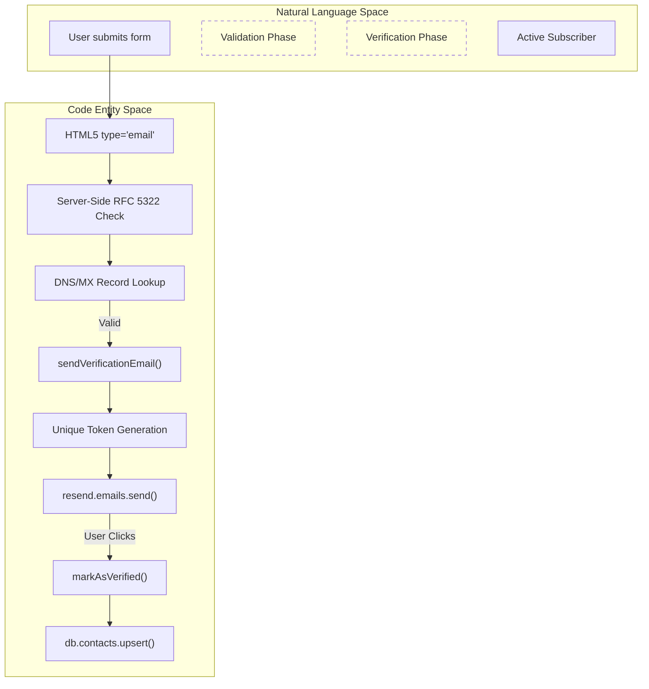
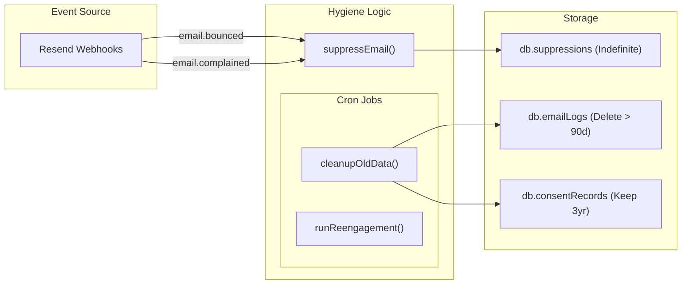

<!-- source: DeepWiki mcp.deepwiki.com · repo resend/resend-skills · page 6.3 Compliance, Capture & List Management · fetched 2026-10-27 -->

# Compliance, Capture & List Management

<details>
<summary>Relevant source files</summary>

The following files were used as context for generating this wiki page:

- [skills/email-best-practices/references/compliance.md](skills/email-best-practices/references/compliance.md)
- [skills/email-best-practices/references/email-capture.md](skills/email-best-practices/references/email-capture.md)
- [skills/email-best-practices/references/list-management.md](skills/email-best-practices/references/list-management.md)

</details>


This section details the technical implementation of legal compliance, secure email capture workflows, and automated list hygiene. Ensuring compliance with global regulations (CAN-SPAM, GDPR, CASL) is integrated into the email pipeline through specific headers, consent recording, and real-time suppression list management.

## Legal Compliance Requirements

Email compliance is governed by regional laws that dictate how consent is obtained, how sender identity is disclosed, and how opt-out requests are processed.

### Global Regulatory Comparison

| Law | Region | Opt-in Requirement | Unsubscribe Processing | Physical Address Required |
|:---|:---|:---|:---|:---|
| **CAN-SPAM** | US | Opt-out (Transactional) | 10 business days | Yes |
| **GDPR** | EU | Explicit Opt-in | Immediately | Yes |
| **CASL** | Canada | Express or Implied | 10 business days | Yes |

Sources: [skills/email-best-practices/references/compliance.md:5-11](), [skills/email-best-practices/references/compliance.md:57-63]()

### One-Click Unsubscribe Implementation
For bulk senders, major providers (Gmail, Yahoo) require the `List-Unsubscribe` header to enable one-click unsubscribing directly from the mail client interface.

The following headers must be included in the outgoing email payload:
```typescript
headers: {
  'List-Unsubscribe': '<https://example.com/unsubscribe>',
  'List-Unsubscribe-Post': 'List-Unsubscribe=One-Click',
}
```
Sources: [skills/email-best-practices/references/compliance.md:67-78]()

### Consent Recording
To comply with GDPR and CASL, the system must maintain an audit trail of consent. This includes:
*   **Timestamp:** Date and time of consent.
*   **Method:** The specific form or checkbox used.
*   **Scope:** Exactly what the user consented to (e.g., "Weekly Newsletter").
*   **Source:** The URL or page where capture occurred.

Sources: [skills/email-best-practices/references/compliance.md:89-98]()

---

## Email Capture & Validation

Effective list management begins at the point of capture. The system employs a multi-layered validation and verification strategy to ensure list quality.

### Double Opt-In Flow
Double Opt-In (DOI) is recommended for all marketing lists to verify address ownership and deliverability.

1.  **Submission:** User submits the form.
2.  **Verification Send:** System sends a transactional email with a unique, time-limited token (24-48 hours).
3.  **Confirmation:** User clicks the link, triggering the verification logic.
4.  **Activation:** The contact is marked as `verified` and added to the active marketing list.

Sources: [skills/email-best-practices/references/email-capture.md:32-45]()

### Capture Data Flow: From Form to Verified Contact

This diagram maps the logical flow of email capture to the validation requirements and security measures.


Sources: [skills/email-best-practices/references/email-capture.md:9-42](), [skills/email-best-practices/references/list-management.md:36-44]()

---

## List Management & Suppression

Maintaining list hygiene is critical for sender reputation. The system must automatically handle bounces, complaints, and unsubscribes.

### Suppression Logic
A suppression list acts as a "never-send" filter. Addresses are added based on specific events received via webhooks.

| Event | Reason | Action |
|:---|:---|:---|
| `email.bounced` | Hard Bounce | Permanent suppression (Invalid address). |
| `email.complained` | Spam Complaint | Permanent suppression (Legal requirement). |
| `email.unsubscribed` | Manual | Suppress from marketing only. |

Sources: [skills/email-best-practices/references/list-management.md:9-16]()

### Pre-Send Suppression Check
Before any `resend.emails.send()` call, the application should verify the recipient's status against the local suppression database.

```typescript
async function sendEmail(to: string, emailData: EmailData) {
  const isSuppressed = await db.suppressions.findOne({ email: to.toLowerCase() });
  
  if (isSuppressed) {
    console.log(`Skipping suppressed email: ${to}`);
    return { skipped: true, reason: isSuppressed.reason };
  }

  return await resend.emails.send({ to, ...emailData });
}
```
Sources: [skills/email-best-practices/references/list-management.md:20-59]()

### Automated Hygiene & Data Retention
Regular maintenance jobs ensure compliance with data retention laws like GDPR (Right to be Forgotten) and CASL (3-year record keeping).


Sources: [skills/email-best-practices/references/list-management.md:65-75](), [skills/email-best-practices/references/list-management.md:116-133]()

### Retention Policies
*   **Email Logs:** 90 days (for debugging and analytics).
*   **Email Content:** 30 days (to minimize storage costs).
*   **Consent Records:** 3 years after expiration (CASL requirement).
*   **Suppression List:** Indefinite (To prevent accidental re-sends to invalid addresses).

Sources: [skills/email-best-practices/references/list-management.md:103-112]()

---

