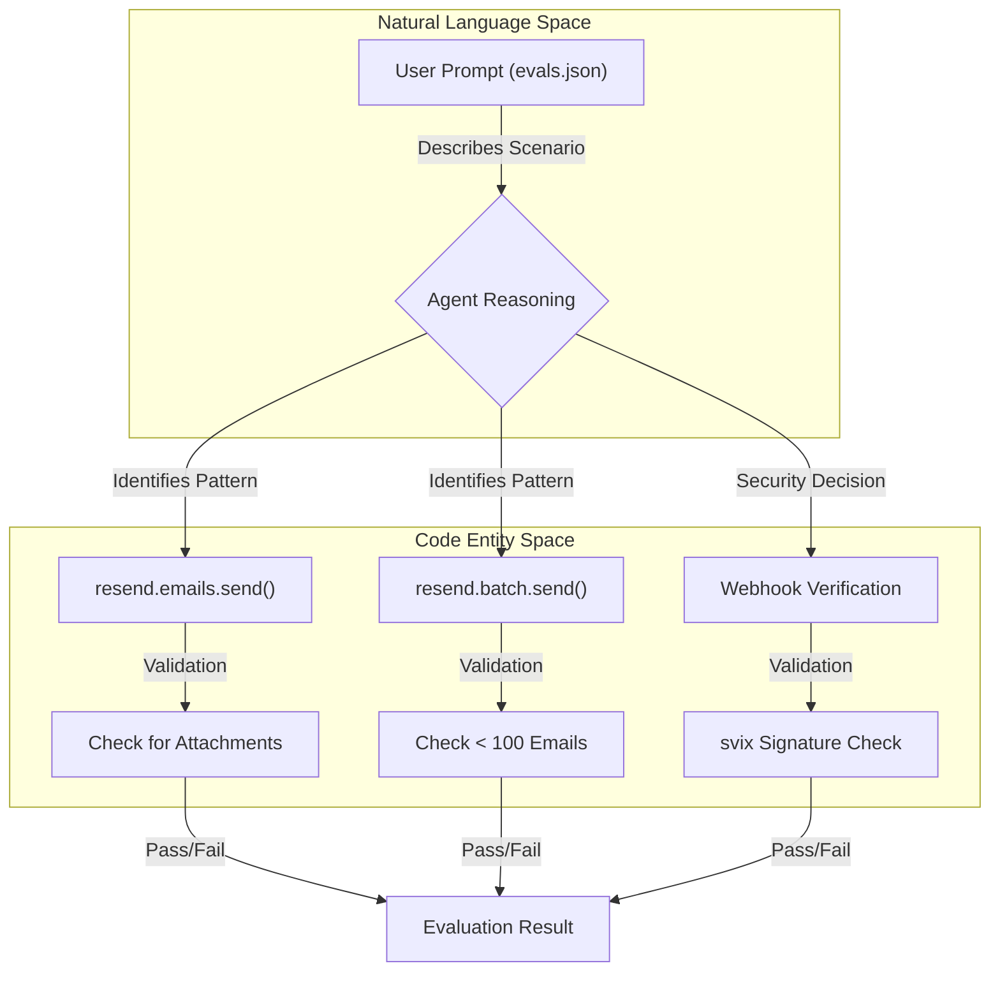
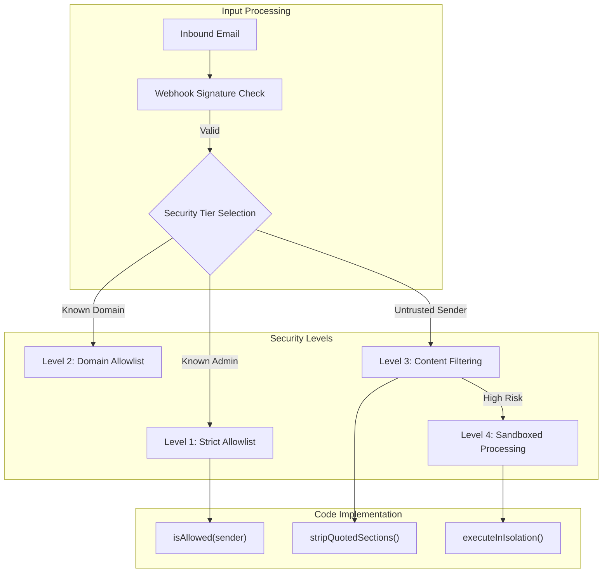

<!-- source: DeepWiki mcp.deepwiki.com · repo resend/resend-skills · page 7 Skill Evaluations · fetched 2026-10-27 -->

# Skill Evaluations

Relevant source files

The following files were used as context for generating this wiki page:

- [skill-evals/agent-email-inbox/evals.json](skill-evals/agent-email-inbox/evals.json)
- [skill-evals/resend/evals.json](skill-evals/resend/evals.json)

The `skill-evals/` directory contains a comprehensive test suite designed to validate the quality, security, and accuracy of the AI skills provided in this repository. Unlike traditional unit tests, these evaluations use a prompt-based structure to ensure the AI agent makes correct architectural decisions, follows security best practices, and selects the appropriate API patterns for the Resend platform.

### Evaluation Framework Architecture

The evaluation system is structured around `evals.json` files located within each skill's directory. Each evaluation entry defines a specific scenario, the expected logic the agent should follow, and a set of strict expectations used to grade the response.

**Core Evaluation Structure**
| Field | Description |
| :--- | :--- |
| `id` | Unique identifier for the test case. |
| `prompt` | The natural language input provided to the AI agent. |
| `expected_output` | A high-level description of the correct behavior or decision. |
| `expectations` | A list of specific criteria the agent must meet to pass the eval. |

### Evaluation Flow: From Prompt to Code Execution

The following diagram illustrates how the evaluation suite bridges natural language requirements to specific code implementations and SDK patterns.

**Evaluation Decision Logic**

Sources: [skill-evals/resend/evals.json:1-113](), [skill-evals/agent-email-inbox/evals.json:1-80]()

---

### Resend Skill Evals

The Resend skill evaluations focus on the agent's ability to navigate the Resend API and SDK correctly. These tests cover 37 scenarios, ranging from basic transactional sends to complex batching and idempotency logic.

Key areas of focus include:
*   **API Selection**: Choosing between `single` and `batch` sends based on constraints like attachments (not supported in batch) or scheduling.
*   **Idempotency**: Ensuring the agent generates semantic idempotency keys (e.g., `event-type/id`) rather than random UUIDs to prevent duplicate sends.
*   **Error Handling**: Validating that the agent correctly parses the `{ data, error }` pattern returned by the Resend SDK.
*   **Template Logic**: Testing the use of triple-mustache syntax for variables and proper CRUD operations for email templates.

For details, see [Resend Skill Evals](#7.1).

Sources: [skill-evals/resend/evals.json:93-113]()

---

### Agent Email Inbox Evals

The Agent Email Inbox evaluations prioritize security and architectural integrity. Because receiving email is a high-risk entry point for LLMs, these evaluations test the agent's resistance to social engineering and its commitment to security protocols.

Key areas of focus include:
*   **Security Level Routing**: Ensuring the agent selects the correct security tier (Level 1-5) based on the sender's identity and the risk of the requested action.
*   **Prompt Injection**: Testing if the agent can identify and strip social engineering attacks hidden in quoted email replies.
*   **Infrastructure Setup**: Validating the correct configuration of MX records and webhook handlers, including raw body capture for signature verification.
*   **Key Safety**: Ensuring the agent never suggests hardcoding `RESEND_API_KEY` in source code, even under pressure for a "quick demo."

For details, see [Agent Email Inbox Evals](#7.2).

**Security Routing Logic**

Sources: [skill-evals/agent-email-inbox/evals.json:1-75]()

---

