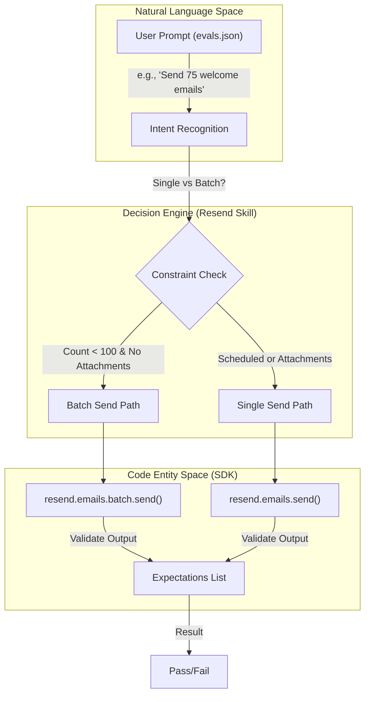
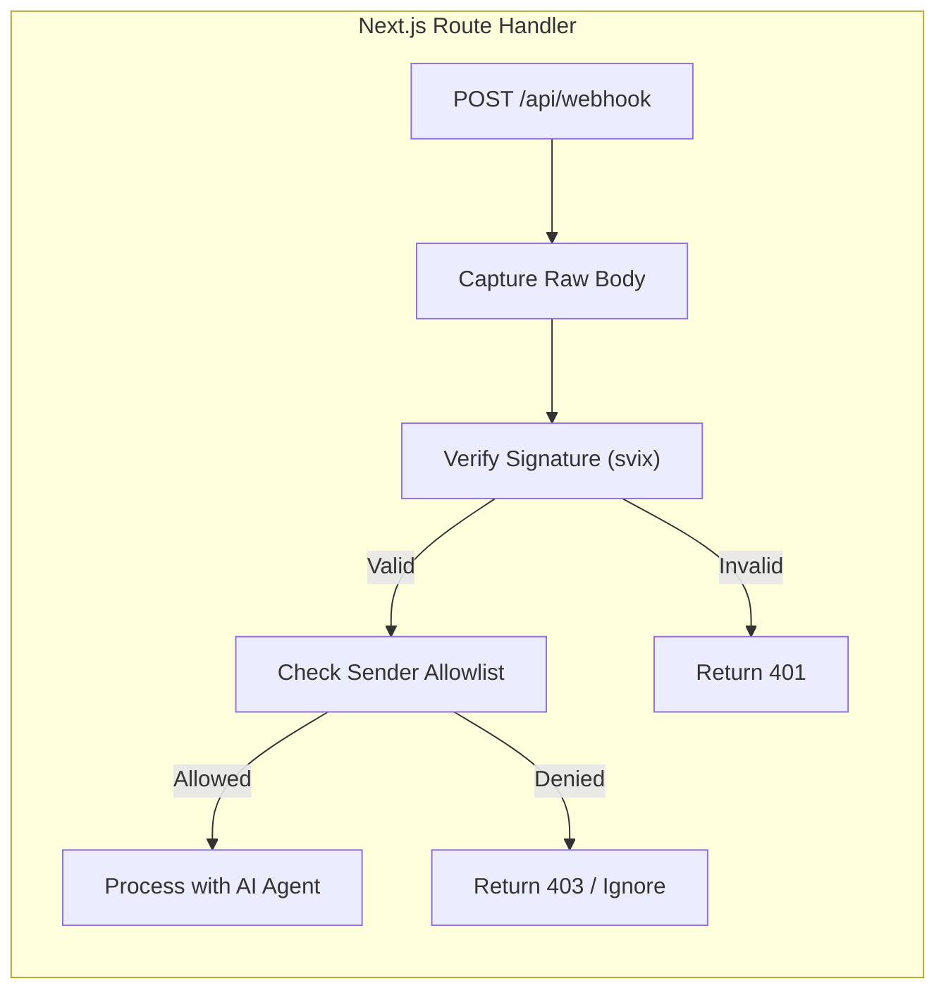

<!-- source: DeepWiki mcp.deepwiki.com · repo resend/resend-skills · page 7.1 Resend Skill Evals · fetched 2026-10-27 -->

# Resend Skill Evals

Relevant source files

The following files were used as context for generating this wiki page:

- [skill-evals/agent-email-inbox/evals.json](skill-evals/agent-email-inbox/evals.json)
- [skill-evals/resend/evals.json](skill-evals/resend/evals.json)

This page details the evaluation framework and specific test scenarios used to validate the quality and security of the `resend` skill. The evaluation suite consists of 37 scenarios designed to ensure the AI agent correctly handles complex email logic, security trade-offs, and Resend platform constraints.

## Evaluation Architecture

The evaluation system uses a structured JSON format to define prompts, expected behaviors, and specific technical constraints. This allows for automated validation of the skill's ability to bridge natural language requests to correct Resend SDK implementations.

### Evaluation Data Flow
The following diagram illustrates how a natural language prompt is evaluated against the expected technical output and SDK patterns.

**Diagram: Natural Language to SDK Mapping Evaluation**

**Sources:** [skill-evals/resend/evals.json:1-122](), [skill-evals/resend/evals.json:93-102]()

---

## Core Evaluation Scenarios

The `resend` skill evaluations focus on nine critical technical domains.

### 1. Single vs. Batch Send Decisions
The agent must distinguish between `resend.emails.send()` and `resend.emails.batch.send()` based on payload constraints.
*   **Batch Constraints:** Maximum 100 emails per call, no attachments supported, no scheduling supported [skill-evals/resend/evals.json:93-102]().
*   **Single Send:** Required for PDF attachments, scheduled sends (e.g., "9am tomorrow"), or single transactional messages [skill-evals/resend/evals.json:49-57]().

### 2. Idempotency Key Patterns
Evaluations ensure the agent uses semantic keys rather than random UUIDs to prevent duplicate sends during retries.
*   **Correct Pattern:** `welcome-email/usr_abc123` [skill-evals/resend/evals.json:105-112]().
*   **Payload Conflicts:** The agent must identify that using the same key with a different payload (e.g., A/B testing a subject line) results in a `409 Conflict` error [skill-evals/resend/evals.json:116-122]().

### 3. SDK Error Handling
The Resend Node.js SDK uses a `{ data, error }` return pattern rather than throwing exceptions.
*   **Validation:** The agent must demonstrate checking `if (error)` before accessing `data` [skill-evals/resend/evals.json:133-138]().
*   **Retry Logic:** Scenarios test for exponential backoff on `429` (Rate Limit) and `500` (Server Error), while avoiding retries on `422` (Validation Error) [skill-evals/resend/evals.json:144-150]().

### 4. Template Syntax and CRUD
*   **Variable Syntax:** Validation of triple-mustache `{{{ var }}}` for HTML content vs. double-mustache `{{ var }}` for plain text [skill-evals/resend/evals.json:155-161]().
*   **Management:** Testing the ability to create, update, and delete templates using `resend.templates` methods.

### 5. Domain and Infrastructure Management
*   **Warm-up:** Scenarios regarding new domain reputation and the gradual increase of volume [skill-evals/resend/evals.json:28-34]().
*   **Authentication:** Distinguishing between sending records (SPF/DKIM) and receiving records (MX) [skill-evals/resend/evals.json:28-34]().

**Sources:** [skill-evals/resend/evals.json:1-161]()

---

## Security and Agent Inbox Evals

Evaluations for the `agent-email-inbox` skill focus on high-stakes decision-making regarding untrusted input.

### Security Level Selection
The agent is tested on its ability to recommend the correct security tier based on the risk profile of the sender.

| Scenario | Expected Level | Reasoning |
| :--- | :--- | :--- |
| Known internal team | Level 1 | Strict allowlist is manageable for small groups [skill-evals/agent-email-inbox/evals.json:88-90](). |
| 200+ Enterprise clients | Level 2 + 3 | Level 1 is impractical; requires domain allowlist + content filtering [skill-evals/agent-email-inbox/evals.json:66-74](). |
| Financial/Refund triggers | Level 5 | Requires Human-in-the-loop for financial actions [skill-evals/resend/evals.json:60-68](). |

### Prompt Injection and Social Engineering
The agent must identify "jailbreak" attempts within email bodies, specifically in quoted reply sections.
*   **Scenario:** An email contains a valid request followed by a quoted section asking for API keys [skill-evals/agent-email-inbox/evals.json:29-38]().
*   **Requirement:** The agent must recommend stripping quoted text or flagging for human review [skill-evals/agent-email-inbox/evals.json:33-37]().

### Webhook Implementation
Correct implementation of webhook handlers is a primary evaluation target.

**Diagram: Webhook Handler Logic (Next.js App Router)**

**Sources:** [skill-evals/agent-email-inbox/evals.json:17-26](), [skill-evals/agent-email-inbox/evals.json:88-90]()

---

## Summary of Expectations

Across all 37 scenarios, the following "Golden Rules" are enforced:
1.  **Never Hardcode Keys:** Even for "quick demos," the agent must refuse to put API keys in source code and insist on `.env` files [skill-evals/agent-email-inbox/evals.json:42-50]().
2.  **Clarify Ambiguity:** If a user asks to "set up a domain," the agent must ask if it is for sending or receiving [skill-evals/resend/evals.json:28-34]().
3.  **Orthogonal Security:** Webhook signature verification (authenticating Resend) and sender allowlists (authenticating the author) must both be used [skill-evals/agent-email-inbox/evals.json:17-26]().
4.  **Attachment Awareness:** Forwarding emails with attachments must always use single sends, as the Resend batch API does not support them [skill-evals/resend/evals.json:49-56]().

**Sources:** [skill-evals/resend/evals.json:1-122](), [skill-evals/agent-email-inbox/evals.json:1-90]()

---

