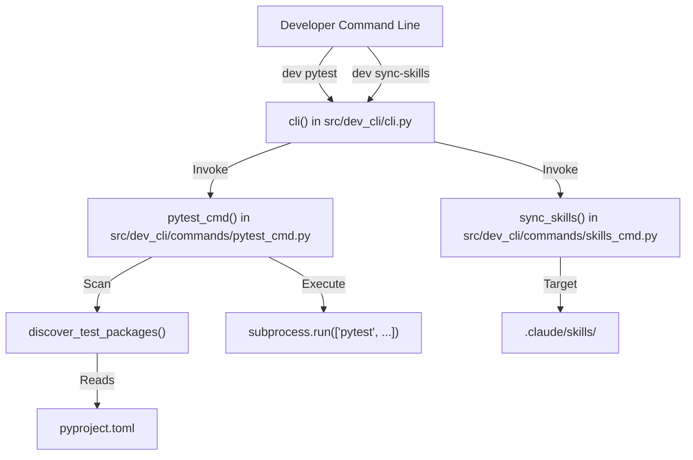
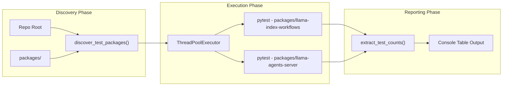

<!-- source: DeepWiki mcp.deepwiki.com · repo run-llama/llama-agents · page 1.1 Getting Started · fetched 2026-10-27 -->

# Getting Started

<details>
<summary>Relevant source files</summary>

The following files were used as context for generating this wiki page:

- [.github/workflows/lockfile.yml](.github/workflows/lockfile.yml)
- [.pre-commit-config.yaml](.pre-commit-config.yaml)
- [examples/agent.ipynb](examples/agent.ipynb)
- [examples/document_processing.ipynb](examples/document_processing.ipynb)
- [examples/feature_walkthrough.ipynb](examples/feature_walkthrough.ipynb)
- [package.json](package.json)
- [packages/llama-agents-integration-tests/pyproject.toml](packages/llama-agents-integration-tests/pyproject.toml)
- [pnpm-lock.yaml](pnpm-lock.yaml)
- [pyproject.toml](pyproject.toml)
- [src/dev_cli/cli.py](src/dev_cli/cli.py)
- [src/dev_cli/commands/__init__.py](src/dev_cli/commands/__init__.py)
- [src/dev_cli/commands/pytest_cmd.py](src/dev_cli/commands/pytest_cmd.py)
- [src/dev_cli/commands/skills_cmd.py](src/dev_cli/commands/skills_cmd.py)
- [tests/dev_cli/test_pytest_cmd.py](tests/dev_cli/test_pytest_cmd.py)
- [uv.lock](uv.lock)

</details>


This page provides technical instructions for setting up the `llama-agents` monorepo, configuring the development environment, and using the internal tooling to manage packages and tests.

## Purpose and Scope

The `llama-agents` repository is a Python-based monorepo managed by `uv` and `pnpm`. It contains the core `llama-index-workflows` engine, various server/client implementations, and the Kubernetes operator for deploying agentic workflows at scale [uv.lock:11-27](). This guide covers the initial workflow for developers to transition from a fresh clone to a fully functional development environment.

## Prerequisites

The monorepo relies on two primary package managers:
1.  **uv**: Used for Python dependency management, workspace isolation, and executing the internal developer CLI [pyproject.toml:158-181]().
2.  **pnpm**: Used for managing JavaScript-based tooling, such as `@changesets/cli`, and coordinating cross-language dependencies like the Kubernetes operator and Helm charts [pnpm-lock.yaml:1-26]().

## Development Environment Setup

### 1. Install Dependencies
Initialize the Python workspace and install Node-based development tools:

```bash
# Install Python dependencies and create virtual environment
uv sync

# Install JS-based development tools (Changesets, etc.)
pnpm install
```

### 2. Configure Pre-commit
The repository enforces code quality via `pre-commit` hooks, including `ruff` for formatting/linting and `basedpyright` for static type checking [pyproject.toml:5-15]().

```bash
uv run pre-commit install
```

The hooks are configured to run `ruff-format`, `ruff-check`, and a custom `ty` check across all packages [ .pre-commit-config.yaml:20-33]().

## Monorepo Tooling: The Dev CLI

The repository includes a specialized developer CLI located in `src/dev_cli` [pyproject.toml:101-102](). This tool abstracts common monorepo tasks such as running tests across multiple packages and managing versions.

### Dev CLI Entry Point
The CLI is exposed as a script named `dev` [pyproject.toml:37](). It uses `click` to organize subcommands and features an intelligent injection mechanism: if no subcommand is provided, it defaults to running `pytest` [src/dev_cli/cli.py:31-49]().

### Key Commands
| Command | Description | File Reference |
| :--- | :--- | :--- |
| `dev pytest` | Discovers and runs tests in all packages containing a `tests/` directory. | [src/dev_cli/commands/pytest_cmd.py:180-203]() |
| `dev changeset-version` | Consumes changesets to bump package versions and update `CHANGELOG.md`. | [src/dev_cli/cli.py:116]() |
| `dev sync-skills` | Symlinks local agent skills for use with development assistants. | [src/dev_cli/commands/skills_cmd.py:24-34]() |

### Code Entity Mapping: Dev CLI Execution
The following diagram illustrates how the `dev` CLI maps high-level developer intentions to specific code entities within the `src/dev_cli` package.

**Title: Dev CLI Command Dispatch Flow**

Sources: [src/dev_cli/cli.py:50-57](), [src/dev_cli/commands/pytest_cmd.py:180-192](), [src/dev_cli/commands/skills_cmd.py:30-43]()

## Running Tests

Testing is handled by the `pytest_cmd` module, which performs automatic discovery of workspace members [src/dev_cli/commands/pytest_cmd.py:3-17]().

### Test Discovery Logic
The `discover_test_packages` function scans the `packages/` directory for any folder containing both a `pyproject.toml` and a `tests/` directory [src/dev_cli/commands/pytest_cmd.py:180-203](). It also includes the repository root to cover internal tools like the `dev_cli` itself [src/dev_cli/commands/pytest_cmd.py:189-191]().

### Execution Workflow
1.  **Parallelization**: Tests are run across packages using a `ThreadPoolExecutor` [src/dev_cli/commands/pytest_cmd.py:15]().
2.  **Output Parsing**: The CLI parses pytest's stdout to extract failure counts and specific failure reasons using `extract_test_counts` and `extract_failed_test_names` [src/dev_cli/commands/pytest_cmd.py:58-84]().

**Title: Test Execution and Data Flow**

Sources: [src/dev_cli/commands/pytest_cmd.py:15-23](), [src/dev_cli/commands/pytest_cmd.py:58-76](), [src/dev_cli/commands/pytest_cmd.py:180-203]()

## First-Run Workflow

To verify the installation, users should run a basic workflow from the `examples` directory.

### Running a Simple Workflow
Workflows are defined by subclassing `Workflow` and using the `@step` decorator [examples/feature_walkthrough.ipynb:54-63]().

```python
from llama_index.core.workflow import Workflow, step, StartEvent, StopEvent

class MyWorkflow(Workflow):
    @step
    async def my_step(self, ev: StartEvent) -> StopEvent:
        return StopEvent(result="Success")

w = MyWorkflow()
# await w.run()
```

### Contribution Guidelines (CONTRIBUTING.md)
Before submitting code, developers must ensure:
1.  **Changesets**: All PRs that modify package code must include a changeset generated via `pnpm changeset` [package.json:7]().
2.  **Type Checking**: The `uv run ty check packages/` command must pass without errors [ .pre-commit-config.yaml:32]().
3.  **Dependency Updates**: If modifying dependencies, `uv lock` must be run to update `uv.lock` [uv.lock:1-27]().

Sources: [pyproject.toml:1-38](), [pnpm-lock.yaml:1-26](), [src/dev_cli/cli.py:1-50](), [src/dev_cli/commands/pytest_cmd.py:1-100](), [examples/feature_walkthrough.ipynb:54-68]()

---

