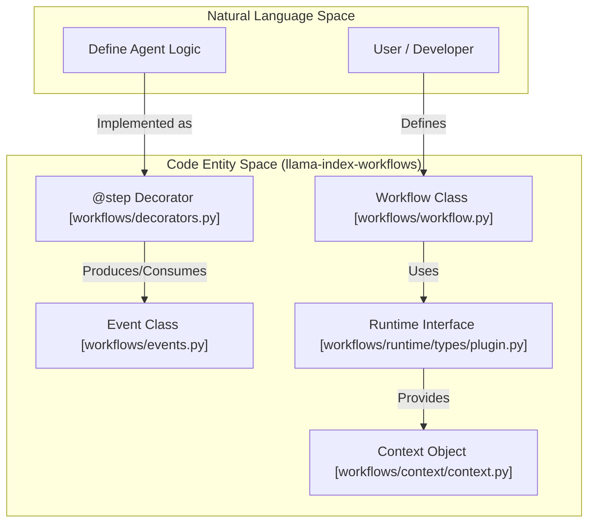
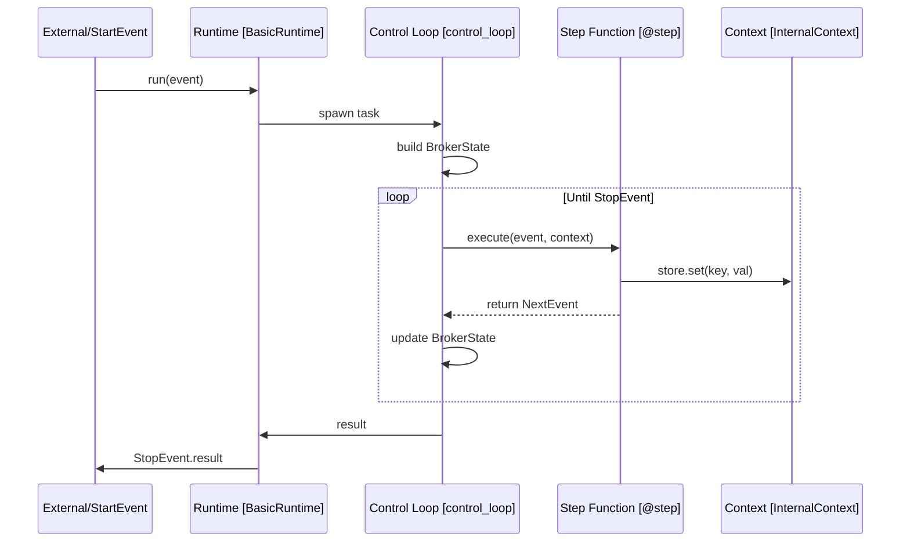

<!-- source: DeepWiki mcp.deepwiki.com · repo run-llama/llama-agents · page 2 Core Workflow Engine (llama-index-workflows) · fetched 2026-10-27 -->

# Core Workflow Engine (llama-index-workflows)

Relevant source files

The following files were used as context for generating this wiki page:

- [CONTRIBUTING.md](CONTRIBUTING.md)
- [README.md](README.md)
- [docs/src/content/docs/llamaagents/workflows/observability.md](docs/src/content/docs/llamaagents/workflows/observability.md)
- [examples/observability/workflows_observability_pt1.ipynb](examples/observability/workflows_observability_pt1.ipynb)
- [examples/observability/workflows_observability_pt2.ipynb](examples/observability/workflows_observability_pt2.ipynb)
- [examples/observability/workflows_observablitiy_arize_phoenix.ipynb](examples/observability/workflows_observablitiy_arize_phoenix.ipynb)
- [examples/observability/workflows_observablitiy_langfuse.ipynb](examples/observability/workflows_observablitiy_langfuse.ipynb)
- [examples/state_management_with_vector_databases.ipynb](examples/state_management_with_vector_databases.ipynb)
- [packages/llama-index-workflows/src/workflows/context/context.py](packages/llama-index-workflows/src/workflows/context/context.py)
- [packages/llama-index-workflows/src/workflows/context/internal_context.py](packages/llama-index-workflows/src/workflows/context/internal_context.py)
- [packages/llama-index-workflows/src/workflows/plugins/basic.py](packages/llama-index-workflows/src/workflows/plugins/basic.py)
- [packages/llama-index-workflows/src/workflows/representation/validate.py](packages/llama-index-workflows/src/workflows/representation/validate.py)
- [packages/llama-index-workflows/src/workflows/runtime/types/commands.py](packages/llama-index-workflows/src/workflows/runtime/types/commands.py)
- [packages/llama-index-workflows/src/workflows/runtime/types/plugin.py](packages/llama-index-workflows/src/workflows/runtime/types/plugin.py)
- [packages/llama-index-workflows/src/workflows/runtime/types/results.py](packages/llama-index-workflows/src/workflows/runtime/types/results.py)
- [packages/llama-index-workflows/src/workflows/runtime/types/step_function.py](packages/llama-index-workflows/src/workflows/runtime/types/step_function.py)
- [packages/llama-index-workflows/src/workflows/runtime/types/ticks.py](packages/llama-index-workflows/src/workflows/runtime/types/ticks.py)
- [packages/llama-index-workflows/src/workflows/workflow.py](packages/llama-index-workflows/src/workflows/workflow.py)
- [packages/llama-index-workflows/tests/conftest.py](packages/llama-index-workflows/tests/conftest.py)
- [packages/llama-index-workflows/tests/context/test_context.py](packages/llama-index-workflows/tests/context/test_context.py)
- [packages/llama-index-workflows/tests/runtime/conftest.py](packages/llama-index-workflows/tests/runtime/conftest.py)
- [packages/llama-index-workflows/tests/test_child_state_inheritance.py](packages/llama-index-workflows/tests/test_child_state_inheritance.py)
- [packages/llama-index-workflows/tests/test_graph_validation.py](packages/llama-index-workflows/tests/test_graph_validation.py)
- [packages/llama-index-workflows/tests/test_workflow.py](packages/llama-index-workflows/tests/test_workflow.py)

The `llama-index-workflows` package is the foundational event-driven orchestration library for the LlamaAgents monorepo. It provides a purely Pythonic, type-safe way to define complex agentic behaviors without the need for a Domain Specific Language (DSL). Workflows are composed of discrete steps that communicate by emitting and consuming typed events [README.md:15-18]().

## System Overview: From Natural Language to Code

The following diagram bridges the high-level concept of a "Workflow" to the specific code entities that manage execution.

### Workflow Execution Mapping

**Sources:** [packages/llama-index-workflows/src/workflows/workflow.py:41-87](), [packages/llama-index-workflows/src/workflows/runtime/types/plugin.py:81-98]()

## Core Components

### 1. Workflow, Steps, and Events
A `Workflow` is a class-based orchestrator where logic is encapsulated in methods decorated with `@step`. These steps are asynchronous functions that take a specific `Event` type as input and return another `Event` (or `None`). The system uses Python type hints to automatically validate the event graph at startup, ensuring every produced event has a consumer and that the workflow can reach a `StopEvent`.

For details, see [Workflow, Steps, and Events](#2.1).

**Sources:** [packages/llama-index-workflows/src/workflows/workflow.py:41-55](), [packages/llama-index-workflows/src/workflows/representation/validate.py:140-163]()

### 2. Control Loop and Runtime Architecture
Execution is managed by a `Runtime`. By default, workflows use a `BasicRuntime`, but the architecture supports pluggable backends for durability and distribution. The engine operates on a "tick-based" model where every event injection, step completion, or timeout is a `WorkflowTick`. An `InternalRunAdapter` manages the communication between the step execution and the central control loop.

For details, see [Control Loop and Runtime Architecture](#2.2).

**Sources:** [packages/llama-index-workflows/src/workflows/runtime/types/plugin.py:81-166](), [packages/llama-index-workflows/src/workflows/runtime/types/ticks.py:1-40]()

### 3. Context, State, and Resources
The `Context` object is the primary interface for steps to interact with the workflow's environment. It provides:
*   **State Management:** A `StateStore` for persisting data across steps.
*   **Event Streaming:** Methods like `write_event_to_stream` to surface progress to external observers.
*   **Resource Injection:** A `ResourceManager` for managing dependencies like LLMs or database connections.

For details, see [Context, State, and Resources](#2.3).

**Sources:** [packages/llama-index-workflows/src/workflows/context/context.py:58-116](), [packages/llama-index-workflows/src/workflows/workflow.py:158-158]()

### 4. Retry Policies and Error Handling
The engine includes robust error handling via the `@catch_error` decorator, which allows routing specific exceptions to designated handler steps. Steps can also define `RetryPolicy` objects (e.g., `ExponentialBackoffRetryPolicy`) to handle transient failures automatically.

For details, see [Retry Policies and Error Handling](#2.4).

**Sources:** [packages/llama-index-workflows/src/workflows/workflow.py:54-54](), [packages/llama-index-workflows/src/workflows/runtime/types/results.py:34-50]()

### 5. Workflow Visualization and Utilities
The `llama-index-utils-workflow` package provides tools to visualize the event graph and execution traces. This includes generating Mermaid diagrams or interactive PyVis graphs to debug complex branching and looping logic.

For details, see [Workflow Visualization and Utilities (llama-index-utils-workflow)](#2.5).

**Sources:** [packages/llama-index-workflows/src/workflows/workflow.py:105-105]()

## Operational Flow

The following diagram illustrates the lifecycle of an event moving through the system.

### Event Processing Lifecycle

**Sources:** [packages/llama-index-workflows/src/workflows/runtime/types/step_function.py:162-210](), [packages/llama-index-workflows/src/workflows/context/context.py:149-183]()

## Observability
Workflows integrate with OpenTelemetry and third-party tools like Arize Phoenix and Langfuse. The `llama_index_instrumentation` dispatcher tracks every step's input, output, and duration, emitting `WorkflowStepOutputEvent` and `WorkflowRunOutputEvent` for detailed tracing [docs/src/content/docs/llamaagents/workflows/observability.md:11-38](), [packages/llama-index-workflows/src/workflows/runtime/types/step_function.py:71-89]().

---

