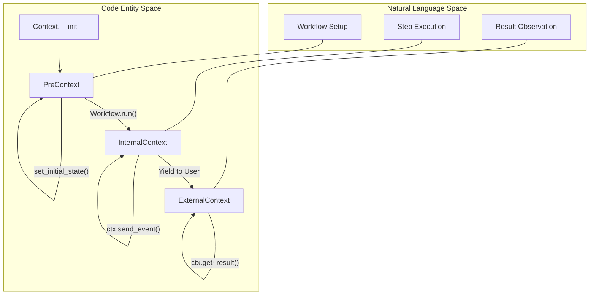
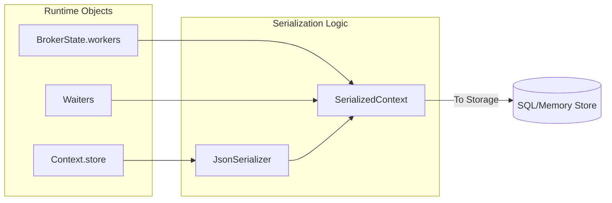
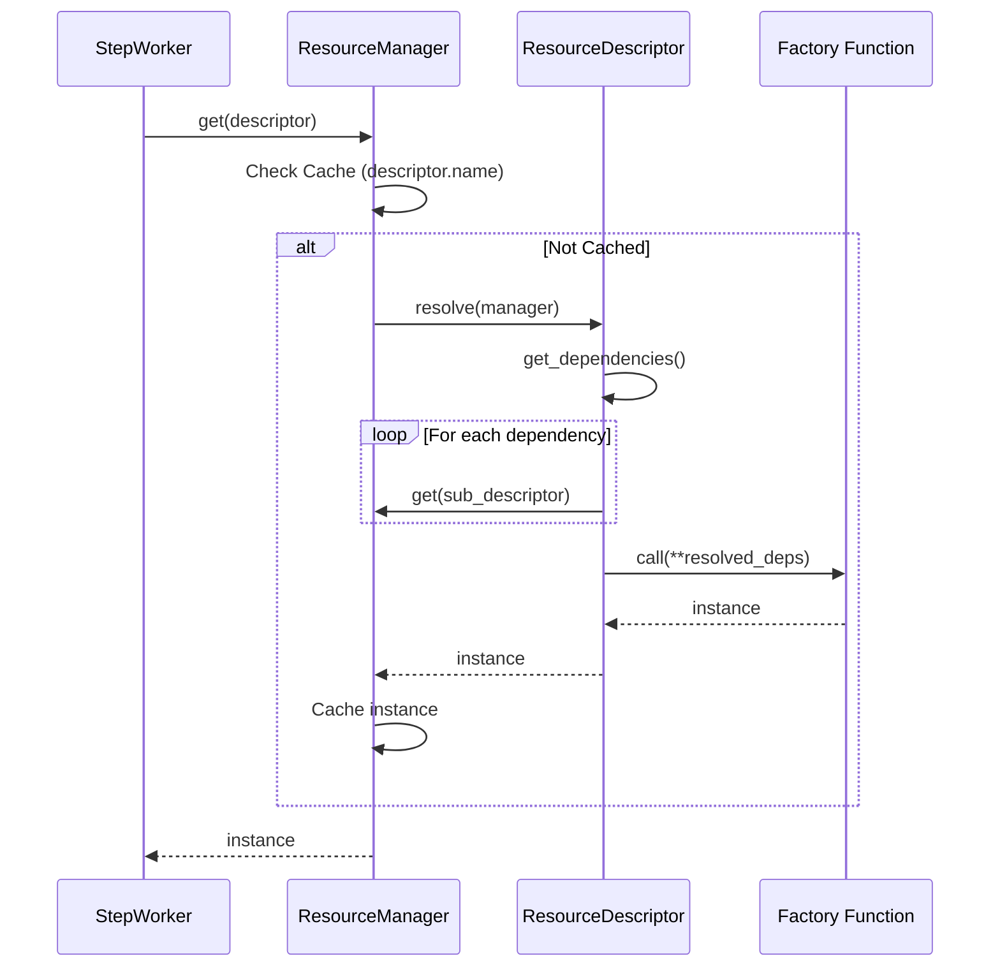

<!-- source: DeepWiki mcp.deepwiki.com · repo run-llama/llama-agents · page 2.3 Context, State, and Resources · fetched 2026-10-27 -->

# Context, State, and Resources

<details>
<summary>Relevant source files</summary>

The following files were used as context for generating this wiki page:

- [.changeset/add-json-serializer-allowlist.md](.changeset/add-json-serializer-allowlist.md)
- [LICENSE](LICENSE)
- [packages/llama-agents-server/src/llama_agents/server/_store/migration_utils.py](packages/llama-agents-server/src/llama_agents/server/_store/migration_utils.py)
- [packages/llama-index-workflows/src/workflows/context/__init__.py](packages/llama-index-workflows/src/workflows/context/__init__.py)
- [packages/llama-index-workflows/src/workflows/context/context.py](packages/llama-index-workflows/src/workflows/context/context.py)
- [packages/llama-index-workflows/src/workflows/context/context_types.py](packages/llama-index-workflows/src/workflows/context/context_types.py)
- [packages/llama-index-workflows/src/workflows/context/internal_context.py](packages/llama-index-workflows/src/workflows/context/internal_context.py)
- [packages/llama-index-workflows/src/workflows/context/serializers.py](packages/llama-index-workflows/src/workflows/context/serializers.py)
- [packages/llama-index-workflows/src/workflows/context/state_store.py](packages/llama-index-workflows/src/workflows/context/state_store.py)
- [packages/llama-index-workflows/src/workflows/context/utils.py](packages/llama-index-workflows/src/workflows/context/utils.py)
- [packages/llama-index-workflows/src/workflows/resource.py](packages/llama-index-workflows/src/workflows/resource.py)
- [packages/llama-index-workflows/src/workflows/runtime/types/commands.py](packages/llama-index-workflows/src/workflows/runtime/types/commands.py)
- [packages/llama-index-workflows/src/workflows/runtime/types/results.py](packages/llama-index-workflows/src/workflows/runtime/types/results.py)
- [packages/llama-index-workflows/src/workflows/runtime/types/step_function.py](packages/llama-index-workflows/src/workflows/runtime/types/step_function.py)
- [packages/llama-index-workflows/src/workflows/runtime/types/ticks.py](packages/llama-index-workflows/src/workflows/runtime/types/ticks.py)
- [packages/llama-index-workflows/src/workflows/utils.py](packages/llama-index-workflows/src/workflows/utils.py)
- [packages/llama-index-workflows/tests/context/test_context.py](packages/llama-index-workflows/tests/context/test_context.py)
- [packages/llama-index-workflows/tests/test_child_state_inheritance.py](packages/llama-index-workflows/tests/test_child_state_inheritance.py)
- [packages/llama-index-workflows/tests/test_decorator.py](packages/llama-index-workflows/tests/test_decorator.py)
- [packages/llama-index-workflows/tests/test_resources.py](packages/llama-index-workflows/tests/test_resources.py)
- [packages/llama-index-workflows/tests/test_utils.py](packages/llama-index-workflows/tests/test_utils.py)
- [packages/llamactl/src/llama_agents/cli/config/_migrations.py](packages/llamactl/src/llama_agents/cli/config/_migrations.py)
- [packages/llamactl/src/llama_agents/cli/local_context.py](packages/llamactl/src/llama_agents/cli/local_context.py)

</details>


This section covers the mechanisms for managing data, persistent state, and external dependencies within a workflow execution. The core of this system is the `Context` object, which acts as the primary interface for steps to interact with the workflow runtime and shared storage.

## The Context Object

The `Context` class provides a per-run environment for a `Workflow` [packages/llama-index-workflows/src/workflows/context/context.py:58-67](). It is responsible for coordinating event delivery, tracking in-flight work, and exposing a type-safe state store [packages/llama-index-workflows/src/workflows/context/context.py:64-66]().

To ensure safety and appropriate access at different stages of a workflow's lifecycle, the `Context` implements a "State Pattern" using three internal "faces":

| Face | Class | Purpose |
| :--- | :--- | :--- |
| **Pre-run** | `PreContext` | Used for configuration before the workflow starts (e.g., setting initial state) [packages/llama-index-workflows/src/workflows/context/pre_context.py:23-28](). |
| **Internal** | `InternalContext` | Provided to step functions via the `ctx` parameter. Allows sending events and accessing the store [packages/llama-index-workflows/src/workflows/context/internal_context.py:34-40](). |
| **External** | `ExternalContext` | Used by external observers (like a UI or a parent process) to stream events or check status [packages/llama-index-workflows/src/workflows/context/external_context.py:27-32](). |

### Context Lifecycle and Face Transitions

The `Context` transitions through these faces as the workflow execution progresses.

Title: Context Face Transition Diagram

Sources: [packages/llama-index-workflows/src/workflows/context/context.py:123-146](), [packages/llama-index-workflows/src/workflows/context/context.py:186-210]()

## StateStore and Persistence

The `StateStore` provides a type-safe, asynchronous interface for persisting data across step boundaries [packages/llama-index-workflows/src/workflows/context/state_store.py:251-260](). By default, workflows use `DictState`, which behaves like a standard Python dictionary [packages/llama-index-workflows/src/workflows/context/state_store.py:238-245]().

### Key Functions
- `ctx.store.set(key, value)`: Persists a value into the store [packages/llama-index-workflows/src/workflows/context/state_store.py:313-324]().
- `ctx.store.get(key, default)`: Retrieves a value from the store [packages/llama-index-workflows/src/workflows/context/state_store.py:284-304]().
- `get_by_path(state, path)`: Accesses nested values using dot-notation (e.g., `"user.profile.name"`) [packages/llama-index-workflows/src/workflows/context/state_store.py:197-212]().

### Context Serialization
Serialization allows a workflow to be paused, saved to a database, and resumed later. The system uses `SerializedContext` (Version 1) to capture the state of the store, worker queues, and active waiters [packages/llama-index-workflows/src/workflows/context/context_types.py:125-142]().

Title: Serialization Data Flow

Sources: [packages/llama-index-workflows/src/workflows/context/context_types.py:125-142](), [packages/llama-index-workflows/src/workflows/context/state_store.py:83-114]()

## Resource Dependency Injection

The Resource system allows developers to inject external dependencies (like LLMs, databases, or API clients) into workflow steps without hardcoding them. This is achieved using the `Annotated` type hint and the `Resource` or `ResourceConfig` descriptors [packages/llama-index-workflows/src/workflows/resource.py:11-25]().

### Components
1. **`Resource`**: Wraps a factory function (sync or async) that produces the dependency [packages/llama-index-workflows/src/workflows/resource.py:93-105]().
2. **`ResourceConfig`**: Loads configuration for a Pydantic-based resource from a JSON file [packages/llama-index-workflows/src/workflows/resource.py:194-213]().
3. **`ResourceManager`**: Orchestrates the resolution and caching of these resources during step execution [packages/llama-index-workflows/src/workflows/resource.py:269-280]().

### Implementation in Steps
When a step is invoked, the runtime uses `partial()` to resolve all annotated resources via the `ResourceManager` before calling the step function [packages/llama-index-workflows/src/workflows/runtime/types/step_function.py:116-135]().

```python
@step
async def my_step(
    self, 
    ev: StartEvent, 
    db: Annotated[DatabaseClient, Resource(get_db_factory)]
) -> StopEvent:
    # 'db' is automatically resolved and injected
    await db.query(...)
    return StopEvent()
```
Sources: [packages/llama-index-workflows/src/workflows/runtime/types/step_function.py:128-135](), [packages/llama-index-workflows/tests/test_resources.py:240-244]()

### Resource Resolution Process
The `ResourceManager` maintains a `resolution_scope` to prevent circular dependencies and ensure that resources marked for caching are only created once per workflow context [packages/llama-index-workflows/src/workflows/resource.py:274-290]().

Title: Resource Resolution Logic

Sources: [packages/llama-index-workflows/src/workflows/resource.py:107-127](), [packages/llama-index-workflows/src/workflows/resource.py:293-315]()

---

