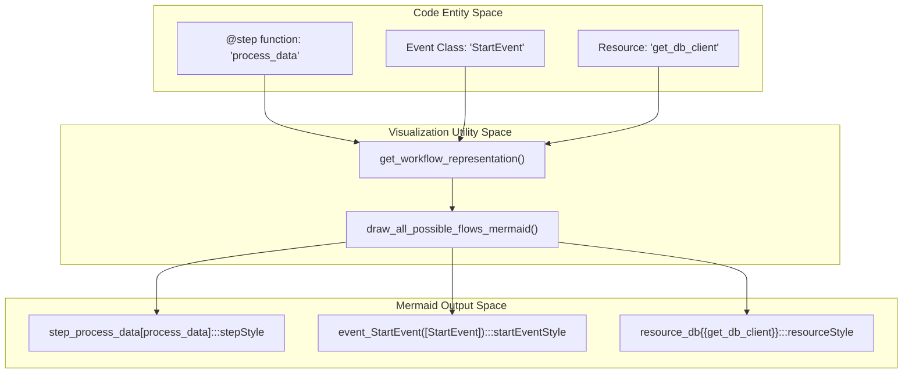
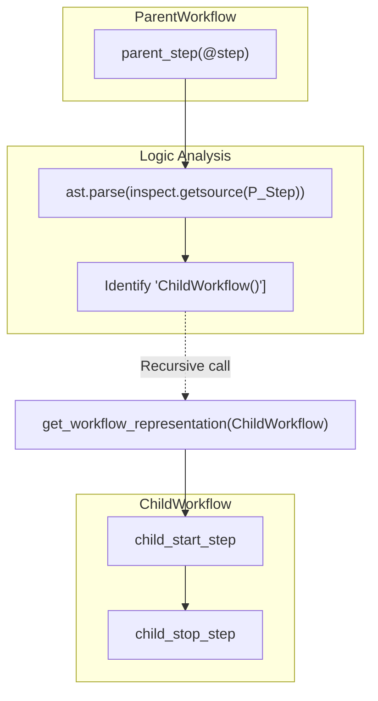

<!-- source: DeepWiki mcp.deepwiki.com · repo run-llama/llama-agents · page 2.5 Workflow Visualization and Utilities (llama-index-utils-workflow) · fetched 2026-10-27 -->

# Workflow Visualization and Utilities (llama-index-utils-workflow)

Relevant source files

The following files were used as context for generating this wiki page:

- [examples/visualization/resource_nodes_example.py](examples/visualization/resource_nodes_example.py)
- [packages/llama-index-utils-workflow/CHANGELOG.md](packages/llama-index-utils-workflow/CHANGELOG.md)
- [packages/llama-index-utils-workflow/package.json](packages/llama-index-utils-workflow/package.json)
- [packages/llama-index-utils-workflow/pyproject.toml](packages/llama-index-utils-workflow/pyproject.toml)
- [packages/llama-index-utils-workflow/src/llama_index/utils/workflow/__init__.py](packages/llama-index-utils-workflow/src/llama_index/utils/workflow/__init__.py)
- [packages/llama-index-utils-workflow/tests/conftest.py](packages/llama-index-utils-workflow/tests/conftest.py)
- [packages/llama-index-utils-workflow/tests/test_drawing.py](packages/llama-index-utils-workflow/tests/test_drawing.py)
- [packages/llama-index-workflows/src/workflows/protocol/__init__.py](packages/llama-index-workflows/src/workflows/protocol/__init__.py)
- [packages/llama-index-workflows/src/workflows/representation/__init__.py](packages/llama-index-workflows/src/workflows/representation/__init__.py)
- [packages/llama-index-workflows/src/workflows/representation/build.py](packages/llama-index-workflows/src/workflows/representation/build.py)
- [packages/llama-index-workflows/src/workflows/representation/types.py](packages/llama-index-workflows/src/workflows/representation/types.py)
- [packages/llama-index-workflows/tests/test_annotation_resolution.py](packages/llama-index-workflows/tests/test_annotation_resolution.py)
- [packages/llama-index-workflows/tests/test_representation_utils.py](packages/llama-index-workflows/tests/test_representation_utils.py)

The `llama-index-utils-workflow` package provides tools for inspecting, analyzing, and visualizing the structure and execution of workflows. It bridges the gap between the event-driven code defined in `llama-index-workflows` and a human-readable graphical representation. It supports static analysis (drawing all possible paths) and dynamic analysis (visualizing a specific execution trace), with rendering options for both interactive HTML (via Pyvis) and static diagrams (via Mermaid).

## Workflow Representation and Graph Model

At the core of the visualization utilities is the `WorkflowGraph` model. This model is built by performing static analysis on a `Workflow` class or instance to identify steps, the events they consume, and the events they emit.

### Key Representation Entities
The system uses several specialized node types to represent different workflow components:

| Class | Node Type | Description |
| :--- | :--- | :--- |
| `WorkflowStepNode` | `step` | Represents a function decorated with `@step`. |
| `WorkflowEventNode` | `event` | Represents an `Event` class flowing between steps. Includes the inheritance chain. |
| `WorkflowResourceNode` | `resource` | Represents an injected dependency via `Resource`. |
| `WorkflowResourceConfigNode` | `resource_config` | Represents configuration loaded from JSON files. |
| `WorkflowExternalNode` | `external` | Represents Human-in-the-loop (HITL) or external system interactions. |
| `WorkflowGenericNode` | `agent`, `tool`, etc. | Catch-all for specialized visualizations like `AgentWorkflow`. |

Sources: [packages/llama_index/utils/workflow/src/llama_index/utils/workflow/__init__.py:28-35](), [packages/llama-index-workflows/src/workflows/representation/types.py:21-158]()

### The Graph Construction Process
The function `get_workflow_representation` (defined in `workflows.representation.build`) inspects the workflow's `_get_steps_from_class()` metadata to build the `WorkflowGraph`.

1.  **Step Discovery**: Iterates through all methods decorated with `@step`.
2.  **Event Mapping**: Identifies input event types from type annotations and output event types from the return type hint.
3.  **Resource Extraction**: Scans `Annotated` parameters for `Resource` or `ResourceConfig` markers.
4.  **Edge Creation**: Connects events to steps (input) and steps to events (output).

Sources: [packages/llama-index-workflows/src/workflows/representation/build.py:155-182]()

## Visualization Utilities

The package provides four primary functions for generating visualizations, split by their source (static vs. execution) and output format (Pyvis vs. Mermaid).

### Static Analysis: All Possible Flows
These functions visualize every potential path defined in the workflow code, regardless of whether they were triggered in a specific run.

*   `draw_all_possible_flows(workflow, filename, ...)`: Generates an interactive Pyvis HTML file.
*   `draw_all_possible_flows_mermaid(workflow, filename, ...)`: Generates a Mermaid.js flowchart string or file.

### Execution Analysis: Trace Visualization
These functions visualize the actual path taken during a specific workflow execution by inspecting the `WorkflowHandler`.

*   `draw_most_recent_execution(handler, filename, ...)`: Uses the handler's execution history to draw a Pyvis graph of the steps that actually ran.
*   `draw_most_recent_execution_mermaid(handler, filename, ...)`: Similar to above, but outputs Mermaid syntax.

Sources: [packages/llama-index-utils-workflow/src/llama_index/utils/workflow/__init__.py:231-255](), [packages/llama-index-utils-workflow/src/llama_index/utils/workflow/__init__.py:410-435]()

## Mermaid Rendering Logic

The Mermaid rendering engine converts the `WorkflowGraph` into a `flowchart TD` definition. It applies specific CSS classes and shapes to differentiate node types.

### Node Mapping to Mermaid Space

| Code Entity Type | Mermaid Shape | CSS Class |
| :--- | :--- | :--- |
| `WorkflowStepNode` | `[Label]` (Box) | `stepStyle` |
| `WorkflowEventNode` (Start) | `([Label])` (Ellipse) | `startEventStyle` |
| `WorkflowEventNode` (Stop) | `([Label])` (Ellipse) | `stopEventStyle` |
| `WorkflowResourceNode` | `{{Label}}` (Hexagon) | `resourceStyle` |

### Diagram: From Code Entities to Mermaid Visualization
This diagram shows how Python objects in the `llama-index-workflows` space are transformed into Mermaid identifiers by the `_clean_id_for_mermaid` and style functions.

Sources: [packages/llama-index-utils-workflow/src/llama_index/utils/workflow/__init__.py:186-229](), [packages/llama-index-workflows/src/workflows/representation/build.py:155-170]()

## Nested Workflow Visualization

For complex systems where a parent workflow invokes child workflows, the utility `draw_all_possible_flows_nested_mermaid` provides a hierarchical view.

### Implementation Detail
The nested visualization uses `ast` (Abstract Syntax Tree) parsing and `inspect` to look inside step functions. It searches for instantiation of other `Workflow` subclasses.

1.  **AST Parsing**: It parses the source code of each step function.
2.  **Class Identification**: It looks for assignments where the right-hand side is a call to a class inheriting from `Workflow`.
3.  **Recursive Graphing**: It builds a sub-graph for each discovered child workflow and links it to the parent step via a `child_connector` node.

Sources: [packages/llama-index-utils-workflow/src/llama_index/utils/workflow/__init__.py:440-480](), [packages/llama-index-utils-workflow/CHANGELOG.md:87-87]()

### Diagram: Nested Workflow Data Flow
This diagram illustrates how the visualization utility traverses from a parent workflow into its children by analyzing step implementations.

Sources: [packages/llama-index-utils-workflow/src/llama_index/utils/workflow/__init__.py:450-500](), [packages/llama-index-utils-workflow/tests/conftest.py:114-125]()

## Resource and Configuration Visualization

The utilities can visualize dependency injection. If a step requires a `Resource`, the graph includes a node for that resource and an edge pointing to the step, labeled with the parameter name.

*   **WorkflowResourceNode**: Captures the factory function name (`getter_name`), the source file, and line number.
*   **WorkflowResourceConfigNode**: Captures the path to the JSON configuration file and the specific `path_selector` used to extract data.

Sources: [packages/llama-index-workflows/src/workflows/representation/types.py:64-122](), [packages/llama-index-workflows/src/workflows/representation/build.py:116-152]()

---

